# Screenshot Gallery

Every app screenshot the docs show, grouped by area. Generated by `scripts/gen_gallery.py` from `docs/images/doc-screenshots.yml`; recapture the images with `make doc-screenshots`.

## Main panels

### Ams panel

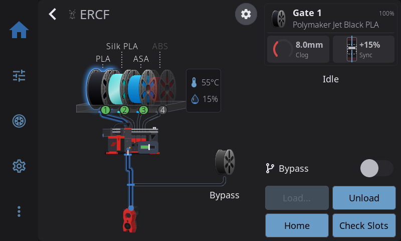

### Bed mesh panel

### Controls panel

### Home panel

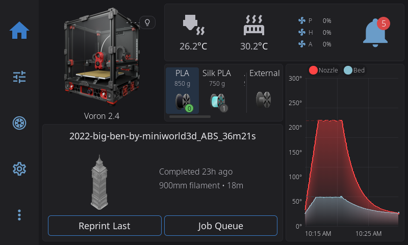

### Motion panel

### Print select card

### Settings panel

## Home

### Home widget catalog category

### Home widget catalog

### Home

## Controls

### Controls bed mesh

### Controls extrusion

### Controls fan

### Controls motion

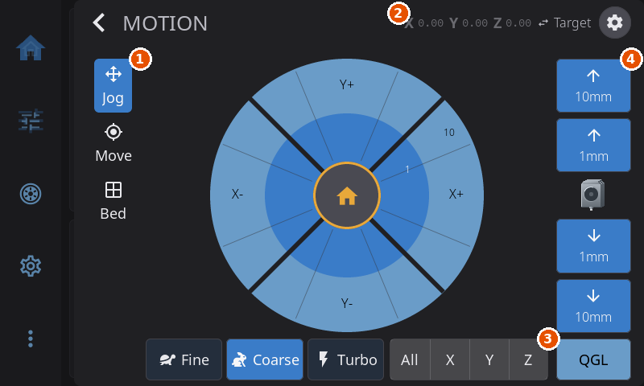

### Controls pid

### Controls temperature

## Printing

### Preflight check

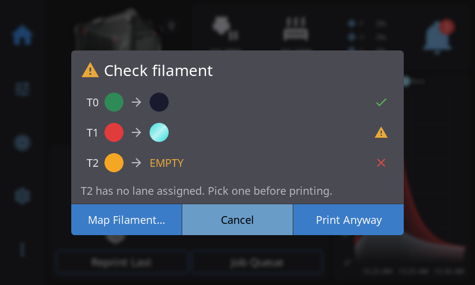

### Print select

### Print status

### Print tune

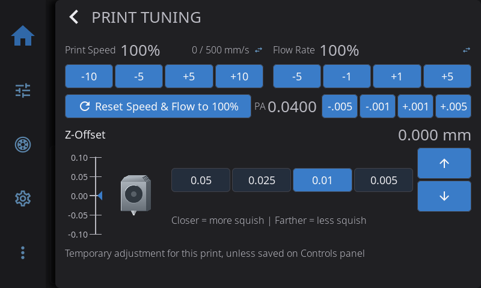

## Filament (AMS)

### Ams

### Color mismatch

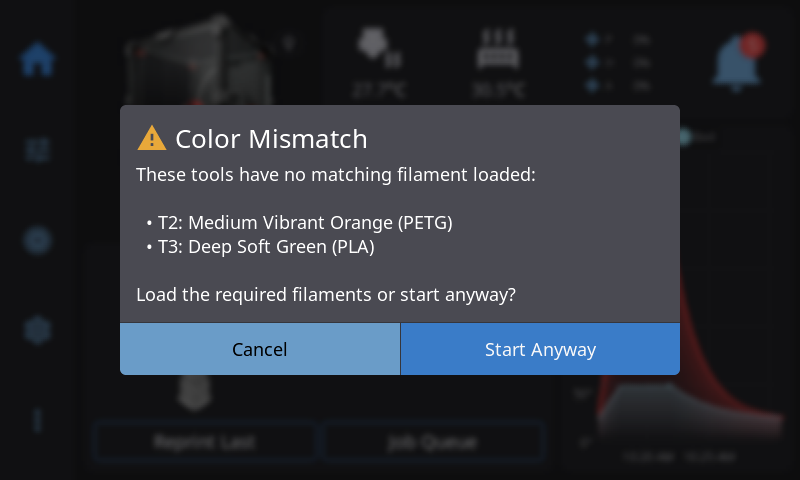

### Runout modal

## Advanced

### Advanced console

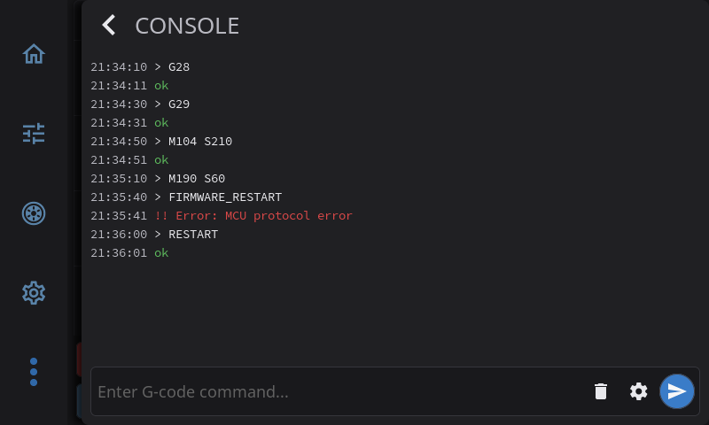

### Advanced history

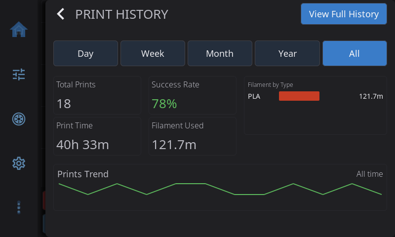

### Advanced macros

### Advanced screws

### Advanced shaper

### Advanced spoolman

### Advanced zoffset

### Advanced

## Settings

### Settings about

### Settings appearance 2

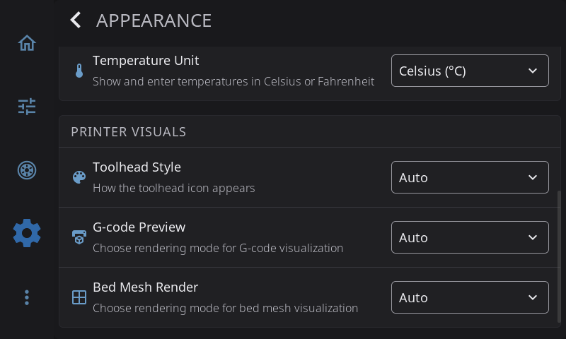

### Settings appearance

### Settings barcode scanner

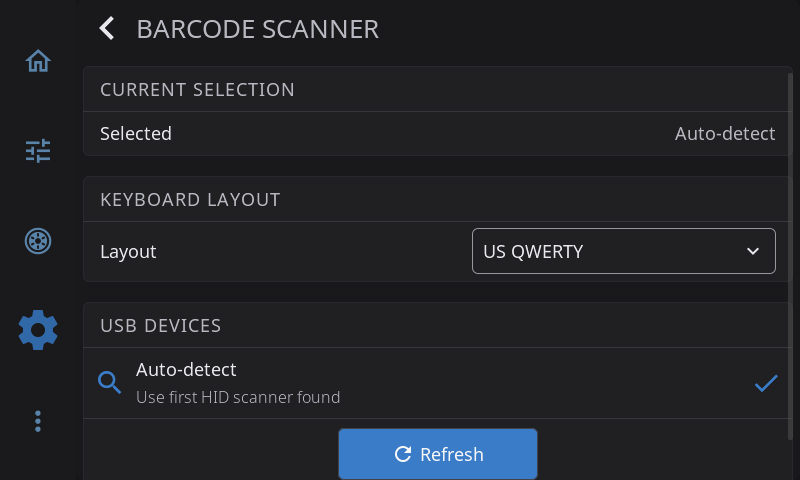

### Settings connection

### Settings devices 2

### Settings devices

### Settings display 2

### Settings display

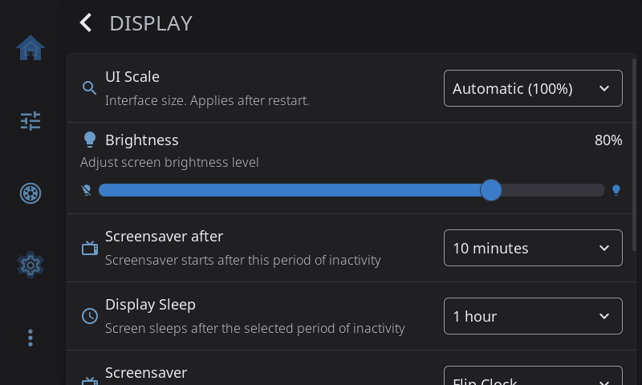

### Settings fans

### Settings hardware health

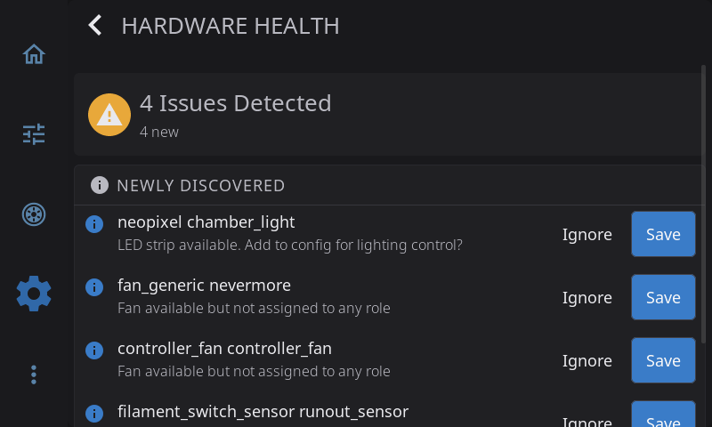

### Settings help about

### Settings label printer

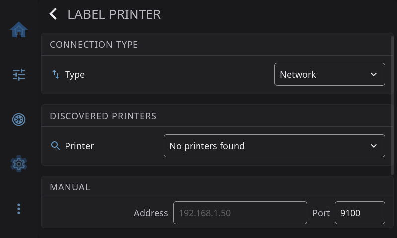

### Settings language time

### Settings network

### Settings printers

### Settings printing 2

### Settings printing 3

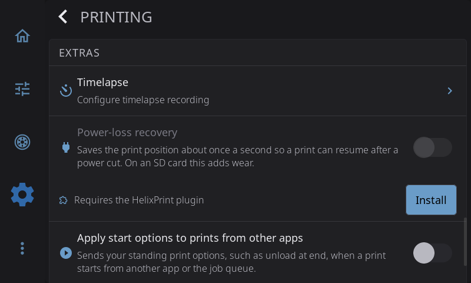

### Settings printing

### Settings root helixscreen

### Settings root printer

### Settings safety

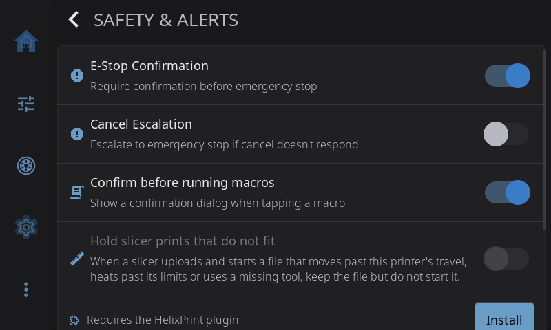

### Settings security

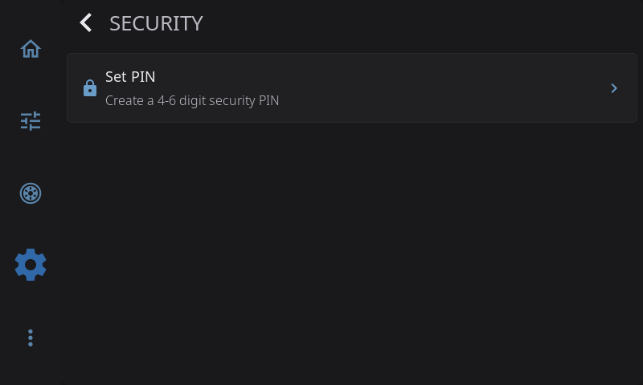

### Settings sensors

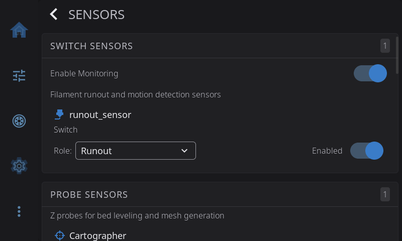

### Settings sound 2

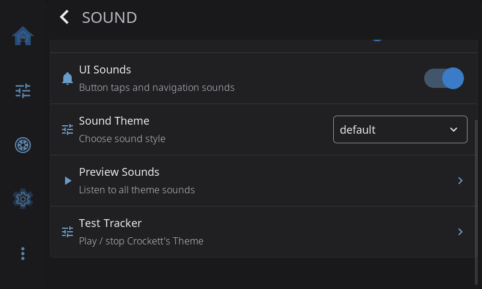

### Settings sound

### Settings system 2

### Settings system

### Settings theme

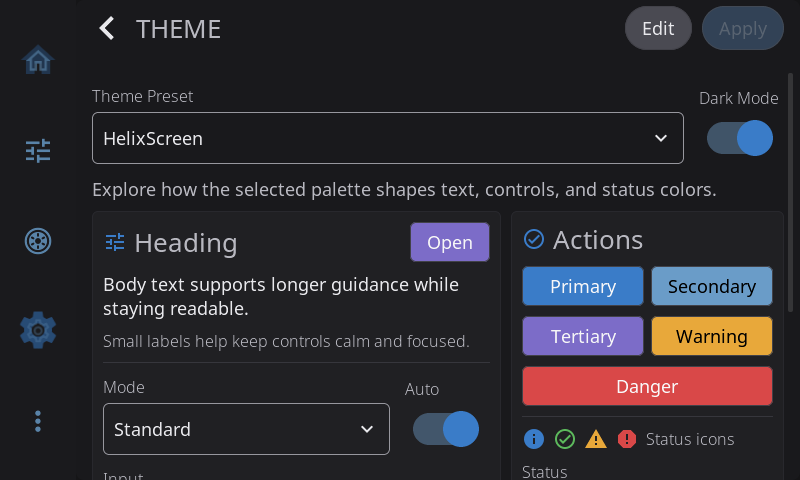

### Settings touch input 2

### Settings touch input

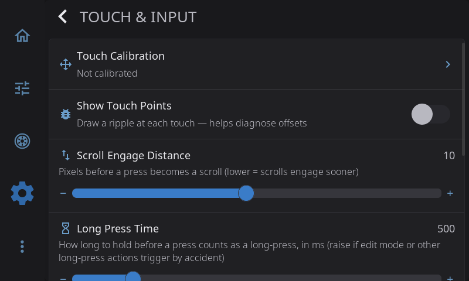

### Settings updates

### Settings

## Lock screen

### Screen lock

