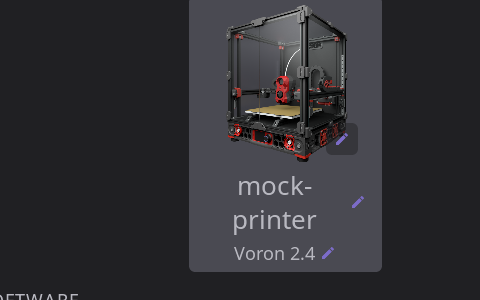

# Printer Manager (Developer Guide)

How the Printer Manager overlay works, its sub-components (inline name editing, custom printer images, capability chips), and how to extend it.

---

## Overview

The Printer Manager is a full-screen overlay with two entry points, both calling `get_printer_manager_overlay().show()`:

- **Home panel**: tapping the Printer Image widget (`src/ui/panel_widgets/printer_image_widget.cpp#handle_printer_manager_clicked`)
- **Settings > Printer**: the `row_printer` row at the top of the Printer group in `ui_xml/settings_panel.xml`, wired to `on_printer_clicked` through `nav_row<get_printer_manager_overlay>()` in `src/ui/settings/ui_panel_settings.cpp#register_settings_panel_callbacks`. It keeps the overlay reachable on a layout without the Printer Image widget

It serves as the central hub for printer identity and hardware capabilities, displaying:

- **Printer identity** -- name (editable inline), model, and image (swappable)
- **Software versions** -- Klipper, Moonraker, and HelixScreen
- **Capabilities** -- everything HelixScreen detected on this printer, as grouped chips with detail text; each chip opens the screen that uses it, or a short info popup

It follows the standard OverlayBase lifecycle and uses the `overlay_panel` XML component for navigation (back button, title bar).

### Key Files

| File | Purpose |
|------|---------|
| `include/ui_printer_manager_overlay.h` | Class declaration, subjects, callbacks |
| `src/ui/ui_printer_manager_overlay.cpp` | Implementation (refresh, name edit, chip text subjects) |
| `include/printer_manager_chips.h` | Chip spec table, fact gathering, tap dispatch |
| `src/ui/printer_manager_chips.cpp` | One `CapChipSpec` per chip: name, text subject, info copy, opener |
| `include/capability_chip_text.h` | `CapChip`, `CapabilityChipFacts`, `capability_chip_text()` (pure) |
| `ui_xml/components/capability_chip.xml` | The chip: icon, bound text, tap callback |
| `ui_xml/printer_manager_overlay.xml` | Declarative layout (3 sections) |
| `tests/unit/test_printer_manager_overlay.cpp` | Unit tests |
| `include/printer_image_manager.h` | Image import/conversion/selection |
| `src/system/printer_image_manager.cpp` | PNG/JPEG to LVGL .bin pipeline |
| `include/ui_overlay_printer_image.h` | Image picker overlay |
| `src/ui/ui_overlay_printer_image.cpp` | Image picker implementation |
| `ui_xml/printer_image_overlay.xml` | Image picker layout (list + preview) |
| `include/printer_images.h` | Printer type to image path mapping |
| `include/prerendered_images.h` | Screen-responsive image size selection |
| `include/ui_overlay_printer_type.h` | Model-correction overlay (click-to-correct row) |
| `src/ui/ui_overlay_printer_type.cpp` | Type list, selection, `apply_type_choice()` routing |
| `assets/config/printer_database.json` | Printer definitions, heuristics, images |
| `include/printer_image_variants.h` | `image_variants` matcher: pure, over `HardwareFacts` |
| `include/capability_matrix.h` | Pre-print operation capability merging |
| `include/capability_overrides.h` | User overrides for auto-detected capabilities |

---

## Architecture

```
PrinterManagerOverlay (overlay_panel; header: Manage Printers, a text button in landscape, an icon in portrait)
  |
  +-- Section 1: Printer Identity (pm_identity_card)
  |     +-- Printer image (lv_image, clickable -> PrinterImageOverlay)
  |     +-- Printer name (text_heading, max_lines="2": wraps, then dots; clickable -> inline edit)
  |     +-- Printer model (text_muted + pencil icon, clickable -> PrinterTypeOverlay)
  |
  +-- pm_details: Sections 2 and 3
  |
  +-- Section 2: Software Versions
  |     +-- Firmware version: label bound to klipper_firmware_name ("Klipper", "Kalico"), value to klipper_version
  |     +-- Moonraker version (bound to moonraker_version subject)
  |     +-- HelixScreen version (bound to helix_version subject)
  |
  +-- Section 3: Capabilities, six setting_groups
        +-- MOTION & LEVELING, THERMAL & AIR, FILAMENT & TOOLHEAD,
        |   PRINTING, ELECTRONICS & ACCESSORIES, ADD-ONS
        +-- capability_chip instances (flow-wrapped, subject-bound visibility)
        +-- every chip taps through pm_chip_clicked
```

Landscape is two columns: the identity card on the left (`#pm_identity_width` wide,
image over name over model) and `pm_details` filling the rest and scrolling on its own.
Portrait stacks an identity header card (a `#pm_image_size_portrait` image beside the
name and model) over the two groups, and the whole body scrolls. One tree serves both:
the orientation-dependent properties are `bind_style_if_eq` pairs keyed on
`ui_is_portrait`, so none of them may also be set inline.

The model row is clickable because detection can decline to guess or land on a wrong
near-neighbour; picking a model in `PrinterTypeOverlay` goes through
`PrinterDetector::apply_type_choice()`, the same call the wizard's identify step makes.



### Subject Bindings

The overlay owns these subjects for its own data:

| Subject Name | Type | Description |
|---|---|---|
| `printer_manager_name` | string | User-editable printer name |
| `printer_manager_model` | string | Printer model from config |
| `helix_version` | string | HelixScreen build version |
| `pm_name_editing` | int | 1 while the name editor is open |
| `pm_chip_text_<chip>` | string | One per capability chip: its text (see Capability Chips) |
| `pm_has_kinematics`, `pm_has_build_volume`, `pm_has_filament_system`, `pm_has_tool_changer`, `pm_has_mcus` | int | Visibility for chips whose fact has no app-wide subject |

The firmware row's label binds `klipper_firmware_name`, which `PrinterVersionsState`
publishes from `PrinterDiscovery::firmware_name()`.

Every other chip's visibility binds the subject the rest of the app gates on
(`printer_has_*`, `power_device_count`, `filament_sensor_count`, `ams_is_tool_changer`,
`helix_macros_status`, ...). The chip list in `printer_manager_overlay.xml` is the
reference for which subject hides which chip.

---

## Overlay Lifecycle

```
get_printer_manager_overlay()     // Singleton, lazy-created
  .init_subjects()                // Register 3 string subjects
  .register_callbacks()           // Register chip + name edit + image callbacks
  .create(parent)                 // Build XML tree, find named widgets

on_activate()                     // Called each time overlay becomes visible
  -> cancel_name_edit()           // Reset any in-progress edit
  -> refresh_printer_info()       // Re-read config, update subjects + image
  -> observe_chip_inputs()        // Watch what the chips read; schedules ONE refresh_capability_chips()
```

`refresh_printer_info()` is called on every activation, ensuring the overlay always shows current data. It:

1. Reads printer name from `Config` (key: `/wizard/printer_name`)
2. Reads printer model from `Config` (key: `/wizard/printer_type`)
3. Reads HelixScreen version from `helix_version()`
4. Resolves the printer image: checks `PrinterImageManager` for a user-selected image first, falls back to auto-detection via `helix::printer_images::get_best_printer_image()`

---

## Inline Name Editing

The printer name supports click-to-edit inline renaming. This is implemented as a heading/textarea swap pattern.

### How It Works

Two widgets occupy the same layout slot in the XML:

```xml
<!-- Always visible (unless editing) -->
<text_heading name="pm_printer_name" bind_text="printer_manager_name"/>

<!-- Hidden until edit starts -->
<text_input name="pm_printer_name_input" hidden="true" one_line="true"/>
```

The edit lifecycle is managed by three methods:

```
start_name_edit()     // User taps heading
  1. Set name_editing_ = true
  2. Pre-fill textarea with current name_buf_
  3. Hide heading, show textarea
  4. Focus textarea and show keyboard (ui_keyboard_show)

finish_name_edit()    // User presses Enter/checkmark (LV_EVENT_READY)
  1. Read new name from textarea
  2. Save to Config and persist to disk
  3. Update printer_manager_name subject
  4. Swap back: show heading, hide textarea

cancel_name_edit()    // User presses Escape/X (LV_EVENT_CANCEL)
  1. Swap back without saving
```

### Implementation Notes

- The heading click is registered via XML `<event_cb callback="pm_printer_name_clicked"/>` (declarative)
- The textarea `READY` and `CANCEL` events are registered via `lv_obj_add_event_cb()` in `create()` -- this is an acceptable exception to the declarative rule because LVGL textarea lifecycle events are not supported in XML
- The keyboard is managed by `ui_keyboard_show()` from `ui_keyboard_manager.h`
- `on_activate()` cancels any in-progress edit, preventing stale state when navigating back

### Reusability

The heading/textarea swap pattern is currently inline in `PrinterManagerOverlay`. To reuse it elsewhere:

1. Add a `text_heading` + `text_input` pair in XML (same parent, input hidden)
2. Register a click callback on the heading container
3. Use `lv_obj_add_event_cb()` for READY/CANCEL on the textarea
4. Implement the three-method pattern: `start_edit()`, `finish_edit()`, `cancel_edit()`

The pattern could be extracted into a reusable component if more inline edit fields are needed.

---

## Custom Printer Images

### Image Selection Flow

```
User taps printer image in Printer Manager
  -> change_printer_image_clicked_cb()
  -> PrinterImageOverlay.show()
     -> Left panel: scrollable list of images
        - Auto-Detect option (uses printer type for lookup)
        - Shipped images (bundled PNGs, pre-rendered to .bin)
        - Custom images (user-imported, in config/custom_images/)
        - USB import (if USB drive detected)
     -> Right panel: live preview of selected image
```

### Image ID Namespace

All image references use a namespaced ID string:

| Format | Meaning | Example |
|---|---|---|
| `""` (empty) | Auto-detect from printer type | Default behavior |
| `"shipped:NAME"` | Bundled printer image | `"shipped:voron-v2"` |
| `"custom:NAME"` | User-imported image | `"custom:my-printer"` |

The active image ID is persisted in `Config` at the per-printer path (e.g., `/printers/{id}/printer_image`). Legacy configs with `/display/printer_image` are migrated automatically during v3-to-v4 config migration.

### Supported Source Formats

| Format | Constraints |
|---|---|
| PNG | Up to 2048x2048px, up to 5MB |
| JPEG/JPG | Up to 2048x2048px, up to 5MB |

Validation is performed by `PrinterImageManager::validate_image()` using `stbi_info()` for dimension checks without full decode.

### Conversion Pipeline

When a PNG/JPEG is imported (from USB or dropped into `config/custom_images/`):

```
Source PNG/JPEG
  |
  stbi_load() -> RGBA pixel buffer (4 channels forced)
  |
  +-- stbir_resize_uint8() -> 300px variant (aspect ratio preserved)
  |     RGBA -> BGRA swap (LVGL ARGB8888 in little-endian)
  |     write_lvgl_bin() -> config/custom_images/NAME-300.bin
  |
  +-- stbir_resize_uint8() -> 150px variant (aspect ratio preserved)
        RGBA -> BGRA swap
        write_lvgl_bin() -> config/custom_images/NAME-150.bin
```

The `write_lvgl_bin()` function (in `lvgl_image_writer.h`) writes an LVGL 9 binary image header followed by raw pixel data. It uses atomic write (temp file + rename) to prevent corruption on embedded devices.

Two size variants are always created:
- **300px** -- for medium and large displays (800x480 and above)
- **150px** -- for small displays (480x320) and preview thumbnails

### Shipped Image Pipeline

Shipped images (bundled with HelixScreen) go through a build-time conversion:

```bash
make gen-printer-images          # Runs scripts/regen_printer_images.sh
```

This converts all PNGs in `assets/images/printers/` to pre-rendered `.bin` files at 300px and 150px, stored in `build/assets/images/printers/prerendered/`. Generic fallback images (`generic-*.png`) are skipped (kept as PNG for flexibility).

### Screen-Responsive Image Sizing

`get_printer_image_size(screen_width)` selects the variant:

| Screen Width | Image Size |
|---|---|
| >= 600px | 300px |
| < 600px | 150px |

The XML also uses responsive consts for the image container:

```xml
<consts>
  <px name="pm_image_size_small" value="120"/>   <!-- 391-460px height -->
  <px name="pm_image_size_medium" value="160"/>  <!-- 461-550px height -->
  <px name="pm_image_size_large" value="200"/>   <!-- 551-700px height (_xlarge falls back here) -->
</consts>
```

### Image Resolution Priority

`PrinterImageManager::get_displayed_image_path()` decides what every surface shows:

1. **User-selected image** -- `PrinterImageManager::get_active_image_path()` checks config for a `shipped:` or `custom:` ID
2. **Auto-detected image** -- `get_detected_image_path()` looks up the configured printer type in `printer_database.json`, applying `image_variants` (see [Image Lookup](#image-lookup))
3. **Fallback** -- `generic-corexy.png` if nothing else matches

### Auto-Import

On overlay activation, `auto_import_raw_images()` scans `config/custom_images/` for any raw PNG/JPEG files that lack corresponding `.bin` variants and imports them automatically. This lets users simply drop image files into the directory.

---

## Printer Database

The printer database (`assets/config/printer_database.json`) is the source of truth for printer identity, detection heuristics, and image mappings.

### Entry Structure

```json
{
  "id": "flashforge_adventurer_5m",
  "name": "FlashForge Adventurer 5M",
  "manufacturer": "FlashForge",
  "image": "flashforge-adventurer-5m.png",
  "print_start_profile": "forge_x",
  "z_offset_calibration_strategy": "firmware_managed",
  "heuristics": [
    {
      "type": "macro_match",
      "field": "macros",
      "pattern": "SUPPORT_FORGE_X",
      "confidence": 99,
      "reason": "Definitive ForgeX signature"
    }
  ],
  "print_start_capabilities": {
    "macro_name": "START_PRINT",
    "params": { ... }
  }
}
```

### Key Fields

| Field | Purpose |
|---|---|
| `id` | Unique identifier (snake_case) |
| `name` | Human-readable name shown in UI |
| `manufacturer` | Manufacturer name |
| `image` | PNG filename in `assets/images/printers/` |
| `image_variants` | Optional ordered list of alternate images chosen by detected hardware, e.g. `[{"when": {"filament_system": "cfs"}, "image": "creality-k2-cfs.png"}]`. See [Image Lookup](#image-lookup) |
| `print_start_profile` | Profile for print start phase detection |
| `z_offset_calibration_strategy` | Z-offset calibration approach: `probe_calibrate`, `endstop`, or `firmware_managed` (HelixScreen offers no Save step of its own). Omit to derive from probe presence. Separate from *where the value is stored* — see `include/z_offset_persistence.h` |
| `z_offset_persists` | `false` on a `firmware_managed` printer whose firmware does not persist a `SET_GCODE_OFFSET` adjustment, so Print Tune calls the adjustment temporary instead of auto-saved. Omit (default `true`) when the firmware persists it. An installed persistence provider (`include/z_offset_persistence.h`) counts as persisting whatever this says. |
| `tool_change_resets_z_offset` | `true` when activating a tool re-applies that head's stored gcode offset absolutely, replacing any adjustment; Print Tune then says a tool change resets it. Omit (default `false`) otherwise, including klipper-toolchanger, whose tool offsets leave the babystep alone. |
| `hide_manual_z_calibration` | `true` when the printer's `CALIBRATE_TOOL_OFFSETS` routine sets every tool's Z, the reference tool included, so the manual Z calibration (paper test) entries step aside. Omit (default `false`) for a stock klipper-toolchanger, whose example macro measures the other tools against T0 and writes nothing for T0. Independent of `z_offset_calibration_strategy`: the result may still need `SAVE_CONFIG`. |
| `heuristics` | Array of detection rules with confidence scores |
| `print_start_capabilities` | PRINT_START macro parameters |

The bundled `assets/config/printer_database.json` is schema-checked by the `[printer_database][schema]` test (`tests/unit/test_printer_database_evidence.cpp`): every entry needs non-empty string `id`, `name`, `manufacturer` and `image` fields and a `heuristics` array, ids are unique lowercase slugs (`a-z`, `0-9`, `_`, `-`), and names are unique ignoring case.

### Heuristic Types

| Type | Description |
|---|---|
| `hostname_match` | Match Moonraker hostname |
| `kinematics_match` | Match printer kinematics (corexy, cartesian, delta) |
| `object_exists` | Check for Klipper object in objects/list |
| `stepper_count` | Count of Z steppers |
| `sensor_match` | Match temperature_sensor names |
| `fan_match` | Match fan object names |
| `fan_combo` | Match multiple fan patterns |
| `led_match` | Match LED/neopixel names |
| `mcu_match` | Match MCU chip type |
| `build_volume_range` | Match X/Y stepper travel from the configfile (not the bed mesh or print area) |
| `macro_match` | Match G-code macro names |

Detection scores are combined across multiple heuristics. A confidence of >= 70 is considered high-confidence.

### Image Lookup

`PrinterDetector::get_image_for_printer(name)` returns the `image` field for a given printer name. Note: there is no `PrinterDatabase` class -- the printer database is a JSON file (`assets/config/printer_database.json`) accessed through `PrinterDetector` static methods. The two-argument overload, `get_image_for_printer(name, facts)`, applies `image_variants`. `helix::printer_images::get_best_image_for_file()` then resolves a filename to an LVGL path, preferring pre-rendered `.bin` files.

**What the connected printer shows** comes from one resolver,
`src/system/printer_image_manager.cpp#get_displayed_image_path`: the
user's chosen image (`custom:` or `shipped:`) if there is one, else
`get_detected_image_path()`, the configured printer type's image after `image_variants`.
The home widget, the printer manager, the screensavers, the image picker's Auto-Detect
preview and the tagger all read it; the wizard's model list uses the plain `image`, since
it names models rather than the machine in front of it.

`image_variants` is an ordered list on an entry. Each variant is `{"when": {...},
"image": "..."}`; the first whose every condition holds replaces `image`, and none holding
leaves `image`. The matcher is a pure function over detected facts
(`include/printer_image_variants.h`, `[printer_image_variants]`), so a vendor name appears
only in the database.

| Condition | Holds when | Values |
|---|---|---|
| `filament_system` | a registered backend of this kind (any of them, not only the active one) has at least one unit that is `connected` and not `absent`. A backend registered from the firmware object alone, before a unit reports in, does not count | an `AmsType` spelling `ams_type_from_string()` parses that `is_filament_system()` accepts: `cfs`, `afc`, `happy_hare`, `ace`, `ad5x_ifs`, `snapmaker`, `qidi_box`, `openams`. `tool_changer` is not a filament system and never matches |
| `enclosure_top` | the firmware's report of a removable enclosure top (`include/enclosure_top.h`, read into the `printer_enclosure_top_fitted` capability subject) equals the value. A printer that reports none, or has not reported yet, reads `false` | a JSON boolean |
| `chamber_heater` | whether the printer has a chamber heater, detected or manually assigned (the `printer_has_chamber_heater` capability subject), equals the value | a JSON boolean |

A condition key or value the build does not know makes its variant never match, so the
entry degrades to its plain image; the `[printer_database][schema]` test fails on one, and
`scripts/check_printer_images.py` fails on a variant image that is not on disk. A new
condition is a new `HardwareFacts` field, a branch in `condition_holds()`, and its
gathering in `PrinterImageManager` (`src/system/printer_image_manager.cpp#detected_hardware_facts`). The home widget re-resolves when AmsState's
backend count, type or data revision changes, or the enclosure-top or chamber-heater subject does, so a filament system whose units report in after connect switches the
image live, and one whose units drop back to disconnected switches it back; a top fitted or lifted off, or a heater assigned by hand, does the same. Conditions in one `when` all have to hold; to show one image when either of two facts holds, list two variants naming the same image. Each variant image needs its own `regions.json` entry for the callout chips.

---

## Capability Chips

The CAPABILITIES area lists what HelixScreen detected on this printer, and only that: a
capability that was not detected has no chip. Chips sit under six `setting_group`s; a
group whose chips are all hidden collapses, header included, because each group's chip
row (`pm_chips_<group>`) has no vertical padding and the chips carry their own vertical
margins, so an empty row measures zero and `setting_group` treats the group as empty.

Three pieces make a chip:

| Piece | Where | Owns |
|---|---|---|
| Visibility | `printer_manager_overlay.xml`, a binding nested in each `capability_chip` | Which subject (or inline `cond=`) hides it. Always the subject the app's own gating uses |
| Text | `capability_chip_text(CapChip, CapabilityChipFacts)` | The label, then ` · ` and a detail ("Probe · Beacon", "Tool Changer · 4 Tools", "QGL · set manually") |
| Tap | `CapChipSpec::open` in `printer_manager_chips.cpp` | The screen it opens; `nullptr` shows `info_title` / `info_message` in `modal_alert` |

`gather_capability_chip_facts()` reads the facts on the main thread: the API's
`PrinterDiscovery` (kinematics, build volume, MCUs, fans, LEDs, LED effects), the
primary probe's type, the count subjects, `ToolState`, every `AmsState` backend's
`get_system_info()`, and `CapabilityOverrides::is_forced_on()` for the overridable
capabilities (bed mesh, QGL, Z-tilt, nozzle clean, heat soak, speaker). Vendor names in
chip text come only from those owning modules (`type_name`, `probe_type_to_display_string`).

The tool chip reads "Tool Changer · N Tools" when discovery found a klipper-toolchanger
or any AMS backend is a tool changer, and "N Extruders" for several heads without one
(IDEX, multi-extruder); N is `ToolState::physical_heads()`. The Multi-Filament chip names
the other backends and hides when a tool changer is the only one. The Fans chip counts
controllable fans besides part cooling (`PrinterFanState::count_extra_controllable_fans`).

While the overlay is open, `observe_chip_inputs()` re-texts the chips when discovery
reruns (`printer_hardware_generation`, bumped by `set_hardware()` and new kinematics),
the build volume arrives, an AMS backend or slot count changes, the tool list changes,
or a count a chip shows changes. Requests made before the refresh runs join it, so an
activation computes the chips once.

On ESP32, screens absent from the image (bed mesh, input shaper, screws tilt, belt
tension, PA and tool offset calibration, Spoolman, timelapse) have `open = nullptr`
there, so their chips show the info popup instead.

---

## Developer Guide: Extending

### Adding a New Capability Chip

1. **The capability subject.** Use the one the app already gates on. If none exists,
   add a `Capability` and a `kCapabilityDefs` row in
   `src/printer/printer_capabilities_state.cpp` and set it in `set_hardware()`.
2. **The text.** Add a `CapChip` enumerator (display order) and its case in
   `capability_chip_text()`, with a `[capability_chip_text]` test.
3. **The spec.** Add the `CapChipSpec` row in `printer_manager_chips.cpp` (same order):
   widget name `pm_chip_<snake>`, text subject `pm_chip_text_<snake>`, info title and
   message (`TR_NOOP`, what it is, what HelixScreen does with it, where), and an opener or
   `nullptr`, and `beta`. The opener calls the owning module's `open_*()` so every
   entry point opens it the same way. Screens not in the ESP32 image go through
   `PM_DESKTOP_SCREEN()`.
4. **The XML.** Add the chip to its group in `printer_manager_overlay.xml`:
   ```xml
   <capability_chip name="pm_chip_my_feature" icon="my_icon" text="pm_chip_text_my_feature">
     <bind_flag_if_eq subject="printer_has_my_feature" flag="hidden" ref_value="0"/>
   </capability_chip>
   ```
5. `make translation-sync && make translations`, then translate the new keys.

The `[printer_manager]` tests fail if a chip has no spec or a spec no chip.

### Adding a Shipped Printer Image

1. Place a PNG file in `assets/images/printers/` (e.g., `my-printer.png`)
2. Run `make gen-printer-images` to create pre-rendered `.bin` variants
3. Add a printer entry in `config/printer_database.json` with `"image": "my-printer.png"`
4. The image will appear in both the auto-detect lookup and the shipped images list

An image for optional hardware (a printer with its filament unit attached) is a variant, not a new entry:

1. Add the PNG as above, named `<entry image>-<hardware>.png` (`creality-k2-cfs.png`)
2. Tag its callout points in `assets/images/printers/regions.json` under its own basename; a variant shares nothing with the plain image's entry
3. Add `"image_variants": [{"when": {"filament_system": "cfs"}, "image": "creality-k2-cfs.png"}]` to the printer entry, keeping its plain `image`
4. `scripts/check_printer_images.py` and `[printer_database][schema]` check that the image exists and the condition is known

### Adding a Custom Image Import Source

The `PrinterImageOverlay` supports USB import out of the box. To add a new import source (e.g., network download):

1. Add a new section in `printer_image_overlay.xml` (similar to the USB section)
2. Add a populate method in `PrinterImageOverlay` (similar to `populate_usb_images()`)
3. Use `PrinterImageManager::import_image()` to convert and store the image
4. Call `refresh_custom_images()` after import to update the list

### Display Name Formatting

`PrinterImageManager::format_display_name()` converts filename stems to readable names:
- Dashes and underscores become spaces
- Dashes between two digits become dots (e.g., `voron-0-2` becomes `voron 0.2`)

---

## Testing

```bash
# Run Printer Manager tests
./build/bin/helix-tests "[printer_manager]"

# Run printer image manager tests
./build/bin/helix-tests "[printer_image_manager]"

# Run capability tests
./build/bin/helix-tests "[capability_matrix]"
./build/bin/helix-tests "[capability_overrides]"
```

Tests cover:
- Subject initialization and double-init safety
- Global singleton accessor pattern
- Destructor cleanup (with and without init)
- Lifecycle state tracking

---

## Multi-Printer Management

A **Manage Printers** button always appears in the Printer Manager overlay's header bar: the labelled `action_button` in landscape, the round `printer_3d` icon `action_icon_button` in portrait, where the label would crowd out the title. This navigates to the Printer List overlay for switching, adding, and deleting printers.

See [Multi-Printer Management](MULTI_PRINTER.md) for the full developer guide on the multi-printer system.
