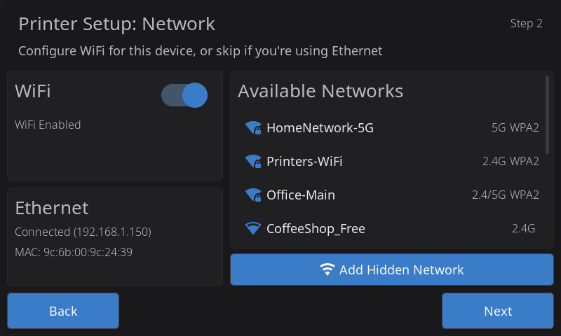
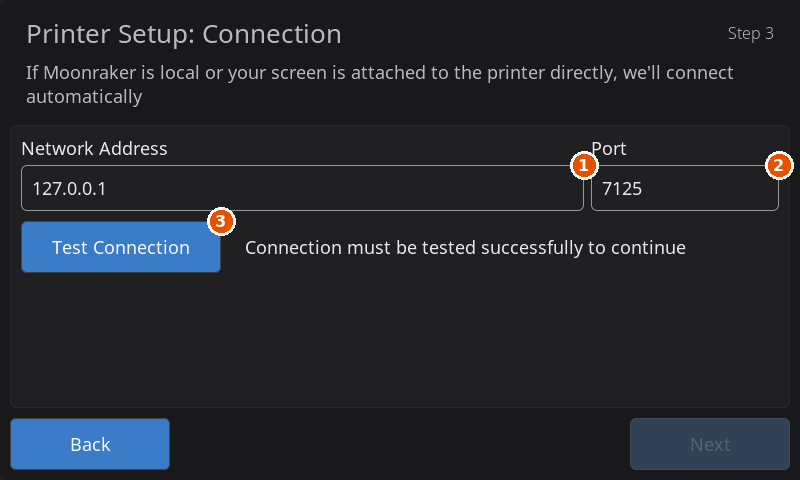
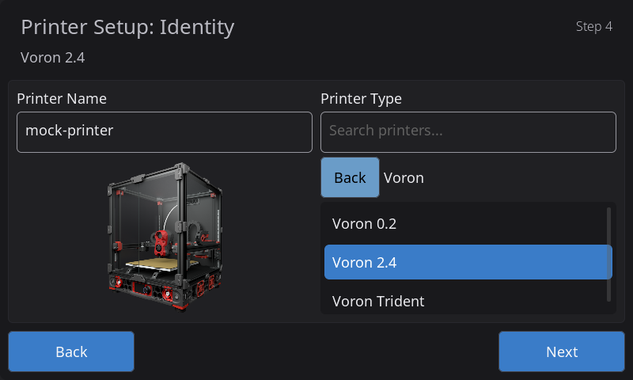
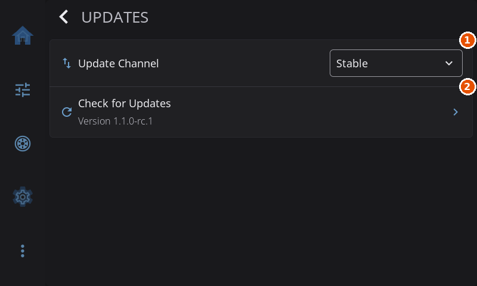

# HelixScreen Installation Guide

This guide gets HelixScreen onto your printer's touchscreen, or onto a separate screen that controls your printer over the network. Start with [Which printer are you installing on?](#which-printer-are-you-installing-on): most printers have their own guide with the exact steps, and this page covers what they all share.

If you are a developer building from source, see [DEVELOPMENT.md](../devel/DEVELOPMENT.md) instead.

---

## Table of Contents

- [Quick Start](#quick-start)
  - [Easy installer (desktop app)](#easy-installer-desktop-app)
  - [From the command line](#from-the-command-line)
- [Which printer are you installing on?](#which-printer-are-you-installing-on)
- [New in 1.1](#new-in-11)
- [Installer options](#installer-options)
- [Remote Screen Setup (Run on a Separate Device)](#remote-screen-setup-run-on-a-separate-device)
- [Android App (Experimental)](#android-app-experimental)
- [Generic Linux Install (Raspberry Pi, BTT, x86)](#generic-linux-install-raspberry-pi-btt-x86)
- [First Boot & Setup Wizard](#first-boot--setup-wizard)
- [Display Configuration](#display-configuration)
- [Updating HelixScreen](#updating-helixscreen)
- [Uninstalling](#uninstalling)
- [Getting Help](#getting-help)

---

## Quick Start

### Easy installer (desktop app)

If you would rather not use a terminal, the HelixScreen easy installer runs on a Windows, macOS or Linux computer. [Download it](https://helixscreen.org/installer/), switch your printer on, and open the app. It looks for printers on your network, shows the ones it knows how to handle, and walks you through the rest. It signs in to the printer over SSH, with a password or your SSH key. When it is not sure what a printer is, it stops and changes nothing, and it never installs an older version of HelixScreen over a newer one.

What it handles today is mostly updating printers that already run Klipper or a firmware mod:

| Printer | Guide |
|---------|-------|
| Raspberry Pi, BTT CB1/CB2 and other Klipper hosts | [Klipper host](guide/install-generic.md) |
| Creality K1 / K1C / K1 Max already on Simple AF or rooted | [K1 series](guide/install-k1.md) |
| Creality K2 / K2 Plus / K2 Pro | [K2 series](guide/install-k2.md) |
| QIDI Q2 / Max 4 / Plus 5 | [QIDI](guide/install-qidi.md) |
| Flashforge Adventurer 5M / 5M Pro on Forge-X | [Adventurer 5M](guide/install-ad5m.md) |
| BigTreeTech K-Touch (flashing the firmware over USB) | [K-Touch](guide/install-esp32.md#with-the-easy-installer) |

First installs on printers that need a firmware mod first (a K1 on stock firmware, the Adventurer 5M and 5X) are still to come. Until then, use the guide for your printer in [the table below](#which-printer-are-you-installing-on).

A printer the app recognizes but cannot handle sends you to [Printers the easy installer doesn't handle](guide/easy-installer-unsupported.md). macOS and Windows may warn the first time you open the app; the [download page](https://helixscreen.org/installer/) shows how to get past that.

### From the command line

> **Run these commands on your printer's host, not on your own computer.**
>
> SSH into the computer that runs Klipper: a Raspberry Pi, a BTT CB1/CB2/Manta or similar. On all-in-one printers (Creality K1 and K2, Flashforge Adventurer 5M, and the others in the table below), SSH into the printer itself as root.

```bash
curl -sSL https://releases.helixscreen.org/install.sh | sh
```

The installer works out what kind of printer or computer it is on, shows you its plan, and asks before it changes anything. It runs under `sh` or `bash`, including the minimal BusyBox shell many printers ship.

Some printers have no `curl`, or no secure download support at all. Their install guides give a plain-HTTP download command instead, or a two-step method: download the release on your computer, copy it to the printer, and install it there.

**KIAUH users:** HelixScreen is also available as a KIAUH extension. Run `kiauh` and find HelixScreen in the extensions menu. When the installer finds KIAUH, it registers the extension for you.

After installing, the [setup wizard](#first-boot--setup-wizard) appears on the screen.

---

## Which printer are you installing on?

The command above works on every supported printer, but each family has its own prerequisites, install location, and service commands. Your printer's guide has all of them:

| Printer | Install guide |
|---------|---------------|
| Raspberry Pi, BTT CB1/CB2/Manta, x86 PC running Klipper | [Generic Linux Install](#generic-linux-install-raspberry-pi-btt-x86) on this page, or the [easy installer on a Klipper host](guide/install-generic.md) |
| Creality K1 / K1C / K1 Max | [K1 Series Install](guide/install-k1.md): by hand (root access, then Simple AF or the Guilouz helper script) or with the easy installer |
| Creality K2 / K2 Plus / K2 Pro | [K2 Series Install](guide/install-k2.md): works on stock firmware |
| Flashforge Adventurer 5M / 5M Pro | [Adventurer 5M Install](guide/install-ad5m.md): needs the Forge-X (recommended), ZMOD or Klipper Mod firmware mod first |
| Flashforge Adventurer 5X | [Adventurer 5X Install](guide/install-ad5x.md): the ZMOD firmware mod installs and updates HelixScreen |
| Flashforge Creator 5 / Creator 5 Pro | The [Z-Mod wiki](https://wiki.zmod.link/C5PRO/): Z-Mod installs and updates HelixScreen itself. On [Reforge](https://github.com/Klipper4FlashForge/firmware), HelixScreen ships with the firmware |
| Elegoo Centauri Carbon | [Centauri Carbon Install](guide/install-cc1.md): needs the OpenCentauri COSMOS firmware, 26.07.0 or newer |
| Creality Sonic Pad | [Sonic Pad Install](guide/install-sonicpad.md): needs the SonicPad-Debian firmware |
| QIDI Q2 / Max 4 / Plus 5 | [QIDI Install](guide/install-qidi.md): replaces QIDI's screen program. Read the QIDI Studio and cloud notice first |
| Snapmaker U1 | [Snapmaker U1 Install](guide/install-u1.md): stock firmware 1.2 or newer with Root access, or PAXX Extended Firmware |
| BigTreeTech K-Touch (standalone ESP32 screen) | [K-Touch Install](guide/install-esp32.md): alpha firmware, flashed from your browser or over USB |
| A Linux desktop or laptop (HelixScreen in a window) | [Run HelixScreen in a Window on a Linux Desktop](guide/install-linux-desktop.md) |
| An Android phone or tablet | [Android App](#android-app-experimental) on this page |

---

## New in 1.1

- **The installer shows its plan first.** Before it changes anything it lists your printer, what it found, what it will install and what it will change, and asks `Continue? [Y/n]`. `--dry-run` prints the plan and stops. Each step then gets one line, and a failure says what state your printer is in and where the log is.
- **An install log you can read from Mainsail or Fluidd.** Every run is logged in full, even without `--verbose`. See [Installer log](#installer-log).
- **Installing from a downloaded package.** Name a release archive, or run the installer that comes inside an extracted package, and it installs exactly that release without downloading anything. See [Installing from a downloaded package](#installing-from-a-downloaded-package).
- **A window on your Linux desktop.** A new package for x86_64 Linux PCs runs HelixScreen as an ordinary app window. See [Run HelixScreen in a Window on a Linux Desktop](guide/install-linux-desktop.md).
- **New printers:** the Flashforge Creator 5 and Creator 5 Pro, and the BigTreeTech K-Touch (alpha).
- **Smaller downloads.** Packages carry only the splash screens and printer pictures your screen can show. The K1 series and the Adventurer 5X share one package, still published under each printer's name.
- **Logs and caches survive an update** on the K1, Centauri Carbon, Snapmaker U1 and Adventurer 5X: they now live beside the install instead of inside it.
- **Some installs move on disk, automatically**, during the update to 1.1. See [Coming from 1.0](UPGRADING.md#coming-from-10) in the upgrading guide.

---

## Installer options

Add options after `sh -s --` when you pipe the installer, for example:

```bash
curl -sSL https://releases.helixscreen.org/install.sh | sh -s -- --update
```

When you run a downloaded copy of the installer, put them straight after it: `sh install.sh --update`.

| Option | What it does |
|--------|--------------|
| *(none)* | Installs the latest release for your update channel. If HelixScreen is already installed, it reinstalls over it and keeps your settings |
| `--update` | Updates an existing install and keeps your settings. Does not ask for confirmation |
| `--version v1.1.0` | Installs that version instead of the latest. A beta version (such as `v1.1.0-beta.9`) puts a new install on the Beta update channel |
| `--clean` | Removes the existing install completely, including its settings, settings backups and thumbnail caches, then installs fresh. Asks first; the answer defaults to no |
| `--yes` or `-y` | Answers yes to that question. Needed for `--clean` when nothing can answer, for example a command run from a web console or from a script |
| `--dry-run` | Prints the plan and stops. Changes nothing, and exits with an error if a check would stop the install |
| `--verbose` or `-v` | Prints every detail line and command output as it happens |
| `--local FILE`, or the file name on its own | Installs from a release archive (`.zip` or `.tar.gz`) you already have, without downloading |
| `--uninstall` | Removes HelixScreen and turns your previous screen program back on. See [Uninstalling](#uninstalling) |
| `--desktop` | x86_64 Linux: installs HelixScreen as a window on this desktop, for your user only, with no root and no service |
| `--kiosk` | x86_64 Linux: installs HelixScreen as a service that takes over the whole screen |
| `--skip-kiauh-registration` | Does not register the KIAUH extension, even when KIAUH is installed |
| `--standalone`, `--payload-root PATH`, `--auto-update` | For printers running the Forge-X or Z-Mod firmware mod, which manage HelixScreen themselves. Your printer's install guide says when you need them |
| `--help` | Lists every option |

Two settings go in front of `sh` instead:

- `R2_CHANNEL=beta` installs from the Beta channel: `curl -sSL https://releases.helixscreen.org/install.sh | R2_CHANNEL=beta sh`
- `INSTALL_DIR=/path/to/helixscreen` picks the install folder on a Raspberry Pi or other generic Linux host. The last part of the path must contain `helixscreen`. Printers with a fixed install location ignore it.

---

## Remote Screen Setup (Run on a Separate Device)

HelixScreen does **not** have to run on your printer. You can install it on another device with a display and have it control your printer over the network.

Choose this setup when:

- Your printer has no screen of its own, like many Vorons, RatRigs and other Klipper printers
- The printer is somewhere else: another room, a garage, a workshop
- You want one screen for several printers: the printer manager switches between every printer you add
- Your printer's own screen cannot be replaced (some QIDI models)

Good screen devices:

- A spare Raspberry Pi (3, 4, 5, Zero 2 W or CM4) with a touchscreen
- A Klipper pad or a small touchscreen PC
- A mini PC with an HDMI touchscreen
- Your Linux desktop or laptop, with HelixScreen in a window: see [Run HelixScreen in a Window on a Linux Desktop](guide/install-linux-desktop.md)
- An Android phone or tablet: see [Android App](#android-app-experimental)
- A BigTreeTech K-Touch with the [ESP32 firmware](guide/install-esp32.md) (alpha)

**How it works:** HelixScreen talks to your printer through Moonraker, Klipper's web API, which listens on port `7125` by default. It only needs to reach that port over the network.

**Steps:**

1. Install HelixScreen on the device that drives the display, not on the printer. A Raspberry Pi uses the [Generic Linux Install](#generic-linux-install-raspberry-pi-btt-x86) steps.
2. Make sure the device is on the same network as your printer. From the device, `ping <printer-ip>` should get replies.
3. In the setup wizard, at [Step 4: Moonraker Connection](#step-4-moonraker-connection), pick your printer from the discovered list or enter its IP address (for example `192.168.1.50`), not `localhost`. Leave the port at `7125` unless you changed it.
4. The wizard tests the connection, then reads your printer's hardware as usual.

> **Point it at Moonraker, not at Mainsail or Fluidd.** HelixScreen uses Moonraker's port (`7125`), not the web interface's. The screen device does not need Mainsail or Fluidd at all.

To change the printer's address later, go to **Settings > Connection > Host**. To add another printer, use **Settings > Connection > Printers**.

A remote screen controls the printer just like one on the printer. Only the things that need to run on the printer itself, such as taking over the printer's own panel, do not apply.

---

## Android App (Experimental)

HelixScreen also runs on an Android phone or tablet. It is a remote screen like the ones above: it talks to your printer's Moonraker over the network and installs nothing on the printer.

> **This is experimental.** It works, but it has had less real-world use than the Linux builds. Please report the rough edges you find.

**What you need:**

- Android 9.0 or newer
- The phone or tablet on the same network as your printer
- Your printer's IP address

**Which file to download.** Get it from the [latest release](https://github.com/prestonbrown/helixscreen/releases/latest):

| File | Use it for |
|------|-----------|
| `helixscreen-android-arm64-v<VERSION>.apk` | Nearly every modern phone and tablet. **Start here** |
| `helixscreen-android-armv7-v<VERSION>.apk` | 32-bit devices, where the arm64 file fails with `INSTALL_FAILED_NO_MATCHING_ABIS`: Fire tablets, older phones, an Echo Show 5 (2nd gen) running LineageOS |
| `helixscreen-android-x86_64-v<VERSION>.apk` | Emulators and x86 Chromebooks |
| `helixscreen-android-universal-v<VERSION>.apk` | Works on everything, but is a larger download. Use it if the arm64 file will not install |

Ignore the `.aab` file on the release page. It is for publishing to Google Play and does not install on a device.

**Installing it:**

1. Download the APK on the device, or copy it there.
2. Open it. Android warns that it came from outside the Play Store and offers to let your browser or file manager install apps. Allow it for that app, then confirm the install.
3. With a cable, `adb install helixscreen-android-arm64-v<VERSION>.apk` from a computer works too.

**First run.** The setup wizard skips the network step. At [Step 4: Moonraker Connection](#step-4-moonraker-connection), enter your printer's IP address (for example `192.168.1.50`) and leave the port at `7125`.

**Good to know:**

- **It runs in landscape.** Turn the device sideways, or let auto-rotate do it.
- **It asks for very little:** network access, and permission to keep the screen awake while you watch a print. No location, storage, contacts or camera.
- **Updating means installing the new APK over the old one.** **Settings > Updates** tells you when a new version is out; installing it opens the release page, where you download the new APK.
- **Your settings survive updates.** Installing a new APK over the old one keeps your settings and never overwrites a theme you made or edited. When Android's backup is on, your HelixScreen settings are backed up with the rest of the phone and come back on a new device restored from it.
- **Foldables and unusual screen shapes** can show layout quirks when the device folds or resizes. Reports with a screenshot are welcome.
- **Power controls are hidden.** An Android app cannot shut down or restart the device it runs on, so the shutdown widget never appears on the Home screen (the widget catalog marks it "Not available on Android") and the power section of the Advanced screen is hidden. Moonraker power devices, such as smart plugs, still work.

**Google Play.** HelixScreen is on [Google Play](https://play.google.com/store/apps/details?id=org.helixscreen.app), which installs and updates it like any other app. An install from Play is signed differently from the APKs on the release page, so moving from a downloaded APK to the Play version means uninstalling first and setting the app up again.

---

## Generic Linux Install (Raspberry Pi, BTT, x86)

> **Want HelixScreen in a window on your desktop PC instead?** That is a separate package that leaves your desktop alone: see [Run HelixScreen in a Window on a Linux Desktop](guide/install-linux-desktop.md).

This covers Klipper printers whose Klipper runs on a separate board with MainsailOS or similar: Vorons, RatRigs, SOVOL SV06 and SV08, and many more. It also covers BTT CB1/CB2/Manta boards, and x86 Linux PCs running Debian or Ubuntu with Klipper and a touchscreen.

### Prerequisites

- **Hardware:**
  - A Raspberry Pi 3, 4, 5 or Zero 2 W, or a BTT CB1/CB2. A Pi 3 or Zero 2 W is plenty for HelixScreen itself; a faster board only helps the rest of your setup (cameras and the like)
  - 64-bit or 32-bit Raspberry Pi OS / MainsailOS
  - A touchscreen (HDMI or DSI)
  - A network connection (Ethernet or WiFi)
- **Software:**
  - Klipper and Moonraker installed and printing from Mainsail or Fluidd
  - SSH access to the board
  - **Debian 11 (Bullseye) or newer.** See the OS version note below
  - About 100 MB of free disk space

> **32-bit or 64-bit:** the installer checks which system you run and downloads the matching build. You do not need to choose.

> **OS version: Bullseye or newer.** The Raspberry Pi builds need glibc 2.31, the version in Debian 11 (Bullseye). On Debian 10 (Buster) the program does not start, and fails with an error such as `version 'GLIBC_2.29' not found`. Check yours with:
>
> ```bash
> ldd --version | head -1        # glibc version
> cat /etc/os-release | head -2  # distro release
> ```
>
> This mostly affects stock printer images that still ship Buster. If you cannot upgrade the OS, see [TROUBLESHOOTING: binary won't start](TROUBLESHOOTING.md#binary-wont-start-glibc-version-not-found).

### Step 1: Connect to Your Pi

Open a terminal on your computer and SSH into the Pi:

```bash
ssh pi@mainsailos.local
# Or use its IP address:
ssh pi@192.168.1.xxx
```

Use the user name and password you set when you prepared the Pi's SD card.

### Step 2: Run the Installer

```bash
curl -sSL https://releases.helixscreen.org/install.sh | sh
```

The installer:

1. Detects your board, 32-bit or 64-bit system, and Klipper setup
2. Downloads the matching release
3. Turns off other screen programs, such as KlipperScreen
4. Installs HelixScreen (see [Where it installs](#where-it-installs))
5. Sets up and starts the `helixscreen` service
6. Adds HelixScreen to Moonraker's update manager, so you can update it from Mainsail or Fluidd
7. Installs `libturbojpeg` when it is missing, which speeds up the camera view

It prints its plan first and asks `Continue? [Y/n]`. To see the plan without changing anything:

```bash
curl -sSL https://releases.helixscreen.org/install.sh | sh -s -- --dry-run
```

To watch every detail as it happens:

```bash
curl -sSL https://releases.helixscreen.org/install.sh | sh -s -- --verbose
```

#### Where it installs

On a Klipper host, HelixScreen installs in the home folder of the user Klipper runs as, for example `/home/pi/helixscreen`. That is true even when you run the installer as root. An existing install is always updated where it is. Only when there is no Klipper user does it install to `/opt/helixscreen`. `INSTALL_DIR` overrides this (see [Installer options](#installer-options)).

Your settings live in Klipper's config folder, at `~/printer_data/config/helixscreen/settings.json`, so you can see and edit them from Mainsail or Fluidd. The install's own `config` folder links to them.

#### Installer log

Every run writes a full log to `~/printer_data/logs/helixscreen-install.log` (in the Klipper user's home), which Mainsail and Fluidd show in their log list. The previous run's log is kept as `helixscreen-install.log.1`. On a host without a `printer_data` folder, the log goes in a `logs` folder in HelixScreen's state folder beside the install. When an install fails, the failure message ends with `Full log:` and the exact path.

#### Installing from a downloaded package

If you already downloaded a release from the [releases page](https://github.com/prestonbrown/helixscreen/releases), the installer can install exactly that release without downloading anything. Either name the archive:

```bash
sh install.sh helixscreen-pi-v1.1.0.tar.gz
```

(`--local helixscreen-pi-v1.1.0.tar.gz` does the same), or extract it and run the installer inside it:

```bash
tar -xzf helixscreen-pi-v1.1.0.tar.gz
./helixscreen/install.sh
```

The installer says `Installing the package next to this installer` and shows the package's version in its plan. If an extracted package was built for a different kind of printer or computer, it stops and changes nothing. Adding `--version` or `--update` makes it download from the internet instead.

A beta package (a version like `v1.1.0-beta.9`) puts a new install on the Beta update channel, so later updates stay on betas. If HelixScreen is already installed, the update channel you chose in the app is kept. Change it any time under **Settings > Updates > Update Channel**.

### Step 3: Complete the Setup Wizard

When the installer finishes, HelixScreen starts and the setup wizard appears on the screen. See [First Boot & Setup Wizard](#first-boot--setup-wizard).

### Service Management

HelixScreen runs as the `helixscreen` systemd service and starts at boot. Day-to-day control:

```bash
sudo systemctl restart helixscreen    # restart (after config changes)
sudo systemctl stop helixscreen       # stop
sudo systemctl start helixscreen      # start
sudo systemctl status helixscreen     # is it running?
sudo journalctl -u helixscreen -f     # follow live logs
```

If it does not start at boot, check `sudo systemctl is-enabled helixscreen` (it should print `enabled`) and run `sudo systemctl enable helixscreen` if it does not.

The installer turns off other screen programs it finds. To turn off KlipperScreen by hand:

```bash
sudo systemctl stop KlipperScreen
sudo systemctl disable KlipperScreen
```

Printers that do not use systemd (K1, K2, Adventurer 5M and 5X, Centauri Carbon, Snapmaker U1) have their own start and stop commands in their install guides.

### Raspberry Pi 5

A Pi 5 has several display devices. HelixScreen picks the right one by itself. If it picks the wrong one, set it in `settings.json`:

```json
{
  "display": {
    "drm_device": "/dev/dri/card1"
  }
}
```

On a Pi 5, `/dev/dri/card1` is usually the DSI touchscreen and `/dev/dri/card2` the HDMI output. `/dev/dri/card0` is the 3D engine and drives no display.

### Low Memory Systems (Pi 3, Pi Zero 2 W)

HelixScreen is built for small boards. If memory is still tight:

1. Turn off the camera stream if you do not need it. It is usually the biggest user of memory on a small Pi
2. Keep less print history in Moonraker
3. Turn off other services you do not use

---

## First Boot & Setup Wizard

The first time HelixScreen starts, a setup wizard walks you through the steps below. Steps that do not apply to your printer are skipped, and the step counter at the top counts only the steps you will see.

### Step 1: Touchscreen Calibration

Tap the targets so touches land where you press. Most touchscreens (capacitive, USB and HDMI panels) are calibrated at the factory, and this step is skipped for them. To recalibrate later, go to **Settings > Touch & Input > Touch Calibration**.

### Step 2: Language

Pick your language. This step is skipped when a language other than English is already set.

### Step 3: Network

Connect to WiFi, or check that Ethernet is connected. Pick a network from the list, or tap **Add Hidden Network** to join one that does not broadcast its name. If you are already connected, go on to the next step.



### Step 4: Moonraker Connection



1. **Network Address**: the printer's hostname or IP address.
2. **Port**: usually `7125`.
3. **Test Connection**: checks the address and port before you go on.

Tell HelixScreen where your printer's Moonraker is. Printers found on your network are listed under **Discovered Printers**. To enter one by hand, type its **Network Address** and **Port** (usually `7125`):

- HelixScreen running on the printer itself: `127.0.0.1` (or `localhost`)
- A remote screen: the printer's IP address

Tap **Test Connection**. The wizard goes on once the connection works.

### Step 5: Printer Identification

Give your printer a name and choose its type. HelixScreen suggests a type from what the printer reports about itself. To pick one yourself, search by name or browse by maker; the list covers over 100 printers.



### Step 6: Heaters

Choose the bed heater and hotend heater Klipper uses.

### Step 7: Fans

Choose your hotend fan and part cooling fan, and a chamber or exhaust fan if you have one.

### Step 8: Multi-Filament System (If Detected)

If your printer has a filament changer (AFC, Happy Hare, a Creality CFS, a QIDI Box, an Anycubic ACE and others), this step shows what HelixScreen found.

### Step 9: LEDs (Optional)

Choose your main light. Skipped when Klipper has no LEDs.

### Step 10: Filament Sensor (Optional)

Choose which sensor pauses the print when filament runs out, or None. Skipped when there is no standalone filament sensor.

### Step 11: Input Shaping (Optional)

When your printer has an accelerometer, you can calibrate input shaping here to reduce ringing. You can do it later from the calibration screens too.

### Step 12: Preferences

A few choices about how HelixScreen behaves, such as sounds, widget labels, sleeping while printing, and what happens around filament loads. You can change each of them later in Settings.

### Step 13: Review

Check what you set up, choose whether to share anonymous usage statistics, and tap **Finish**.

### Completion

The home screen appears and your settings are saved.

> **Printers whose install sets them up in advance.** On some printers (for example the K2 and the Adventurer 5M) the install already knows the printer's type and hardware. The wizard then skips printer identification and the hardware steps, and on the first printer the review is replaced by a one-time question about sharing anonymous usage statistics.

> **Adding another printer** with **+ Add Printer** under **Settings > Connection > Printers** runs the wizard again, without the language and network steps.

---

## Display Configuration

### HDMI Displays

Most HDMI touchscreens work without any setup. If touch does not respond:

1. Check that the display's USB cable (it carries the touch signal) is plugged into the Pi
2. Check that the touchscreen shows up as an input device:
   ```bash
   ls /dev/input/event*
   ```

### Official Raspberry Pi Touchscreen (DSI)

The official Pi touchscreen on the DSI connector is detected automatically. To turn the picture, see [Screen Rotation](#screen-rotation).

### SPI Displays

Small SPI screens need a driver set up in the Pi's boot configuration before any program can use them. Follow your display maker's instructions, or the [MainsailOS documentation](https://docs.mainsail.xyz/), then install HelixScreen.

### BTT Pad 7 and Similar All-in-One Pads

The BTT Pad 7 and similar Klipper pads combine the computer and touchscreen in one housing, with the display and touch already set up. HelixScreen detects and uses them automatically.

### Screen Rotation

The easiest way: **Settings > Display > Screen Rotation**. Pick Normal, 90° Clockwise, 180° Upside Down or 270° Clockwise, then restart HelixScreen. Touch follows the rotation by itself.

If the display can rotate itself, that costs nothing, so prefer it:

- A monitor with a rotation option in its own menu
- A Pi DSI panel, which the kernel can turn: add `video=DSI-1:panel_orientation=upside_down` to /boot/firmware/cmdline.txt. HelixScreen notices this on first start. See [TROUBLESHOOTING: display upside down or rotated](TROUBLESHOOTING.md#display-upside-down-or-rotated)

Before HelixScreen starts the first time, you can also set the rotation in `settings.json`:

```json
{
  "display": {
    "rotate": 180
  }
}
```

Valid values: `0`, `90`, `180`, `270`.

### Display Backends: DRM vs Framebuffer

HelixScreen draws to the screen through DRM when the board supports it. DRM shows each frame in step with the display, which avoids tearing, and builds with GPU support also use it to speed up drawing and rotation. On boards without DRM, HelixScreen uses the plain framebuffer (`fbdev`). When the screen is rotated and the display hardware cannot rotate it, a build without GPU support switches to the framebuffer automatically.

DRM works on the Raspberry Pi 3B+, 4 and 5, and BTT CB1 and CB2 boards, with HDMI or DSI displays.

To force one, add a line to `helixscreen.env` in HelixScreen's config folder (on a Pi, `~/printer_data/config/helixscreen/helixscreen.env`, also editable from Mainsail or Fluidd):

```ini
HELIX_DISPLAY_BACKEND=fbdev
```

Then restart HelixScreen:

```bash
sudo systemctl restart helixscreen
```

Valid values: `drm` (in step with the display, no tearing), `egl` (DRM with GPU drawing, on builds that have it) and `fbdev` (works almost everywhere). Remove the line to go back to automatic.

On a Raspberry Pi 5, if HelixScreen picks the wrong display, add `HELIX_DRM_DEVICE=/dev/dri/card1` (DSI) or `HELIX_DRM_DEVICE=/dev/dri/card2` (HDMI) to the same file. See [CONFIGURATION.md](CONFIGURATION.md#display-settings) for every display setting.

---

## Updating HelixScreen

There are three ways to update, in order of preference: in the app, from Mainsail or Fluidd, or from the command line. [UPGRADING.md](UPGRADING.md) covers what an update keeps, the command for each printer, and what to expect when you come from 1.0.

### In the App (Preferred)

Go to **Settings > Updates > Check for Updates**. When a new version is out, tap **Install Update**: the app downloads it with a progress bar and installs it, with no SSH and no web browser. **Update Channel** on the same screen picks Stable or Beta. See [Updates](guide/settings/updates.md) for the full walkthrough.



1. **Update Channel**: picks Stable or Beta.
2. **Check for Updates**: asks for a new version. When one is out, an **Install Update** row appears below it.

Some installs cannot update themselves. Where the printer's firmware ships HelixScreen, the screen says **Managed by your firmware** and you update the firmware instead. Where HelixScreen can see a new version but cannot install it, the screen says to update from a terminal and shows a QR code to [UPGRADING.md](UPGRADING.md). The Linux desktop package and the Android app open the release page instead.

### Check Your Version

On the touchscreen: **Settings > Help & About > About** shows **Current Version**.

Over SSH, on a generic Linux install (other printers' paths are in their guides):

```bash
~/helixscreen/bin/helix-screen --version
```

### From Mainsail or Fluidd

The installer adds HelixScreen to Moonraker's update manager wherever it finds your `moonraker.conf` (Raspberry Pi and other generic Linux hosts, and most all-in-one printers; not the Adventurer 5M, and not printers whose firmware mod manages HelixScreen), following the update channel you installed on. Open the update manager (Mainsail: **Machine**; Fluidd: **Settings**), find **HelixScreen**, and click **Update** when a new version is out.

If you installed by hand, or the installer could not find your `moonraker.conf`, add this section to it yourself, with `path` set to your install folder:

```ini
[update_manager helixscreen]
type: web
channel: stable
repo: prestonbrown/helixscreen
path: ~/helixscreen
```

Use `channel: beta` to follow betas. Do not add `install_script`, `managed_services` or `persistent_files`: Moonraker ignores the first two for this kind of entry and warns about them, and the third cannot keep your settings because the update replaces the whole install folder. Your settings are safe anyway, in `printer_data/config/helixscreen/`, and HelixScreen restarts by itself after the update.

Then restart Moonraker:

```bash
sudo systemctl restart moonraker
```

### From the Command Line

Over SSH, run the installer with `--update`:

```bash
curl -sSL https://releases.helixscreen.org/install.sh | sh -s -- --update
```

It keeps your settings and installs the latest version on your update channel. Add `--version v1.1.0` to choose a version. To start over with fresh settings, use `--clean` instead; see [Reinstall with Fresh Settings](UPGRADING.md#reinstall-with-fresh-settings).

Printers without `curl` or secure downloads update differently; [UPGRADING.md](UPGRADING.md#update-from-a-terminal) has the command for each printer.

---

## Uninstalling

### With the Installer (Recommended)

`--uninstall` removes HelixScreen and turns your previous screen program back on (KlipperScreen, the printer's stock screen, and so on):

```bash
curl -sSL https://releases.helixscreen.org/install.sh | sh -s -- --uninstall
```

It also removes HelixScreen's entry from Moonraker's update manager, its Moonraker plugin, its service and its caches. Your settings folder in Klipper's config (`printer_data/config/helixscreen/`) is left in place, so a later reinstall picks your settings up again. Delete that folder yourself if you want them gone.

Printers without `curl` have the installer inside the install folder; your printer's install guide has the exact command and any extra steps.

### By Hand (Generic Linux)

<details>
<summary>Generic Linux (systemd)</summary>

```bash
# Stop and remove the service and its update watcher
sudo systemctl disable --now helixscreen helixscreen-update.path
sudo rm -f /etc/systemd/system/helixscreen.service \
           /etc/systemd/system/helixscreen-update.path \
           /etc/systemd/system/helixscreen-update.service
sudo systemctl daemon-reload

# Remove the install (check your actual path)
rm -rf ~/helixscreen
# Or, if it is in /opt:
sudo rm -rf /opt/helixscreen
```

Then delete the `[update_manager helixscreen]` section from `moonraker.conf`, and re-enable your previous screen program if you had one.
</details>

---

## Getting Help

### Check the Logs First

Most problems show up in the logs. On systemd hosts (Raspberry Pi, BTT, x86, Sonic Pad):

```bash
sudo journalctl -u helixscreen -n 100   # the last 100 lines
sudo journalctl -u helixscreen -f       # follow live
sudo journalctl -u helixscreen -p err   # errors only
```

If the install itself failed, read the [installer log](#installer-log) first, and attach it to your report.

Other printers (K1, K2, Adventurer 5M and 5X, Centauri Carbon, Snapmaker U1) keep their logs in the places their install guides list. **Settings > Help & About > About** also shows where this install writes its logs.

### Capturing Logs for a Bug Report

A problem reproduced with more logging gives far more to work with:

1. Set **Settings > System > Log Level** to **Debug**, or **Trace** for touch or display problems (Trace is very detailed). It takes effect right away.
2. Do the thing that goes wrong.
3. Send a debug bundle: **Settings > Help & About > Upload Debug Bundle** collects the logs, removes personal data, and gives you a share code to put in your report. See [Debug Bundles](guide/settings/help-about.md#upload-debug-bundle).
4. Set the log level back. Debug and Trace write a lot, and on printers that keep plain log files nothing trims them.

### Common Issues

[TROUBLESHOOTING.md](TROUBLESHOOTING.md) covers connection problems, display and touch problems, and configuration errors. If the setup wizard keeps coming back after an update, see [UPGRADING.md](UPGRADING.md#if-the-setup-wizard-keeps-appearing).

### Still Stuck?

1. Ask in the [HelixScreen Discord](https://discord.gg/RZCT2StKhr)
2. Look through [GitHub Issues](https://github.com/prestonbrown/helixscreen/issues) for known problems
3. Open a new issue with your hardware (board and display), HelixScreen version, the relevant log lines, and the steps that cause the problem

---

*Next: [User Guide](USER_GUIDE.md), to learn how to use HelixScreen*
