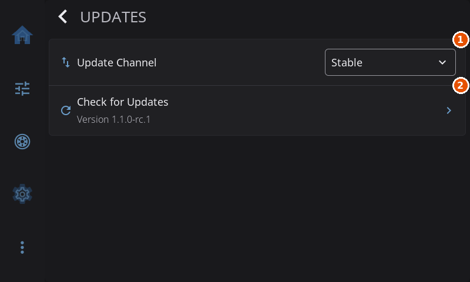
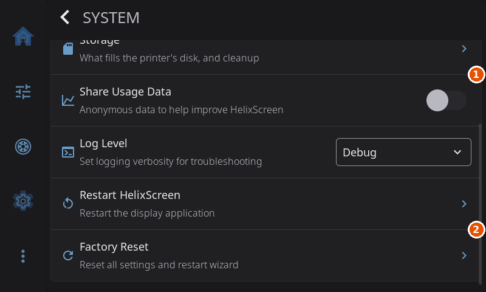

# Upgrading HelixScreen

How to update HelixScreen to a newer version, what an update keeps, and what to expect when you move to 1.1.

> **Sent here by a QR code on your screen?** Your screen said **Update from a Terminal** because HelixScreen can see the new version but cannot install it by itself. Use the command for your printer under [Update from a Terminal](#update-from-a-terminal).

---

## Quick Upgrade

The easiest ways to update, in order:

1. **In the app:** **Settings > Updates > Check for Updates**, then **Install Update**. See [Updates](guide/settings/updates.md).
2. **From Mainsail or Fluidd:** HelixScreen appears in the update manager on Raspberry Pi and other generic Linux installs, and on most all-in-one printers that run Mainsail or Fluidd. Click **Update** next to it.
3. **From a terminal:** see the next section.



1. **Update Channel**: picks Stable or Beta.
2. **Check for Updates**: asks for a new version. When one is out, an **Install Update** row appears below it.

An update keeps your settings. See [What an Update Keeps](#what-an-update-keeps).

> **One thing that can change: your home screen arrangement.** If an update changes how the home grid is sized, saved widget positions no longer fit the new cells, so HelixScreen re-places the widgets on the new grid. Which widgets you have and how each is set up is kept; only their positions and sizes are worked out again. See [What Happens on Upgrade](guide/home-panel.md#what-happens-on-upgrade).

---

## Update from a Terminal

SSH into the printer (or the computer HelixScreen runs on) and run the installer with `--update`.

**Most printers** (Raspberry Pi and other generic Linux hosts, Creality K2, Elegoo Centauri Carbon, Snapmaker U1, Creality Sonic Pad, QIDI):

```bash
curl -sSL https://releases.helixscreen.org/install.sh | sh -s -- --update
```

If the printer has no `curl`, run the copy of the installer that came with your install instead. It is in the install folder:

```bash
sh <install folder>/install.sh --update
```

| Printer | Install folder |
|---------|----------------|
| Raspberry Pi and other generic Linux hosts | `helixscreen` in the Klipper user's home (for example `/home/pi/helixscreen`), or `/opt/helixscreen` |
| Creality K2 / K2 Plus / K2 Pro | `/mnt/UDISK/helixscreen` |
| Elegoo Centauri Carbon | `/user-resource/helixscreen` |
| Snapmaker U1 | `/userdata/helixscreen` |

For example, on a K2: `sh /mnt/UDISK/helixscreen/install.sh --update`. When the printer cannot download over HTTPS, the installer says `HTTPS not available, trying HTTP fallback...` and fetches the release and its checksum over plain HTTP from `dl.helixscreen.org` instead, so this command also works on printers with only a basic `wget`, such as the Adventurer 5M. **Settings > Help & About > About** shows the install folder as **Install Root**.

**Printers with their own update steps:**

| Printer | How to update |
|---------|---------------|
| Creality K1 / K1C / K1 Max | [Updating in the K1 Series guide](guide/install-k1.md#updating): `sh /usr/data/helixscreen/install.sh --update`, or copy a newer package to the printer first when it has no internet |
| Flashforge Adventurer 5M / 5M Pro | [Updating in the Adventurer 5M guide](guide/install-ad5m.md#updating): on Forge-X, `sh /opt/config/mod_data/helixscreen/install.sh --update`; on Klipper Mod, the same command at the install folder for your version |
| Flashforge Adventurer 5X | [Updating in the Adventurer 5X guide](guide/install-ad5x.md#updating): from inside ZMOD's environment (`chroot`) |
| Flashforge Creator 5 / Creator 5 Pro | Z-Mod or Reforge updates HelixScreen with the firmware |
| Linux desktop (HelixScreen in a window) | [Updating in the Linux desktop guide](guide/install-linux-desktop.md#updating) |
| Android | Install the new APK over the old one: see [Android App](INSTALL.md#android-app-experimental) |
| BigTreeTech K-Touch | [Updating in the K-Touch guide](guide/install-esp32.md#updating) |

`--update` installs the latest version on your update channel and never asks for confirmation. Add `--version v1.1.0` to install a particular version instead.

---

## Coming from 1.0

1.1 installs over 1.0 as a normal update, from the app, from Mainsail or Fluidd, or from a terminal. It reaches the Stable channel once 1.1.0 is released. To try it earlier, switch to the Beta channel first: **Settings > Updates > Update Channel > Beta**, then **Check for Updates**. On printers whose firmware ships HelixScreen, the Updates screen says **Managed by your firmware** instead; update the firmware to get the new version.

What to expect after the update:

- **Your 1.0 settings are kept.** On its first start, 1.1 saves a copy of your old `settings.json` beside the new one, as `settings.json.pre-migration`, before converting it. HelixScreen never reads that copy back; it is there in case you want it.
- **Settings pages moved; your settings did not.** Settings is now one list of pages in three groups, and nothing is reset. See [Settings](guide/settings.md).
- **Your home screen is converted, not reset.** The first time 1.1 draws the home screen, it maps your saved arrangement onto the new grid. Which widgets you have, their settings and your extra pages all carry over, and widgets that sat next to each other stay next to each other. Sizes can shift a little because the new grid divides the screen differently, and a widget that no longer fits is re-placed on its own. What you see on that first start is what gets saved.
- **Your print signal macros keep their names.** If your printer already has HelixScreen's helper macros, `HELIX_READY` and the `HELIX_PHASE_*` macros stay as they are, so your `PRINT_START` needs no changes.
- **Print preparation tracking needs nothing in your config.** The screen works out the current phase (heating, homing, printing) from the printer itself. A `PRINT_START` that already carries `HELIX:PHASE` markers keeps working.
- **Display sleep turns the backlight off.** The panel stays powered and only the backlight goes dark, so waking is instant. Screens whose backlight cannot be controlled are powered down instead. Set `"panel_power_off": 1` under `"display"` in `settings.json` if you always want a full power-down.
- **Some installs move on disk, automatically.** On the Adventurer 5M, HelixScreen's settings, logs and caches move to `/data/.helixscreen`, out of the printer's file list. On the K2, the install moves off the small system partition onto the user partition (`/mnt/UDISK`). Both moves happen during the update and keep everything.
- **`helixscreen.env` values are taken literally.** The file is no longer run through the shell, so `$VAR`, `${VAR}`, `$(command)` and backticks are not expanded. A line that uses them is skipped, with a warning in the log; write the final value instead. Only the settings documented for this file are accepted. When the file cannot be trusted (wrong owner, or writable by others), a warning on the screen says what is wrong and how to fix it.
- **A custom update server moves out of `settings.json`.** If you pointed HelixScreen at your own update server, move `r2_url` or `dev_url` into `/var/lib/helixscreen/update_urls.json`, a file only root or HelixScreen's own user may own. The old keys in `settings.json` are ignored, and the log says where to move them.
- **Lane details come from the printer.** See [Coming from a 1.1 beta](#coming-from-a-11-beta) below; the same applies when you come from 1.0.

**Going back to 1.0** is safe for your settings, with two exceptions:

- **Material Temperatures.** 1.1 moves your per-material temperature and preheat changes out of `settings.json` into `user_filaments.json`, which 1.0 does not read, so a 1.0 build uses its built-in values. Note your changes before going back.
- **The home screen.** A 1.0 build saves widget positions in its own grid's units, so when you return to 1.1 the widgets may sit in the wrong places, or the home screen may come back with its default layout. Long-press the home screen to enter Edit Mode and arrange it again.

### Coming from a 1.1 beta

HelixScreen now keeps no spool or lane details of its own. Everything a lane shows lives on the printer, where every screen, Mainsail and OrcaSlicer read the same thing (see [Where a lane's details come from](guide/filament-tracking.md#where-a-lanes-details-come-from)). That retires a few things earlier betas kept on the screen:

- **The local copy of your lanes**, used when the printer could not be reached, is gone. Lanes fill in from the printer as soon as HelixScreen connects.
- **Edits held while disconnected** are gone too. Editing is unavailable until the printer is connected and its lanes have been read, so nothing waits to be sent later.
- **`tool_spools.json`**, the per-tool spool list, and the **external spool** saved in `settings.json` are read once, the first time this release connects, and then deleted. On a tool changer, a tool's spool is linked to the lane that feeds it, unless that lane already names a spool. The external spool becomes the printer's bypass record, unless the printer already has one. From then on a tool's spool is the spool of the lane that feeds it, and the external spool is kept on the printer like any lane.

What carries over: everything already on the printer. Spool links, materials and colors your filament system holds, and the lane records earlier betas wrote, are read as they are. Happy Hare tuning values set from HelixScreen move from the screen's settings to the printer the first time 1.1 connects. A detail that only ever lived on the screen (an edit made while the printer was offline and never sent) does not carry over; set it again.

On an AFC printer, AFC's own **remember spool** setting now decides what a lane keeps when the spool comes out, and an unlink only sticks if AFC drops the spool's ID.

---

## What an Update Keeps

An update replaces HelixScreen's program files and keeps:

- **`settings.json`**: every setting, including your printers, display, sound and safety choices
- **`helixscreen.env`**: any environment overrides you set
- **Your own files**: custom printer images, themes, your own printer database entries, `user_filaments.json` and the rest of HelixScreen's config folder

On a Raspberry Pi and other Klipper hosts, these live in Klipper's config folder, at `printer_data/config/helixscreen/`, outside the install folder an update replaces. HelixScreen also keeps backup copies of its settings outside the install, and restores them if the settings file goes missing.

Your Klipper configuration, Moonraker settings, print history and G-code files are separate and never touched by an update.

---

## Upgrade to a Specific Version

```bash
curl -sSL https://releases.helixscreen.org/install.sh | sh -s -- --update --version v1.1.0
```

A beta version, such as `v1.1.0-beta.9`, can be installed the same way.

To go back to an older version from the app, switch **Settings > Updates > Update Channel** to a channel whose latest version is older than yours. Install Update then asks **Install Older Version?** before it goes ahead. Anything added in the newer version is removed, and settings the newer version wrote are not converted back.

### Reinstall with Fresh Settings

`--update` keeps your settings. To reinstall **and** reset HelixScreen's settings to defaults, use `--clean`:

```bash
curl -sSL https://releases.helixscreen.org/install.sh | sh -s -- --clean
```

`--clean` lists what it will delete (the install, its settings and settings backups, and its thumbnail caches) and asks you to confirm; the answer defaults to no. Where nothing can answer the question, for example from a web console or a script, add `--yes` to confirm in advance:

```bash
curl -sSL https://releases.helixscreen.org/install.sh | sh -s -- --clean --yes
```

Add `--version v1.1.0` to reinstall a particular version. Your Klipper configuration, Moonraker settings, print history and G-code files are **not** affected.

---

## If the Setup Wizard Keeps Appearing

If HelixScreen shows the setup wizard on every start after an update, its settings are not being saved or read back. Start over with clean settings, in one of two ways:

**From the screen,** if you can get past the wizard to the Settings screen:

1. Open **Settings > System**
2. Tap **Factory Reset** and confirm



1. **Share Usage Data**: turns anonymous usage statistics on or off.
2. **Factory Reset**: erases every HelixScreen setting and restarts into the setup wizard.

HelixScreen resets every setting to its default and restarts into the setup wizard.

**From a terminal,** reinstall with fresh settings:

```bash
curl -sSL https://releases.helixscreen.org/install.sh | sh -s -- --clean
```

Deleting `settings.json` by hand does not reset HelixScreen: it restores the file from its own backup copy on the next start.

If the wizard still comes back after a clean reinstall, ask for help (see below) and include a [debug bundle](guide/settings/help-about.md#upload-debug-bundle) or the log.

### What a Reset Clears

A factory reset or `--clean` puts every HelixScreen setting back to its default, so the setup wizard runs again and you set up:

- The printers you added, and their connection details
- Display preferences: brightness, theme, sleep
- Sound, safety and the other choices in Settings

Your network connection belongs to the system, not to HelixScreen, so it stays connected. Your Klipper configuration, Moonraker settings, print history and G-code files are **not** affected.

---

## Checking Your Version

**On the touchscreen:** **Settings > Help & About > About** shows **Current Version**.


**Over SSH:** run `<install folder>/bin/helix-screen --version`, for example `~/helixscreen/bin/helix-screen --version` on a Raspberry Pi. Each printer's install guide lists its install folder.

---

## Getting Help

If something goes wrong after an update:

1. Ask in the [HelixScreen Discord](https://discord.gg/RZCT2StKhr)
2. Check [TROUBLESHOOTING.md](TROUBLESHOOTING.md) for common problems
3. Read the logs. On systemd hosts: `sudo journalctl -u helixscreen -n 50`. The installer's own log is `printer_data/logs/helixscreen-install.log` on Klipper hosts; other printers' log locations are in their install guides
4. Open an issue on [GitHub](https://github.com/prestonbrown/helixscreen/issues) with your version and any error messages

---

*Back to: [Installation Guide](INSTALL.md) | [User Guide](USER_GUIDE.md)*
