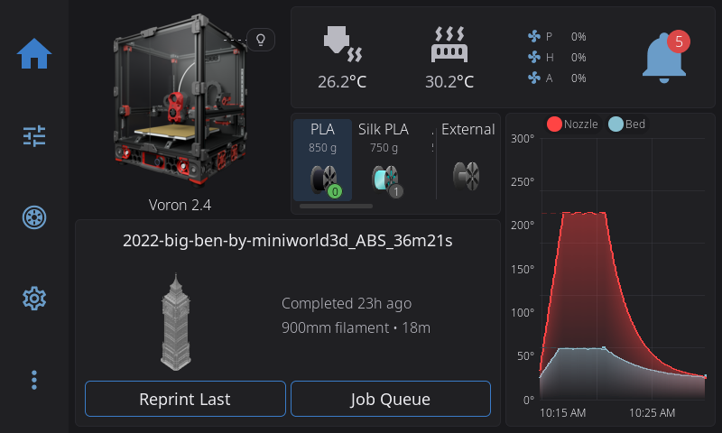
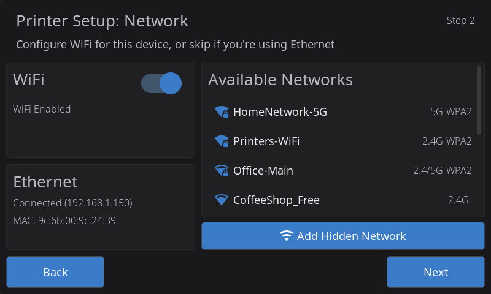
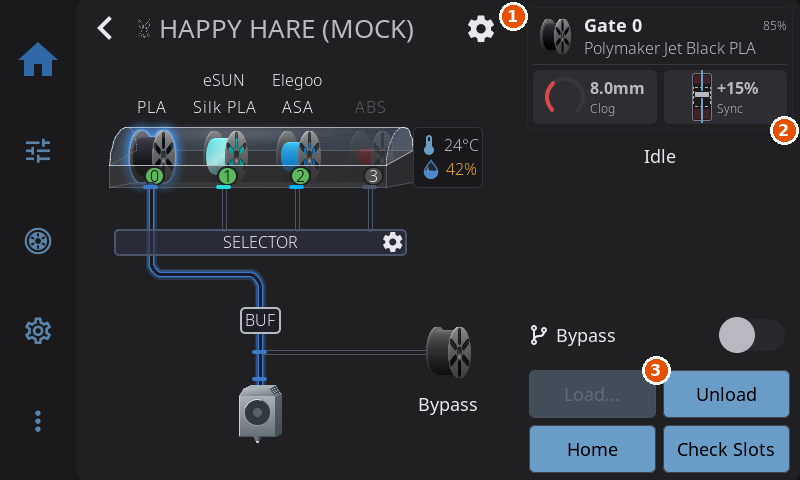
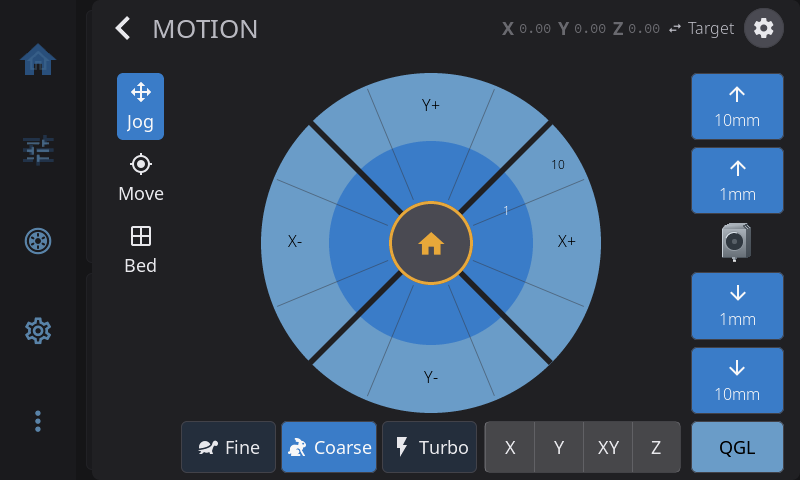
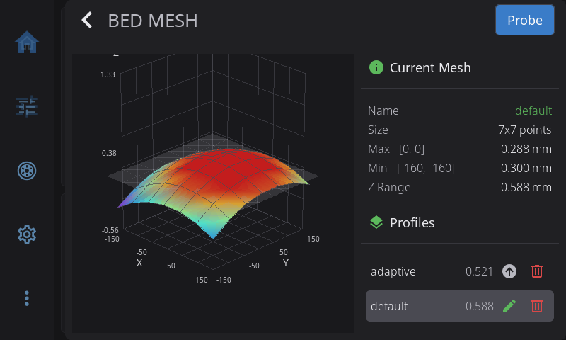

# HelixScreen User Guide

Your printer's touchscreen should show you more than temperatures and a progress bar. HelixScreen is a full-featured touch interface for Klipper printers that puts everything at your fingertips — things you'd normally need to open Mainsail or Fluidd for.

**What you get that other touchscreen UIs don't:**

- **A real dashboard** — Drag-and-drop widgets across multiple pages. Temperature graphs, fan controls, camera feeds, power toggles, favorite macros. You decide what's on screen, not the developer.
- **3D visualization** — Rotate your bed mesh with your finger. Preview G-code layers before printing. See input shaper frequency response charts right on the screen.
- **Multi-material that works** — 11 filament systems: AFC, Happy Hare, ACE, CFS, AD5X IFS, Snapmaker U1, QIDI Box, OpenAMS, Bondtech INDX (early support), any Lane Status producer, and tool changers. Per-box drying controls and humidity monitoring, Spoolman integration.
- **Exclude objects** — Tap the failing part on an overhead map to exclude it mid-print. No more scrapping an entire plate for one bad object.
- **Runs on hardware you already own** — ~15MB RAM on embedded targets (a few times more on 64-bit Pi, still well under what other touchscreen UIs need). No X11, no browser, no desktop environment. Directly on the framebuffer. From a Creality K1 to a Pi Zero 2 W to a random mini-ITX box with an HDMI touchscreen.
- **Looks good** — 18 theme presets with a live editor, responsive layouts from 480x320 to 1024x600, GPU-accelerated blur. Light and dark modes. (Ultrawide and portrait screens are alpha — see [Which displays are supported?](FAQ.md#which-displays-are-supported).)
- **Smart setup** — A first-run wizard auto-detects your printer from a database of over 100 models and configures everything. 9 languages.

---

## Quick Reference

| Sidebar Icon | Panel | What You'll Do There |
|--------------|-------|----------------------|
| Home | [Home](guide/home-panel.md) | [Monitor status](guide/home-panel.md), [start prints](guide/printing.md), [view temperatures](guide/temperature.md) |
| Tune | [Controls](guide/motion.md) | [Move axes](guide/motion.md), [set temperatures](guide/temperature.md), [control fans](guide/fans.md) |
| Spool | [Filament](guide/filament.md) | [Load/unload filament](guide/filament.md#load--unload--purge), [manage AMS slots](guide/filament-ams-panel.md) |
| Gear | [Settings](guide/settings.md) | Configure [display](guide/settings/display.md), [sound](guide/settings/sound.md), [LED](guide/settings/led-settings.md), [network](guide/settings/connection.md), [sensors](guide/sensors.md) |
| More | [Advanced](guide/advanced.md) | [Calibration](guide/calibration.md), [history](guide/print-history.md), [macros](guide/advanced.md#macro-execution), [system tools](guide/advanced.md) |

---

## Guide Contents

The guide follows how you use a printer day to day: your home screen, starting a job, watching it, and handling filament come first, then tuning and the things you set up once.

### Getting Started

- **[Getting Started](guide/getting-started.md)**: navigation, touch gestures, connection status, the first-run setup wizard, WiFi, and the on-screen keyboard.
- **[Supported Printers](guide/supported-printers.md)**: which printers get model-specific integration and what works on each.
- **[Installation](INSTALL.md)**: installing HelixScreen on your printer or a Klipper host. To try it without touching the printer, [run it in a window on a Linux desktop](guide/install-linux-desktop.md).

### Your Home Screen

The home screen is yours to build: pick the widgets, size them, and spread them across pages.

- **[Home Panel](guide/home-panel.md)**: the status area, the widget grid, multiple pages, and emergency stop.
- **[Edit Mode](guide/home-edit-mode.md)**: adding, moving, resizing and configuring widgets, and adding pages.
- **[Widget Catalog](guide/home-widgets.md)**: every widget, with details on the [print](guide/home-widgets-print.md), [filament](guide/home-widgets-filament.md), and [control and system](guide/home-widgets-controls.md) widgets.
- **[Printer Manager](guide/printer-manager.md)**: your printer's name, model and picture, its software versions, and the hardware HelixScreen found.

### Starting a Print

- **[Choosing and starting a print](guide/printing.md)**: browsing files, the preview, pre-print options, checking the file fits the printer, queueing, and sending prints from OrcaSlicer.
- **[Filament Mapping](guide/filament-mapping.md)**: matching each color in a multi-color file to a slot before the print starts.
- **[Print History](guide/print-history.md)**: past jobs with statistics and trend charts, and reprinting a previous job.

### Watching the Current Print

- **[During a print](guide/printing.md#during-a-print)**: progress, pausing at a layer, the tune overlay, Z-offset baby steps, excluding a failed object, the post-print summary, and resuming after a power loss.
- **[Print Monitoring & Failure Detection](guide/print-monitoring.md)**: the pre-print filament check and the response to camera-based failure detection.
- **[Camera](guide/camera.md)**: the camera widget and the fullscreen viewer.
- **[Screen Sharing and Remote Control](guide/screen-sharing.md)**: seeing and using the printer's screen from any browser, or as a webcam in Mainsail and Fluidd.

### Filament

- **[Filament Management](guide/filament.md)**: load, unload and purge, extrusion controls, the external spool, and running more than one filament system.
- **[The Filament System Panel](guide/filament-ams-panel.md)**: slots, lanes, and per-unit controls for AMS-style systems (AFC, Happy Hare, ACE, IFS, QIDI Box, OpenAMS, and more).
- **[Creality Filament System (CFS)](guide/filament-cfs.md)** and **[Snapmaker U1 and MedusaHC](guide/filament-tool-changers.md)**: what is specific to those systems.
- **[Filament Drying and Humidity](guide/filament-drying.md)**: per-unit drying controls and humidity monitoring.
- **[Filament Tracking & Spoolman](guide/filament-tracking.md)**: how material, color and remaining weight are tracked, with the built-in tracker or a Spoolman server.

### Printer Control

- **[Temperature Control](guide/temperature.md)**: nozzle, bed and chamber targets, material presets, multiple extruders, and live graphs.
- **[Motion & Positioning](guide/motion.md)**: jogging, homing, tap-to-move, the bed map, parking, and emergency stop.
- **[Fans](guide/fans.md)**: speed control, RPM readouts, and renaming fans.
- **[Advanced Features](guide/advanced.md)**: the G-code console, macros, interactive prompts, power devices, notification history, and timelapse.

### Tuning & Calibration

- **[Calibration & Tuning](guide/calibration.md)**: bed mesh, screws tilt adjust, input shaper, Z-offset, tool offsets, belt tension, pressure advance, and PID tuning.

### Settings & Setup

- **[Settings](guide/settings.md)**: display, appearance and themes, touch, sound, printing, devices, safety, connection, language, updates, and more.
- **[Sensors](guide/sensors.md)**: filament runout and motion sensors, door and button inputs, and read-only sensors.
- **[Security & Screen Lock](guide/security.md)**: PIN lock, auto-lock, and what a factory reset clears.
- **[Touch Calibration](guide/touch-calibration.md)**: fixing taps that land in the wrong spot.
- **[HelixPrint Plugin](guide/helixprint-plugin.md)**: the optional Moonraker add-on, what it adds, and what works without it.
- **[Add-On Chamber Heater Setup](guide/chamber-heater.md)**: getting a BIGTREETECH Panda Breath working with Klipper.
- **[Bluetooth Setup](guide/bluetooth-setup.md)**: enabling Bluetooth on a Pi or BTT Pi, or adding a USB dongle.
- **[Barcode Scanner](guide/barcode-scanner.md)**: reading Spoolman QR codes with a USB or Bluetooth scanner.
- **[Label Printing](guide/label-printing.md)**: printing spool labels on Brother QL, Phomemo, Niimbot, or MakeID printers.

### More

- **[Tips & Best Practices](guide/tips.md)**: shortcuts, quick troubleshooting, and which panel to use for what.
- **[Beta Features](guide/beta-features.md)**: turning on beta features and choosing an update channel.
- **[Troubleshooting](TROUBLESHOOTING.md)**, **[FAQ](FAQ.md)**, **[Configuration](CONFIGURATION.md)**, and **[Upgrading](UPGRADING.md)**.
- **[Creality K1C Setup](guide/creality-k1c-setup.md)**: rooting, community firmware, and installing HelixScreen on a K1, K1C or K1 Max.

---

*HelixScreen — Making Klipper accessible through touch*
