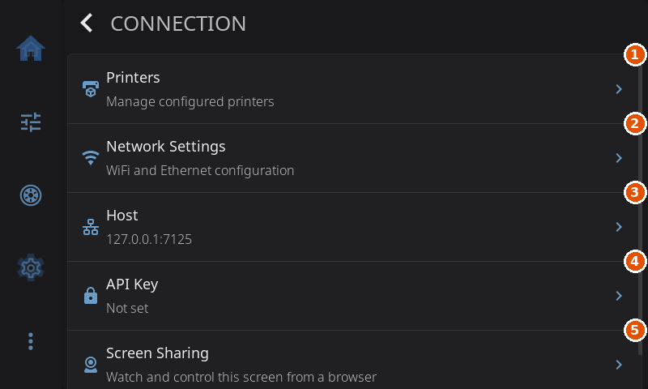
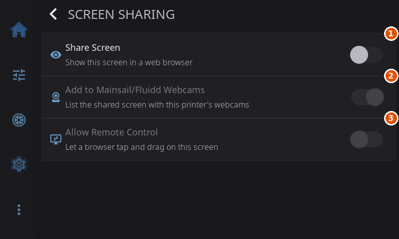

# Printer and Connection

How HelixScreen finds and talks to your printer, Wi-Fi settings, screen sharing and the printer switcher. See [Settings: Connection](../guide/settings/connection.md) and [Screen Sharing](../guide/screen-sharing.md) for the walkthroughs.

[Back to the Configuration Reference](../CONFIGURATION.md)

---

## Several printers

HelixScreen can drive more than one printer. Each printer has its own entry under `printers`, named by an id (`default` for the first one), and `active_printer_id` says which entry is live:

```json
{
  "active_printer_id": "voron-24",
  "printers": {
    "show_printer_switcher": true,
    "voron-24": {
      "printer_name": "Voron 2.4",
      "moonraker_host": "192.168.1.100",
      "moonraker_port": 7125,
      "wizard_completed": true
    },
    "ender-3": {
      "printer_name": "Workshop Ender",
      "moonraker_host": "192.168.1.101",
      "moonraker_port": 7125,
      "wizard_completed": true
    }
  }
}
```

Each entry holds everything that is specific to that machine: connection details, hardware choices, lights, filament systems, the Home screen layout and so on. Settings for the screen itself, such as brightness and Wi-Fi, stay outside the entries and are shared.

You do not need to edit this by hand. **Settings > Connection > Printers** adds, switches and removes printers.

| Key | Default | What it does |
|-----|---------|--------------|
| `printers.show_printer_switcher` | `false` | Shows a printer icon in the navigation bar for jumping between printers. Off by default because a single-printer setup does not need it. **Settings > Connection > Printers > Show Printer Switcher**. |

---

## Moonraker connection

These keys are in each printer's entry, `printers.<id>`. Change the address and key from **Settings > Connection > Host** and **API Key**; both open the **Change Printer Host** dialog.



1. Printers switches, adds or removes printers.
2. Network Settings opens Wi-Fi and Ethernet.
3. Host is the Moonraker address.
4. API Key shows Configured or Not set.
5. Screen Sharing shows this screen in a browser.

| Key | Default | What it does |
|-----|---------|--------------|
| `moonraker_host` | `"127.0.0.1"` | The Moonraker host name or IP address. |
| `moonraker_port` | `7125` | The Moonraker port. |
| `moonraker_api_key` | `false` | The printer's Moonraker API key, needed when Moonraker has `force_logins` on. HelixScreen sends it only to this printer's host and port. Use `false` when Moonraker trusts the screen without one. A wrong key is worse than none, because Moonraker refuses it even from a trusted address. See [how to get the key](../TROUBLESHOOTING.md#unauthorized-everywhere-moonraker-requires-a-login). |

The `--moonraker ws://HOST:PORT` flag overrides the address for one run.

### Timing

You will rarely need to change these. They control how patient HelixScreen is with a slow or flaky connection.

| Key | Default | What it does |
|-----|---------|--------------|
| `moonraker_connection_timeout_ms` | `10000` | How long to wait for a connection to open. |
| `moonraker_request_timeout_ms` | `60000` (the template sets `30000`) | How long to wait for an answer to a request. |
| `moonraker_keepalive_interval_ms` | `10000` | How often to send a keepalive. |
| `moonraker_reconnect_min_delay_ms` | `200` | The shortest wait before trying to reconnect. |
| `moonraker_reconnect_max_delay_ms` | `2000` | The longest wait before reconnecting. The wait grows up to this. |
| `moonraker_timeout_check_interval_ms` | `2000` | How often HelixScreen checks for requests that have timed out. |

---

## Wi-Fi

The connection type, network name and IP address shown in **Settings > Connection > Network Settings** are read live from the printer's operating system. The setup wizard configures the network through the printer, not through this file. These keys are at the top level.

| Key | Default | What it does |
|-----|---------|--------------|
| `wifi_expected` | `false` | Whether Wi-Fi is expected to be available. When `true`, HelixScreen warns you if it is not. The wizard sets it from your network choice. |
| `wifi_enabled` | `true` | Whether Wi-Fi is on. The switch at **Settings > Connection > Network Settings**. |
| `wifi_country` | `""` | A two-letter country code such as `"US"`, `"DE"` or `"GB"`, applied every time HelixScreen starts. Without one the radio stays in a restricted worldwide mode and usually cannot find 5 GHz networks until it has joined a 2.4 GHz one. Empty leaves the country to the printer's system. **Settings > Connection > Network Settings > Country**. |
| `wifi_country_last_seen` | `""` | The last country the radio itself reported, recorded by HelixScreen. If `wifi_country` is empty and the radio falls back to the worldwide mode, for example after a firmware update, HelixScreen sets this country again. A country the radio already reports is never changed. Do not edit it. |

---

## Screen sharing

These settings let you watch and control the screen from a browser or from Mainsail and Fluidd. They are set at **Settings > Connection > Screen Sharing**, which is hidden on printers whose firmware shares the screen itself. Three switches are **per printer**, inside `remote_screen` in the printer's entry, so one printer's screen never appears among another printer's webcams.



1. Share Screen is the master switch (`remote_screen.enabled`).
2. Add to Mainsail/Fluidd Webcams adds the screen as a webcam (`webcam`).
3. Allow Remote Control lets the browser send touches (`control`).

```json
"remote_screen": {
  "enabled": false,
  "control": false,
  "webcam": true
}
```

| Key | Default | What it does |
|-----|---------|--------------|
| `remote_screen.enabled` | `false` | Shares the screen in a web browser. **Share Screen**. |
| `remote_screen.webcam` | `true` | Adds the screen to Mainsail and Fluidd as the **HelixScreen Screen** webcam. **Add to Mainsail/Fluidd Webcams**. |
| `remote_screen.control` | `false` | Lets a browser tap and drag on the screen. It takes effect only while sharing is on. **Allow Remote Control**. |

Two more entries are shared by all printers and sit at the top level in `remote_screen`:

| Key | Default | What it does |
|-----|---------|--------------|
| `remote_screen.port` | `7130` | The port the screen is served on. It has no menu. Change it only if something else on the printer already uses 7130. Where the installer put the screen behind nginx, nginx expects 7130. |
| `remote_screen.pair_secret`, `remote_screen.paired_tokens` | written by HelixScreen | The pairing code and the paired browsers, on printers with nothing in front of Moonraker. Manage them from the screen with **Pairing Code** and **Forget Paired Browsers**, not by hand. |
