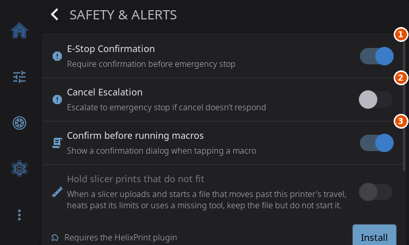

# Safety, Alerts and Screen Lock

Confirmation dialogs, cancel behaviour, print-failure detection, notifications and the optional PIN lock. All of these are **per screen** unless a row says otherwise. See [Settings: Safety & Alerts](../guide/settings/safety.md) and [Security](../guide/security.md) for the walkthroughs.

[Back to the Configuration Reference](../CONFIGURATION.md)

---

## Confirmations and cancel

These are in the `safety` section.

1. E-Stop Confirmation.
2. Cancel Escalation.
3. Confirm before running macros.

| Key | Default | Values | What it does |
|-----|---------|--------|--------------|
| `estop_require_confirmation` | `true` | `true` or `false` | Asks for confirmation before an emergency stop. With `false` the E-Stop acts immediately. The default protects against accidental stops. **Settings > Safety & Alerts > E-Stop Confirmation**. |
| `macro_require_confirmation` | `true` | `true` or `false` | Asks before running a macro from a button that has no confirmation of its own. **Confirm before running macros**. |
| `cancel_escalation_enabled` | `false` | `true` or `false` | When on, a cancel that does not finish within the timeout escalates to an emergency stop (M112). When off, cancel waits as long as the printer needs to finish its cancel routine. Leave it off if your printer has a long cancel macro, for example a tool changer that must park its tools. **Cancel Escalation**. |
| `cancel_escalation_timeout_seconds` | `30` | `15`, `30`, `60`, `120` | How long to wait after sending a cancel before escalating. It applies only while `cancel_escalation_enabled` is `true`. **Escalation Timeout**. Other values round up to the next of these four, and anything above 60 becomes 120. |
| `tool_change_require_confirmation` | `true` | `true` or `false` | Asks before switching to another tool from the Home screen's tool switcher, from a toolhead on the filament system's screen, or from the Filament screen's tool list on printers where that list switches tools. With `false` those taps switch straight away. A tool change during a paused print always asks. **Settings > Printing > Confirm tool changes**, shown only on printers with more than one tool. |
| `allow_cold_extrude` | `false` | `true` or `false` | Lets filament loading and unloading run with a cold nozzle. **Settings > Printing > Allow cold load/unload**. |

---

## Print-failure detection

These are in the `detection` section.

| Key | Default | Values | What it does |
|-----|---------|--------|--------------|
| `detection.enabled` | `true` | `true` or `false` | Whether failure detection is used where the printer offers it. **Settings > Safety & Alerts > Spaghetti Detection**. The row appears only when a detector is available. |
| `detection.pause_on_detect` | `true` | `true` or `false` | When off, HelixScreen only warns about prints it pauses itself. A print the firmware paused always shows its response dialog. **Pause on Detection**. |
| `printers.<id>.detection.policy_u1` | `2` | `0` Off, `1` Notify only, `2` Defer to source | **Per printer.** What HelixScreen does with the Snapmaker U1's built-in detector: `0` shows nothing, `1` warns without pausing, `2` (the default) leaves the response to the detector together with the two settings above. See [Print monitoring](../guide/print-monitoring.md). |

---

## Notifications and print completion

| Key | Default | Values | What it does |
|-----|---------|--------|--------------|
| `completion_alert` (top level) | `2` | `0` Off, `1` Notification, `2` Alert | How HelixScreen tells you a print has finished or been canceled while you are on a different screen. `0` shows nothing (a sound still plays if sounds are on). `1` shows a brief message at the top of the screen. `2` shows a full-screen dialog with the print's duration, layers and filament used, with confetti for a successful print. Errors always show the full alert. **Settings > Safety & Alerts > Print Completion Alert**. |
| `notifications.min_toast_severity` | `0` | `0` all, `1` warnings and errors, `2` errors only | The lowest level of notification allowed to pop up as a toast. Quieter ones still land in the notification history, and full-screen error dialogs always show. **On-screen Alerts**. |

---

## Screen lock

These are in the `security` section. Manage them at **Settings > System > Security**.

| Key | Default | What it does |
|-----|---------|--------------|
| `security.pin_hash` | `""` | A scrambled (SHA-256) form of your PIN. HelixScreen never stores the PIN itself. Empty means no PIN and no lock screen. **Do not edit it by hand.** Set, change or remove the PIN from **Security**, which writes the value for you. |
| `security.auto_lock` | `false` | Locks the screen every time the display sleeps and wakes, so your PIN is needed to get back in. It does nothing without a PIN. **Auto-lock**. |
