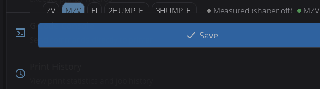
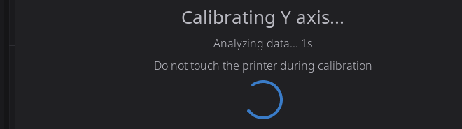
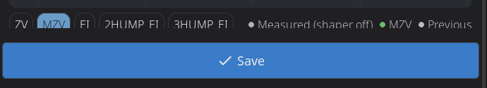
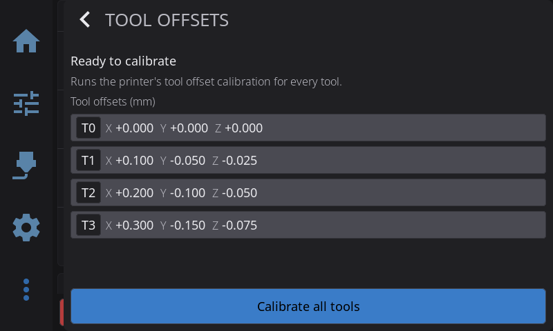
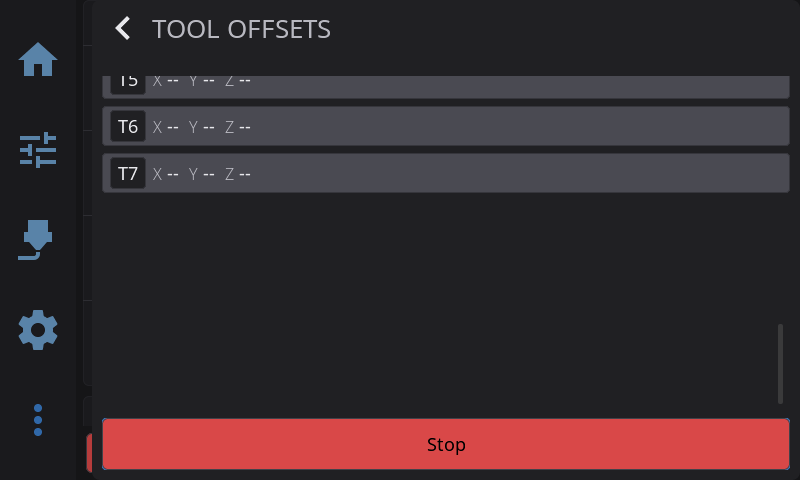
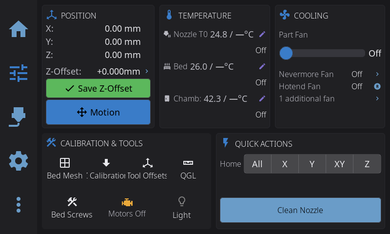
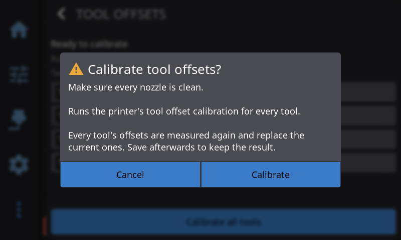
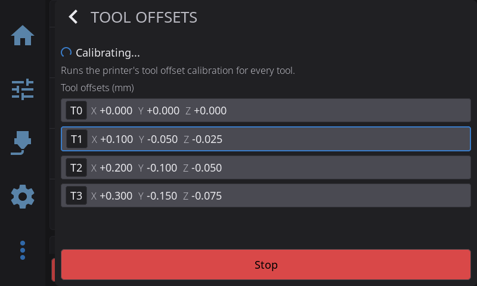
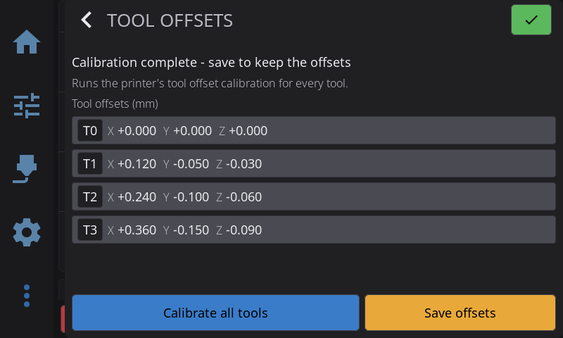

# Calibration & Tuning

HelixScreen provides built-in tools for the most common Klipper calibration tasks.

> **Looking for touchscreen calibration?** See the [Touch Calibration Guide](touch-calibration.md).

---

## Bed Mesh

The Bed Mesh panel has two parts: a 3D visualization of your bed surface on the left, and information cards on the right.

The [Bed Mesh widget](home-panel.md#bed-mesh-widget) shows the active mesh and how flat it is on the home screen, and opens this panel when tapped.

**Visualization (left):**

- **Color gradient**: Blue (low) to Red (high)
- **Touch to rotate** the 3D view
- **Pinch** to zoom in on the spot, **two-finger drag** to move a zoomed view around; pinching all the way out returns to the full view
- When no mesh is loaded, the panel shows a "No mesh loaded" placeholder

**Current Mesh card (right):** shows the active profile name, mesh size (probe-point grid), highest and lowest points, and the overall Z range (variance).

**Probe a new mesh:** tap **Probe** in the panel header. HelixScreen first asks which profile to store the new mesh in. The name starts as `default`, the profile Klipper loads at startup; type another name to keep the new mesh separate. Tap **Start** to probe. When probing finishes, HelixScreen asks whether to save the printer configuration so the mesh survives a restart.

The visualization mode (3D, 2D, or Auto) can be changed in **Settings > Appearance > Bed Mesh Render**.

### Profile Management

The **Profiles** card on the right lists your saved mesh profiles. Each row shows the profile name and its Z range, with action icons on the right:

| Icon | Appears on | What It Does |
|------|-----------|--------------|
| **Load** (up arrow) | Inactive profiles | Loads that saved mesh, making it the active profile |
| **Rename** (pencil) | The active profile | Opens the rename dialog (see below) |
| **Delete** (trash) | Every profile | Removes that saved profile |

Tapping a row (or its Load icon) loads that profile.

**Renaming a profile:**

1. Tap the **pencil** icon on the active profile
2. The rename dialog shows the current name and a field for the new name
3. Enter a new profile name and tap **Rename**. Klipper reserves `default` for new calibrations, so a profile cannot be renamed to it.

**After renaming or deleting**, HelixScreen asks **"Save changes to persist them across restarts?"** Profile changes only live in memory until saved:

- Tap **Save** to write the change to your printer's saved configuration. This persists the change across restarts but **restarts Klipper**.
- Tap **Don't Save** to keep the change for the current session only — it will be lost when the printer reboots.

---

## Screws Tilt Adjust

Assisted manual bed leveling:

1. Navigate to **Advanced > Screws Tilt**
2. Tap **Start Probing**. The printer homes, then probes every bed screw position. It homes before every probe, Re-probe included, because turning a screw moves the bed under a Z position that still reads as homed
3. Read each screw's instruction, e.g. "Tighten 1/4 turn" or "Loosen 1/8 turn"
4. Turn the screws, tap **Re-probe**, and repeat until the bed reads level

**Which way to turn:**

- **Tighten or Loosen** comes from the probed heights: a corner higher than the reference screw tightens down to it, a lower one loosens up to it. This is true of any spring-mounted bed, whatever thread your screws use
- **The arrow** on each screw is Klipper's own clockwise or counterclockwise direction, the same one the console prints (`adjust CW 00:15`). The legend above the list says which arrow is which

**The bed diagram** is shaded by height across the bed, using the same colors as the bed mesh view: red is high, purple is low. A twisted bed shows as a saddle. The line under it gives how far apart the highest and lowest corners are.

**Screw colors:**

- **Green**: Level (within tolerance), or the reference screw
- **Highlighted**: The screw furthest off; start with this one
- **Yellow**: Minor adjustment needed
- **Red**: Significant adjustment needed

### Sharing the Results

Next to **Done** and **Re-probe** in the results view, a **share button** (QR icon) opens a card with every screw's name, probed height, and adjustment spelled out, plus a QR code alongside. The QR encodes exactly the same results as plain text — scan it with any phone camera and the numbers appear there, ready to paste into your notes or a forum post. A printer has no clipboard to copy from, so the QR is how the values leave the screen.

The reference screw is labeled **base** (it is the one everything else is measured against), and a screw needing no adjustment shows `--`.

---

## Input Shaper

Tune vibration compensation for smoother, faster prints:

1. Navigate to **Advanced > Input Shaper**
2. Review your current shaper configuration displayed at the top
3. Pre-flight check verifies accelerometer is connected
4. Select axis to test (X or Y)
5. Tap **Calibrate** to run the resonance test. While the printer sweeps, a compact header shows a progress bar and the **Stop** button, and below it a chart draws the measured vibration live as the sweep climbs through the frequencies (see [The live chart](#the-live-chart) below). The sweep covers the frequency range your printer's own resonance-tester config specifies, so progress tracks the real sweep rather than a fixed span. Once the sweep finishes, the progress bar gives way to a spinner with an "Analyzing data... Ns" counter while the printer's host crunches the samples, and the chart stays on screen with the full curve. On slower printers the analysis alone can take a few minutes per axis; that wait is why the whole run gets a 10-minute timeout
   **Stop** (the red button with an octagon icon, also shown in the setup wizard's Input Shaper step) ends a running test. It is an emergency stop followed by a firmware restart, because the printer cannot cancel a resonance test partway through. Use it only when something is wrong.
6. View the **frequency response chart**; tap a shaper's chip to select it - the chart highlights what that shaper would leave behind
7. Review the **comparison table** showing recommended shaper and alternatives (frequency, vibration reduction, smoothing)
8. Check the **change summary** under the table: it shows what was active before the run ("ei @ 69.8 Hz -> mzv @ 53.8 Hz") and, when the chart has data, how much vibration the old setting would leave on today's measurements versus the new one ("Old setting on today's data: 8.4% residual - now: 7.8%")
9. Tap **Save**. One button does both jobs: it writes your selected shaper for each axis to the Klipper config and restarts the printer's firmware, so the new setting is active immediately and persists across reboots.

**Chart features:**
- The chart plots **relative vibration** (see the caption above each chart): lower is less residual vibration
- The legend keys all three curve kinds: **Measured (shaper off)** is the raw vibration your printer produced during the test, the shaper chips show the vibration each shaper would leave behind, and **Previous** shows what your old setting would have left behind (only shown when a previous setting existed)
- The shaper chips act as a selector, not a stack of switches: one shaper per axis is selected, the selected chip is what **Save** writes, and tapping the selected chip again keeps it selected
- Platform-adaptive: full interactive charts on desktop, simplified on embedded hardware
- Per-axis results shown independently

### The live chart

While a test runs, the Input Shaper screen and the setup wizard's Input Shaper step draw the axis's response as the accelerometer measures it, so you can watch the peaks appear instead of waiting minutes for a result. When the test finishes, Klipper's own analysis replaces the live curve. The live curve is only a preview: the recommended shaper, the comparison table and everything you save come from Klipper's analysis.

The live chart needs HelixScreen to reach Klipper's accelerometer stream, which works when HelixScreen runs on the printer's own computer. Without it, or on the smallest screens (480x272), the test shows the progress bar alone and the results arrive as usual.

> **Creality K1/K2 note:** some Creality firmware versions overwrite the saved X-axis result with the Y-axis values when you calibrate both axes. HelixScreen detects this and shows a warning on the X results card — the X values it measured were correct, but the printer's saved config discards them. (On a Y-only run the warning appears on the Y card instead, since there is no X card to carry it.) Re-run **Calibrate X** alone and save if you want the measured X values kept.

> **Requirement:** Accelerometer must be configured in Klipper for measurements. If no accelerometer is detected, the pre-flight check will show a warning.

---

## Probe Management

View and control your Z probe from **Advanced > Probe Management**. HelixScreen auto-detects your probe type and shows the appropriate controls.

**Supported probe types:**

| Probe | Detected As | Type-Specific Controls |
|-------|-------------|----------------------|
| **Cartographer** | Cartographer | Calibrate, Touch Cal, Scan Cal |
| **Beacon** | Beacon | Calibrate, Auto-Calibrate |
| **BTT Eddy / Mellow Fly Eddy** | Eddy Current | Calibrate, Drive Current Cal |
| **BLTouch** | BLTouch | Deploy, Stow, Reset, Self-Test |
| **Voron Tap** | Voron Tap | — |
| **Klicky** | Klicky | Deploy, Dock |
| **Standard probe** | Probe | — |

**Universal actions** (all probe types):

| Button | What It Does |
|--------|--------------|
| **Accuracy Test** | Runs `PROBE_ACCURACY` to check probe repeatability |
| **Z-Offset Cal** | Opens the interactive Z-offset calibration panel |
| **Bed Mesh** | Opens the bed mesh calibration panel |

**Configuration:** Tap any config row (X/Y offset, samples, speed, retract distance, tolerance) to edit probe settings directly — changes are saved to your Klipper config with a firmware restart.

---

## Z-Offset Calibration

Interactive panel for dialing in your Z-offset when not printing. Works with all probe types — Cartographer, Beacon, BLTouch, eddy current probes, and standard probes.

1. Navigate to **Advanced > Z-Offset**, or tap **Z-Offset Cal** in the Probe Management overlay
2. Optionally enable **Warm Bed** to heat the bed before calibrating (accounts for thermal expansion)
3. Tap **Start** — the printer homes and begins the calibration sequence
4. Use the **+/−** adjustment buttons to lower the nozzle (paper test: adjust until paper drags slightly)
5. Tap **Accept** when satisfied, or **Abort** to cancel
6. The offset is saved to your Klipper config automatically. On printers whose firmware keeps the Z-offset itself (FlashForge with ZMOD, for example) HelixScreen applies it and the firmware stores it. On the Snapmaker U1 nothing stores it: the firmware re-applies each head's own stored offset whenever that head is picked up, so the result lasts only until the next tool change. With **Save Z-Offset Buttons** off in [Settings > Motion](motion.md#motion-settings), HelixScreen does not save the result: Klipper holds it until the next config save, and the completion screen says so

HelixScreen picks the right calibration command for your setup (`PROBE_CALIBRATE`, `Z_ENDSTOP_CALIBRATE`, or `SET_GCODE_OFFSET`) based on your printer's detected probe configuration.

> **Quick access:** A **Z Calibration** button is also available on the Controls panel for one-tap access.

> **Tool changer?** Some printers can also measure Z automatically for every tool, including the reference one, as part of [automatic Tool Offsets calibration](#tool-offsets) — on those, this paper-test flow is hidden. Most tool changers only measure the *other* tools' offsets relative to the reference tool, so the paper test stays available to set the reference tool's own Z.

---

## Tool Offsets

> Added in 1.1.

For tool-changer printers that can measure their own tool positions: one tap calibrates every tool's X, Y, and Z offset in a single automated pass, instead of adjusting each tool by hand.

### Requirements

This screen only appears on a tool changer whose firmware exposes the calibration macro. If your printer doesn't have it, use the regular [Z-Offset Calibration](#z-offset-calibration) flow instead — it still works per-tool.

On a Snapmaker U1, the same **Tool Offsets** entry runs the printer's own guided calibration instead of the screen below: see [Toolhead Offset Calibration](filament.md#toolhead-offset-calibration).

Every tool your printer reports gets its own row, however many there are:

A tool that has never been calibrated shows `--` on each axis instead of a number, so it's never mistaken for a tool that measured exactly zero.

### Running a Calibration

1. Navigate to **Advanced > Tool Offsets** —

   

   — or tap **Tool Offsets** on the Controls panel:

   

2. Clean every nozzle first — the confirmation dialog reminds you:

   

3. Tap **Calibrate all tools**, then confirm. The printer measures each tool in turn against its sensor; the row for whichever tool is currently being probed gets a highlighted border so it's clear which one is changing, while the rest keep showing their last known values

4. When the status line reads **Calibration complete**, tap **Save offsets** to write the results to your Klipper config (this briefly restarts Klipper, same as any other offset save)

5. If the run fails partway through, the status line explains why and the run stops there — clean the affected tool's nozzle and try again

Tapping **Stop** during a run performs an emergency stop, since the calibration macro can't be paused partway through, only canceled outright.

### FlashForge Creator 5 and 5 Pro (Reforge)

On Reforge, the Tool Offsets screen above runs Reforge's own `CALIBRATE_TOOL_OFFSETS`. The confirmation shows Reforge's instruction to remove the build plate first. It measures the station, then every head in turn at 200 °C. When it finishes, **Save offsets** writes the measured results to your Klipper config with `SAVE_CONFIG`, which briefly restarts Klipper.

Reforge derives each head's offsets from its measurements, so HelixScreen doesn't adjust them one tool at a time. While printing, the Z-offset buttons move the machine-wide offset, the same as on a single-head printer. This has not been tested on a printer yet.

### FlashForge Creator 5 Pro (Z-Mod)

On a Creator 5 Pro running Z-Mod, the printer runs its own tool offset calibration, and the Tool Offsets screen above does not open. Instead:

1. Navigate to **Advanced > Tool Offsets**, or tap **Tool Offsets** on the Controls panel.
2. The printer shows its own dialog, **CALIBRATE EXTRUDERS**, asking you to remove the build plate first.
3. Remove the build plate, then tap **OK** to start, or **Cancel** to back out.

The printer measures all four heads and keeps the results itself. HelixScreen does not show per-tool progress or results for this run; follow it on the printer and in the console. The entry appears only when Z-Mod's `CALIBRATE_EXTRUDERS` macro is present, and it is refused while a print is running.

---

## Vertical Artifact Compensation

Some printers can tune their X and Y motors to remove the fine, evenly spaced vertical lines a motor's own vibration leaves on walls printed at constant speed. This is different from [Input Shaper](#input-shaper), which removes ringing after corners.

### Requirements

The **Vertical Artifact Compensation** row appears only on printers whose firmware provides this calibration:

- **FlashForge Creator 5 / 5 Pro running Z-Mod**: uses Z-Mod's `CALIBRATE_VFA` macro and runs with one head you choose.
- **FlashForge printers on their stock Klipper with the motor resonance tester** (the `[stepper_resonance_tester]` section FlashForge ships in `printer.vibration.cfg`): calibrates the whole machine at once.

The printer measures with its own built-in accelerometer; you do not need to add one.

### Running It

1. Make sure no print is running.
2. Navigate to **Advanced > Vertical Artifact Compensation**.
3. On a Creator 5 with several heads, choose the **Tool** to run it with, then tap **Start**. Otherwise, confirm the dialog.
4. If the printer is not homed, it homes first. It then measures its X and Y motors.
5. When it finishes, the printer saves the result and restarts Klipper. The screen briefly shows the printer reconnecting; this is expected.

There is nothing to turn off: on printers without the calibration, the row never appears.

---

## Belt Tension

> Added in 1.1.

For CoreXY printers: compares the tension of the two belt paths by driving each one with the motors and measuring how it responds, so both paths get the same excitation every run instead of relying on a hand-plucked belt.

### Requirements

The row appears under **Advanced > Calibration** on a CoreXY printer whose Klipper config has an accelerometer. **Start Check** stays disabled until all of these hold:

- A **CoreXY** printer. The check compares the two diagonals only a CoreXY has, so it is unavailable on other kinematics
- An **accelerometer** configured in Klipper, and exactly one. When more than one accelerometer reports during the sweep, the check stops with a message rather than guess which one to compare
- **HelixScreen running on the printer's own computer.** Klipper writes its measurements to a file as it sweeps; only a HelixScreen installed on the same machine can read it. A remote session from another computer cannot run the check
- On a printer with **less than 200 MB of memory**, the check warns you first. Klipper analyses each sweep on the printer itself, and on a small board that analysis can run out of memory and leave Klipper stuck until it is restarted
- Klipper ready, and **no print running**. The toolhead has to be free to move

### Running a Check

1. Navigate to **Advanced > Belt Tension**
2. The panel shows what it found: your kinematics, your accelerometer, and the frequency range the sweep will cover. If a requirement is not met, the reason appears above the Start button
3. Tap **Start Check**. The printer homes first if it needs to, runs three quick laps to settle the belts, then sweeps each belt path in turn: the toolhead moves back and forth along one diagonal while the accelerometer listens, then the other. Two full sweeps take about 5 minutes at Klipper's default settings - keep clear of the printer while it moves. Each path's curve draws live on the chart while it sweeps, as on the [Input Shaper live chart](#the-live-chart), and Klipper's analysis replaces it when the sweep ends
4. Both curves appear on one chart, each path in its own color

The sweeps stay inside the frequency range set in your printer's `[resonance_tester]` section; nothing goes past its `max_freq`. On a printer with less than 512 MB of memory or a single-core processor, the panel shows the results without a chart.

The check always uses Klipper's plain pulse test, even on printers set up for the newer sweeping test: the sweeping test smooths over exactly the kind of mechanical difference a belt comparison looks for.

**Stop** ends the run with an emergency stop followed by a firmware restart: a sweep cannot be paused or canceled partway. Use it only when something is actually wrong.

### Reading the Results

- **Similarity**, the large number in the middle: how closely the two response curves match in shape, from 0 to 100%. Balanced belts give curves of the same shape
- A verdict of **Good match** (90% and up), **Fair match** (75% and up) or **Poor match**. The verdict is provisional: the thresholds come from a handful of printers so far, so treat it as a starting point and read the curves yourself
- **Peaks both paths share**, listed under the chart as pairs of frequencies, Path A first ("Peaks 35/36 · 133/132 Hz"), strongest first. Each pair carries the same number on both curves
- **Peaks only one path has** ("Only on Path A: 120, 129 Hz"), shown as hollow rings on the chart. A strong peak one path has and the other lacks is usually the clearest sign the two belts differ
- The chart's height is **relative**: both curves are scaled to the taller one, so the highest point reads 100%

The check measures **paths**: Path A is the 1,-1 diagonal and Path B the 1,1 diagonal, the same naming Shake&Tune and the Voron documentation use. Which physical belt each path is depends on your printer, so name them before you turn anything:

1. Tap **Which belt is which?** on the start screen, a path name above the results chart, or the pencil while tuning
2. Tap **Identify** next to Path A. Path A's motor buzzes back and forth for about 10 seconds; watch which motor and belt move. Do the same for Path B. Identify is unavailable while a check runs or a print is active
3. Pick the layout that matches: A left and B right, A right and B left, A upper and B lower, or A lower and B upper

From then on every screen and instruction uses those names ("Tighten the left belt one full turn"). The choice is saved for each printer separately; **Not set** goes back to Path A and Path B.

HelixScreen's similarity reads lower than Shake&Tune's for the same printer. Shake&Tune compares the curves up to 200 Hz, where both are nearly flat and so agree; HelixScreen compares only the range the printer actually swept.

### Adjusting and Re-testing

After adjusting a belt, you do not need to re-run both paths:

- **Re-test A** / **Re-test B** sweeps just that one path and keeps the other's previous result. The path's old curve stays on the chart as a faint line, so you can see which way, and how far, your adjustment moved it
- **Test Both** discards both and starts a fresh run of the full check

### Tuning Your Belts

When the results show the paths differ, **Tune Belts** (**Fine-tune** if they already match well) walks you through closing the gap one belt at a time. Instead of repeating the full check after every adjustment, it re-measures only the stretch of the spectrum where the two paths disagree, which takes a fraction of the time. The same requirements as the full check apply, and every Measure, Re-measure, Next Zone and Confirm checks them again: if a print has started or Klipper has dropped out, the sweep is refused with the reason. Tuning needs to know your printer's sweep range, so Tune Belts stays disabled until the printer has reported its `[resonance_tester]` settings.

Before every sweep that can follow a belt adjustment, the toolhead runs three quick laps around the bed. A turned tensioner first changes only the stretch of belt next to it; the laps spread the change around the whole belt so the reading reflects it. On a printer with several toolheads the laps stay in the middle of the bed, clear of the parked tools.

**If your belts already match.** Tune Belts tells you so ("Belts already match", with how close they are) and asks nothing of you. **Good Enough** goes back to your results; **Calibrate Anyway** carries on to the calibration turn below if you want to tune further.

**The calibration turn.** Your printer may show several peaks, and the tallest one is not always the belt: it can be a frame resonance that tension hardly moves. So HelixScreen first asks you to tighten the looser belt one full turn ("Tighten B one full turn"; on printers it does not recognise, "Tighten B noticeably"), then tap **Measure**. It sweeps both paths in full and looks for the peaks that moved with your turn; those are the ones it tunes.

- "That turn didn't register yet": the readings did not move enough to tell. Tighten the same belt one more full turn and Measure again. On some printers this is normal for the first turn
- "Nothing followed 2 turns of B. Turn B back 2 turns, then check the mechanics": nothing moved with your turns. Undo them and look for a mechanical problem (see below) before tuning further

Once a turn registers, HelixScreen measures the chosen zone twice straight away, to check that the readings repeat, and then shows its first advice.

What the screen shows:

- **The instruction** at the top: which path to adjust and which way ("Tighten A", "Loosen B"). A higher frequency means a tighter belt, and clockwise tightens
- **The amount**, on printers HelixScreen knows have screw tensioners (the Voron 2.4 and Trident): how far to turn, in quarter turns, from half a turn up to two, or a quarter turn once the belts are nearly matched. The calibration turn gives a first idea of how many Hz a turn moves on your machine, and later rounds refine it
- **The gap gauge**: the distance between the two paths. The middle band is "matched". The solid marker is this round's gap and the hollow one is last round's, so you can see which way it moved. The color tells you how far off you are
- **The chart**: the zone being tuned, with the adjusted path's earlier rounds fading behind it

To work through it:

1. Follow the instruction: turn the named tensioner by the amount shown, use the plus and minus buttons to set what you actually turned, then tap **Re-measure**. The printer settles the belts and sweeps both paths over the zone only. Leaving the stepper at "Not turned" makes the round a repeat check: it shows how much the reading wanders on its own, and nothing is counted as a turn
2. Read the note under the gauge:
   - "last turn: N Hz closer": keep going
   - "No turn: the gap moved N Hz": a repeat check; that is how far a reading wanders by itself
   - "Went past X": the turn was too big, back it off a little
   - "The gap didn't close": try a bigger turn
   - "The gap grew after tightening": the other belt, or the other direction, probably moved. Check which tensioner you turned
   - "Path X's peak left the zone": the belt you were not adjusting moved. Check that only the named tensioner was turned
   - "That reading jumped too far to trust": a measurement glitch. Re-measure without turning anything; your last turn still counts
   - "No clear peak in this zone": the sweep found nothing to compare there. Try again, or see below
   - "peak moved out of the zone. Widening it.": nothing to do, the next sweep covers the wider range
3. When the gap is inside the matched band, the zone is **matched**. Three things can follow:
   - **Keep Tuning** goes back to the same zone if you want to close the gap further. The turn counter starts again at "Not turned"
   - **Next Zone**, if another zone moved with your calibration turn, moves on to it and measures it at once (twice, as above); on larger screens the button shows how long that takes
   - **Confirm**, when there is no other zone, runs a full two-path check and shows the result against the one you started from, with the rounds taken and the total turns per belt, calibration turns included. The round count only counts the rounds where you adjusted a belt. If the belts already matched when the zone was first measured, no count is shown
4. **Adjust X instead** switches which belt you are tuning, if the other one is easier to reach or you turned the wrong one. During the calibration turn it is offered only before your first Measure, and it turns the instruction into loosening the tighter belt instead. **Good Enough** leaves tuning with your starting results

The screen can dim or show the screensaver while you are at the tensioner; waking it returns you to the same round. On printers with little memory the low-memory warning is asked once, at the first sweep of a tuning session.

**"These readings aren't repeatable"** means two sweeps of the same zone, with nothing turned in between, disagreed. Tuning advice would only chase noise, so none is given. Check the mechanics (below), then **Re-measure** for a fresh pair, or leave with **Good Enough**.

**"Curves differ in shape"** means the tallest peak on one path has no partner on the other. Tuning still follows the zone that moved with your turn, but something besides tension may be shaping the response. **"Path B resonates much more than A"** means the tuned zone is far stronger on one path than the other, which also points at a mechanical difference rather than tension. Tap either warning for the list of things to check:

- a worn, frayed or mis-tracking belt
- a loose or slipping pulley grub screw
- an idler or bearing that binds
- debris in the belt teeth, or a belt rubbing a flange
- a loose accelerometer mount

The shape warning also appears if the gap is not closing after many rounds.

**Spring-tensioned and unrecognised printers** get direction-only advice, with no amount in turns, since HelixScreen cannot know what your tensioner does per turn. A spring-tensioned printer skips the calibration turn and starts measuring at once; its instruction is to release the tensioner, let the spring settle and lock it again, which resets the belt to whatever the spring gives. If two re-seats in a row do not improve things, the mechanical hint appears.

**On small, tall and very wide screens.** The same steps apply, laid out to fit. On a small or tall (portrait) screen the instruction, amount and gap gauge collapse into one line: tap the thin gauge to adjust the other path instead, and the two Re-test buttons share one **Re-test** menu. Buttons wrap onto their own lines in portrait so every label stays readable. On a very wide screen the chart takes the left side and the buttons and status sit in a column on the right.

The matched band and the other limits are provisional while they are being checked against more printers, so treat a "matched" result as a good sign and the final full check as the verdict.

---

## Pressure Advance

> Added in 1.1.

Some printers can measure pressure advance themselves instead of printing a tuning tower you judge by eye. On those, a **Pressure Adv.** button appears in the Controls panel's **Calibration & Tools** card, and a **Pressure Advance** row under **Advanced > Calibration**. Today that is the **Snapmaker U1** and the **FlashForge Creator 5 Pro**; on other printers both stay hidden.

1. Tap either entry and pick the tool to measure. Picking a tool mounts it.
2. Set the nozzle temperature for the filament that's loaded, or tap a material preset.
3. Tap **Start** and confirm. Filament must be loaded: the printer heats the nozzle and extrudes a series of short test moves, which takes a few minutes (about 3 on the U1, up to 5 on the Creator 5 Pro).
4. Read the result. A value outside the usual range for the extruder is flagged so you can measure again.

Where the result goes depends on the printer:

- **Snapmaker U1:** the printer applies the value and keeps it for that tool.
- **Creator 5 Pro:** the printer keeps nothing. Copy the value into the filament's slicer profile.

Leaving the screen while it is still heating stops the run. Once measuring has started, **Stop** ends the run on the screen, but the printer finishes that measurement on its own and the nozzle stays hot.

---

## Pressure Advance Tuning (test tower)

> Added in 1.1.

Works on any Klipper printer. HelixScreen prints a small test tower, raises pressure advance as the tower grows, and lets you take over while you watch the corners. You pick the height that looked best, and that value is applied.

1. Open **Advanced > Calibration > Pressure Advance Tuning**.
2. On a printer with more than one extruder (a tool changer or IDEX), pick which one to tune; filament lanes feeding one nozzle count as one. Tap the material preset that matches what's loaded; it sets the nozzle and bed temperature.
3. Choose **Direct drive** or **Bowden**. That sets a sensible range (0 to 0.1 for direct drive, 0 to 1.0 for Bowden); adjust **Start K** and **End K** with **-** and **+** if you want a different range.
4. Clear the plate, tap **Print Test Tower** and confirm. HelixScreen uploads a hollow tower 40 mm wide and about 31 mm tall (roughly 11 minutes plus heating) and starts it. It begins with your printer's own start macro (PRINT_START or similar, with the bed and nozzle temperatures), so homing, leveling and purging happen the way they do for a sliced file, and ends with your end macro. A printer without a start macro just homes and heats.
5. The tuner fills the screen while the tower prints: the pressure advance in effect, large, and the current layer and height. The value steps up every 3 mm. Under the value, a list shows each height range printed so far and the value it printed at, newest first.
6. Watch the corners. Tap **-** or **+** at any time (pick the step size along the bottom): the automatic steps stop and your value stays until the print ends, so you can judge it.
7. When the print finishes, or you tap **End Test**, you get a list of height ranges and the value that was in effect for each. Measure up from the plate, find the band with sharp corners (no bulge, no gap), tap it and tap **Apply**. **Keep current** keeps whatever value you ended on. **Discard** puts back the value you started with. The end of the tower's own G-code also puts the original value back, so a print stopped any other way never leaves a test value behind.

The values in the list are what the printer reported while each band printed, so if you changed the value from the console or a macro during the test, the list shows that too.

**After you apply:**

- The value is active right away, but Klipper forgets it at the next restart. Enter it as **Pressure advance** in your slicer's filament profile.
- If Spoolman is connected and a spool is active, **Save to Spool** stores it on that spool's filament. See [Pressure advance per filament](filament-tracking.md#pressure-advance-per-filament).

You can leave the tuner during the print; the steps keep going. Open it again from **Tuner** in the print's **Tune** overlay.

---

## Heater Calibration (PID / MPC)

Calibrate temperature controllers for stable heating. HelixScreen supports two calibration methods:

- **PID** — Classic proportional-integral-derivative tuning. Works on all Klipper firmware.
- **MPC**: Model Predictive Control. A physics-based thermal model that can provide more stable temperatures. Requires [Kalico](https://github.com/KalicoCrew/kalico) firmware (a Klipper fork with MPC support).

### PID Calibration

1. Navigate to **Advanced > Heater Calibration**
2. Select **Nozzle** or **Bed**
3. Choose a **material preset** (PLA, PETG, ABS, etc.) or enter a custom target temperature
4. Optionally set **fan speed** — calibrating with the fan on gives more accurate results for printing conditions
5. Tap **Start** to begin automatic tuning

**During calibration:**
- **Live temperature graph** shows the heater cycling in real-time
- **Progress percentage** updates as calibration proceeds
- **Stop** ends the run early. It is an emergency stop followed by a firmware restart, because the heater test cannot be paused partway through, so use it only when something is wrong
- A **20-minute timeout** acts as a safety net for stuck calibrations (slow-cooling beds can legitimately take longer than 15 minutes, so the limit sits above that)

**When complete:**
- View new PID values (Kp, Ki, Kd) with **old-to-new deltas** so you can see what changed
- Tap **Save Config** to persist the new values to your Klipper configuration

> **Tip:** Run PID tuning after any hardware change (new heater, thermistor, or hotend) and with the fan speed you typically use while printing.

### MPC Calibration (Kalico Only)

If you are running Kalico firmware, a **Method** selector appears with MPC and PID options. HelixScreen detects Kalico on its own, and the selector only appears when it does.

1. Navigate to **Advanced > Heater Calibration**
2. Select **MPC** in the Method selector
3. Select **Nozzle** or **Bed**
4. Choose a target temperature preset
5. For nozzle calibration, select a **fan calibration level**: Quick (3 points), Detailed (5 points), or Thorough (7 points) — more points improve accuracy but take longer
6. If switching from PID to MPC for the first time, enter your **heater wattage** (check your heater's rating — typically 40–60W for hotends)
7. Tap **Start**

**First-time MPC switch:** If your heater is currently configured for PID, HelixScreen will automatically update your Klipper configuration to MPC mode and restart Klipper before beginning calibration. A progress screen shows "Updating Configuration..." during this step.

**When complete:**
- View MPC model parameters: Heat Capacity, Sensor Response, Ambient Transfer, and Fan Transfer (nozzle only)
- Results are automatically saved to your Klipper configuration

---

## See Also

- [Motion & Positioning](motion.md) — Jog controls used during manual calibration
- [Settings: Printing](settings/printing.md) — Machine limits, and which way the Z buttons move (under Motion)
- [Printing](printing.md) — Z-offset fine-tuning during active prints

---

**Next:** [Settings](settings.md) | **Prev:** [Barcode Scanner](barcode-scanner.md) | [Back to User Guide](../USER_GUIDE.md)
