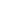
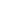

# Add-On Chamber Heater Setup

> Added in 1.1.

An add-on chamber heater is a separate box that sits in your enclosure, heats the air and filters it. The one HelixScreen understands in detail is the **BIGTREETECH Panda Breath**.

**HelixScreen does not install or configure the heater.** It is a network device that talks to Klipper, so Klipper has to be told about it first. That part is the same whether or not you use HelixScreen. Once Klipper knows about it, HelixScreen finds it on its own and there is nothing to switch on: the chamber temperature appears in the Temperatures widget, you can set a chamber target, and the chamber card shows the heater's health.

This page covers getting Klipper to that point. What you see afterwards is described in [Temperature](temperature.md#chamber-heater-diagnostics).

---

## Step 1: Put the heater on your network

Power the unit up and join it to your Wi-Fi by following BIGTREETECH's instructions (the unit publishes its own setup access point on first boot). Then find the address your Klipper host can reach it at: either its IP address from your router, or the name it advertises, usually `PandaBreath.local`.

Check from the machine Klipper runs on:

```bash
ping PandaBreath.local
```

If the name does not resolve, use the IP address everywhere below instead. Give the unit a DHCP reservation in your router if you can. The address ends up in your Klipper config, and a heater that changes address goes offline.

---

## Step 2: Choose which firmware it runs

Two firmwares work with HelixScreen. You do not have to change anything to use the one the unit came with.

| | **Stock** (as shipped) | **DragonBreath** (third-party) |
|---|---|---|
| Flashing needed | No | Yes, over Wi-Fi |
| Chamber heating and filtration | Yes | Yes |
| Filament drying | Start and stop from the chamber card | From the unit only |
| Fault banner and **Reset** button | No | Yes |
| Filter-fan speed and switch | No | Yes |
| Heating-element temperature | No | Yes |
| **Heater offline** warning | Yes | Yes |

Stock is fine, and it is the right choice if you would rather not flash anything. DragonBreath reports more, so HelixScreen can show more. Everything else on this page applies to both unless a step says otherwise.

> **Snapmaker U1 owners:** skip to [the U1 shortcut](#snapmaker-u1-with-extended-firmware). Your printer has a menu for this and you do not need to edit any files.

---

## Step 3: Tell Klipper about the heater

Klipper needs two things: a small add-on module and a few lines in your config. Both projects below ship an installer that does it for you. You need SSH access to the machine running Klipper.

### If you are on stock firmware

```bash
cd ~
git clone https://github.com/justinh-rahb/pandabreath-klipper
cd pandabreath-klipper
./install.sh --host PandaBreath.local
sudo systemctl restart klipper
```

Add `--dry-run` first if you want to see what the installer will change. If your Klipper install is in a non-standard place, the installer also takes `--klipper-dir`, `--config-dir` and `--printer-cfg`.

To write the config by hand instead, copy `panda_breath.py` into Klipper's `klippy/extras/` folder and add this to `printer.cfg`:

```ini
[panda_breath]
firmware: stock
host: PandaBreath.local
port: 80

[heater_generic panda_breath]
heater_pin: panda_breath:pwm
sensor_type: panda_breath
control: watermark
max_delta: 0.5
min_temp: 15
max_temp: 80

[verify_heater panda_breath]
check_gain_time: 360
hysteresis: 5
heating_gain: 1
```

Aim for BIGTREETECH firmware **1.0.3 or newer** on the unit. Earlier versions are missing sensor fault detection.

### If you are on DragonBreath firmware

Flash it first. Open the unit's own web page in a browser, use its **Firmware Update** feature to upload the `dragonbreath-<version>.bin` file from the [project's releases](https://github.com/plastikman/DragonBreath/releases), and let it reboot. It carries your Wi-Fi settings across, so it should rejoin by itself. The stock firmware stays on the unit and you can switch back to it later.

Then install the Klipper side:

```bash
cd ~
git clone https://github.com/plastikman/dragonbreath-klipper
cd dragonbreath-klipper
./install.sh
sudo systemctl restart klipper
```

Set the address in the `[dragonbreath]` section of your config:

```ini
[dragonbreath]
host: dragonbreath.local   # or the unit's IP address

[heater_generic dragonbreath]
heater_pin: dragonbreath:pwm
sensor_type: dragonbreath
control: watermark
max_delta: 2.0
min_temp: 0
max_temp: 75

[verify_heater dragonbreath]
check_gain_time: 300
hysteresis: 5
heating_gain: 1

[output_pin dragonbreath_filter]
pin: dragonbreath:filter
```

The `[output_pin dragonbreath_filter]` section is what gives you the filter-fan switch in HelixScreen. Keep that exact name.

To have Moonraker keep the module updated, add this to `moonraker.conf`:

```ini
[update_manager dragonbreath-klipper]
type: git_repo
path: ~/dragonbreath-klipper
origin: https://github.com/plastikman/dragonbreath-klipper.git
primary_branch: main
managed_services: klipper
```

> **The two section names must match.** `[panda_breath]` goes with `[heater_generic panda_breath]`, and `[dragonbreath]` goes with `[heater_generic dragonbreath]`. If they differ, Klipper will not start.

### Snapmaker U1 with extended firmware

Nothing to install and no files to edit. It is already on the printer.

1. Open `http://<your-printer-ip>:9091` in a browser.
2. Find **Panda Breath Chamber Heater** under Snapmaker Components.
3. Set it to **Auto** (recommended) or **Manual**, and enter the heater's address when asked.

**Auto** lets the unit hold the chamber itself once the bed is hot, which is gentler on long prints. HelixScreen shows **External** on the chamber card while it does that. **Manual** keeps every decision with Klipper. Either works with HelixScreen.

Setting it back to **Disabled** removes the configuration cleanly.

---

## Step 4: Restart and check

Restart Klipper (`FIRMWARE_RESTART` from any console, or the restart menu in Fluidd or Mainsail). If Klipper refuses to start, the error names the section it did not like. It is usually a typo in a section name, or the two names not matching.

In HelixScreen you should now see:

- A **chamber row** in the Temperatures widget on the home panel.
- A chamber target you can set from the chamber temperature screen (preset buttons or **Custom...**), and from material presets that call for one, such as ABS.
- A **chamber card** on that screen showing the heater's health. See [Temperature](temperature.md#chamber-heater-diagnostics) for what each part means.
- On stock firmware, a **Start Drying** button on that card. See [Drying Filament in the Chamber](temperature.md#drying-filament-in-the-chamber).

On DragonBreath firmware the card also shows the heater's own readings:





1. The drying row.
2. Start Drying, which starts a drying run on the heater.

---

## If HelixScreen picks the wrong heater

HelixScreen picks the chamber heater by name. It recognises the Panda Breath and DragonBreath heaters, and anything called `chamber`, `enclosure`, `cavity` or `box`. If your setup has more than one generic heater and it chooses badly, set it yourself:

**Settings > Devices > Sensors**, then in the **Temperature Sensors** section use the **Chamber Heater** dropdown. **Auto** keeps the automatic pick, and **None (disable)** turns the chamber heater off in HelixScreen.

Choosing a different heater there also hides the chamber card's health readouts, because they belong to the add-on heater rather than to whatever you picked.

---

## Temperature limits

The chamber target will not go above the `max_temp` in your Klipper heater section. If that section has no `max_temp`, HelixScreen limits chamber targets to 60°C for these heaters. DragonBreath firmware itself refuses targets above 70°C.

---

## Troubleshooting

**"Heater offline" on the chamber card.** The unit has stopped answering on the network while Klipper keeps reporting its last temperature. Check that it has power and is still on Wi-Fi. Brief dropouts are ignored; the warning appears only after the unit has been unreachable for several status updates in a row. A heater that goes offline often usually has a weak signal where it sits, or an address that changed. A DHCP reservation fixes the second.

**The chamber never reaches its target.** These heaters are slow, and the chamber warms far more slowly than the heating element inside the unit. A target only a few degrees above room temperature can also sit unreached for a long time. Check that your enclosure is actually closed.

**"External" is showing and I did not do that.** Something other than HelixScreen's target is driving the heater: the unit's own web page, a button on the unit, or its built-in Auto mode. It is informational, not a fault.

**The filter-fan switch is greyed out and says "Device".** The unit is running the fan itself, during warm-up or while purging after a heating cycle, and your request cannot override it. It returns to normal when the unit is done.

**The heater refused my target.** If the unit turns a target down (it is switched off, faulted, or another controller changed it), the chamber card shows the reason in red, with a **Retry** button where HelixScreen can resend the target.

---

## A note on security

The stock firmware's network interface has no password. Anyone on your network can reach the heater and turn it on. Keep it on a trusted network, and do not forward its port to the internet.
