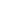

# Filament Tracking & Spoolman

HelixScreen keeps track of what filament is loaded and how much of it is left: the material, brand, color and remaining weight of each spool. It does this in two ways. A built-in tracker works on its own, and a deeper integration is available if you run a [Spoolman](https://github.com/Donkie/Spoolman) server for your filament inventory.

This page explains what is tracked in each mode, how remaining weight is kept up to date, and how to connect Spoolman. For the hands-on filament controls (load, unload, purge, AMS slots), see [Filament Management](filament.md).

---

## The Two Modes

| | Without Spoolman | With Spoolman |
|---|---|---|
| **What you set** | Material, color, brand and remaining weight per spool, entered on the touchscreen | The same details, filled in from your Spoolman inventory when you link a spool |
| **Where it is stored** | On the printer, so it survives restarts and reboots | In your Spoolman database, shared with every tool that reads it |
| **How usage is tracked** | HelixScreen estimates it from how much filament each print uses | Spoolman subtracts usage itself, through Moonraker; HelixScreen shows the result |
| **Best for** | One printer and no inventory system | Many spools, or more than one printer |

Everything works without Spoolman. Connecting it later adds the inventory and does not erase anything.

---

## Tracking Without Spoolman

Nothing needs to be turned on.

### Telling HelixScreen what is loaded

**A single spool (no multi-filament system):** tap the spool icon on the Filament panel to set up the **external spool**: material, color and brand. Once it is set, the preset heat buttons, the purge temperature and the **Active Spool** widget on the Home panel all use it. See [External Spool Configuration](filament.md#external-spool-configuration).

**A multi-filament system:** each slot has its own material, color, brand and remaining weight. Systems that read a spool's tag (Creality CFS, Snapmaker U1) fill these in when you seat a spool. On other systems, tap a slot and choose **Edit Spool** to enter them yourself. See [Editing Filament Properties](filament.md#editing-filament-properties).

### Where a lane's details come from

HelixScreen keeps no private copy of your lanes. A lane shows, in this order of priority:

1. **What your filament system holds.** AFC, Happy Hare, the CFS, the ACE, the QIDI Box, the AD5X and the Snapmaker U1 each remember some details of a spool themselves, at least color and material.
2. **The lane record on the printer.** Brand, spool name, weights and, where the system cannot hold it, the Spoolman link are kept in a record that OrcaSlicer, Mainsail, Fluidd and other screens read too. OrcaSlicer 2.3.2 and later keeps its filament panel in step with it. See [Syncing with OrcaSlicer](filament.md#syncing-with-orcaslicer-232-and-later).
3. **Spoolman**, for the spool the lane is linked to. It fills in only what the first two leave blank. Remaining weight is the exception: for a linked spool, Spoolman's weight comes first.

Because everything lives on the printer:

- **A second screen agrees with this one.** Another HelixScreen, Mainsail or Fluidd showing the same printer sees the same lanes, and a change made on any of them shows up here within about ten seconds.
- **Saving waits for the printer.** The spool editor shows **Saving...** and closes once the printer has the new details. If the printer cannot take them, the editor stays open, keeps what you typed and shows a line under Save, for example **Not saved: the printer did not confirm it. Try again.** Nothing is queued to retry later.
- **Editing waits for the connection.** While HelixScreen is connecting or reading the lanes for the first time, **Edit Spool** is unavailable and the editor shows **Loading lane details...**. While the printer is disconnected, edits are refused.

### How remaining weight is estimated

When a spool has a known remaining weight, HelixScreen keeps it current as you print:

- When a print starts, it takes the spool's current weight as the starting point.
- While the print runs, it follows the filament length the printer reports as used and converts it to grams using the material's density and your printer's configured filament diameter. The remaining weight on screen drops as the print goes.
- The new weight is saved to the printer about once a minute during the print, and again when the print pauses, finishes, is canceled or fails.
- If you edit the spool's weight during a print, HelixScreen starts counting again from the number you entered.

On a multi-filament system with one extruder (Happy Hare, CFS, ACE, AD5X and similar), only the loaded slot is charged. On a tool changer, each tool's own extruder charges the slot it is assigned to.

This is an **estimate**, not a scale reading, so it is only as accurate as the starting weight and material you entered. A spool is skipped, and its weight does not change, when:

- its material is not one HelixScreen knows the density of, or its remaining weight is unknown;
- it is linked to a Spoolman spool, because Spoolman does the counting for it;
- it is the external spool and the printer has a load cell set up to weigh it (the load cell is used instead).

If your filament system reports a weight itself, for example from a spool tag, the screen shows that number in place of the estimate.

---

## Tracking With Spoolman

Spoolman is a free, self-hosted filament inventory manager. With it connected, HelixScreen becomes a front end to your spool library: link real spools to the printer, browse your inventory on the touchscreen, and let Spoolman keep the record of how much each spool has left.

HelixScreen talks to Spoolman **through Moonraker**. You give HelixScreen your Spoolman address, and it configures Moonraker to relay the requests.

### Connecting Spoolman

You need a running Spoolman server on your network. Then, on the printer:

1. Open **Settings > Devices > Spoolman**.
2. Under **Server Setup**, enter your server's **IP Address / Hostname** and **Port** (the port starts as `7912`).
3. Tap **Connect**.

HelixScreen checks that the server is reachable and sets up Moonraker for you; you do not edit `moonraker.conf` by hand. Once connected, the page shows **Spoolman Server** with **Change** and **Remove** buttons. **Remove** asks you to confirm, then takes the Spoolman setting out of Moonraker and restarts that service.

Every setting on that page is described in [Settings > Devices > Spoolman](settings/devices.md#spoolman).

### Weight sync

With Spoolman connected, HelixScreen does not subtract weight itself for linked spools. Spoolman does, against the **active spool**, as the print runs. HelixScreen reads the new weight back so the screen stays current:

- **Sync with Spoolman**, under **Settings > Devices > Spoolman > Weight Sync**, is on by default and turns this reading on or off.
- Weights are also read again whenever a print starts, pauses or completes.
- **Refresh Interval** offers 30 s, 1 min, 2 min and 5 min. In 1.1 the choice is saved but the screen still checks every 30 seconds whichever you pick.
- On a printer with several tools or lanes, turn on **Switch spools at each tool change** (same page) so each tool's filament is charged to that tool's spool. See [Switch spools at each tool change](settings/devices.md#switch-spools-at-each-tool-change).

HelixScreen writes to Spoolman only when you make a change (linking a spool, editing a spool, creating one, saving a pressure advance value), and when it switches the active spool as described below.

> **What the printer holds comes first.** A lane shows what your filament system or the printer holds for it. Spoolman's details fill in only what the printer leaves blank (remaining weight excepted), and only for the spool the lane is linked to. A color set on the printer's own menu (on an AD5X, for example) therefore shows on the lane even when a Spoolman spool is linked.

1. Sync with Spoolman.
2. Refresh Interval.
3. Switch spools at each tool change.

### Browsing and linking spools

With Spoolman connected, **Advanced > Spoolman** opens the spool inventory:

- **The list.** Every spool in your Spoolman database, each with a color-coded spool picture, its weight and the percentage left. A warning icon marks any spool under 100 g. The title shows how many spools there are.
- **Search and filter.** Type in **Search spools...** to find a spool by vendor, material, filament name, location or ID number. When any spool has a storage location, a location dropdown appears beside the search box.
- **Refresh and add.** The round refresh button in the header reloads the list. **+ Add** creates a spool (below).
- **The spool menu.** Tap a spool for **Set Active**, **Edit**, **Print Label** (which asks you to set up a label printer first if you have none), **Duplicate**, **Archive** and **Delete**. Archive asks you to confirm and can be undone from Spoolman's own web page. It is not offered for the active spool.
- **Set Active** tells Spoolman and HelixScreen that this is the spool feeding the printer. The Home panel's **Active Spool** widget shows it.
- **Link a spool to a slot.** Tap a slot and choose **Select Spool**, or tap the Spoolman button in the spool editor's header, to pick from Spoolman and fill in that slot's brand, material, color and temperatures. A spool already linked to another slot is grayed out. See [Editing Filament Properties](filament.md#editing-filament-properties).
- **Scan to link.** Scan a QR-coded spool label to look the spool up and link it. See [Barcode Scanner](barcode-scanner.md) and [Label Printing](label-printing.md).

### Adding a spool

Tap **+ Add** to start **New Spool**, which has three steps:

1. **Vendor.** Search your vendors or tap **+ New**. When your Spoolman server offers it, matches from SpoolmanDB (Spoolman's public catalog) are listed under **From SpoolmanDB**.
2. **Filament.** Choose an existing filament or tap **+ New** to create one with its material, color, temperature ranges and weight.
3. **Spool details.** Set **Remaining Weight (g)**, **Price**, an optional lot number and optional notes, then tap **Create Spool**.

HelixScreen creates the vendor, filament and spool in Spoolman together, so the new spool is ready to link right away.

### Which spool Spoolman charges on a multi-filament system

Moonraker records usage against one spool at a time: Spoolman's **active spool**. If no spool is active during a print, no spool is charged. On a system with lanes (CFS, AFC, Happy Hare, QIDI Box, ACE and others), HelixScreen sets the active spool for you:

- **When a lane becomes the loaded one** and is linked to a Spoolman spool, that spool becomes active. This happens on every load, including reloading the same spool.
- **Linking a spool to the lane that is already loaded** makes it active straight away; you do not need to unload and reload.
- **Only the link counts.** Names play no part: a spool whose filament Spoolman calls "RePETG" is charged the same as one called "PETG", whatever your slicer profile is named.
- **A print started before the lane was linked is not tracked**, and neither is a print from a lane with no linked spool. Link the spool first, then print.
- **Unloading does not clear the active spool.** The last one set stays active until another is set.

Some systems set the active spool themselves, and HelixScreen leaves it to them: **AFC**, **Happy Hare** when its own Spoolman support is on, and **INDX** when its tool-change macros set the spool. On the **AD5X IFS**, HelixScreen never changes the active spool on its own; it changes only when you set it.

> **Creality CFS:** a CFS lane counts as loaded once the toolhead's filament sensor sees filament from it. While a load is still feeding, the Active Spool widget shows no spool; the lane's spool is active by the time the filament reaches the toolhead.

### Spools named by a tag

On systems that read a spool's tag, a tag that names a Spoolman spool links the slot to that spool, just as picking it by hand would. A tag naming a spool Spoolman does not have gets a short notice and leaves the slot alone. **Link Spools from Tags** in the filament system's settings turns this off.

### Pressure advance per filament

> Added in 1.1.

When you finish a [pressure advance test tower](calibration.md#pressure-advance-tuning-test-tower), **Save to Spool** stores the value on that spool's **filament** in Spoolman, in an extra field named `pressure_advance` (HelixScreen creates the field the first time). Every spool of that filament shares it.

Afterwards, when a spool of that filament becomes active, HelixScreen sets that pressure advance on the extruder the spool feeds (on a tool changer, the tool the spool is assigned to). It does this only when nothing is printing, so a pressure advance your slicer sets at the start of a print wins for that print.

**Getting it into OrcaSlicer.** OrcaSlicer does not read Spoolman directly. [spoolman2slicer](https://github.com/bofh69/spoolman2slicer) turns your Spoolman filaments into OrcaSlicer profiles, and its templates already read the `pressure_advance` field. HelixScreen also keeps the latest results in Moonraker's database for slicer plugins to read.

---

## Seeing How Much Is Left

However it is tracked, remaining filament shows in the same places:

| Where | What it shows |
|---|---|
| **Active Spool** widget (Home panel) | The loaded spool's color, material, brand and, at wider sizes, remaining and total weight, for example 750g / 1000g. Works with or without Spoolman |
| **Multi-filament system screens** | Remaining weight of the loaded slot and of each slot |
| **Edit Spool** editor | The slot's remaining weight, and its full weight when known |
| **Spoolman inventory** | Weight and percentage left for every spool, with a warning icon under 100 g |

**Running out** mid-print is caught by your filament sensors and multi-filament hardware, not by the weight number. The printer's firmware pauses the print and HelixScreen guides you through reloading. On **AFC** and **Happy Hare**, a backup slot you configured can take over automatically (Endless Spool). On the **Creality CFS**, **Auto-Refill** is run by the box and always pauses first: it switches only when Auto-Refill is on and another slot holds the exact same material and color. See [Reading Error States](filament.md#reading-error-states), [Slot Context Menu](filament.md#slot-context-menu) and [Sensors](sensors.md).

> **Tip:** The remaining weight is only as good as the starting number. When you load a fresh spool, set its weight (enter the grams in the Edit Spool editor, or link a fresh Spoolman spool) so the estimate starts from the right place.

---

## Which Should I Use?

- **Want the touchscreen to know what is loaded and roughly how much is left?** The built-in tracking does that with nothing to install.
- **Juggling many spools, or several printers?** Run Spoolman for a real inventory shared by everything that talks to Moonraker.

---

## See Also

- [Filament Management](filament.md): load and unload, AMS slots, drying and humidity, and the spool editors
- [Settings > Devices > Spoolman](settings/devices.md#spoolman): every Spoolman setting in one place
- [Sensors](sensors.md): filament runout and motion sensors
- [Barcode Scanner](barcode-scanner.md): scan Spoolman QR codes
- [Label Printing](label-printing.md): print spool labels that link back to Spoolman

---

**Next:** [Bluetooth Setup](bluetooth-setup.md) | **Prev:** [Filament Management](filament.md) | [Back to User Guide](../USER_GUIDE.md)
