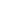

# Filament Management

---

## External Spool Configuration

If you're not using an AMS or multi-material system, you can tell HelixScreen what filament is loaded by configuring an **external spool**. Tap the spool icon on the Filament panel to set the material, color, and brand. If Spoolman is configured, you can also link to a specific Spoolman spool. To take the spool off again, open it and tap **Clear Spool** below the form. The external spool is saved on the printer, in Moonraker's database, so every screen and slicer connected to the printer sees the same spool, and a change made on one shows on the others within about ten seconds. A spool whose filament carries a tuned pressure advance applies it when it becomes active; see [Pressure advance per filament](filament-tracking.md#pressure-advance-per-filament).

Once configured, the external spool information is used throughout the UI:

- **Spool preset button**: A dynamic preset button appears in the Filament panel's preset grid, between TPU and Cool Down, with your spool's material name and recommended temperatures. Tap it to pre-heat both the nozzle and bed to the correct temperatures for your loaded filament.
- **Temperature panel presets**: The Nozzle and Bed temperature panels also show a spool preset button for quick one-tap heating.
- **Purge temperature**: When you tap **Purge**, HelixScreen passes a nozzle temperature to the purge macro (as the `PURGE_TEMP` parameter): the nozzle's current target or the spool's recommended temperature, whichever is hotter. A temperature at or below your printer's minimum extrusion temperature, or above your hotend's maximum temperature, is never passed; the parameter dialog asks instead.

The spool preset button only appears when the loaded material differs from the standard presets (PLA, PETG, ABS, TPU). For standard materials, just use the built-in preset buttons. Its place in the grid stays empty when it isn't shown, so the other buttons never move.

> **Tip:** The spool preset updates automatically when you change the external spool configuration: no need to close and reopen panels.

> **Tip:** You can change which filament type a preset button controls: long-press it to pick a different material. See [Reassigning a Preset's Filament Type](temperature.md#reassigning-a-presets-filament-type).

---

## Extrusion Panel

Manual filament control:

| Button | Action |
|--------|--------|
| **Extrude** | Push filament through the nozzle |
| **Retract** | Pull filament back |

Pick the **Length** to move first: 5mm, 10mm or 25mm.

> **Safety:** Extrusion requires the hotend to be at minimum temperature (usually 180°C for PLA, higher for other materials). If HelixScreen knows what filament is loaded, either from an [external spool](filament.md#external-spool-configuration) or an active AMS slot, it skips the cold-nozzle safety warning and auto-preheats to the correct temperature instead.

---

## Load / Unload / Purge

The Filament panel has dedicated **Load**, **Unload**, and **Purge** buttons. These run Klipper macros: HelixScreen auto-detects common names like `LOAD_FILAMENT`, `UNLOAD_FILAMENT`, and `PURGE` from your printer config.

If a load, unload or tool change needs the printer homed and it isn't, HelixScreen homes it first and then carries on, without asking. Make sure the bed is clear before you start one on a printer that has been sitting idle with its motors off. When HelixScreen can see that your multi-material system homes on its own (AFC's `auto_home` setting in `AFC.cfg`), it leaves the homing to it.

When the nozzle is too cold to move filament and HelixScreen doesn't know what is loaded, a warning takes the place of the **Operations** heading until the nozzle is hot enough.

### Choosing a tool on a multi-head printer

On a printer with more than one tool (a tool changer, an IDEX or dual-extruder machine, the Snapmaker U1), the multi-filament card at the bottom left of the Filament panel has a dropdown that chooses which tool the panel acts on. Its caption uses your printer's own word for a tool (**Toolhead** on the Snapmaker U1). The closed dropdown shows just the tool's G-code name, such as **T0**; open it to see the full list.

Choosing a tool in the dropdown only aims the panel at it. Nothing moves, and the printer does not change tools. The tool is picked up when you use a button that needs it: **Load**, **Unload**, **Extrude**, **Retract** or **Purge** first pick up the selected tool if it is not the mounted one, then carry on. That pick-up follows **Settings > Printing > Confirm tool changes** (on by default, shown only on multi-tool printers): with it on, the printer asks before switching. A paused print always asks, and the switch is refused while printing, while spools lie on the bed, or while the filament system is waiting for you. If the tool does not arrive, the step is dropped and a message says that nothing was sent.

One button beside the dropdown does the tool change by itself. It reads **Pick up** when the selected tool is not the mounted one, and **Park** when it is mounted and your printer can park a tool in its dock. With a single-head printer, or when neither applies, the button is hidden.

1. The tool drop-down, which aims the panel at a tool and moves nothing.

### Customizing which macro runs

You can override any of these buttons to run a different macro:

1. Go to **Settings > Printing > Macro Buttons**
2. Scroll to the **Standard Macros** section
3. Tap the dropdown for **Load Filament**, **Unload Filament**, or **Purge**
4. Select the **(Auto: ...)** entry, which names the macro HelixScreen detected, to use auto-detection, or pick any macro from your Klipper config

This works whether or not you have an AMS system. If a slot is left empty (no macro detected or configured), the button is disabled.

> **With an AMS system:** by default the Load and Unload buttons drive your filament system directly (slot-based load and unload through the AMS) rather than running a macro. Pick a macro yourself and **your choice wins**: the button runs your macro and the filament system's own handling is skipped for that operation. That is the point of the override, and it is worth knowing what it means, because your macro then owns everything the built-in path would have done, on AFC, for example, `TOOL_UNLOAD` no longer runs, so parking the shuttle and marking the lane are up to your macro. Set the slot back to its **(Auto: ...)** entry to hand the operation back to the filament system.
>
> The Purge button always uses your configured macro.

### When no preheat happens first

Loading or unloading normally heats the nozzle to the material's temperature before the operation starts. HelixScreen skips that preheat when something else already handles the heat, so the nozzle is not heated twice:

- your filament system heats on its own when it loads,
- your configured Load/Unload macro heats the hotend itself, or
- **Allow cold load/unload** is on (Settings > Printing).

### What happens to the nozzle afterward

Loading or unloading heats the nozzle to material temperature. Two minutes after the operation finishes, HelixScreen turns the extruder heater back off: the delay lets you run several operations in a row without the nozzle cooling in between, and a running print is never touched.

If your filament system already handles this (AFC does), turn off **Settings > Printing > Cool nozzle after filament ops** so only one of them is driving the heater. It's a per-printer setting. See [Printing settings](settings/printing.md#cool-nozzle-after-filament-ops).

### Loading on a QIDI (M604)

QIDI's own load macro, `M604`, is only the first step of a wizard that QIDI's stock screen walks you through. HelixScreen runs the whole wizard, so a load from the Filament panel finishes on the screen instead of stopping with a hot nozzle and filament that nothing has gripped:

1. Tap **Load**. The printer heats the nozzle and parks over the waste chute.
2. A **Load Filament** dialog asks you to push the filament into the extruder until it stops. It is gripped as soon as the filament sensor sees it, or tap **Extrude** to feed it yourself.
3. Once it has fed, the dialog asks **Is new filament coming out of the nozzle?** Tap **Extrude more** to push more through, or **Done** when the new color runs clean.

However the dialog ends, with **Done** or **Cancel**, HelixScreen cools the nozzle and turns the filament sensor back on, which the stock macro leaves off. An unload with QIDI's `M603` turns the sensor back on afterward too. On firmware older than 01.01.02.x, which has no push-in step, the dialog opens straight on the question.

With a QIDI Box, box slots load and unload the way the stock screen does them.

---

---

## AMS / Multi-Material Systems

1. The gear, which opens Multi-Filament System Management.
2. What is loaded now.
3. Load, Unload, Reset and the other actions.

A printer with a multi-material system (Happy Hare, AFC, OpenAMS, ACE, a tool changer, the Snapmaker U1, the Creality CFS, the AD5X IFS, the QIDI Box) gets a Filament System panel that draws your slots and the filament path. Tap **Manage** on the Filament panel's multi-filament card to open it; on a multi-head printer the card has the tool dropdown instead. The panel's header has a gear that opens Multi-Filament System Management. The details live on their own pages:

| Topic | Page |
|-------|------|
| Slot view, sidebar, load and unload, bypass, the slot menu, the spool editor, Endless Spool, the management screen | [The Filament System Panel](filament-ams-panel.md) |
| Which slot feeds which tool, for one print or as a standing table; syncing with OrcaSlicer | [Filament Mapping](filament-mapping.md) |
| Creality CFS, tags, auto-refill, the external spool | [Creality Filament System](filament-cfs.md) |
| Snapmaker U1 and MedusaHC | [Snapmaker U1 and MedusaHC](filament-tool-changers.md) |
| Heated boxes, humidity, drying cycles | [Filament Drying and Humidity](filament-drying.md) |

### Where each topic lives

The headings below are short pointers, so older links keep working.

#### Sidebar

The loaded-filament strip, the step progress and the action buttons: see [The Filament System Panel](filament-ams-panel.md#sidebar).

#### Reading Error States

Error dots, buffer tints and recovery steps: see [Reading Error States](filament-ams-panel.md#reading-error-states).

#### When Bypass Doesn't Appear

Which systems report no bypass, and the **Enable Bypass Controls** setting: see [When Bypass Doesn't Appear](filament-ams-panel.md#when-bypass-doesnt-appear).

#### Switching Toolheads from the Filament Path

Tap a toolhead that is not mounted on the filament path to switch to it: see [Switching Toolheads from the Filament Path](filament-ams-panel.md#switching-toolheads-from-the-filament-path).

#### Slot Context Menu

What tapping a slot offers: see [Slot Context Menu](filament-ams-panel.md#slot-context-menu).

#### Editing Filament Properties

The spool editor: see [Editing Filament Properties](filament-ams-panel.md#editing-filament-properties).

#### Filament Mapping

Choosing which slot feeds each tool: see [Filament Mapping](filament-mapping.md#filament-mapping).

#### Printers that map filament by rewriting the file

Printers whose firmware cannot remap a tool, such as a MedusaHC: see [Printers that map filament by rewriting the file](filament-mapping.md#printers-that-map-filament-by-rewriting-the-file).

#### Syncing with OrcaSlicer (2.3.2 and later)

How slot edits reach OrcaSlicer: see [Syncing with OrcaSlicer](filament-mapping.md#syncing-with-orcaslicer-232-and-later).

#### Toolhead Offset Calibration

The Snapmaker U1's offset calibration: see [Toolhead Offset Calibration](filament-tool-changers.md#toolhead-offset-calibration). Other tool changers use [Tool Offsets](calibration.md#tool-offsets).

#### Creality Filament System (CFS)

See [Creality Filament System](filament-cfs.md).

#### CFS and the External Spool

See [CFS and the External Spool](filament-cfs.md#cfs-and-the-external-spool).

#### Filament Drying and Humidity

See [Filament Drying and Humidity](filament-drying.md).

---

## Multiple Filament Systems

HelixScreen supports running multiple filament management backends at the same time. For example, a toolchanger printer might use both a Tool Changer backend and Happy Hare for different parts of the filament path.

When multiple backends are detected:

- A **backend selector** appears at the top of the AMS panel
- Tap to switch between systems (e.g. "Happy Hare" vs "Tool Changer")
- Each backend has its own slots and status display
- Slot assignments and controls are independent per backend

**Supported system types:**

| System | Description |
|--------|-------------|
| **CFS** | Creality Filament System (K2 series, plus K1/K1C/K1 Max with the official CFS upgrade) |
| **Happy Hare** | MMU2, ERCF, 3MS, Tradrack, EMU |
| **AFC** | Box Turtle, OpenAMS, ViViD |
| **OpenAMS** | klipper_openams without AFC. Needs a klipper_openams version that publishes its UI API; Load and Unload also need the `OPENAMS_LOAD` / `OPENAMS_UNLOAD` macros from its `oams_macros.cfg` |
| **ACE** | Anycubic ACE Pro (via ValgACE/BunnyACE/DuckACE Klipper drivers) |
| **Tool Changer** | Toolchanger-based filament routing |
| **AD5X IFS** | FlashForge Adventurer 5X Intelligent Filament Switching (requires ZMOD firmware v1.7.0 or newer) |
| **SnapSwap** | Snapmaker U1 4-toolhead changer (parallel, one independent toolhead per slot) |

Each system displays its own logo in the AMS panel header. Happy Hare and AFC show their firmware logos; specific hardware variants (ERCF, Box Turtle, ViViD, the QIDI Box, etc.) show hardware-specific logos when detected.

With a single backend there is no selector: the panel just shows that system.

---

## Spoolman Integration

Spoolman is an optional filament-inventory server. Once it's connected, the AMS panel shows saved spool data on each slot and lets you assign spools straight from your inventory:

- Spool name and material type shown per slot
- Remaining filament weight shown
- Tap a slot's **Select Spool**, or **Edit Spool** and the Spoolman button in its header, to assign a saved spool. See [Editing Filament Properties](#editing-filament-properties) and the [Slot Context Menu](#slot-context-menu)

Connecting a server, the full spool-inventory panel, the new-spool wizard, and how remaining weight is tracked all live on their own page: **[Filament Tracking & Spoolman](filament-tracking.md)**.

---

## See Also

- [Filament Tracking & Spoolman](filament-tracking.md): How remaining weight is tracked, with and without Spoolman, and how to connect a Spoolman server
- [Temperature Control](temperature.md): Preheat presets work with spool material info
- [Bluetooth Setup](bluetooth-setup.md): Required for Bluetooth-connected AMS and label printers
- [Label Printing](label-printing.md): Print physical spool labels with Spoolman data
- [Settings: Devices](settings/devices.md): AMS, Spoolman, and filament sensor configuration

---

**Next:** [Filament Tracking & Spoolman](filament-tracking.md) | **Prev:** [Motion & Positioning](motion.md) | [Back to User Guide](../USER_GUIDE.md)
