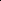
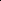
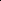
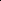
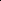
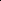
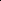

# Getting Started

HelixScreen is a touchscreen interface for Klipper 3D printers. It talks to your printer through Moonraker and gives you printing, temperature, motion, filament and calibration controls on the screen.

This page covers the first start: the setup wizard, finding your way around, and typing on the touchscreen.

---

## Quick Reference



1. **Home**: the printer at a glance.
2. **Controls**: motion, temperatures and fans.
3. **Filament**: loading, unloading and filament system slots.
4. **Settings**: the screen, the printer and HelixScreen.
5. **Advanced**: calibration and other tools.

| Navigation bar icon | Panel | What you do there |
|---------------------|-------|-------------------|
| House | Home | Watch the printer, start prints, see temperatures |
| Sliders | Controls | Move axes, set temperatures, run fans |
| Spool | Filament | Load and unload filament, manage filament system slots |
| Gear | Settings | Set up the screen, the printer and HelixScreen |
| Three dots | Advanced | Calibration, history, macros, console and other tools |

---

## Navigation Basics

- **Navigation bar**: five buttons that switch between the main panels. It runs down the left edge in landscape and along the bottom in portrait.
- **Home button**: brings you back to the Home panel, on the page you last viewed. Tap it again while you are on Home to jump to the first page.
- **Back arrow**: closes a sub-screen and returns to the one it opened from.
- **Controls and Filament** are grayed out until HelixScreen is connected and Klipper is ready.
- **More buttons can appear in the bar**: an emergency stop while a print is running, a bed-drying button while spools are drying on the bed, and a printer switcher if you turn it on (see [Adding Another Printer](#adding-another-printer)).

To pick a file to print, tap the print area on the Home panel. There is no separate print button in the navigation bar.

---

## Touch Screen Basics

| Gesture | What it does |
|---------|--------------|
| **Tap** | Press buttons, open screens, flip switches |
| **Swipe** | Scroll lists and long pages |
| **Swipe left or right on Home** | Move between Home pages |
| **Long press** | Type a key's second character on the keyboard (see [On-Screen Keyboard](#on-screen-keyboard)) |
| **Pinch or spread** | Zoom the 3D G-code preview or the 3D bed mesh on the spot between your fingers |
| **Two-finger drag** | Move a zoomed 3D view around |

Pinch and two-finger drag need a screen that senses two fingers at once. Resistive screens sense one finger, so on those printers (for example the FlashForge Adventurer 5M and 5X, the Creality Nebula Pad, and the Ender-3 V3 and V3 KE) a one-finger drag turns the 3D views but they do not zoom or pan. On the bed mesh, pinching all the way out returns to the full view.

Temperatures on the Home panel are shortcuts: tap the nozzle or bed temperature to open its temperature screen.

---

## Connection Status

The printer picture on the Home panel shows whether HelixScreen can reach your printer:

| What you see | Meaning |
|--------------|---------|
| Picture in full color | Connected and ready |
| A red "no entry" sign over the picture | Not connected to Moonraker. HelixScreen keeps trying to reconnect on its own. |
| Picture dimmed, with an orange warning sign | Klipper has shut down. A firmware restart is usually needed. |
| Picture dimmed, no sign | Klipper reports an error. |

When Klipper stops, a dialog says why and offers **Restart Klipper** and **Firmware Restart**.



---

## First-Time Setup

The first time HelixScreen starts, a setup wizard walks you through the settings it needs. It shows only the steps that apply to your hardware, and its "Step 3 of 8" counter counts only those.

To run the whole wizard again later, use **Settings > System > Factory Reset**. That erases your HelixScreen settings, so read [System settings](settings/system.md) first.



1. **Share Usage Data**: your answer to the wizard's usage statistics question, which you can change here.
2. **Factory Reset**: erases your HelixScreen settings and runs the wizard again.

### The Wizard Steps

These are the steps in the order they appear. Each one is shown only when its condition is true.

| Step (title on screen) | When it appears |
|------------------------|-----------------|
| **Printer Setup: Touch Calibration** | Your touchscreen needs calibrating (usually a resistive screen) and has not been calibrated yet. See the [Touch Calibration guide](touch-calibration.md). |
| **Printer Setup: Language** | No language other than English has been chosen on this screen yet. |
| **Printer Setup: Network** | Always on the first printer, except in the Android app. |
| **Printer Setup: Connection** | Always. |
| **Printer Setup: Identity** | Your printer has no ready-made profile (see [Preset Setup](#preset-setup)). |
| **Printer Setup: Heaters** | Your printer has no ready-made profile. |
| **Printer Setup: Fans** | Your printer has no ready-made profile. |
| **Multi-Filament System Detected** | A filament system such as an AMS, CFS or Happy Hare unit is found, and your printer has no ready-made profile. |
| **Printer Setup: LEDs** | LED lights are found, and your printer has no ready-made profile. |
| **Printer Setup: Filament Sensor** | Two or more filament sensors are found, and your printer has no ready-made profile. With exactly one, HelixScreen uses it for runout on its own. |
| **Printer Setup: Input Shaping** | An accelerometer is found, and your printer has no ready-made profile. |
| **Preferences** | Always. A few on/off choices you can change later in Settings. |
| **Printer Setup: Review** | Your printer has no ready-made profile, or you are adding another printer. |
| **Help Improve HelixScreen** | Your printer has a ready-made profile and this is your first printer. It takes the place of the Review step. |

You can go back to an earlier step with **Back** at any time. When you finish, HelixScreen opens the Home panel, your main dashboard. See the [Home Panel guide](home-panel.md).

### Network


This step connects the screen itself to WiFi. If you use Ethernet, the left side shows your wired connection; tap **Next** to move on.

1. Wait for **Available Networks** to fill in.
2. Tap your network.
3. Type the password with the on-screen keyboard.
4. Tap **Connect** and wait until it says you are connected.

A network that hides its name never appears in the list. Tap **Add Hidden Network** below the list and type its name, security type and password instead.

**Band badges.** A network row can carry a small `2.4G`, `5G` or `2.4/5G` badge, telling you which radio band the network uses. This matters when a dual-band router uses one name for both bands: the screen joins whichever band it connects on. Badges appear only when the scan found networks on more than one band. A screen whose WiFi only supports 2.4GHz shows `(2.4GHz)` next to the WiFi label in Network Settings.

**After setup**, change WiFi in **Settings > Connection > Network Settings** (see [Connection Settings](settings/connection.md#network-settings)). There you can pick another network, add a hidden one, or turn WiFi off.

**Forgetting a network.** In Network Settings, the connected network has a trash icon next to its name. Tap it and confirm to remove the network and its password from this screen. You need the password again to reconnect. Do this before you give a screen away, or when the router's password changed and reconnecting keeps failing.

**Where passwords are kept.** WiFi passwords stay on the screen itself: in the system's own WiFi settings where that is possible, otherwise in a file named `wifi_networks.json` in HelixScreen's config folder that only HelixScreen's user account can read. That file is never included in a debug bundle. Forgetting a network removes it from both places.

### Connection


1. **Network Address**: the printer's hostname or IP address.
2. **Port**: the Moonraker port, usually `7125`.
3. **Test Connection**: checks the address and port and shows the result on this step.

This step tells HelixScreen where your printer's Moonraker is.

- **Screen on the printer itself**: HelixScreen finds Moonraker on the same machine and connects without any typing.
- **Separate screen**: pick your printer under **Discovered Printers**, or type its address under **Or Enter Manually**, then tap **Test Connection**.

The fields:

- **Discovered Printers**: while this step is open, HelixScreen looks for Moonraker on your home network (up to 254 neighboring addresses, on ports `7125` and `80`, plus any printer that announces itself) and lists what it finds. Tapping one fills in the address and port. A printer on a different network segment does not appear; type its address instead.
- **Network Address**: your printer's hostname or IP address, for example `voron.local` or `192.168.1.100`.
- **Port**: leave it as HelixScreen filled it in (`7125`), or empty. HelixScreen then tries `7125` first and `80` second, for printers whose Moonraker sits behind a web server, and switches the field to `80` when that is the one that answers. A different port you type is the only one tried.
- **API key**: appears only when your printer's Moonraker asks for a login, or when a key is already saved.

**Test Connection** is the answer to any doubt during setup. Until the wizard is finished, a separate screen has no printer address except "this machine", so it cannot reach Moonraker yet. That is expected, and the wizard does not interrupt you with connection errors while you set up. **Test Connection** checks the address you typed and reports the result on this step.

To point HelixScreen at a different printer address later, use **Settings > Connection > Host** (see [Connection Settings](settings/connection.md#host)).

### Picking Your Printer Model



The **Printer Setup: Identity** step lists every printer HelixScreen knows. Type in the search box to filter by model or brand, or tap a brand tile (Creality, Prusa, Voron and so on) to see only that brand's printers, and tap **Back** to return to the tiles.

If HelixScreen already recognized your printer, the step opens on it, inside its brand's list. If several models match equally well, it starts on those, and the one you pick is saved. A model picked wrongly here can be fixed later without running the wizard again; see [Supported Printers](supported-printers.md).

### Preset Setup

Many printers have a ready-made profile in HelixScreen, for example the Creality K1 and K2 series, the FlashForge Adventurer 5M and 5X, the Snapmaker U1 and the QIDI Q2. When HelixScreen recognizes one of these, it already knows the heaters, fans and other hardware, so the wizard is shorter: it skips the Identity, Heaters, Fans, filament system, LEDs, Filament Sensor and Input Shaping steps, and ends with **Help Improve HelixScreen** instead of the Review step.



**Help Improve HelixScreen** asks whether to send anonymous usage statistics. No personal data is collected, and you can change your answer later in **Settings > System > Share Usage Data**. The [Telemetry guide](../TELEMETRY.md) lists what is and is not sent.

On a printer without a profile you see the full set of hardware steps, ending with Review.

### Preferences



This step offers a few on/off choices: opening the slot editor when you load a new spool, and turning the nozzle heater off after a load or unload. On your first printer it also offers text labels on Home widgets and letting the screen sleep during a print, plus **Sounds** where the screen can play sound. Two filament-system choices appear only when your filament system uses them. Every choice here is also in Settings, so nothing you pick is final.

### Adding Another Printer



1. **Show Printer Switcher**: adds a printer button to the navigation bar.
2. **+ Add Printer**: runs the setup wizard for another printer.

One screen can control several printers. Open **Settings > Connection > Printers** and tap **+ Add Printer**. The wizard runs again for the new printer, without the Network and Language steps, which belong to the screen and are already set.

On the first step of an added printer the button reads **Cancel** instead of **Back**. Tapping it drops the new printer and takes you back to the one you were using.

To switch printers from any screen, turn on **Show Printer Switcher** on the same screen. A printer button then appears in the navigation bar.

---

## On-Screen Keyboard

The keyboard opens on its own when you tap a text field.

- Letters are laid out QWERTY. There is no number row: hold a top-row letter to type its number.
- **?123** switches to numbers and symbols, and **#+=** to more symbols.
- **XYZ** switches back to letters.
- **Shift** switches to capitals.

### Long-press characters

Every letter key has a second character, shown small and gray in its top-right corner. Hold the key to type it, without switching layers.

| Hold | Get | Hold | Get | Hold | Get |
|------|-----|------|-----|------|-----|
| `q` | `1` | `a` | `@` | `z` | `*` |
| `w` | `2` | `s` | `#` | `x` | `"` |
| `e` | `3` | `d` | `$` | `c` | `'` |
| `r` | `4` | `f` | `_` | `v` | `:` |
| `t` | `5` | `g` | `&` | `b` | `;` |
| `y` | `6` | `h` | `-` | `n` | `!` |
| `u` | `7` | `j` | `+` | `m` | `?` |
| `i` | `8` | `k` | `(` |  |  |
| `o` | `9` | `l` | `)` |  |  |
| `p` | `0` |  |  |  |  |

The comma and period keys beside the space bar carry three characters each:

| Hold | Get | Also there when you slide |
|------|-----|---------------------------|
| `,` | `=` | `<` and `>` |
| `.` | `/` | `[` and `]` |

For Klipper macros, the four worth remembering are **hold `f` for `_`**, **hold `h` for `-`**, **hold `j` for `+`** and **hold `,` for `=`**. They cover most macro names and parameters.

While you hold a key, its characters pop up above it. Slide onto one and lift to type it, or lift where you are to type the first one. To cancel, slide well away from the key before you lift.

On the comma and period keys, the character you pick becomes the new first choice. Hold `,`, slide to `<`, and from then on a plain hold of `,` types `<`, with the key's corner mark updated to match. This lasts until HelixScreen restarts.

---

## USB Mouse and Keyboard

HelixScreen finds USB mice and keyboards that are plugged in when it starts.

- **Mouse**: works alongside the touchscreen. A small white dot shows the pointer.
- **Keyboard**: handy for WiFi passwords and console commands.
- **Combined devices**, such as a keyboard with a built-in trackpad: both parts work.

Plug devices in before HelixScreen starts. A device plugged in later is not picked up until you restart HelixScreen.

If HelixScreen does not find your device, name it yourself in `helixscreen.env`, in the `config` folder inside HelixScreen's install folder:

```bash
HELIX_MOUSE_DEVICE=/dev/input/event4
HELIX_KEYBOARD_DEVICE=/dev/input/event5
```

To find the right `event` number, run `cat /proc/bus/input/devices` and look for your device's name.

---

## Desktop Shortcuts

When HelixScreen runs in a window on a computer (see [Run HelixScreen in a Window on a Linux Desktop](install-linux-desktop.md)), these keys work while no text field is selected:

| Key | Action |
|-----|--------|
| **S** | Save a screenshot (to `/tmp`, as `ui-screenshot-...`) |
| **D** | Switch between dark and light mode |
| **M** | Show or hide the memory statistics overlay |
| **Cmd+Q** / **Win+Q** | Quit |

---

**Next:** [Supported Printers](supported-printers.md) | [Back to User Guide](../USER_GUIDE.md)
