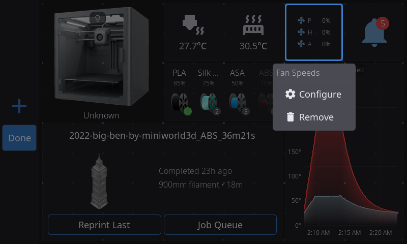
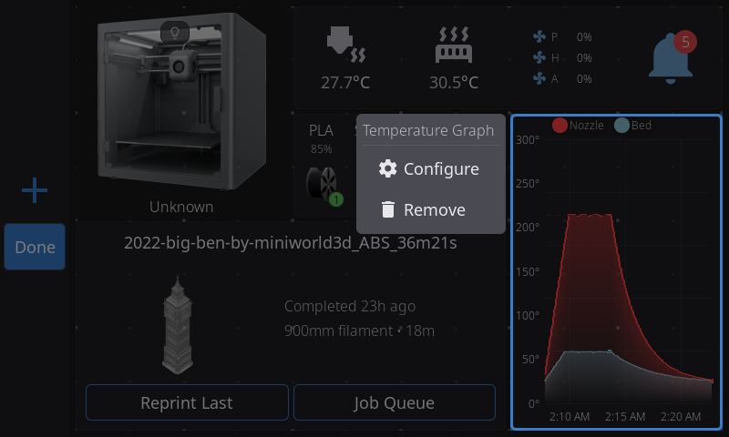

# Home Panel: Edit Mode

Edit Mode is how you customize the dashboard. While you are in it, widgets stop responding to taps, so you can touch anything without triggering it. Everything you change saves automatically.

> **Edit Mode is on by default.** If it starts by accident, for example when a finger rests on a tablet lying flat, you have two options. Turn it off entirely with **Settings > Touch & Input > Allow Home Screen Editing**, or raise **Settings > Touch & Input > Long Press Time** (500 ms by default, adjustable from 300 to 1500) so a longer hold is needed. Both take effect immediately.

**Swiping between pages** works in Edit Mode as it does outside it: between your pages, plus the Add page tile past your last one, and never further. Swiping pauses from the moment your finger lands on the selected widget until you lift it, while you drag or resize a widget, and while the Widget Catalog is open. To take a widget to another page, drag it across the page border (see [Moving a Widget to Another Page](#moving-a-widget-to-another-page)).

## Entering Edit Mode

**Long-press** (press and hold for the Long Press Time, half a second by default) **anywhere on the widget grid**. You will see:

- A faint **grid of dots** showing the grid. **Every dot you can see is somewhere the selected widget may land** (see [Snapping and half cells](#snapping-and-half-cells)).
- **Corner brackets** on the widget under your finger, which means it is selected.
- Normal widget taps are disabled, and the navigation bar shows the **+** and **Done** buttons in place of the usual ones.

The widget you long-pressed is selected, not picked up, however long you keep holding. To move it, lift your finger and press it again.

A long press on a control you drag does not start Edit Mode: the arc on a Fan Speeds carousel, and the plate of a homed [Toolhead widget](home-widgets-controls.md#toolhead-widget). Long-press another part of that widget, or another widget, instead.

## Selecting a Widget

- **Tap a widget** to select it. Animated corner brackets pulse at its edges.
- **Tap empty space** to deselect it.
- Only one widget is selected at a time.
- Pressing a widget that is not selected only selects it, even if your finger then slides: a slide across the grid swipes pages rather than dragging a widget.

## Moving a Widget

1. **Select** the widget by tapping it (the widget you long-pressed to enter Edit Mode is already selected).
2. **Press it again and drag.** You can also skip the tap: **press and hold** any widget for the Long Press Time to pick it up, then drag.
3. While you drag, a **snap preview** shows where the widget will land. A **blue (accent) preview** is a valid drop and a **red preview** is invalid, because it would overlap another widget. Carrying a widget past the edge of the grid does not make it invalid: the preview stays at the nearest position inside the grid.
4. **Release** to drop it where the preview showed.
5. If the position is invalid, the widget returns to its original spot and stays selected.

## Moving a Widget to Another Page

1. Start dragging a widget.
2. Carry it past the left or right edge of the page until most of the widget is over the border, or hold your finger near the edge of the widget area for a moment. In landscape, the left edge is the one beside the navigation bar.
3. The neighboring page slides in with the widget still under your finger. At the left edge of your first page no page slides in: letting go there creates a new page in front (see [Adding a Page](home-panel.md#adding-a-page)).
4. Drop the widget where you want it.

**Creating a page by dropping.** Drag a widget past your last page and an empty page slides in. Drop the widget on it and the page is created with the widget on it. Drag back instead and no page is created. At the 8-page limit neither edge creates a page.

**Empty pages remove themselves.** When a page's last widget is moved to another page or removed, the empty page is deleted from your layout. The main page is never removed this way. A page that still holds widgets grayed out because their hardware is not detected is not empty, and stays.

## Resizing a Widget

Almost every widget can be resized, within the smallest and largest sizes in the [Widget Catalog](home-widgets.md) tables.

1. **Select** the widget by tapping it.
2. Look for **thin edge lines** along the sides of the selected widget. These are the resize handles.
3. **Drag from any edge** to resize in that direction.
4. While you drag, a thin border follows your finger exactly, and a grid-snapped preview shows the size you will get.
5. Resizing stops at the grid boundary and stops where it would overlap another widget. A widget refuses a size it cannot draw legibly, and Edit Mode shows that size in red.
6. **Release** to apply the new size. The widget rebuilds at its new dimensions.

Some widgets change what they show with their size. The Digital Clock, for example, shows only the time when the date does not fit, adds the date as soon as it does (1.5x1 is usually enough), and adds the uptime at 2x2 or larger.

If the Widget Catalog says a widget "Needs 2x1 free: remove or shrink a widget first", there is no room for it at its smallest size.

## Snapping and half cells

Widgets move and resize in **half-cell steps**, with these exceptions:

- **Preheat** moves and resizes in half cells across and whole cells up and down.
- **Print Controls** and **Filament Buffer** snap to whole cells in both directions.
- On the smallest panels (480x272 and 480x320), a widget that shows a reading snaps to whole cells, because half a cell cannot hold an icon and a reading side by side. Icon-only tiles such as LED Light, Notifications, Lock Screen and Firmware Restart still go down to half a cell and drop their caption to fit.

Each widget has its own smallest size, listed in the Widget Catalog. Several of the larger widgets need two cells of width at least: Preheat, Print Status, Clog Detection and Tips.

You do not have to remember any of this, because the dot grid shows it. **Whole-cell dots are always drawn. The smaller, fainter half-cell dots between them appear only while a widget that can use them is selected, and only on the axis it can use them on.** If you see the extra dots, you can snap to them.

Half-cell sizes are also why the Widget Catalog sometimes shows a size such as "1.5x1" on a badge.

## Adding a Widget

There are two ways to open the Widget Catalog in Edit Mode:

- Tap the **+** button in the navigation bar (it runs along the bottom of the screen in portrait).
- **Long-press an empty area** of the grid. This also tells HelixScreen where you want the widget to go.

The catalog, titled **Add Widget**, opens on a list of categories: **Print & Status**, **Temperature & Cooling**, **Filament**, **Controls** and **System**, each with its widget count. A sixth **Plugins** row appears only when a plugin has added a home screen tile. Tap a category to see its widgets, and use the **back button** in the header to return to the list without closing the catalog.

A **Search widgets...** box at the top matches widget names and descriptions. Typing switches the list to the matching widgets from every category, and clearing the box brings the category list back.

Widgets this printer cannot use (missing hardware or an unsupported platform) are in their own **Unavailable on this printer** section at the bottom of the category list, each with the reason in parentheses after its name. In search results they appear inline, dimmed, with the same reason. A category whose widgets are all unavailable is hidden.

Inside a category, each entry shows the widget's name and description and a size badge in cells (for example "2x1" is two cells wide and one tall). Widgets already on your dashboard are dimmed and labeled **Placed**.

Tap an available widget to add it. HelixScreen places it near where you long-pressed, or in the best free spot if that area is taken. If there is no room at the widget's usual size, it tries smaller sizes down to the widget's minimum before telling you there is not enough room.

The **Reset** button in the catalog header resets the whole dashboard (see [Resetting to Defaults](#resetting-to-defaults)), and the **From Printer** button copies a printer's own layout (see [Copying the Layout From a Printer's Own Screen](#copying-the-layout-from-a-printers-own-screen)).

## Removing a Widget

1. **Select** the widget you want to remove.
2. Tap the **trash icon** at its upper-right corner.
3. The widget is removed, and a **Widget removed** message appears for a few seconds with an **Undo** button. Tap **Undo** to put the widget back where it was, with its settings. If something has taken its spot, it goes to a free space on its page, and if there is no room it stays removed and says so. Opening the Widget Catalog, deleting a page or tapping **Done** ends the chance to undo.

Removing a widget you can add only once keeps its settings, so adding it back from the catalog brings them back. A widget you can add more than once, such as Fan, Macro Button or LED Light, is added as a new copy each time, and removing a copy you added deletes that copy with its settings.

## Configuring a Widget

Some widgets have settings you change from Edit Mode. When you select one, a **gear icon** appears in its upper-left corner, beside the trash icon in the upper right.

| Widget | What the gear does |
|--------|--------------------|
| **Temperatures** | Switches between Stack and Carousel display modes |
| **Fan Speeds** | Switches between Stack and Carousel display modes |
| **Temperature Sensors** | Opens the sensor list: tick one sensor for the single view or several for the Carousel, and pick an icon |
| **Fan** | Opens the fan picker, where you choose which fan to show |
| **Temperature Graph** | Opens a window where you turn sensors on and off and choose each series color |
| **Macro Button** | Opens a window with three tabs: **Macro** (pick the macro), **Appearance** (icon and color) and **Options** (**Require Confirmation?**, see [Macro Button confirmation](home-widgets.md#macro-button-confirmation)) |
| **Print Status** | Opens the section picker, where you choose which sections to show |
| **Filament Sensor** | Opens the sensor source picker: Auto, Runout, Toolhead or Entry |
| **Power** | Opens the device picker, where you choose the power device, its icon and its color |
| **LED Light** | Chooses which light the button controls, or **All lights** |
| **Toolhead** | Opens the Presets picker for the three preset buttons (see [Toolhead widget](home-widgets-controls.md#toolhead-widget)) |
| **Camera** | Opens the camera window: which webcam to show, rotation and flip (see [Camera widget](home-widgets-print.md#camera-widget)) |
| **Clog Detection** | Opens the Clog Detection settings: detection source, mode and thresholds |

The Z-Offset widget has no gear: its offset, baby steps and **Save** are on the widget itself (see [Z-Offset widget](home-widgets-print.md#z-offset-widget)).

To configure a widget:

1. Enter Edit Mode and tap the widget. Corner brackets and its buttons appear.
2. Tap the **gear icon** in the upper-left corner.
3. For Temperatures and Fan Speeds the widget switches mode at once, and the gear switches it back. Every other widget opens its picker or window, and your choice applies as soon as you make it.

## Resetting to Defaults

Open the Widget Catalog (the **+** button) and tap **Reset** in its header. A **Reset Home Screen?** dialog asks you to confirm. This is a full reset:

- **All pages** collapse to a single page, and any extra pages you created are removed.
- Widget positions, sizes and the set of enabled widgets all return to the defaults.
- **Per-widget settings go too**: display modes, the fan each Fan widget watches, the macro on each Macro Button. The layout is rebuilt from scratch, not adjusted.

The default is made for your screen and your printer rather than being one arrangement stretched to fit. On a typical 800x480 landscape screen you get the **Printer Image** at top left, a row of nozzle and bed temperatures, fans and **Notifications** (in the corner) to its right, your filament system or humidity readout below that, the **Temperature Graph** down the right side and **Print Status** as a wide band across the bottom. Bigger screens get the same shape with more room and add **Tips** as a footer band. Portrait, ultrawide and very small screens have their own layouts: the 320x240 panel on the Creality Hi drops the printer image to make room for a taller Print Status card. Widgets your printer has no hardware for are left out, and cells nothing fits are left empty. Anything the default does not place is still in the Widget Catalog.

## Copying the Layout From a Printer's Own Screen

If a printer runs HelixScreen on its own display, that screen shares its home layout with the other screens that connect to it. When you add such a printer on another screen (a phone, a desktop, a second panel), its home screen starts as a copy of the printer's own layout instead of the default, and a message tells you so. Your widget settings come along: macros, LED, fan, sensor and camera choices. Widgets that only make sense for one screen (Network, Digital Clock, Lock Screen, Tips, Notifications and Shutdown/Reboot) are not copied, and the screen keeps its own. Screens differ in size, so tiles are fitted to your grid and may land a little differently.

This happens once, for a printer whose home screen you have never arranged on that screen. After that the layout is yours: changes on either screen never carry over to the other, and **Reset** gives you the default layout, not the printer's.

To copy it again later, open the Widget Catalog, tap **From Printer** and confirm **Copy Layout From Printer?**. This replaces the home layout on that screen, whether or not you changed it. If the printer's screen has not shared a layout, a message says "This printer's screen has not shared a layout". The button does not appear on the printer's own screen.

## Leaving Edit Mode

Tap **Done** in the navigation bar. The other navigation buttons are disabled while you edit. If something else takes you off the Home panel, Edit Mode exits automatically and saves your changes.

---

**Back to:** [Home Panel](home-panel.md) | [Widget Catalog](home-widgets.md)
