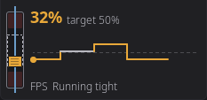

# Home Panel: Filament Widgets

The widgets that watch your filament path and drying: Clog Detection, Filament Buffer and Filament Dryer. Sizes and hardware needs are in the [Widget Catalog](home-widgets.md).

## Clog Detection Widget

The Clog Detection widget monitors your filament path health in real time, detecting clogs and flow issues. It is available when the printer has a clog detector or a filament motion sensor, for example Happy Hare, AFC or another multi-filament system with clog detection.

### What It Shows

The widget shows the FlowGuard bar:

A horizontal scale that fills as your clog or flow reading moves, shifting from green (healthy) through orange to red (danger). Every part of it has one job:

| Where | What it tells you |
|-------|-------------------|
| **Top left** | Which sensor is measuring, `Clog Auto`, `Clog Manual`, `FlowGuard` or `AFC buffer` |
| **Top right** | How worried it is, as an icon: a **check** while healthy, a **warning triangle** once the reading reaches the danger threshold, and a **red nozzle** once your firmware has actually flagged a fault |
| **The bar** | The reading. A shaded red band marks the danger zone, with a bright amber line where that zone begins |
| **Ticks** | A bright tick at the current reading, a fainter one at the worst value seen this print |
| **Underneath** | The reading as a number, headroom in mm, flow deviation as a percentage, or distance to fault |

The bar adapts to your detection backend:

| Backend | End labels | What the bar shows |
|---------|-----------|--------------------|
| **Encoder** | *(none)* | Clog percentage (0–100%), how much the encoder reading deviates from expected. Fills from the left. |
| **Flowguard** | TANGLE ... CLOG | Flow deviation (−100 to +100). Fills **out from the middle**: toward TANGLE when filament is over-feeding, toward CLOG when it is under-feeding. Both ends are shaded, because either extreme is a fault. |
| **AFC** | *(none)* | Buffer fault proximity (0–100%), how close the buffer is to a fault condition. |

Only Flowguard carries end labels, because only Flowguard has two directions that mean different faults. The other two fill from nothing toward their danger band, which the shading already shows, so the labels come off and the scale gets the width instead.

When there is nothing to report at all, an AFC buffer that is armed but not currently tracking, the bar sits empty and the status icon shows a check, rather than leaving you with a blank scale and no number.

> The same reading is drawn as an arc gauge in the filament sidebar and on the loaded-spool card, where the space is tall and narrow rather than wide and short.

### Tapping the Widget

Tap the Clog Detection widget to open the **Buffer Status** modal, a detailed read-only view of your filament path health:

The same FlowGuard bar sits across the top, so the modal shows everything the widget did and more - the reading, the danger threshold and the worst value seen this print.

**Happy Hare printers also show:**
- Filament tension description (e.g., "Running tight", "Balanced")
- Spool motor state
- Gear sync status
- Flow rate

**AFC printers also show:**
- Advancing/trailing buffer state
- Distance to fault (in mm)

Where your printer has a filament buffer with a proportional reading, the modal also shows it live: the tall slider on the left (a fill gauge for an OpenAMS pressure sensor), then the reading, its target and whether the filament is running tight, loose or balanced (at, above or below target for OpenAMS), with the last minute as a trace underneath. The modal closes with the **X** in its corner. See [Filament Buffer Widget](#filament-buffer-widget).

### Configuring Clog Detection

In Edit Mode, select the Clog Detection widget and tap the **gear icon** to open the configuration modal:

| Setting | Options |
|---------|---------|
| **Detection Source** | Auto (recommended), Encoder, Flowguard, or AFC |
| **Detection Mode** | Auto or Manual, in Manual mode, a G-code command is sent to the firmware |
| **Detection Length** | Filament distance threshold (Manual mode only) |
| **Danger Threshold** | Override the computed danger zone percentage |

**Auto** mode is recommended, HelixScreen automatically selects the best source based on your detected hardware.

---

## Filament Buffer Widget

The filament buffer is the slack between your feeder and the extruder, and the feeder steers it toward a target. The widget shows where it sits right now. The upright slider has loose filament up and tight filament down, with the target as a dashed window in the middle and faint zones at both ends. Only the block on the filament moves.

The block and the number beside it share one color: gray when the buffer is near its target, amber as it drifts off, and red when it is close to an end. The small label under the number says what is measuring: **FPS** for a filament pressure sensor (OpenAMS, or an AFC buffer with a pressure sensor) or **Sync** for Happy Hare's sync feedback.

| Size | Shows |
|------|-------|
| **1x1** | The slider, the reading and its label |
| **2x1** | The reading with its target (for example "32%  target 50%"), the last minute as a trace, and the label with **Running tight**, **Running loose** or **Balanced** |

The trace runs from the slider to the right, newest next to the slider. It is a line that turns amber or red for the stretches where the buffer drifted off its target, over a faint dashed line for the target itself. It starts empty and fills as the minute goes by: the part with no history yet is a dotted line.

A sensor that reports no target shows the pressure as text only (for example "Pressure: 32%"), with no slider or trace.

Tap the widget to open [Buffer Status](#tapping-the-widget), which shows the same reading larger and updates while it is open. A printer with no buffer reading leaves the widget dimmed with a slash badge; it comes back on its own when a reading appears.

---

## Filament Dryer Widget

The Filament Dryer widget collects every way your printer can dry filament into one tile: heated filament boxes (AMS-style units with their own dryer), an add-on chamber heater with a drying cycle, and drying on the heated bed. Sources your printer does not have are simply left out, and the widget is unavailable on a printer with none. See [Filament Drying and Humidity](filament.md#filament-drying-and-humidity) for starting a cycle.

| Size | Idle | While drying |
|------|------|--------------|
| 0.5x0.5 | Humidity, or an empty drop when no sensor reports it | Time left, with a progress ring when the progress is known |
| 1x0.5, 0.5x1 | Humidity | Time left and temperature |
| 1x1 | Humidity and "Not drying" | Time left and temperature, usually inside a progress ring |
| 2x1 | Humidity and "Not drying" | The ring beside the dryer's name, time left, temperature, humidity and the clock time it finishes |
| 2x2 and larger | One row per dryer, with its humidity and temperature | The same rows, each with time left and a progress bar |

Below 2x2, the idle humidity sits beside a drop filled to the wettest box's reading, as large as the tile leaves room for. It is the same drop the Humidity widget uses; with no humidity sensor the drop is an empty outline. While drying, the 0.5x1 size shows a heater icon over the time instead.

When two or more dryers run at once, the smaller sizes show how many are drying and the times left instead of a ring. A chamber heater's cycle only gets a ring if HelixScreen saw it start, because the heater reports minutes left but not how long the cycle was.

**Tap** the widget to open the screen of the dryer that finishes first, or the first filament box with a dryer when none is running. On 2x2 and larger, tap a row to open that dryer instead. The widget never starts or stops a cycle.

---

**Back to:** [Home Panel](home-panel.md) | [Widget Catalog](home-widgets.md)
