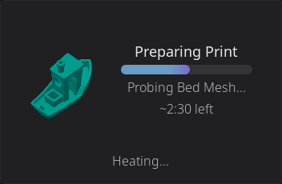

# Home Panel: Widget Catalog

Every widget you can put on the Home Panel, in the five groups the Widget Catalog uses on screen. To add, move or resize widgets, see [Edit Mode](home-edit-mode.md).

> **Sizes** are columns x rows. "2x1" is two columns wide and one row tall, "0.5" is half a cell, and "Full grid" means the widget can stretch across the whole page. A widget you can add more than once says so in its description. The **Hardware Required** column says what the printer needs before the widget is available (see [Hardware-gated widgets](#hardware-gated-widgets)).

### Print & Status

| Widget | Description | Default | Min | Max | Resizable | Hardware Required |
|--------|-------------|---------|-----|-----|-----------|-------------------|
| **Printer Image** | Your printer's photo, with live chips for the heaters, part fan and light while they are in use (see [Status Chips on the Printer Image](printer-manager.md#status-chips-on-the-printer-image)). Tap a chip for that part's controls (the light bulb switches the light), or the picture itself to open the Printer Manager overlay where you can change the name, image, and see hardware info. | 2x2 | 1x1 | 4x3 | Yes | None |
| **Print Status** | Tracks the print job in all three of its states - idle (pick a file), preparing (pre-print steps with a progress bar), and printing (filename, percentage, ETA, elapsed time). When the card is large enough, it also shows the live toolhead speed in mm/s and, after the filament used, the live volumetric flow in mm³/s; each is left out when there is no room for it. Pauses scheduled in the G-code (M600, PAUSE and friends) show as ticks on the progress bar and arc, so you can see a filament change coming. Tap opens the full Print Status overlay whenever a job is preparing or printing, or the file browser when idle. | 2x2 | 2x1 | Full width x3 | Yes | None |
| **Print Controls** | Pause, resume, and stop buttons for the running print, right on the dashboard. | 2x1 | 1x1 | 4x2 | Yes | None |
| **Print Stats** | The hours you have printed this week. Wider and taller sizes add a bar for each of the last seven days (with the weekday's initial under each at the largest size) and a line of lifetime totals: prints, hours and filament in meters. At its smallest size it is one line, the hours and "this week" (shortened to "/wk" on the smallest screens). Tap to open the full print history overlay. | 2x2 | 1x0.5 | 3x2 | Yes | None |
| **Printer Message** | The message your printer's macros show with `M117` or `SET_DISPLAY_TEXT` ("Heating bed...", "Homing..."), the line a stock printer LCD keeps on screen. It shows whether or not a print is running, and says "No message" when there is none. At half a row tall it is one line that scrolls when the message is too long; taller sizes wrap it. Display only. | 2x1 | 1x0.5 | Full width x3 | Yes | None |
| **Job Queue** | The next queued job and how many wait behind it, with a one-tap start when the printer is free. Tap anywhere else on the widget to open the Job Queue Manager modal (see [Job Queue widget](home-widgets-print.md#job-queue-widget) and [Job Queue Manager](home-widgets-print.md#job-queue-manager) below). | 2x2 | 1x0.5 | 4x3 | Yes | Moonraker job queue |
| **Speed / Flow** | The speed and flow override percentages, each shown in the warning color whenever it is not 100%. During a print it adds the live toolhead speed (mm/s) and volumetric flow (mm³/s) wherever there is room for them. At its smallest size, 0.5x0.5, it shows speed alone. Below 1x1 there is room for only one number per reading: if you chose mm/s in the Print Tune overlay (see [Percent or mm/s](printing.md#print-tune-overlay)), the live readings take the percentages' place there. At its largest sizes during a print, **-** and **+** buttons change speed by 5% and flow by 1%, and a long press on a value sets it back to 100%. Tap anywhere else on the widget to open the Print Tune overlay. | 2x1 | 0.5x0.5 | 4x2 | Yes | None |
| **Z-Offset** | The live Z-offset, with baby-step buttons and **Save** at the larger sizes. See [Z-Offset Widget](home-widgets-print.md#z-offset-widget). Tap anywhere except the buttons to open the Print Tune overlay. | 2x1 | 0.5x0.5 | 4x2 | Yes | None |
| **Exclude Objects** | During a print with two or more objects, how many are still printing and how many you have skipped. From 0.5x1 up it draws a small map of the objects: the one printing now in the accent color, skipped ones faded and hatched. Wider sizes name the object printing now, and 2x2 adds a **Skip objects...** button. The widget never skips anything itself: a tap opens the full objects map on the Print Status screen, where you confirm. See [Exclude Objects Widget](home-widgets-print.md#exclude-objects-widget) below. | 2x2 | 0.5x0.5 | 4x3 | Yes | Klipper exclude_object |
| **Camera** | Live webcam feed from your MJPEG stream. Tap to go fullscreen. Automatically detects webcams configured in Moonraker. See [Camera Widget](home-widgets-print.md#camera-widget) below for setup tips. | 2x2 | 1x1 | 4x3 | Yes | A webcam |

### Temperature & Cooling

| Widget | Description | Default | Min | Max | Resizable | Hardware Required |
|--------|-------------|---------|-----|-----|-----------|-------------------|
| **Nozzle Temperature** | Live nozzle temperature for the active extruder, with an animated heating icon that pulses when the heater is active. Tap to open the temperature graph overlay. (Singular - shows one nozzle. For all extruders at once, use **Nozzle Temperatures** below.) | 1x1 | 0.5x0.5 | Full grid | Yes | None |
| **Nozzle Temperatures** | Shows **all** extruder temperatures at once, each as a labeled row with current and target readings color-coded by state (green at-temp, red heating, blue cooling, gray off), plus a bed row at the bottom. On multi-tool printers each extruder gets its own row, labeled "Nozzle 1", "Nozzle 2", … at wider sizes, with shorter "Tool 1"-style labels or bare numbers where the row is narrow (toolchangers with named tools keep their configured names). Tap a nozzle row to open the nozzle temperature graph, or the bed row for the bed graph. (Plural - for single-extruder printers the singular **Nozzle Temperature** widget is simpler.) | 1x2 | 1x1 | 2x3 | Yes | None |
| **Bed Temperature** | Live bed temperature with current and target readings. Tap to open the temperature graph overlay. | 1x1 | 0.5x0.5 | Full grid | Yes | None |
| **Chamber Temperature** | Live chamber temperature with current and target readings, shown with a chamber icon and an animated heating indicator. Tap to open the temperature graph overlay focused on the chamber. Only available on printers with a chamber temperature sensor or heater. | 1x1 | 0.5x0.5 | Full grid | Yes | Chamber sensor or heater |
| **Temperatures** | Stacked view showing nozzle, bed, and chamber temperatures in one widget. Each row shows current temp and target. Also available in Carousel mode (see [Display Modes](#display-modes-stack-vs-carousel) below). Tap any reading to open the temperature graph. | 1x1 | 1x1 | 3x2 | Yes | None |
| **Temperature Sensors** | Monitor additional temperature sensors (chamber, enclosure heater, filament dryer, etc.) in a single-sensor or carousel view. A sensor that has a target (a `[heater_generic]` or `[temperature_fan]`) shows current / target, and tapping it opens the keypad to set the target. You can add multiple instances, each configured to a different sensor. Also available in Carousel mode. | 1x1 | 0.5x0.5 | Full grid | Yes | Extra temp sensors |
| **Temperature Graph** | Live temperature chart with configurable sensor series. Shows colored lines for each sensor with optional target setpoint lines. Content adapts to size, larger sizes show legends, axis labels, gradients, and temperature readouts. Tap to open the full-screen graph overlay. Configure which sensors to display via the gear icon in Edit Mode. You can add multiple instances. | 2x2 | 1x1 | Full width x4 | Yes | None |
| **Preheat** | Quick preheat buttons with material selection. Tap a material to instantly set nozzle and bed temperatures to that material's profile. | 3x1 | 2x1 | 4x1 | Horizontal only | None |
| **Fan Speeds** | Part cooling, hotend, and auxiliary fan speeds at a glance. Each row shows its fan's full name when there is room, then the short names Part, Hotend and Aux, then P, H and A on a narrow widget. Fan icons spin when running. Also available in Carousel mode with arc slider controls. Tap to open the Fan Control overlay. You can add multiple instances. | 1x1 | 1x1 | 3x2 | Yes | None |
| **Fan** | Monitor a single fan's speed. Tap to open a fan picker to choose which fan to display. You can add multiple instances, each showing a different fan. Configure via the gear icon in Edit Mode. | 1x1 | 0.5x0.5 | Full grid | Yes | None |

### Filament

| Widget | Description | Default | Min | Max | Resizable | Hardware Required |
|--------|-------------|---------|-----|-----|-----------|-------------------|
| **Active Spool** | Shows the currently loaded Spoolman spool: it displays the spool color, material type, brand, and remaining weight. Tap it to edit the spool in the loaded slot; with no slot loaded, the tap opens the [External Spool](filament.md#external-spool-configuration) editor instead. At compact sizes (1x1) shows just the colored spool icon; at wider sizes shows material details alongside. | 1x1 | 0.5x0.5 | 4x2 | Yes | None (shows a spool when Spoolman or the filament system knows one) |
| **Multi-Filament System Status** | A live view of your multi-material spool lanes. At 1x it's a compact row of colored bars, one per lane, each filled to show roughly how much filament is left. At 2x and wider it switches to a detailed view: a small spool for each lane with its lane number, material type (PLA, PETG…), and percent remaining, and the currently loaded lane's number badge is highlighted green. The spools size to fit the widget, 2 across at 2x, 4 across at 4x, and any lanes that don't fit scroll sideways. Tap for the full AMS panel. | 1x1 | 1x1 | 4x2 | Yes | AMS/MMU detected |
| **Filament Sensor** | Filament runout detection status. Tap to load, unload, or purge filament - what happens depends on what's going on: if the sensor is turned off, tapping opens its settings instead; while a print is running the modal is a status readout only; and if the print is paused you also get **Resume Print** and **Cancel Print**, so a runout pause can be dealt with without leaving the home screen. Canceling asks you to confirm first. Configurable via the gear icon in Edit Mode - choose which sensor the tile follows. See [Configuring a Widget](home-edit-mode.md#configuring-a-widget) above. | 1x1 | 0.5x0.5 | Full grid | Yes | A filament sensor |
| **Width Sensor** | Live filament width reading from a diameter sensor. | 1x1 | 0.5x0.5 | Full grid | Yes | Width sensor |
| **Clog Detection** | Filament clog and flow health monitor. Shows the FlowGuard bar. Tap to open the Buffer Status detail modal. Configurable via the gear icon in Edit Mode. See [Clog Detection Widget](home-widgets-filament.md#clog-detection-widget) below. | 2x1 | 2x1 | 4x2 | Yes | A clog detector or filament motion sensor |
| **Filament Buffer** | Where the filament buffer between your feeder and extruder sits against its target: an upright slider (loose up, tight down) beside a big colored reading; an OpenAMS pressure sensor is a fill gauge instead, rising from the bottom with a tick at its target. At 2x1 it adds the target, the last minute as a trace, and says whether the filament is running tight, loose or balanced (OpenAMS: at, above or below target). Tap for Buffer Status. | 1x1 | 1x1 | 2x1 | Horizontal only | A filament pressure sensor or sync feedback |
| **Bypass** | One-tap toggle for external-spool bypass. Shows the bypass state (icon changes, and the external spool's color and material while engaged) - tap to toggle. Same guards as the AMS panel's bypass toggle: if filament is loaded from a lane it unloads first, and while a job holds the printer (preparing, printing, or paused) the tap is refused with a "Bypass cannot be changed while printing" warning. | 1x1 | 0.5x0.5 | Full grid | Yes | Filament system with bypass |
| **Humidity** | Enclosure humidity reading from a connected sensor, beside a water drop filled to the same level (an empty outline while the sensor has no reading). | 1x1 | 0.5x0.5 | Full grid | Yes | Humidity sensor |
| **Filament Dryer** | Drying progress for every dryer your printer has: the heated filament boxes, an add-on chamber heater, and drying on the heated bed. Idle, it shows the humidity; while drying, the time left, usually inside a progress ring. See [Filament Dryer Widget](home-widgets-filament.md#filament-dryer-widget) below. Tap to open the dryer's own screen. It never starts or stops a cycle. | 1x1 | 0.5x0.5 | 3x4 | Yes | A filament dryer |

### Controls

| Widget | Description | Default | Min | Max | Resizable | Hardware Required |
|--------|-------------|---------|-----|-----|-----------|-------------------|
| **Macro Button** | One-tap buttons to run configured macros. Add as many Macro Button widgets as you like, each independently configurable, assign a macro to each via the gear icon in Edit Mode. See [Macro Button confirmation](#macro-button-confirmation). | 1x1 | 0.5x0.5 | Full grid | Yes | None |
| **Macros** | One-tap shortcut to open the [Macros](advanced.md#macro-execution) panel for browsing and executing Klipper macros. | 1x1 | 0.5x0.5 | Full grid | Yes | None |
| **GCode Console** | One-tap shortcut to open the [G-code Console](advanced.md#g-code-console) overlay for sending commands and viewing Klipper responses. See [GCode Console Widget](home-widgets-controls.md#gcode-console-widget) below. | 2x2 | 0.5x1 | Full grid | Yes | None |
| **Motion** | One-tap shortcut to open the [Motion](motion.md) panel for jogging the toolhead and homing. | 1x1 | 0.5x0.5 | Full grid | Yes | None |
| **Toolhead** | Where the toolhead is: X, Y and Z, each shown as `--` until that axis is homed. At 0.5x1 and 1x1 it lists the axes; from 1.5x1 it draws the print bed with a crosshair for the nozzle and a bar for Z, and once the printer is homed you can tap or drag on that plate to move the toolhead. During a print the small sizes show the Z height instead. At 2x2 and larger a **Home All** button appears while an axis is not homed, and during a print the active tool and live speed take its place. At 2x3 a row of three preset buttons sits under the plate, set from the gear icon in Edit Mode. See [Toolhead Widget](home-widgets-controls.md#toolhead-widget). | 2x2 | 0.5x0.5 | 4x4 | Yes | None |
| **Bed Mesh** | The active bed mesh as a color heatmap, with how flat it is: the Z range is green below 0.15 mm, amber below 0.30 mm and red above. Wider sizes add the profile name, the lowest and highest point and the grid size, then a color scale and the number of saved profiles. Tap to open the Bed Mesh screen. See [Bed Mesh Widget](home-widgets-controls.md#bed-mesh-widget) below. | 2x2 | 0.5x0.5 | 6x4 | Yes | Bed mesh support |
| **Tool Switcher** | Quick tool switching for multi-tool printers (IDEX, toolchangers, multi-head). Shows each tool with its loaded filament color, lets you switch the active tool with one tap, and parks the mounted tool on printers that support it. See [Tool Switcher Widget](home-widgets-controls.md#tool-switcher-widget) below. | 1x1 | 0.5x0.5 | 4x2 | Yes | None (made for printers with more than one tool) |
| **Power** | Toggle a Moonraker power device (PSU, lights, etc.) with one tap. You can add multiple instances, each bound to a different device. Shows the device name, state, and a customizable icon. Pick a color in the device picker and the tile shows it while the device is on, and a faded version of it while off; a device locked during a print keeps its gray locked look. With no color picked, the tile uses red for on and gray for off. | 1x1 | 0.5x0.5 | Full grid | Yes | Power devices |
| **LED Light** | Turns one light on or off, pick which one, or **All lights**, from the gear icon in Edit Mode; defaults to the chamber light. At 2x1 or wider, an arrow next to the bulb opens full color, brightness, and effects for it in the LEDs overlay. You can add more than one, each controlling a different light. | 1x1 | 0.5x0.5 | Full grid | Yes | A light HelixScreen can switch |
| **LED Controls** | One-tap shortcut to open the LEDs overlay directly, on whichever light you last looked at (or the chamber light). | 1x1 | 0.5x0.5 | Full grid | Yes | Any LED device |

### System

| Widget | Description | Default | Min | Max | Resizable | Hardware Required |
|--------|-------------|---------|-----|-----|-----------|-------------------|
| **Network** | Current network connection status - WiFi signal strength (with bar indicator) or Ethernet. | 1x1 | 0.5x0.5 | Full grid | Yes | None |
| **Host Health** | How hard the computer running Klipper and your printer's controller boards are working: CPU load and temperature, memory, and the busiest board. It turns amber or red when something needs attention (see [Host Health Widget](home-widgets-controls.md#host-health-widget) below). Tap to open the Performance screen. | 2x1 | 0.5x0.5 | 4x4 | Yes | Performance readings |
| **Notifications** | Shows pending notification count with a severity badge (info/warning/error). Tap to open the notification history overlay. Remove it and **Advanced > Notification History** takes its place. | 1x1 | 0.5x0.5 | Full grid | Yes | None |
| **Digital Clock** | Current time and date. Respects your 12/24-hour preference from display settings. Content adapts to size: time only when the date does not fit, time + date once it does (about 1.5x1), time + date + system uptime at 2x2+. Resizes in half-cell steps, see [Snapping and half cells](home-edit-mode.md#snapping-and-half-cells). | 2x1 | 1x1 | 3x3 | Yes | None |
| **Maintenance** | Service hour meters for the HEPA filter, the nozzle and the linear rails. Hours count up while the printer is printing (pauses do not count) and are kept per printer. The ring shows the part closest to its service interval, turning amber at three quarters of the interval and red once it is reached, when a notice also pops up once. Wider sizes list every part with its hours left; at 2x2 each part gets a bar, and the total print time shows where it fits. Tap to open the Maintenance screen: reset a part after servicing it (it asks first), and set each part's interval, where **Off** hides that part. If you used the Maintenance Meters example plugin, its hours carry over the first time. | 1x1 | 0.5x0.5 | 4x2 | Yes | None |
| **Tips** | Rotating helpful tips about 3D printing and HelixScreen features. Tap any tip to see the full article. Tips rotate automatically. | 4x2 | 2x1 | Full width x2 | Yes | None |
| **Shutdown/Reboot** | Shutdown or reboot your printer's host system. Shows a confirmation dialog before acting. When the screen runs on a different machine than the printer, the dialog lets you pick Screen, Printer or Both, and starts on Screen. | 1x1 | 0.5x0.5 | Full grid | Yes | Not available on Android |
| **Firmware Restart** | Restart the Klipper firmware. Useful when Klipper enters SHUTDOWN state. This widget automatically appears during firmware errors even if disabled. | 1x1 | 0.5x0.5 | Full grid | Yes | None |
| **Lock Screen** | Locks the screen immediately. With no PIN set the lock icon is grayed out and tapping it opens Settings > System > Security so you can set one. | 1x1 | 0.5x0.5 | Full grid | Yes | None |

### Hardware-gated widgets

Some widgets depend on hardware Klipper has to report. If it is missing:

- The widget still **appears** in the Widget Catalog, in the **Unavailable on this printer** section, dimmed and untappable, with the reason in parentheses after its name, for example "Humidity (No humidity sensor detected)".
- If the hardware shows up later, the widget becomes available on its own.
- If hardware disappears after you placed a widget, the widget grays out and cannot be tapped, but keeps its grid position and works again when the hardware returns.

| Widget | Needs |
|--------|-------|
| Camera | A webcam configured in Moonraker (crowsnest, camera-streamer and so on). The widget is not available in builds without camera support |
| Chamber Temperature | A chamber temperature sensor (`[temperature_sensor chamber]`) or a chamber heater (`[heater_generic chamber]`) |
| Multi-Filament System Status | A multi-filament system or MMU with at least one slot |
| Bypass | A filament system with a bypass |
| Clog Detection | A clog detector or filament motion sensor |
| Filament Buffer | A filament pressure sensor or sync feedback |
| LED Light | A light HelixScreen can switch: a Klipper LED, a light `[output_pin]`, a WLED strip, or an On/Off or Toggle macro device |
| LED Controls | Any LED device HelixScreen found |
| Power | A Moonraker power device (PSU control, a smart plug) |
| Filament Sensor | A filament sensor |
| Humidity | A humidity sensor |
| Width Sensor | A filament width sensor |
| Temperature Sensors | Extra temperature sensors beyond the nozzle and bed |
| Filament Dryer | A dryer HelixScreen can see: a heated filament box, a chamber heater with a drying cycle, or a heated bed that can dry filament |
| Host Health | Performance readings from Moonraker (the ones behind **Settings > System > Performance**) |
| Bed Mesh | Bed mesh support in Klipper |
| Exclude Objects | Klipper's exclude_object support, and a slicer that labels objects |
| Job Queue | Moonraker's job queue enabled ("Job queue not enabled in Moonraker" otherwise) |
| Shutdown/Reboot | Not available on Android |
| Toolhead | Not available on the BigTreeTech K-Touch |

## Display Modes: Stack vs. Carousel

### Stack Mode (Default)

Compact vertical rows showing all values simultaneously. Each row has an icon, current reading, and target (if applicable). Best when you want to see everything at once without swiping.

### Carousel Mode

Full-size swipeable pages with one item per page. Indicator dots at the bottom show which page you're on. Swipe left and right to browse.

**Temperatures carousel**: each sensor (nozzle, bed, chamber) gets its own full-size page with a large animated icon and temperature readout. The nozzle icon pulses when heating. Tap any page to open the temperature graph overlay for that sensor.

**Fan Speeds carousel**: each fan gets an interactive page with a **270-degree arc slider**. Drag the arc to change fan speed directly, without opening a separate control panel. The fan icon spins at a speed proportional to the actual fan RPM.

### Switching Modes

Long-press the grid to enter Edit Mode, select the Temperatures or Fan Speeds widget, and tap the **gear icon** in the upper-left corner. Each tap toggles the mode. For **Temperature Sensors**, the gear icon opens the sensor list instead: tick one sensor for the single view, or several for the Carousel. Your preference is saved per widget and persists across restarts.

## Widget Interactions

While **not** in Edit Mode, widgets respond to taps and other gestures:

| Widget | Tap Action |
|--------|------------|
| Printer Image | Opens Printer Manager overlay; a status chip opens that part's controls |
| Print Status | Opens Print Status overlay (preparing or printing) or File Browser (idle) |
| Print Controls | Pauses, resumes, or stops the print, one button each |
| Print Stats | Opens print history overlay |
| Printer Message | Display only |
| Job Queue | Opens Job Queue Manager modal; the **Start next** button starts the next job instead |
| Speed / Flow | Opens the Print Tune overlay. At its largest sizes during a print, the **-** and **+** buttons change speed by 5% or flow by 1% without opening anything, and a long press on a value sets it back to 100% |
| Z-Offset | Opens the Print Tune overlay. At 2x2 and larger, the arrow buttons nudge the offset and the step button cycles the step size. From 2x1 up, **Save** appears while there is an unsaved offset |
| Exclude Objects | Opens the Print Status screen with its objects map. Does nothing when there is no print or only one object |
| Digital Clock | Display only |
| Notifications | Opens notification history |
| Tips | Opens the full tip article |
| Network | Display only |
| Host Health | Opens the Performance screen |
| Filament Dryer | Opens the dryer's screen: the environment screen for a filament box, or the chamber or bed drying dialog when that is all the printer has. At 2x2 and larger, tap a row to open that dryer |
| Camera | Opens fullscreen camera view |
| Nozzle Temperature | Opens temperature graph overlay |
| Nozzle Temperatures | Tap a nozzle row opens the nozzle graph; tap the bed row opens the bed graph |
| Bed Temperature | Opens temperature graph overlay |
| Chamber Temperature | Opens temperature graph overlay focused on the chamber |
| Temperatures | Opens temperature graph for the tapped sensor |
| Temperature Sensors | A heater or temperature fan: opens the keypad to set its target. A read-only sensor: opens the sensor picker. Carousel: opens the sensor list. To change which sensor a heater tile shows, use the gear icon in Edit Mode |
| Temperature Graph | Opens full-screen temperature graph overlay |
| Preheat | Sets nozzle and bed temperature to the tapped material profile |
| Humidity | Display only |
| Fan Speeds (stack) | Opens Fan Control overlay |
| Fan Speeds (carousel) | Drag the arc slider to adjust speed directly |
| Fan | Opens fan picker to select which fan to display |
| Multi-Filament System Status | Opens the AMS panel overlay |
| Filament Sensor | Opens a load/unload/purge dialog (idle or paused), a status-only dialog (printing), or the sensor's settings (sensor turned off) |
| Width Sensor | Display only |
| Clog Detection | Opens the Buffer Status detail modal |
| Filament Buffer | Opens the Buffer Status modal |
| LED Light | Toggles its light on or off; on a 2x1 or wider tile, the arrow opens the LEDs overlay for it |
| LED Controls | Opens the LEDs overlay |
| Macro Button | Runs the configured macro, asking for parameters or confirmation first, unless you turned that off ([details](#macro-button-confirmation)) |
| Macros | Opens the Macros panel overlay |
| GCode Console | Opens the G-code Console overlay |
| Motion | Opens the Motion panel overlay |
| Toolhead | Opens the Motion panel. Once the printer is homed and idle, a tap on the plate picks a spot to move to and a drag moves the toolhead instead. **Home All** homes the printer, and a preset button runs its preset ([details](home-widgets-controls.md#toolhead-widget)) |
| Bed Mesh | Opens the Bed Mesh screen. With no mesh loaded and nothing printing, 2x2 and larger offers **Calibrate** and **Load profile** |
| Tool Switcher | Switches to the tapped tool, asking first unless [Confirm tool changes](settings/printing.md#confirm-tool-changes) is off; tapping the mounted tool, or the single large button on small widgets, opens the tool picker. **Park** docks the mounted tool |
| Power | Toggles the bound power device |
| Shutdown/Reboot | Shows confirmation, then shuts down/reboots |
| Firmware Restart | Restarts Klipper firmware |
| Lock Screen | Locks the screen immediately; requires PIN to unlock |

## Macro Button Confirmation

By default, tapping a Macro Button asks you something before it runs anything. If
the macro takes parameters, you get a form to fill in. If it takes none, you get a
"Run MACRO?" dialog, the one controlled by **Settings > Safety & Alerts > Confirm before
running macros**.

That is the right default for a button sitting on the home screen, but it gets in
the way of the macros you added a button for precisely because you run them
constantly and always the same way.

**Require Confirmation?** turns it off, per button:

1. Enter Edit Mode (long-press the widget grid) and tap the Macro Button
2. Tap the gear icon, then the **Options** tab
3. Turn **Require Confirmation?** off

That button now runs its macro on a single tap, with no parameters and no dialog.
Every other Macro Button keeps its own setting, this is per widget, not global.

Two things it does not change:

- **Dangerous macros always confirm.** `EMERGENCY_STOP`, `FIRMWARE_RESTART`,
  `RESTART`, `SHUTDOWN`, `SAVE_CONFIG` and `M112` show their warning dialog no
  matter what this is set to.
- **Macros that need parameters get none.** Turning confirmation off means the
  macro runs with its defaults. If a macro genuinely needs a value from you each
  time, leave confirmation on.

---

**Back to:** [Home Panel](home-panel.md) | [Edit Mode](home-edit-mode.md)
