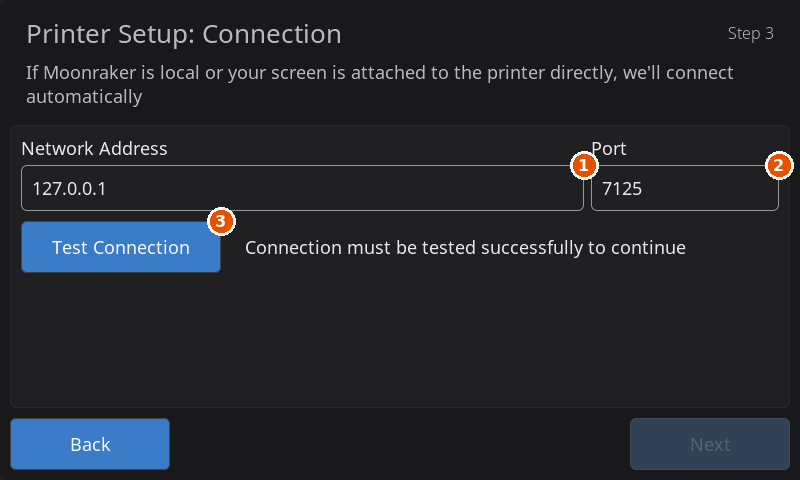

# Run HelixScreen in a Window on a Linux Desktop

HelixScreen can run as an ordinary app window on an x86_64 Linux desktop or laptop. It connects to your printer over the network, so you get the same screen you would have on the printer, at your desk, without installing anything on the printer.

This is a different package from the x86 kiosk install, which takes over a mini PC's whole screen at boot. The desktop package never touches your login screen or desktop session, needs no `sudo`, and installs only into your own home folder. It is new in HelixScreen 1.1; there is no desktop package of 1.0.

## Getting started

1. Open a terminal on your desktop PC (not on the printer) and run:
   ```bash
   curl -sSL https://releases.helixscreen.org/install.sh | sh -s -- --desktop
   ```
2. Start **HelixScreen** from your applications menu.
3. In the setup wizard, at the connection step, enter your printer's IP address (for example `192.168.1.50`) and leave the port at `7125`.
4. Let the wizard find your printer's heaters, fans, sensors and filament system, and you are done.

## Requirements

- **An x86_64 (64-bit Intel or AMD) Linux PC** with a graphical desktop. GNOME, KDE Plasma, Xfce, COSMIC and others all work, on X11 or Wayland.
- **Debian 11, Ubuntu 20.04, Fedora 34, or anything newer.** The app needs glibc 2.31 or later. Check yours with `ldd --version | head -1`.
- **Network access to your printer's Moonraker** (port `7125` by default). The printer needs Klipper and Moonraker; Mainsail or Fluidd is not required.
- **libusb**, which nearly every desktop already has. If HelixScreen will not start and complains about `libusb-1.0.so.0`, install it: `sudo apt install libusb-1.0-0` on Debian and Ubuntu, `sudo dnf install libusb1` on Fedora.

Nothing else needs installing. The 3D G-code preview uses your graphics driver's OpenGL ES support when it has it; without it, the preview draws in 2D and everything else works the same.

## Install

Open a terminal **on your desktop PC** and run:

```bash
curl -sSL https://releases.helixscreen.org/install.sh | sh -s -- --desktop
```

This installs the newest release on the Stable channel. To install one particular release instead, name it with `--version`:

```bash
curl -sSL https://releases.helixscreen.org/install.sh | sh -s -- --desktop --version v1.1.0
```

A beta version (such as `v1.1.1-beta.1`) puts the app on the Beta update channel, so it tells you about each new beta. To get the newest beta without naming one, put `R2_CHANNEL=beta` in front of `sh`:

```bash
curl -sSL https://releases.helixscreen.org/install.sh | R2_CHANNEL=beta sh -s -- --desktop
```

The installer puts HelixScreen in `~/.local/share/helixscreen` and adds **HelixScreen** to your applications menu.

**Do not use `sudo`.** With `--desktop`, a run as root stops with an error and changes nothing. A root run without `--desktop` sets up the full-screen kiosk instead, which replaces your login screen at boot.

> **Without `--desktop`:** on a PC with a desktop session, the installer asks whether you want HelixScreen in a window (the default) or as a full-screen kiosk. The kiosk is meant for a dedicated printer screen and replaces your login screen, so pick the window unless that is what you want. Passing `--desktop` skips the question.

### Installing from a downloaded package

If you downloaded `helixscreen-x86-desktop-<version>.tar.gz` from the [releases page](https://github.com/prestonbrown/helixscreen/releases), the installer installs that package and downloads nothing. Extract it and run the installer inside it:

```bash
tar -xzf helixscreen-x86-desktop-*.tar.gz
./helixscreen/install.sh --desktop
```

Or hand the archive to any copy of the installer:

```bash
./install.sh --desktop helixscreen-x86-desktop-<version>.tar.gz
```

The installer copies the package into `~/.local/share/helixscreen`, so you can delete the extracted folder and the archive afterwards. A kiosk package (`helixscreen-x86-<version>.tar.gz`) is refused, with a message saying so.

## First launch

Start **HelixScreen** from your applications menu, or from a terminal:

```bash
~/.local/share/helixscreen/bin/helix-screen
```



1. **Network Address**: your printer's IP address.
2. **Port**: leave it at `7125`.
3. **Test Connection**: checks that the window can reach the printer.

The setup wizard opens in the window. At the connection step (**Printer Setup: Connection**), enter your **printer's IP address** (for example `192.168.1.50`), leave the port at `7125`, and tap **Test Connection**. The wizard then finds your printer's fans, heaters, sensors and filament system as usual. [Remote Screen Setup](../INSTALL.md#remote-screen-setup-run-on-a-separate-device) has more on connecting to a printer over the network.

To skip typing the address, or to point a second window at another printer, give the address on the command line:

```bash
~/.local/share/helixscreen/bin/helix-screen --moonraker ws://192.168.1.50:7125
```

### Window size

The window opens at 800x480, the size of a typical printer touchscreen. Pick another size with `-s`, either a size name or exact pixels:

```bash
~/.local/share/helixscreen/bin/helix-screen -s 1024x600
~/.local/share/helixscreen/bin/helix-screen -s large
```

Size names are `micro`, `tiny`, `small`, `medium`, `large` and `xlarge`. The layout adapts to the size you choose, the same way it does on a printer's screen.

### Keyboard and mouse

Click and drag work like taps and swipes, and the mouse wheel scrolls lists. A few keys are handy on a desktop (they do nothing while you are typing in a text field):

| Key | Action |
|-----|--------|
| **S** | Save a screenshot (to `/tmp`) |
| **D** | Switch between dark and light mode |
| **M** | Show memory statistics |

Close the window to quit.

## Updating

When a new version is out, HelixScreen tells you in **Settings > Updates**. There, **Install Update** opens the release page in your web browser instead of updating in place. To install the update, close HelixScreen and run:

```bash
curl -sSL https://releases.helixscreen.org/install.sh | sh -s -- --update
```

The installer finds your desktop install by itself, keeps your settings and stays on your update channel. Installing a newer downloaded package the way [Installing from a downloaded package](#installing-from-a-downloaded-package) shows updates it too, settings included.

## Uninstalling

```bash
curl -sSL https://releases.helixscreen.org/install.sh | sh -s -- --uninstall
```

This removes `~/.local/share/helixscreen`, its applications-menu entry and the installer's log, and touches nothing outside your home folder.

HelixScreen also keeps a backup of its settings in `~/.helixscreen`, and a later install picks your old settings back up from it. To start completely fresh, delete that folder too: `rm -rf ~/.helixscreen`.

## Running without installing

You can also run the desktop package from any folder. Download `helixscreen-x86-desktop-<version>.tar.gz` from the [releases page](https://github.com/prestonbrown/helixscreen/releases/latest), then:

```bash
tar -xzf helixscreen-x86-desktop-*.tar.gz
./helixscreen/bin/helix-screen --moonraker ws://192.168.1.50:7125
```

Settings are stored in `helixscreen/config/` next to the app, so keep the folder together.

## Troubleshooting

**The window does not open, and the terminal shows `GLIBC_2.xx not found`.** Your Linux release is older than the requirement above. Upgrade the OS, or run HelixScreen on a Raspberry Pi instead.

**The installer says "Failed to download release."** Check your internet connection first. If it works, the release the installer picked may be older than 1.1, which has no desktop package: name a 1.1 release or newer with `--version`, or use `R2_CHANNEL=beta` as shown under [Install](#install).

**The G-code preview is flat (2D) instead of 3D.** Your graphics driver does not offer OpenGL ES to HelixScreen. Updating your graphics drivers (Mesa on most systems) usually brings it back. Everything else works the same in 2D.

**It cannot reach the printer.** From the same PC, open `http://PRINTER_IP:7125/server/info` in a browser. If that fails too, the problem is the network or Moonraker, not HelixScreen.

For anything else, see [Troubleshooting](../TROUBLESHOOTING.md) or ask on [Discord](https://discord.gg/RZCT2StKhr).

---

**Next:** [Getting Started](getting-started.md) | [Back to User Guide](../USER_GUIDE.md)
