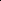

# Installing HelixScreen on the Snapmaker U1

The Snapmaker U1 is a four-toolhead printer with a built-in touchscreen. HelixScreen replaces the stock screen and starts automatically at boot. This page covers installing, updating, firmware upgrades with HelixScreen installed, recovery from a blank screen, and going back to the stock screen.

> **Easy installer:** the [HelixScreen easy installer](https://helixscreen.org/installer/) does not handle this printer yet. See [what works today](easy-installer-unsupported.md#snapmaker-u1).

## Getting started

1. Turn on SSH: enable **Root access** in the printer's settings on stock firmware 1.2 or newer, or install PAXX Extended Firmware (see [What you need](#what-you-need)).
2. From your computer, sign in to the printer: `ssh root@<printer-ip>`, password `snapmaker`.
3. Run the installer:
   ```bash
   curl -sSL https://releases.helixscreen.org/install.sh | sh
   ```
4. HelixScreen takes over the screen. It already knows the U1's heaters, fans, lights and sensors, so the short setup on screen skips the hardware questions and asks only things like your language.
5. Start printing. For the U1's per-toolhead flow calibration, see [Snapmaker U1: flow calibration](printing.md#snapmaker-u1-flow-calibration).

## What you need

- A Snapmaker U1 on your network (WiFi or Ethernet).
- **SSH access**, from either firmware:
  - **Stock Snapmaker firmware 1.2 or newer:** turn on the **Root access** option in the printer's settings (added in firmware 1.2.0). This starts SSH. HelixScreen on stock firmware has not yet been checked end to end on a real stock printer.
  - **[PAXX Extended Firmware](https://github.com/paxx12-snapmaker-u1/SnapmakerU1-Extended-Firmware):** SSH is on by default. Tested on 1.2, 1.3 and 1.4.
- The SSH login: user `root` (or `lava`), password `snapmaker`.

PAXX is not required. It is the turnkey option if you would rather not enable root access yourself.

> **HelixScreen already came with your firmware?** Some PAXX builds include HelixScreen as a firmware component. Turn it on or off in the firmware settings web page under **Snapmaker Components > Touchscreen GUI**, and get new versions by updating the firmware. On those printers the installer refuses to run, because it would overwrite the firmware's own setup, and **Settings > Updates** on the screen reads **Managed by your firmware**.



## Installing

Sign in to the printer over SSH:

```bash
ssh root@<printer-ip>
# password: snapmaker
```

Then run the installer:

```bash
curl -sSL https://releases.helixscreen.org/install.sh | sh
```

The installer recognizes the U1 on its own. It shows a plan of what it will install and change, asks `Continue? [Y/n]`, and then:

- installs HelixScreen to `/userdata/helixscreen`
- sets it to start at boot instead of the stock screen
- switches off the stock screen program (`/usr/bin/gui`). That program sits in a read-only part of the firmware, so it is only disabled, never deleted, and the uninstaller switches it back on
- on stock firmware, keeps SSH working. There the stock screen is what starts SSH at boot while **Root access** is on, so HelixScreen does that job instead each time it starts. The **Root access** switch itself lives on the stock screen: to change it, uninstall HelixScreen, flip the switch, then install again

The installer's log is saved as `helixscreen-install.log` in the printer's logs folder, so Mainsail and Fluidd list it with the other logs.

<details>
<summary>Installing without internet access on the printer</summary>

If the printer cannot download from the internet, download two files on your computer from the [releases page](https://github.com/prestonbrown/helixscreen/releases): `install.sh` and `helixscreen-snapmaker-u1.zip`. Copy both to the printer:

```bash
scp install.sh helixscreen-snapmaker-u1.zip root@<printer-ip>:/tmp/
```

Then, on the printer:

```bash
sh /tmp/install.sh --local /tmp/helixscreen-snapmaker-u1.zip
```

This does the same install as the one-line command, from the file you copied.

</details>

## Restarting and logs

```bash
# Restart HelixScreen
/userdata/helixscreen/config/helixscreen.init restart

# HelixScreen's own log
grep helix-screen /var/log/messages | tail -100

# Startup and crash output
tail -100 /var/log/helixscreen/launcher.log
```

## Updating

The easiest way is on the screen: **Settings > Updates**, then check for an update and install it. HelixScreen also appears in the update list of Mainsail and Fluidd.

From SSH, run the installer with `--update`. It keeps your settings:

```bash
curl -sSL https://releases.helixscreen.org/install.sh | sh -s -- --update
```

To install one particular version, add `--version vX.Y.Z`. To reinstall with fresh settings, use `--clean --yes` instead of `--update`. [Updating HelixScreen](../INSTALL.md#updating-helixscreen) has the details that apply to every printer.

### Upgrading the printer's firmware with HelixScreen installed

A firmware upgrade is safe with HelixScreen installed and does not brick the printer. The upgrade resets the system changes that start HelixScreen at boot, so the stock screen comes back afterwards. HelixScreen's files and your settings stay on the printer's user storage.

Because HelixScreen replaces the stock screen, its **Local Update** button is not available. On PAXX firmware, upgrade over the network instead:

1. In a web browser on the same network, open `http://<printer-ip>/firmware-config`.
2. Choose **Firmware Upgrade**, upload the new `U1_extended_<version>_upgrade.bin` and let it finish. The printer restarts into the new firmware with the stock screen.
3. Sign in over SSH again and run the installer with `--update`:
   ```bash
   curl -sSL https://releases.helixscreen.org/install.sh | sh -s -- --update
   ```
   HelixScreen is back, with your settings.

On stock firmware, upgrade the way Snapmaker's documentation describes, then turn **Root access** back on in the stock screen and run the same command.

## Uninstalling and going back to the stock screen

Run the uninstaller, then restart the printer:

```bash
curl -sSL https://releases.helixscreen.org/install.sh | sh -s -- --uninstall
reboot
```

It switches the stock screen program back on, puts back the firmware's own startup scripts, removes HelixScreen, and turns off the setting that kept the changes across restarts. After the restart the printer runs exactly as it did before HelixScreen.

If you cannot run the uninstaller, undo it by hand:

```bash
chmod +x /usr/bin/gui                 # switch the stock screen program back on
rm -rf /userdata/helixscreen /userdata/helixscreen-state
reboot
```

## Recovery: screen is blank or the printer is off the network

If the printer comes up with a blank screen and cannot be reached over WiFi, recover over a wired connection:

1. Plug a **USB-Ethernet adapter** into the printer and connect it to your router. The printer sets up the wired link on its own and gets an address from your router (look for it in the router's list of connected devices).
2. Sign in over that address: `ssh root@<wired-ip>`, password `snapmaker`.
3. Run the uninstaller and restart:
   ```bash
   curl -sSL https://releases.helixscreen.org/install.sh | sh -s -- --uninstall
   reboot
   ```
4. Once the stock screen is back and the printer is on WiFi again, you can install HelixScreen again.

If the uninstaller cannot run, this command returns the printer to a clean stock state and restarts it:

```bash
rm -f /oem/.debug && rm -rf /oem/overlay/* && rm -rf /userdata/helixscreen && sync && reboot
```

## SSH refused after installing on stock firmware

Versions of HelixScreen before 1.0.4 switched off the stock screen on stock firmware without taking over its job of starting SSH. After the next restart, `ssh` answers "Connection refused". Mainsail and Fluidd keep working, but they give you no shell.

1. **Update HelixScreen from the screen:** **Settings > Updates**, check for an update and install it. The updated HelixScreen starts SSH whenever **Root access** was on. If `ssh` still refuses afterwards, restart the printer once.
2. **If you cannot update from the screen,** reinstall the stock firmware the way Snapmaker's documentation describes. That clears HelixScreen's system changes, so the stock screen comes back. Turn **Root access** back on in the stock screen (**Settings > Maintenance**) and install HelixScreen again.

## Good to know

- **Any firmware update brings the stock screen back.** Run the installer with `--update` afterwards, as in [Upgrading the printer's firmware](#upgrading-the-printers-firmware-with-helixscreen-installed).
- **Seeing the screen in Mainsail or Fluidd.** On PAXX firmware, the built-in "gui" webcam shows the live HelixScreen screen, and you can tap it to control the printer. Turn on **Remote Screen** in the firmware settings web page at `http://<printer-ip>/firmware-config/`. Editing the config file by hand is not enough. Setup and troubleshooting: [Supported Printers: Snapmaker U1](supported-printers.md#snapmaker-u1-snapswap).
- **Two Moonraker warnings you may see.** Mainsail and Fluidd can show "Unable to find DBus PolKit Interface" and "Unable to initialize System Update Provider for distribution: buildroot". Both come from Moonraker looking for an operating-system package manager, which the U1's firmware does not have. The installer turns that check off in Moonraker's settings, which normally clears them. If they still appear, they are harmless: they do not affect HelixScreen or printing.
- **Flow calibration** (Snapmaker's "dynamic flow calibration") is a pre-print option on the screen. To run it for prints started from the slicer, see [Snapmaker U1: flow calibration](printing.md#snapmaker-u1-flow-calibration).

## See also

- [Troubleshooting: Snapmaker U1 blank screen](../TROUBLESHOOTING.md#snapmaker-u1-blank-screen-and-off-the-network-after-a-reboot): the companion to the recovery section above
- [Supported Printers: Snapmaker U1 (SnapSwap)](supported-printers.md#snapmaker-u1-snapswap): what works on the U1, and the remote screen setup
- [UPGRADING.md](../UPGRADING.md): version pinning, resets and migrations
