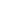

# Label Printing

Print spool labels directly from HelixScreen. Each label leads with the **spool number** as its first and largest line, so you can identify a spool from across the room without scanning it. A label also carries the vendor, material and color, remaining weight, and a QR code that links back to the spool in Spoolman. Scan that QR code later with the [barcode scanner](barcode-scanner.md) or the camera to pick the spool again.

There are two ways to print labels:

- **Thermal label printers** (Brother, Phomemo, Niimbot, MakeID) print one label at a time onto a roll or tape. Most of this page covers them.
- **An ordinary office printer** (inkjet or laser) can print onto **Avery-style sheet labels**. See [Office-Printer (Sheet) Labels](#office-printer-sheet-labels).

> Label printing is not available on the Adventurer 5M and 5M Pro builds or on the BigTreeTech K-Touch (ESP32) screen. The K-Touch hides the **Label Printer** row. On the Adventurer 5M builds the row and the spool menu's **Print Label** can still appear, but they do nothing.

---

## Supported Printers

| Brand | Connection | Models |
|-------|------------|--------|
| **Brother QL** | Network or Bluetooth | QL-820NWB, QL-810W, QL-800 and other QL, TD and RJ models |
| **Brother PT** | Bluetooth | PT-P300BT, PT-P710BT, PT-P910BT and other P-Touch models with Bluetooth |
| **Phomemo** | USB or Bluetooth | M110, M120, M02, Q199 and other M and Q series |
| **Niimbot** | Bluetooth | B21 and the other B-series printers, D11, D110 |
| **MakeID** | Bluetooth | E1 (it advertises itself as "YichipFPGA-" followed by digits), L1, M1, with 9, 12 or 16 mm continuous tape |

Bluetooth printing needs a Bluetooth adapter on the device running HelixScreen (a Raspberry Pi 4 or 5 has one built in). Without Bluetooth hardware the **Type** dropdown offers only Network and USB. If Bluetooth is turned off for UART use, see the [Bluetooth Setup Guide](bluetooth-setup.md).

---

## Setting Up a Label Printer

### Step 1: Open Label Printer settings

Go to **Settings > Devices > Spoolman > Label Printer**.

### Step 2: Choose the connection type

Under **Connection Type**, set **Type**:

| Type | Use it for |
|------|------------|
| **Network** | Brother QL printers on Ethernet or Wi-Fi, and office printers for sheet labels |
| **USB** | Phomemo printers on a USB cable |
| **Bluetooth** | Any supported printer paired over Bluetooth |

### Step 3: Select your printer

**Network.** HelixScreen searches your network and lists what it finds under **Discovered Printers**. Pick yours and the address and port are filled in. You can also type the address and port by hand under **Manual** (the standard port for a Brother QL is 9100).

**USB.** Plug the printer in and pick it from **Detected USB Printers**.

**Bluetooth.**

1. Turn the printer on and put it in pairing mode.
2. Tap **Scan for Printers**.
3. Pick your printer from the **Printer** dropdown. If it is not paired yet, HelixScreen asks **Pair with** the printer's name. Tap **Pair**. Most label printers pair without a PIN.
4. Tap **Connect** to check the link. **Forget** removes the pairing.

### Step 4: Choose the label size

The **Label Size** dropdown follows the printer you picked, so a Niimbot D11 shows different sizes from a B21.

| Printer | Sizes |
|---------|-------|
| Brother QL | 29 mm and 38 mm continuous, 62 mm continuous, 23x23, 29x90, 62x29 and 62x100 mm |
| Brother PT | Set automatically (see below) |
| Phomemo | 40x30, 40x20, 50x30, 50x50, 50x80, 30x20, 25x10 and 40x60 mm |
| Niimbot B-series | 50x30, 40x30, 30x20, 30x40, 40x40, 50x50, 40x20, 25x30, 14x40, 14x60 and 50x80 mm |
| Niimbot D11 and D110 | 12x22, 12x30, 12x40, 12x50, 12x60 and 12x70 mm |
| MakeID E1 | 9x30, 9x40, 12x30, 12x40, 12x50, 16x30, 16x40 and 16x50 mm |

**Brother QL over the network** reads the loaded roll from the printer when you print, and uses that size. The dropdown is the fallback if the printer does not answer. A Brother QL over Bluetooth always uses the size you chose.

**Brother PT** printers read the installed tape cassette (3.5, 6, 9, 12, 18 or 24 mm) when you print, so the **Label Size** dropdown shows **Auto-detect** and cannot be changed. If no tape is installed you get the message "No tape detected in printer".

### Step 5: Choose a preset

| Preset | What the label shows |
|--------|----------------------|
| **Standard** | Spool number, vendor, material and color, weight, and the recommended temperatures, lot number and notes when the spool has them and they fit, plus the QR code |
| **Compact** | Spool number, vendor, material and color, plus the QR code |
| **QR Only** | The QR code and the spool number |

Small labels cannot fit text, so the **Preset** dropdown is locked to **QR Only** on any label that is no more than about 31 mm in both width and length. That covers, for example, the Phomemo 30x20 and 25x10, the Niimbot 30x20 and 25x30, the 12x22 and 12x30 Niimbot D11 labels, the MakeID 30 mm labels and the Brother QL 23x23. Brother PT tape of 9 mm or narrower always prints as **QR Only** too, whatever the preset says. A spool that is not tracked in Spoolman has no spool number or QR code, so its label carries only text: the vendor, material and color, plus the weight on the **Standard** preset.

### Step 6: Test it

Tap **Test Print**. It prints a sample label (a Hatchbox PLA spool) whose QR code deliberately matches no real spool, so scanning it cannot change your active spool.

1. Label Size.
2. Preset.
3. Test Print.

---

## Printing a Label

Once a printer is set up, **Print Label** appears in three places:

- The menu you get when you tap a spool in the Spoolman spool list (reached from the **Filament** tab).
- The spool editor for a Spoolman spool.
- The slot editor on the filament system screen, for a slot linked to a Spoolman spool.

A message confirms **Label printed**, or names what went wrong. Until a printer is configured, **Print Label** in the spool menu says "Set up your label printer in Settings".

---

## Office-Printer (Sheet) Labels

If you have no thermal label printer, HelixScreen can print spool labels onto Avery-style sheets using a networked office printer. It lays several labels out on a Letter or A4 sheet and sends the job over the network with no driver needed. This path is separate from the thermal printers above, but it uses the same **Label Printer** screen.

### Set it up

1. Go to **Settings > Devices > Spoolman > Label Printer** and set **Type** to **Network**.
2. Open the **Printer** dropdown under **Discovered Printers**. Office printers that support driverless printing show **[IPP]** after their name, for example `Office HP LaserJet (192.168.1.40) [IPP]`. Pick one of those. The port is set to 631 for you.
3. Set **Label Size** to the sheet you loaded:

| Sheet | Layout |
|-------|--------|
| **Avery 5160** | 30 labels, 1" x 2-5/8" (Letter) |
| **Avery 5163** | 10 labels, 2" x 4" (Letter) |
| **Avery 5167** | 80 labels, 1/2" x 1-3/4" (Letter) |
| **Avery 5195** | 60 labels, 2/3" x 1-3/4" (Letter) |
| **Avery 5199** | 4 labels, 3-1/2" x 4" (Letter) |
| **Avery 8126** | 2 labels, 8-1/2" x 5-1/2" (Letter) |
| **Avery L7163** | 14 labels, 99.1 x 38.1 mm (A4) |
| **Avery L7160** | 21 labels, 63.5 x 38.1 mm (A4) |
| **Avery L7161** | 18 labels, 63.5 x 46.6 mm (A4) |
| **Avery L7159** | 24 labels, 63.5 x 33.9 mm (A4) |

4. Pick a **Preset**. **Labels Per Sheet** sets how many copies of a label go on a sheet by default.

If your printer is not listed, check that it is on, on the same network, and has driverless, AirPrint or IPP printing enabled. Only the discovered **[IPP]** entry turns sheet printing on; typing an address by hand does not.

### Print onto a sheet

Tap **Print Label** as described above. Because the printer is a sheet printer, a **Sheet Label Print** dialog opens first:

| Option | What it does |
|--------|--------------|
| **Template** | The sheet you chose in settings (read only) |
| **Labels** | How many copies to print |
| **Start at** | Which position on the sheet to begin at (**Position 1**, **Position 2** and so on) |

Tap **Print** to send the job or **Cancel** to back out. **Start at** lets you reuse a partly used sheet: choose the first blank position and the used ones are skipped. HelixScreen remembers your **Labels** choice.

Sheet printing is network only. Bluetooth and USB are for thermal printers.

---

## Troubleshooting

**The Bluetooth scan finds nothing.** Make sure the printer is on and in pairing mode, move it closer (Bluetooth reaches about 10 meters), and scan again. Some printers take a few seconds to start advertising.

**"Bluetooth not available".** The device has no Bluetooth hardware, or it is disabled. On a Raspberry Pi, `bluetoothctl show` should list an adapter. If Bluetooth is disabled for UART, see the [Bluetooth Setup Guide](bluetooth-setup.md).

**It says the label printed but nothing came out.** Check that labels are loaded and the printer has no error (paper jam, open cover). Turn a Bluetooth printer off and on and try again. Check that **Label Size** matches the roll in the printer.

**"No USB printer detected".** Unplug and replug the cable, try another USB port, and check that the printer is on.

**Other messages.** "Printer didn't respond" means the printer is off or out of range. "Printer is not paired" means pair it again from the Label Printer screen. "Can't connect" usually clears by tapping **Forget** and pairing again. "Lost connection during print" means the link dropped mid-job; try again.

**Niimbot will not connect.** Niimbot printers use Bluetooth Low Energy, which allows one connection at a time, so close the Niimbot phone app first. Then power-cycle the printer. The first print after connecting takes a few extra seconds while the link starts up.

**MakeID will not connect.** Look for the name "YichipFPGA-" followed by digits when scanning. Close the MakeID phone app, power-cycle the printer and try again.

**Brother PT will not print.** Pair the printer first, then pick it on the Label Printer screen. If the message is "No tape detected", re-seat the tape cassette. If the label is blank or cut wrong, power-cycle the printer. Labels on 3.5, 6 and 9 mm tape carry only the QR code and spool number; that is expected.

---

**Next:** [Barcode Scanner](barcode-scanner.md) | **Prev:** [Bluetooth Setup](bluetooth-setup.md) | [Back to User Guide](../USER_GUIDE.md)
