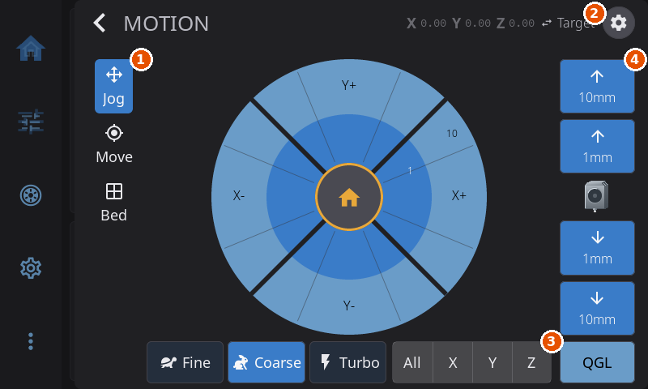
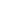
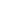

# Motion & Positioning

1. The tab rail (Jog, Move, Bed).
2. The position readout.
3. The jog pad.
4. The home bar.
5. The Z buttons.

---

Open the Motion screen by tapping **Motion** on the Controls panel. It has three tabs, **Jog**, **Move** and **Bed**, and it always opens on Jog. In landscape the tabs sit in a rail on the left edge of the screen. In portrait they become icon pills in the header.

- **Jog** has the circular jog pad, a home bar, the Fine / Coarse / Turbo buttons and a column of Z buttons on the right. See [Jog Tab](#jog-tab).
- **Move** has a grid of named bed positions. See [Move Tab](#move-tab).
- **Bed** is a map of the plate that you tap to send the toolhead there. See [Bed Tab](#bed-tab).

The Z column stays on the right on the Move and Bed tabs. On the Jog tab it is part of the Jog Pad layout, and the other [Jog layouts](#jog-layouts) bring their own Z keys.

---

## Position Display

The current **X**, **Y**, and **Z** coordinates sit in the header of the Motion screen. In portrait they form a row just under the header. Each axis letter is dimmed while that axis is not homed yet.

- **Tap a coordinate** to open a number pad and send the toolhead straight to that position. A value outside the printer's range is refused with "Value must be between A and B" and nothing moves. A coordinate is grayed out and does nothing while its axis is not homed. Home first with the home bar or the center button of the jog pad, or from the Controls panel.
- **Tap the Target / Actual chip** next to the coordinates to switch what they show. **Target** is the position you asked for. **Actual** is where the nozzle really is, with the Z offset, tool offsets and bed mesh correction applied, and it updates while the toolhead moves. The chip names the mode on screen and lights up while Actual is shown. The choice is remembered separately for each printer.

The coordinates are grayed out whenever the printer is not ready, for example when it is not connected or is still starting up.

> **Nothing on the Motion screen homes by itself.** The coordinates, the Move tab's positions, **Park** and the Bed tab's plate all stay grayed out until the printer is homed, and only a home button homes it. A stray tap on an unhomed printer never starts a homing run.

The [Toolhead widget](home-panel.md#toolhead-widget) on the home screen shows the same X, Y and Z, draws where the nozzle sits on the plate, and can move the toolhead too.

---

## Jog Tab

### Jog Pad

The jog pad is a circular control with a home button in the middle and two rings of arrows around it:

- **Center (home button):** tap the home icon to home all axes (X, Y and Z).
- **Inner ring:** tap an arrow to move by the *smaller* step of the current jog mode.
- **Outer ring:** tap an arrow to move by the *larger* step of the current jog mode.

The distance labels printed on the rings update to match the active jog mode.

**Press and hold** any arrow, or a Z button, to repeat. After about 0.4 seconds the move repeats roughly every 0.15 seconds for as long as you hold. A quick tap makes exactly one move.

### Home Bar

Under the jog pad (beside the Fine / Coarse / Turbo buttons in landscape) is a row of home buttons:

| Button | What it does |
|--------|--------------|
| **All** | Homes X, Y and Z. |
| **X** | Homes X only. |
| **Y** | Homes Y only. |
| **Z** | Homes Z only. |

Each button turns **green** once its axis is homed and stays gray until then. **All** turns green when X, Y and Z are all homed. The buttons are disabled while a homing or leveling run is in progress. When homing finishes, a message tells you ("All axes homed", or "X axis homed" for a single axis), and a failure shows "Homing failed" with the reason.

On a **delta** printer the axes can only be homed together, so the bar shows **All** alone. The Controls panel has a similar bar that adds an **XY** button (see [Homing](#homing)).

The home bar belongs to the Jog Pad layout. The other [Jog layouts](#jog-layouts) have their own home keys.

1. Home all axes.
2. Home X (Y sits between X and Z).
3. Home Z.

### Z Column

The right-hand column has four Z buttons, two large steps and two small steps, with up arrows above and down arrows below. A small picture between them says what the Z buttons move:

- On a printer whose **bed** moves up and down in Z, the picture is a bed. The up arrow raises the bed toward the nozzle.
- On a printer whose **print head** or gantry moves in Z, the picture is your toolhead, drawn in the style you chose under **Settings > Appearance > Printer Visuals > Toolhead Style** (see [Appearance](settings/appearance.md#toolhead-style)). The up arrow lifts the head away from the bed.

HelixScreen decides which kind of printer you have from its kinematics. A CoreXY printer without a quad gantry level is treated as a moving bed, and bed-slingers, delta printers, the Voron 2.4 and similar machines are treated as a moving head. If the arrows point the opposite way to what you see, change **Settings > Appearance > Printer Visuals > Z Movement** (see [Appearance](settings/appearance.md#z-movement)). It changes the picture and arrows only, not the commands the printer receives.

A Z button that would move past a Z limit is grayed out, so you can see the edge before you press. Which pair grays out depends on what moves in Z on your printer.

1. The large step up.
2. The toolhead picture, which is a bed icon on printers whose bed moves in Z.
3. The large step down.

### Jog Modes

Three modes control how far the print head moves per tap. Switch between them with the **Fine**, **Coarse** and **Turbo** buttons.

| Mode | Inner Ring | Outer Ring | Best For |
|------|-----------|------------|----------|
| **Fine** | 0.1mm | 1mm | Precise calibration, Z-offset, first-layer tuning |
| **Coarse** (default) | 1mm | 10mm | General positioning, moving to a specific area |
| **Turbo** | 10mm | 50mm | Rapid movement across the full build plate |

Those distances are the defaults. You can set your own in the [Motion settings](#motion-settings), and the table then shows whatever you configured. The Z buttons follow the same mode, and their labels show the current step sizes. Your selected mode is remembered between sessions.

---

## Jog Layouts

**Settings > Printing > Motion > Layout** changes how the Jog tab arranges its buttons. The Move and Bed tabs are the same in every layout.

| Layout | What it shows |
|--------|---------------|
| **Jog Pad** (default) | The circular jog pad, the home bar, the Z column and the Fine / Coarse / Turbo buttons described above. |
| **Arrows** | An XY cross of arrow keys, an up/down Z pair, and Home All / X / Y / Z on the right, with a row of step sizes underneath. Every arrow moves the selected step. |
| **Arrows + Home** | The same arrows with a home key in the middle of each cross: the XY one homes X and Y, the Z one homes Z. Home All, Home X and Home Y sit on the right. |
| **Axis Rows** | Four rows of five keys. The X, Y and Z rows each hold two minus keys, the axis key and two plus keys. The keys move the current jog mode's two distances, and tapping the axis key homes that axis. The fourth row holds the Fine / Coarse / Turbo buttons, Home All and the leveling buttons. |

Keys stay close to square at every screen size, and each layout fills the room the tab has. In the two arrow layouts the home keys sit beside the arrows in landscape and in a row under them in portrait.

The step sizes in the two arrow layouts are every distance set in the Motion settings, smallest first, with repeats dropped. The defaults give 0.1, 1, 10 and 50. The selected step is remembered. In every layout a home key stays solid until its axis is homed, the leveling buttons (QGL, Z-Tilt) appear when the printer has them, and the Z keys use the same arrows and limit graying as the Z column.

---

## Motion Settings

Besides the layout, you can set the jog speeds and step distances. There are two ways to reach the settings, and both open the same screen:

- the **cog icon** in the Motion screen's header, next to the title (hidden on small screens, where you use the Settings path)
- **Settings > Printing > Motion**

| Setting | What It Does |
|---------|--------------|
| **Layout** | Which [Jog layout](#jog-layouts) the Jog tab uses. Remembered per printer. |
| **Jog Speed XY** | How fast the toolhead travels on X and Y taps, in mm/s. The slider tops out at what the printer itself allows, from its reported maximum speeds. If you stored a speed and the printer later reports a lower ceiling, your choice is kept but applied at the new ceiling. |
| **Jog Speed Z** | The same, for the Z axis. |
| **Fine / Coarse / Turbo distances** | The inner and outer distance for each jog mode, shown as Fine Inner, Fine Outer, Coarse Inner and so on. Tap a value and type it on the keypad. The inner and outer values of a mode cannot cross. The arrow layouts offer all of them as steps. |
| **Bed Map Clearance** | How high the nozzle must be before it travels across the plate, from 1 to 50 mm (default 5 mm). Below that height, the nozzle lifts first. It applies to the [Bed tab](#bed-tab), the [Move tab](#move-tab) positions and the plate and preset buttons of the home screen's [Toolhead widget](home-panel.md#toolhead-widget). While your last print may still be on the bed, its height is added on top (see [A print on the bed](#a-print-on-the-bed)). |
| **Save Z-Offset Buttons** | Whether HelixScreen offers to save Z-offset changes to your printer config. Off removes the Save Z-Offset button from the header, the Controls screen and the Z-offset home widget, and Z-offset calibration stops saving its result. Baby-stepping still adjusts the current session. It starts off on tool changers, where each tool keeps its own Z offset and one stray save would change all of them, and on everywhere else. Not shown on printers whose firmware saves the Z offset itself. |
| **Reset Distances** | Puts every distance back to the defaults shown in the table above. Asks for confirmation first. |

---

## At the Limits

Jog moves stop at the axis limits, and the limits include any G-code offset your printer applies, so you cannot jog into a region the firmware would refuse.

- **While holding** a jog arrow, the repeats simply stop when the axis reaches its limit. No warning appears.
- **A fresh press** that cannot move at all shows a message such as "X is at its limit (235.00mm)", naming the axis and the limit, so you know why nothing happened.
- A press that can only make a **partial** move does so silently.

---

## Move Tab

The **Move** tab replaces the jog pad with a 3x3 grid of named bed positions, laid out like the bed seen from above. The **Rear** row is at the top, the **Front** row at the bottom, and the columns are **Left**, **Center** and **Right**.

The positions cover the print plate, taken from the probing area in your `[bed_mesh]` config, not the full axis travel. Many printers can travel past the plate to reach a purge bucket, a wiper or parked tools, and a named position never sends the head there. The center position is the middle of the plate. The other eight sit about 10% in from its edges. Printers with no `[bed_mesh]` section use the axis travel instead. On delta printers the eight outer positions are spread around a circle, matching the round bed.

Tap any position and the toolhead moves there. If the nozzle is lower than the **Bed Map Clearance** height ([Motion settings](#motion-settings), 5 mm by default), it lifts to that height first and then travels. Otherwise Z stays where it is. While your last print may still be on the bed, the nozzle lifts above it instead (see [A print on the bed](#a-print-on-the-bed)).

The positions and **Park** are grayed out until every axis is homed. Home first with the home bar or the jog pad's center button on the Jog tab, or with the button on the Bed tab. The positions and **Park** also gray out while the toolhead is moving and come back once it stops, so a second tap cannot land mid-move. The Z buttons stay live.

Below the grid are two buttons:

- **Park** (see [Park](#park))
- **Motors Off** (see [Motors Off](#motors-off))

Everything on the Move tab is disabled while a print is running or paused, and while the printer is not ready.

---

## Bed Tab

The **Bed** tab shows the print plate from above, rear edge at the top, with a 50 mm grid, a ringed dot where the toolhead is and faint crosshair lines through it, edge to edge. The objects of your last print are outlined on the plate while it may still be there (see [A print on the bed](#a-print-on-the-bed)). The readout under the plate shows the head's X, Y and Z.

**Tap anywhere on the plate** and the toolhead goes there in X and Y. **Drag** and the toolhead follows your finger, while the readout shows the X and Y beneath it. The head chases the latest point rather than every point it passed, so on a fast drag it moves in short hops and catches up when you stop. A tap or drag past the edge of the plate goes to the nearest point on it. On a delta printer the plate is drawn round and the nearest point is on its rim.

The map is deliberately coarse. For an exact position, tap a coordinate in the header or use the Move tab.

The plate is the same area the Move tab uses: the probing area from your `[bed_mesh]` config, or the axis travel when there is none. A tap never sends the head off the plate into a purge bucket or tool dock.

- **Z clearance.** A move keeps the current Z, unless the nozzle is below the **Bed Map Clearance** height ([Motion settings](#motion-settings), 5 mm by default). Then it first lifts to that height and only then travels, so it never drags across the plate. A drag lifts once, before its first move. The readout warns you before you tap, for example "Z 0.20, will lift to 5mm". While your last print may still be on the bed, the lift clears that print too (see below).
- **Not homed.** If any axis is not homed, Z included (the lift needs a known height), the plate grays out, ignores taps and drags, and the dot is hidden rather than drawn at a guessed spot. The readout says to home first, and the same home button the jog pad has (a house in a yellow ring) sits in the middle of the plate. Tap it to home all axes. That button is the only thing on the tab that homes.
- **Printing.** The Bed tab is disabled while a print is running or paused. The plate also grays out while the toolhead is busy and while the printer is not ready.

### A print on the bed

When a print finishes, HelixScreen assumes the part may still be on the bed until you say otherwise. This holds for a print that was canceled or stopped with an error too, since those can leave a partial part behind, and for a print started from Mainsail, Fluidd or your slicer. It is remembered for each printer, through a restart of HelixScreen or of the printer.

While a part may be on the bed:

- The plate on the Bed tab (and on the home screen's [Toolhead widget](home-panel.md#toolhead-widget)) outlines the print's objects, when the print recorded their shapes.
- Every move across the plate first lifts the nozzle to the print's height plus the **Bed Map Clearance**. The readout tells you why, for example "Z 0.20, will lift to 77.6mm: last print is 72.6mm tall". This covers the Bed tab, the Move tab's positions, **Park**, and the Toolhead widget's plate and preset buttons.
- A **Cleared** button sits in the plate's top-right corner. Once you have taken the part off, tap **Cleared**. HelixScreen asks **Is the bed clear?**. Confirm, and the outlines go away and moves go back to the normal clearance. Cancelling keeps the extra lift.
- Starting the next print also clears it.

If the print's file does not say how tall the part is, the outlines and the **Cleared** button still appear, but there is no height to add, so moves lift only to the normal clearance.

If the part is so tall that the nozzle cannot rise at least 1 mm above it, the move is refused with "The part on the bed is too tall to clear. Remove it, then tap Cleared." and nothing moves.

Homing does not clear it. Many printers home Z without touching the plate, so a successful home says nothing about whether the part is still there.

---

## Park

**Park** moves the toolhead out of the way to a safe spot.

- If your printer has a parking macro (named `PARK`, `PARK_TOOLHEAD` or `TOOLHEAD_PARK`), HelixScreen runs it, including any park height and retract it defines.
- If no macro is found, the nozzle lifts 10mm (on a printer whose bed moves in Z, the bed drops 10mm), then the toolhead moves over the rear of the plate, centered side to side and 10mm inside its back edge. It never goes past the plate. While your last print may still be on the bed, the nozzle lifts at least high enough to clear it (see [A print on the bed](#a-print-on-the-bed)).
- **Park** is grayed out until every axis is homed. It never homes by itself.

You can point the button at a different macro in **Settings > Printing > Macro Buttons** (the **Park** row). See [Macro Buttons](settings/printing.md#macro-buttons).

---

## Leveling (QGL / Z-Tilt)

If your printer supports it, leveling buttons appear on the Motion screen: under the Z column in landscape, and in the bottom row (beside the Fine / Coarse / Turbo buttons on the Jog tab) in portrait. They stay on the Move and Bed tabs too. The other [Jog layouts](#jog-layouts) carry their own leveling buttons.

- **QGL** runs Quad Gantry Level. It is shown only on printers configured with `quad_gantry_level`, common on Voron 2.x and similar four-Z-motor gantries.
- **Z-Tilt** runs Z-Tilt Adjust. It is shown only on printers configured with `z_tilt_adjust`, common on dual or triple Z printers such as the Voron Trident.

Tap either button to start the routine. If you picked a macro for **Bed Level** in [Macro Buttons](settings/printing.md#standard-macros), both buttons run that macro instead. A status message confirms when it begins and when it completes. Both buttons are disabled during an active print and while another leveling or homing operation is already running. The same buttons are on the Controls panel (see [Calibration & Tools](#calibration-buttons-on-the-controls-panel)).

---

## Homing

The Controls panel has a **Home** row in its **Quick Actions** card. It is a segmented bar:

| Button | Action |
|--------|--------|
| **All** | Homes X, Y and Z |
| **X** | Homes X only |
| **Y** | Homes Y only |
| **XY** | Homes X and Y |
| **Z** | Homes Z only |

Each button turns **green** once that axis is homed and gray when it is not. All buttons are disabled while a homing or leveling operation is in progress. On a delta printer only **All** is shown, because the axes cannot be homed one at a time.

A status message confirms when homing begins and when it completes, the same way the leveling buttons do. If the printer connection is down, tapping a button tells you so rather than doing nothing.

The Motion screen has its own home buttons: the [Home Bar](#home-bar) and the jog pad's center button, which homes all axes.

---

## Calibration Buttons on the Controls Panel

The Controls panel's **Calibration & Tools** card holds the calibration actions your printer supports. The grid rearranges itself to fit the card. On a landscape screen five or six buttons sit three across in two rows, a taller card stacks them two across, and every button keeps its label on one line. When the card is too small for labels at all, as on a 480x800 portrait screen, the buttons show their icons alone. In portrait the panel's top cards rearrange too: **Position** sits beside **Temperature**, with **Cooling** across the full width below them.

- **Bed Mesh** and **Z Calibration**
- **QGL** (Quad Gantry Level, shown only when `quad_gantry_level` is configured)
- **Z-Tilt** (Z-Tilt Adjust, shown only when `z_tilt_adjust` is configured)
- **Tool Offsets** (tool changers with the offset calibration macro)
- **Pressure Adv.** (printers that can measure pressure advance; see [Pressure Advance](calibration.md#pressure-advance))
- **Bed Screws** (shown only when `screws_tilt_adjust` is configured)

QGL and Z-Tilt are disabled during an active print and while another operation is running. **Motors Off** sits beside **Motion** on the Position card, and the light switch is one of the Quick Actions choices (see [Quick Buttons](settings/printing.md#quick-buttons)).

---

## Motors Off

The **Motors Off** button appears both on the Move tab and beside **Motion** on the Controls panel's **Position** card. It releases all stepper motors, letting you move the gantry and bed by hand. On the Controls panel the button shows a lit motor icon when the steppers are energized and a dimmed one when they are already off. When the motors are already off, the button is grayed out and does nothing.

Tapping it asks for confirmation ("Release all stepper motors. Position will be lost.") before disabling the steppers. The button is disabled while a print is running or paused. If a print starts while the confirmation is open, confirming only tells you "Motors stay on while a print is active" and leaves the motors alone.

> **Safety note:** Releasing the motors drops all holding torque. On a bed-slinger the bed can drop or the gantry can sag under its own weight, and the printer no longer knows its position, so you must re-home before printing or jogging. To stop a running print, use the E-Stop or cancel the print, not Motors Off.

---

## Emergency Stop

While a print is preparing, running or paused, a red E-Stop button appears at the end of the navigation bar. It halts all printer motion immediately. By default it asks you to confirm first, so a stray tap cannot stop a print. To make it fire on the first tap, turn off **Settings > Safety & Alerts > E-Stop Confirmation**.

---

**Next:** [Filament Management](filament.md) | **Prev:** [Temperature Control](temperature.md) | [Back to User Guide](../USER_GUIDE.md)
