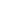

# Print History

HelixScreen keeps a record of your completed, failed and canceled prints, read from Moonraker's job history. The history view has two parts: a dashboard with summary statistics and trend charts, and a full searchable list with per-job details and reprinting.

Open it from **Advanced > Print History**, or by tapping the **Print Stats** widget on the home screen.

---

## History Dashboard

The dashboard opens with a summary for a time range and two charts.

### Time filters

A row of buttons sets the range for the statistics and charts: **Day**, **Week**, **Month**, **Year** and **All**. All is the default. The ranges are rolling windows: Day is the last 24 hours, Week the last 7 days, Month the last 30 days and Year the last 365 days.

HelixScreen keeps the newest jobs in memory and fetches older ones when a range reaches further back. If it has not loaded every job in the range, a note under the cards reads **Based on the newest N prints**.

On **All**, the **Total Prints**, **Print Time** and **Filament Used** figures come from Moonraker's lifetime totals, so they cover every job. The **Success Rate** and the charts still use the jobs HelixScreen has loaded.

1. The shortest time range button.
2. All, the default range.
3. Success Rate.
4. Prints Trend.
5. Filament by Type.

### Statistics

| Stat | What it shows |
|------|---------------|
| **Total Prints** | Number of jobs in the range |
| **Success Rate** | Share of those jobs that finished with a **Completed** status |
| **Print Time** | Total time spent printing |
| **Filament Used** | Total filament used (mm, m or km) |

### Charts

- **Prints Trend** shows how many prints you made over the range, labeled with the period (**Last 24 hours**, **Last 7 days**, **Last 30 days**, **Last 12 months** or **All time**). Day uses hourly points, Week and Month daily points and Year monthly points. On All, your whole history is split into twelve equal spans.
- **Filament by Type** shows how much filament each material used, as bars for the four heaviest materials. A multi-material job splits its filament equally between its materials, and a job with no material recorded counts as **Unknown**.

With no history yet, the dashboard shows **No print history yet** instead of the statistics and charts.

Tap **View Full History** at the top to open the detailed list.

---

## History List

The list shows individual jobs. Each row has the filename, date, duration, material and a status (**Completed**, **Failed**, **Canceled** or **In Progress**) with a colored bar at the left edge.

- **Search:** type in the **Search filename...** box to filter by filename. The small **x** in the box clears it.
- **Filters:** tap the filter button beside the search box to show two drop-downs. The first picks a status (**All**, **Completed**, **Failed** or **Canceled**) and the second a sort order (**Date (newest)**, **Date (oldest)**, **Duration** or **Filename**). The button turns the accent color while a filter is active.

When filters hide everything, the list says **No matching prints** and suggests trying different search terms or filters. With no jobs at all it says **No print history found**.

> **Multi-color jobs and filenames:** on [printers that map filament by rewriting the file](filament.md#printers-that-map-filament-by-rewriting-the-file), a job with Filament Mapping is printed from a rewritten copy. History normally shows the original filename again once the print is done, but that restore needs the HelixPrint plugin (and a reasonably current Moonraker). Without it, the job is listed under the rewritten name, which looks like `modified_1730824_benchy.gcode`. The print itself is unaffected.

---

## Print Details & Reprinting

Tap a job to open its details:

- the filename and status, with a matching icon
- **Started** and **Ended** (date and time, or a dash when the printer did not record one) and **Duration**
- **Layers**, **Nozzle** and **Bed** temperatures
- **Filament** used, its **Type** and the **Layer Height**
- **Spools:** which spool each tool or slot used and how much. This needs the [HelixPrint plugin](helixprint-plugin.md#switch-spools-at-each-tool-change)'s spool switching, and only prints it counted show it (see [Settings > Devices > Spoolman](settings/devices.md#switch-spools-at-each-tool-change))
- a picture of the print, with camera photos when the print has them: one taken after layer 2 and one when it ended. The picture opens on the end photo, and the **Preview**, **Layer 2** and **End** buttons switch between the slicer thumbnail and the photos. See [Print photos](settings/devices.md#print-photos) for how they are taken. Screens built without the [camera view](camera.md) do not show the photos.

Three buttons act on the job:

- **Reprint** takes you to the file's details in Print Files so you can start it again. It is greyed out when the original file is no longer on the printer.
- **Delete** asks **Delete the history record for <filename>?** and, when you confirm with **Delete**, removes the job from the history along with its camera photos. The G-code file itself stays.
- **View Timelapse** appears only when a timelapse exists for that job and opens the timelapse browser.

---

**Prev:** [Camera](camera.md) | **Next:** [Advanced Features](advanced.md) | [Back to User Guide](../USER_GUIDE.md)
