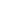
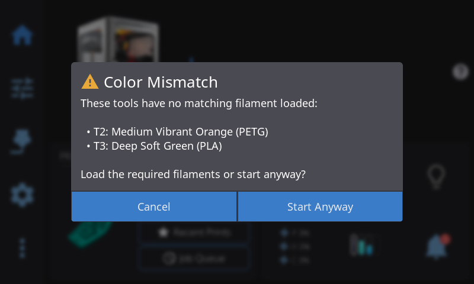
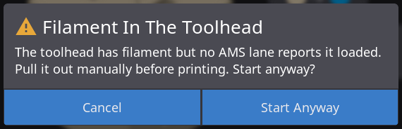
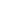

# Print Monitoring & Failure Detection

HelixScreen watches a print in three places. Before the print starts it checks the file and your filament and warns you about anything that looks wrong. While the print runs it shows a recovery dialog if the filament runs out. On the printers that can do it, it also reacts when a camera spots a failed print. This page covers all three.

---

## Before a Print Starts

When you tap **Print** on a file, HelixScreen runs a series of checks before anything heats up or moves. Most of them only warn: the dialog has a **Cancel** button and a button that starts the print anyway. A few block the print outright. If the file is still being checked when you tap, a **Checking filament...** message appears and the print continues as soon as the check finishes.

The checks run in this order:

| Check | Appears when | Can you start anyway? |
|-------|--------------|-----------------------|
| [Check filament](#the-check-filament-dialog) | A tool the file uses points at an empty slot, or at a slot with no material set (Snapmaker U1 only) | Yes, with **Print Anyway** |
| [File Will Stop the Printer](#file-will-stop-the-printer) | The file calls a command your printer treats as an emergency stop | No |
| [File Does Not Fit This Printer](#file-does-not-fit-this-printer) | The file moves past the printer's travel, heats past its limits or needs a tool the printer lacks | No |
| [Sliced for a Different Setup](#file-does-not-fit-this-printer) | The file was sliced for a different nozzle size | Yes |
| [Mixed-Temperature Materials](#the-mixed-temperature-materials-dialog) | The file prints two materials that need very different temperatures | Yes |
| [Not Enough Filament](#the-not-enough-filament-dialog) | The spool, or a mapped slot, holds less filament than the file needs | Yes |
| [Bypass Is Active](#printing-from-bypass) | The file needs several slots but bypass is engaged | Yes |
| [Filament In The Toolhead](#the-filament-in-the-toolhead-dialog) | Filament sits in the toolhead that no slot reports loaded | Yes |
| [No Filament Detected](#the-no-filament-detected-dialog) | The filament system or the runout sensor reports no filament for the print | Yes |
| [Color Mismatch](#the-color-mismatch-dialog) | A tool the file uses has no slot assigned | Yes |
| [Material Mismatch](#the-material-mismatch-and-filament-grade-mismatch-dialogs) and Filament Grade Mismatch | The loaded material or grade differs from what the file was sliced for | Yes |
| Door Open | A door sensor reports an open door on a material that wants a closed enclosure (see [Printing](printing.md)) | Yes |

The filament checks need something to compare against. On a printer with a multi-slot filament system (AMS, CFS, IFS, Box Turtle, Happy Hare and so on), HelixScreen compares each tool with the slot mapped to it. On a printer without one, the [No Filament Detected](#the-no-filament-detected-dialog) check uses your runout sensor instead.

### Printing from bypass

When bypass is engaged, filament goes straight to the extruder without passing through any slot. Every tool would read as unfed, so HelixScreen skips the slot checks for as long as bypass stays engaged and tells you so. The file details show **Bypass active — this print runs on the external spool.** For a single-tool file the Filament Mapping card is hidden, because there is nothing to assign.

Two things are still checked:

- **Material:** if the material set on the external spool does not match the file (the file says ASA, the spool holds PLA), you get one [Material Mismatch](#the-material-mismatch-and-filament-grade-mismatch-dialogs) warning naming the spool.
- **Amount:** a spool with a known remaining weight is compared with what the file needs (see [Not Enough Filament](#the-not-enough-filament-dialog)).

A file that uses several tools gets the **Bypass Is Active** warning instead: the printer may refuse to load a slot while bypass filament is in the toolhead, so remove the filament and turn bypass off first, or tap **Start Anyway**. Disengage bypass and the slot checks come back on the next print.

### The Check filament dialog

This dialog stops a print before it heats, so you do not find the problem halfway through. It appears when a tool the file uses has a problem that would ruin the print:

- the tool points at an **empty slot**, or
- on a Snapmaker U1, the tool points at a slot that has filament but no material set, and the print has **Pressure Advance Calibration** switched on (that calibration refuses a slot with no material).

It does not appear while you are printing from bypass, or on a printer with no multi-slot filament system.

The dialog shows one row per tool: the tool label (**T0**, **T1** and so on), the color the slicer wanted, an arrow, the color actually loaded (or **EMPTY** when the slot has no filament), and a status icon on the right.

| Icon | Meaning |
|------|---------|
| Green check | The slot has filament and matches the file |
| Amber warning | The color or the material differs. This only warns |
| Red cross | The slot is empty, or the slot has no material set |

Below the rows, one line explains the first blocking problem, for example:

> *T1 needs filament in slot 2, which is empty — this print will run out.*

If a tool has no slot at all, the line reads **T1 has no lane assigned. Pick one before printing.** (HelixScreen uses your filament system's own word for the position, such as slot or lane.)

For a slot with no material set, the line says which slot it is and a button appears that names the fix, for example **Set Slot 2 to PLA**. Tap it to write the file's material onto that slot. The button only appears when the file names a material for the tool and the slot belongs to the first filament system.

| Button | Action |
|--------|--------|
| **Map Filament…** | Opens [Filament Mapping](filament.md#filament-mapping) so you can point the tool at a slot that has filament. It is hidden when a remap cannot be carried out: when your filament system has no way to remap, when remapping needs the [HelixPrint plugin](helixprint-plugin.md) and it is not installed, when the file uses no tools worth mapping, and on a screen that cannot keep a local copy of the file. |
| **Cancel** | Backs out without printing. Load or map the missing filament, then start again. |
| **Print Anyway** | Starts the print despite the problem. Use it only if you know the check is wrong, for example when filament is loaded but not yet detected. |

> **Tip:** The check re-runs every time you tap Print, and again whenever your filament system's state changes. Loading a slot or engaging bypass while the file is open clears the warning without reopening the file.

> **Note:** A color or material difference alone does not raise this dialog. It shows as an amber or red outline on that tool's chip in the FILAMENTS card of the file details (see [Filament Mapping](filament.md#filament-mapping)), and the material difference raises its own warning below.

1. The line that names the slot with no material set.
2. The button that writes the file's material onto that slot.

### The No Filament Detected dialog

This warning has two forms. On a printer with a multi-slot filament system it lists the tools whose slot holds no filament, for example **T1 → Slot 2: no filament loaded.** On a printer without one it appears when the runout sensor is on and reports no filament: **The runout sensor indicates no filament is loaded. Start print anyway?** The proceed button reads **Start Print**.

The multi-slot form is skipped on systems that unload the toolhead after every print on purpose (the FlashForge AD5X IFS), and while you print a single-tool file from bypass.

### The Color Mismatch dialog

Where **Check filament** is about a tool pointing at an empty slot, **Color Mismatch** is about a tool that points at no slot at all: the file asks for a tool your filament system has no slot assigned to. That happens most often when a file was sliced for more tools than your system has, or when automatic matching could not find a home for one of them.

It lists each unmatched tool with the color and material the file wants:

> *T2: Medium Vibrant Orange (PETG)*

| Button | Action |
|--------|--------|
| **Cancel** | Backs out. Map the tool to a slot in [Filament Mapping](filament.md#filament-mapping), then start again. |
| **Start Anyway** | Starts the print. Your printer's firmware decides what to do when it reaches that tool. |

Despite the name, a merely wrong color never raises it. It only appears when a tool has no matching filament at all. It is skipped for single-color files, while you print from bypass, and on printers whose firmware picks the slots when the print starts.

### The Material Mismatch and Filament Grade Mismatch dialogs

When the filament mapped to a tool is a different material from the one the file was sliced for, **Material Mismatch** says so and shows the temperature ranges of both materials where it knows them. It ends with a reminder that the wrong material can cause clogs, poor adhesion or a failed print. **Start Anyway** prints regardless. Unknown materials never raise it, and tools the file never extrudes with are ignored.

Some filaments are the same plastic with something mixed into it. **PLA-CF** is PLA with chopped carbon fiber, **ASA-GF** is ASA with glass fiber, and wood, marble, metal and glow-in-the-dark filaments carry a powder. They print differently from the plain version and wear a brass nozzle, so a slicer profile for one is not the profile for the other. When the loaded filament is the same plastic but a different *grade*, HelixScreen shows **Filament Grade Mismatch** instead. The wording depends on which way round it is:

| Situation | What you are told |
|-----------|-------------------|
| The **loaded** spool is the filled one (the file wants PLA, the slot holds PLA-CF) | The filled filament runs at a lower flow rate and needs a hardened nozzle. This is the direction that can wear out a brass nozzle |
| The **file** is the filled one (the file wants PLA-CF, the slot holds PLA) | It will print slower and hotter than the loaded spool needs, which wastes time but does no harm |

Marketing suffixes raise nothing: **PLA+** against **PLA**, or **Silk** and **Matte** finishes. If one print has both a wrong material and a grade difference, you get one Material Mismatch dialog that lists everything.

Neither dialog changes your Filament Mapping: the tool still feeds from the slot it was mapped to.

### The Mixed-Temperature Materials dialog

Some plastics print far hotter than others. ABS, ASA, PC and nylon want a nozzle above 240°C and a warm enclosure. PLA, PVA and TPU soften not far above 60°C and print below 230°C. When one file uses a material from each end, the cooler one can be damaged by what the hotter one needs.

HelixScreen checks every pair of materials the file actually prints with. It warns when the hotter material wants a heated enclosure and the two have no nozzle temperature in common.

| Pair | Warns? |
|------|--------|
| PLA + ABS, PLA + PC, PLA + nylon (PA, PA-CF) | Yes |
| PLA + PETG, PLA + TPU, PLA + PVA | No: none of them needs an enclosure |
| PETG + ABS, ABS + PC | No: their nozzle temperatures overlap |

The message depends on your printer. With **one nozzle**, the cooler material goes through the same nozzle at the hotter material's temperature, where it can burn and clog. With **several nozzles** (a tool changer, or two or more hotends), each material has its own nozzle but they share the bed and the enclosure, and the heat can soften the cooler one and jam its nozzle.

A slicer profile often lists a material for every tool even when the file uses one, and those unused tools are ignored. **Start Anyway** is how you print a combination you know works on your printer. There is no setting to turn the check off.

### The Filament In The Toolhead dialog

The checks above compare the file with your slots. This one looks at the toolhead itself: filament is sitting in it, but no slot reports having loaded it. That usually means leftovers from a canceled or aborted job. HelixScreen asks before printing on top of unknown material.

On most systems the message is **The toolhead has filament but no AMS slot reports it loaded. Pull it out manually before printing. Start anyway?** On a system that can clear the toolhead by itself (the Creality CFS), it says instead that the printer may refuse to load a slot until the toolhead is cleared.

| Button | Action |
|--------|--------|
| **Start Anyway** | Starts the print with the filament left in the toolhead. Reasonable when you know it is the tail of the spool you just printed with. |
| **Cancel** | Backs out. Tap **Unload** in the filament sidebar, pull the filament out by hand, or load it properly from a slot, then start again. |

Only filament systems that can tell raise this dialog: AFC (Box Turtle), Happy Hare, Creality CFS and FlashForge AD5X IFS. Printing from bypass skips it, because the toolhead filament is then the external spool's.

### The Not Enough Filament dialog

This one is about quantity. It compares what the file is expected to use with what is left, and warns when the spool is short:

> *This print needs about 108g but the spool has about 62g remaining. Start anyway?*

There are two forms:

- **The external spool.** Used when you print without a multi-slot filament system, or from bypass. It needs a spool tracked through Spoolman with its remaining weight recorded.
- **Slots.** On a multi-slot system, each tool the file uses is compared with the remaining weight of the slot it is mapped to. A single short slot reads **Slot 2 has about 40g but T1 needs about 95g. Start anyway?** Several short slots are listed together. Slots with no weight on record are never compared.

The estimate uses the file's own filament weight when the slicer recorded it, and otherwise converts the filament length using the spool's material. A small shortfall may still fit, since spools often hold a little more than their label says. **Start Anyway** prints, and **Cancel** lets you swap in a fuller spool.

### File Will Stop the Printer

Some printers have macros that double as emergency stops (a `HALT` or a vendor stop command), and a file sliced for a different printer profile can call one by name. HelixScreen scans the start of the file for commands your printer treats as an emergency stop, and when it finds one it refuses to start the print:

> *Line 4123 calls HALT, which this printer treats as an emergency stop. Re-slice the file with a profile made for this printer.*

The dialog names the line and the command, plus the printer's own stop message when it has one. The same check runs when you start a job from the print queue. The job stays in the queue so you can fix or remove it.

### File Does Not Fit This Printer

A file sliced for another printer can ask for moves this printer cannot make, or temperatures its heaters do not allow. HelixScreen compares the file with the printer's own limits (its travel, its heaters' maximum temperatures and its tools) and blocks a file that breaks one:

> *Moves to X 360 mm, past this printer's 350 mm.*
> *Re-slice the file with a profile made for this printer.*

A file sliced for a different nozzle size gets the softer **Sliced for a Different Setup** warning with **Start Anyway**. A different printer model in the slicer profile is only noted in the file details. The findings also show in the file's details before you tap Print; see [Does the file fit this printer?](printing.md#does-the-file-fit-this-printer).

---

## Filament Runout During a Print

When the runout sensor stops detecting filament during a print, **the printer's own firmware pauses the job** before HelixScreen is involved. HelixScreen notices the pause and shows the **Filament Runout** dialog so you can recover without opening the console.

While the print is paused the dialog offers:

| Button | Action |
|--------|--------|
| **Load** | Runs your load sequence (heat, feed, purge) to bring fresh filament to the nozzle. On a multi-slot system this loads from the active slot. |
| **Unload** | Retracts the remaining filament so you can swap the spool before loading. |
| **Purge** | Extrudes a little filament to clear the old color or confirm flow. |
| **Resume Print** | Continues the print once filament is loaded. |
| **Cancel Print** | Cancels the print. |

Outside a pause, for instance when you tap the Filament Sensor tile on the home screen, the dialog shows **Load**, **Unload**, **Purge** and **Close** instead. While a print is running, Load, Unload and Purge are hidden and only **Close** remains, because they would ruin the print.

On the **Snapmaker U1**, which feeds the next filament by itself when you resume, the dialog has no Load, Unload or Purge buttons. It says **Refill the spool, then Resume.** and keeps **Resume Print** disabled until filament is back at that tool's feed port. If the port still sees filament, the dialog says **Motion sensor stuck: filament is still at the feeder. Resume to feed it.**

This dialog handles recovery on tool-changer and single-extruder printers, on any multi-filament system running from an external spool (bypass), and on the Anycubic ACE and QIDI Box, which report nothing of their own when filament runs out. Bypass prints get extra protection automatically: when you engage bypass, HelixScreen switches on the toolhead runout sensor at the printer if the filament system's own software had left it off, and switches it back when you disengage.

Systems that *do* raise their own runout alert show that alert instead, so one runout never produces two dialogs. What happens next differs by system:

- **AFC (Box Turtle) and Happy Hare** can switch to a backup slot if you configured one and it holds compatible filament. Otherwise their alert offers the recovery buttons.
- **Creality CFS** always pauses the print first. The box only switches spools when **Auto-Refill** is switched on *and* another slot holds the exact same material and color. If either condition is missing, the alert says so and the print stays paused until you load filament and resume.
- **FlashForge AD5X IFS** does not switch spools on stock firmware. Its alert tells you filament ran out and offers Resume, Purge and an IFS reset.

A runout alert only appears while the firmware is actually running the sensor. A sensor the printer has switched off for its own operations raises none.

---

## Print-Failure Detection

Some printers can watch a print through a camera and flag a failure. HelixScreen supports this on two:

- **Snapmaker U1** (stock firmware): the printer's own defect detector flags the failure and pauses the print itself.
- **Creality K2, K2 Plus and K2 Pro** (stock firmware, which ships Creality's AI model): HelixScreen runs the printer's own AI model on a camera snapshot at a fixed interval while a print is running. The interval and the confidence needed to flag a failure come from the printer's own AI settings: every 25 seconds at 77.5 percent unless the printer says otherwise.

On other printers the detection settings stay hidden.

### Settings

Under **Settings > Safety & Alerts**:

- **Spaghetti Detection** ("Watch the camera during a print for failed prints") switches detection on or off. It is on by default. On a K2, the first time HelixScreen runs it copies the printer's own AI detection switch and pause choice, so detection stays off if you had it off in Creality's settings. After that, HelixScreen's switches are the ones that count.
- **Pause on Detection** ("Pause the print when a failure is seen (off = warn only)") decides whether a detection pauses the print or only warns you. It is greyed out while Spaghetti Detection is off, and hidden on the U1, which always pauses by itself.
- **Bed Clear Check** ("Camera checks the bed is empty before each print") appears on the Snapmaker U1 only. See below.

On a K2, the pre-print options of a file can also include an **AI detection** tile ("Monitor for print abnormalities"), which is off by default. It appears only when the printer has Creality's own AI start macro.

1. Spaghetti Detection, the main switch.
2. Pause on Detection, which is greyed out while detection is off.

### What happens on a detection

- **Pause on Detection on**, or a printer that paused by itself: the print is paused and a **Print issue detected** dialog opens. On a screen that has the [camera view](camera.md), it also shows a small camera picture of the moment (not on the printer's own screen of a K2 or U1, which has no camera view). Below is a line of text: **Spaghetti detected (91%)** on a K2, where the model reports its confidence, or the printer's own message on a U1.
- **Pause on Detection off:** a **Spaghetti detected** warning toast appears and the print keeps going. A U1 has already paused by itself, so it always gets the dialog.

| Button | Action |
|--------|--------|
| **Resume** | Continues the paused print. |
| **Abort** | Cancels the print. |
| **Reduce Sensitivity** | (U1 only) Tells the printer to be less quick to flag spaghetti, and leaves the dialog open so you can then Resume or Abort. |
| **Turn off detection** | Switches Spaghetti Detection off and leaves the dialog open for your Resume or Abort choice. |

> **Note:** On the U1, the dialog appears for spaghetti failures. The printer's other defect codes (residue, dirty nozzle) are recognized but not shown.

### Bed Clear Check (Snapmaker U1)

Before a print, the U1's camera looks over the bed. If it thinks something is on it, the printer stops before printing and HelixScreen opens **Something on the bed?** whatever your Spaghetti Detection settings say. A false alarm on a clear bed is possible. The paused job cannot be resumed.

| Button | Action |
|--------|--------|
| **Restart print** | Starts the same file again from the beginning. |
| **Cancel print** | Cancels the job. |
| **Turn off bed check** | Switches the check off for later prints. Only shown while the check is on. |

Turn the check off or back on any time with **Settings > Safety & Alerts > Bed Clear Check**. The row is greyed out when the printer's detection module is off.

---

## See Also

- [Filament Management](filament.md): AMS slots, Filament Mapping, and loading filament
- [Printing](printing.md): starting prints, pre-print options, and monitoring during a print
- [Safety & Alerts](settings/safety.md): all the safety settings in one place
- [Supported Printers](supported-printers.md): which detection and filament features each model supports

---

**Next:** [Temperature Control](temperature.md) | **Prev:** [Printing](printing.md) | [Back to User Guide](../USER_GUIDE.md)
