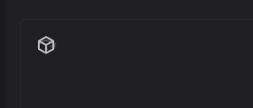
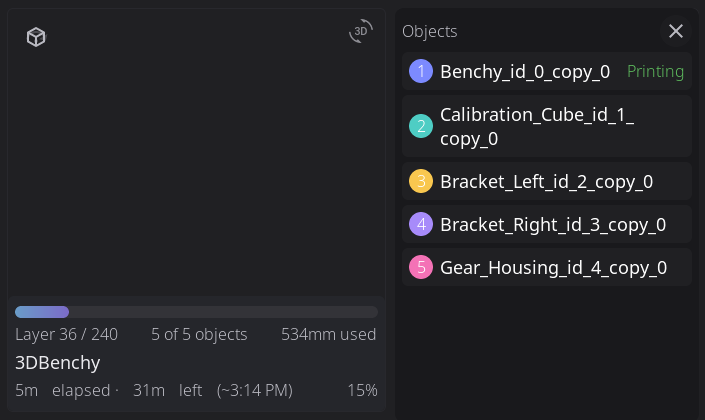

# Printing

Everything about selecting, starting, monitoring, and tuning your prints.

---

## Selecting a File


1. From the **Home panel**, tap the print file area (shows "Select a file" when idle)
2. Browse your G-code files from Moonraker's virtual SD card

**File source tabs:**

If your printer exposes a USB drive, the top-left of the panel shows **Printer** and **USB** tabs. Tap a tab to switch which storage the file browser lists — **Printer** shows files on the printer's storage (Moonraker's virtual SD card), **USB** shows files on the attached USB drive. The tabs only appear when more than one source is available.

Printing (or queueing) a file from the **USB** tab first copies it to the printer's storage, into a folder named `usb_prints`, with a progress bar while it copies. The copy stays there afterwards, so the file is also listed under **Printer** and can be reprinted without the stick. If `usb_prints` already holds the same file, it is printed from there without copying again. If it holds a different file with the same name, nothing is overwritten: the new copy is saved as `name (2).gcode`, then `name (3).gcode`, and so on. HelixScreen never deletes these copies, so clear out `usb_prints` from the file list when it fills up. A file that would leave the printer with less than 100 MB free is not copied, and a message says the printer is out of space.

**USB sticks on boards that do not mount them.** Some printer boards have nothing that mounts a USB stick when you plug it in. There, HelixScreen mounts the stick itself, read-only, at `/mnt/usb/<device>` (for example `/mnt/usb/sda1`), and a stick plugged in while HelixScreen is running shows up within about a second. HelixScreen never touches a stick the system has already mounted, and it only does this when it runs as root. It unmounts its own mounts when a stick is removed and when HelixScreen shuts down. FAT, exFAT and NTFS sticks are supported. On a board whose kernel only mounts FAT sticks with short names, a file like `3DBenchy.gcode` appears as `3DBENC~1.GCO` and still prints. To turn this off, set `HELIX_USB_AUTOMOUNT=0` in `helixscreen.env`.

**View options:**

- **Card View** (default): Thumbnails with file info — estimated time, filament usage, slicer
- **List View**: Compact view for browsing many files (toggle with the grid icon in top-right)


List view shows filename, print status, file size, modification date, and estimated print time in a sortable table. Tap any column header to sort.

Once HelixScreen has timed at least one print start, the estimated time in both views adds how long the printer usually takes to get ready (heating, homing, leveling) to the slicer's print time.

**Sort columns** (tap a column header to sort):

- Filename (A-Z or Z-A)
- Size (largest or smallest)
- Modified (newest or oldest first)
- Time (longest or shortest)

---

## Sending Prints from OrcaSlicer

Files you slice in OrcaSlicer can be sent straight to your printer over the network, where they show up in the file browser above — no USB stick or web upload needed. **OrcaSlicer 2.4.0 or newer** added a native Klipper/Moonraker connection that makes this work out of the box; HelixScreen needs nothing configured on its side.

In OrcaSlicer:

1. Open **Printer Settings** (the gear next to your printer profile) → **Connection** (or the printer/network icon in the device area).
2. Set the host type to **Moonraker (Klipper)**.
3. Enter your printer's address — the same IP or hostname your printer's web interface (Mainsail/Fluidd) uses, e.g. `http://192.168.1.50` or `http://myprinter.local`.
4. **API key** (only if your Moonraker requires one): paste the key from your Moonraker config. Most home setups can leave this blank on OrcaSlicer 2.5. On 2.4, a blank key breaks filament sync even though uploads work; see [Troubleshooting](../TROUBLESHOOTING.md#orcaslicer-doesnt-pick-up-your-slot-colors-or-materials).
5. Click **Test** — OrcaSlicer confirms it can reach the printer.

Once connected, OrcaSlicer's **Print** button uploads the sliced file and (optionally) starts it. The file appears in HelixScreen's file browser like any other, and you can also start it from the touchscreen.

> **A print that doesn't fit:** with the [HelixPrint plugin](helixprint-plugin.md) installed you can have the printer refuse to start an uploaded file that would move past its travel or heat past its limits. See [Hold slicer prints that do not fit](settings/safety.md#hold-slicer-prints-that-do-not-fit).

> **Older OrcaSlicer (2.3.x):** the native Moonraker option isn't available. Either upgrade to 2.4.0+, use the older **Octo (Klipper)** host type, or just export the G-code and copy it through Mainsail/Fluidd.

> **Filament presets come along for the ride:** if your AMS slots are configured in HelixScreen, OrcaSlicer pre-selects matching filament presets automatically — see the [Filament guide](filament.md#syncing-with-orcaslicer-232-and-later).

---

## File Preview


Tap a file to see the preview panel:

- **3D G-code preview**: Rotatable with touch, showing the toolpath. On slower boards, the preview shows a simplified model while you drag and sharpens a moment after you let go.
- **Sliced colors button**: The round palette button in the preview's top-left corner switches the 3D preview between the colors of the filament actually loaded and the colors the file was sliced with. It lights up while the sliced colors are showing, and appears once the 3D preview has drawn.
- **2D layer preview**: Outer walls darken where the surface folds, so overhang ledges, rims and steps read as edges while straight and evenly sloped walls keep their color. Sequential prints, objects at different layer heights and spiral vases are left unshaded.
- **Metadata**: Estimated time, filament weight, layer count, material, and layer height. The material names the filament of each tool the print actually uses, such as "ABS-GF" or "PLA, PETG". Tools the file defines but never prints with are left out.
- **FILAMENTS card**: One chip per tool the print uses, showing the file's filament over the slot that will feed it, with a colored outline when they don't match. Tap a chip to change its slot. See [Filament Mapping](filament.md#filament-mapping).
- **Pre-print steps**: Shows which calibration steps will run before printing (e.g., bed mesh)
- **Timelapse toggle**: Enable recording if you have the timelapse plugin installed

### Sliced 3MF files

A sliced 3MF (a `.gcode.3mf` file, as Bambu Studio, OrcaSlicer and FlashForge's slicer upload it) can hold several plates. The preview shows one plate at a time, with a plate label at the bottom of the preview:

- With one plate, the label shows that plate.
- With several, arrows appear either side of the label. Tap them to step through the plates. The preview, time and filament follow the plate shown, and **Print** prints that plate.

The label uses the name you gave the plate in the slicer, such as **Hull (1 of 2)**. A plate without a name shows its plate number instead, such as **Plate 2 (2 of 2)**. Very long names are shortened.

### With the HelixPrint plugin

When the [HelixPrint plugin](helixprint-plugin.md) is installed on your printer (the **Install** row on the **Advanced** screen; on a screen that is not attached to the printer it shows a command to run on the printer instead), it reads every G-code file once, in the background, right after you upload it. You don't need to do anything, and the file prints exactly as it would without it. What you get:

- **A thumbnail for every file.** A file your slicer saved without a picture gets one: a top-down view of the print, colored by filament. It shows in the file list here and in Mainsail and Fluidd too.
- **Faster previews of large files.** The 2D layer preview of a big file appears as soon as the file has downloaded, instead of after HelixScreen has read through it.
- **Filament per tool, sooner.** The filament amounts and colors for each tool come straight from the plugin, so the filament checks before a print have them without HelixScreen reading the file.

A file uploaded a moment ago may not be read yet; HelixScreen then works it out itself, as it does without the plugin. Reading a file never slows a print down: on a printer with a single-core processor it waits until no print is running.

---

## Pre-Print Options

Before starting, you can enable or disable the steps below. Each option is a tile: tap it to switch it on or off. A tile that is on is filled with the accent color and shows a check in place of its icon.

| Option | What It Does |
|--------|--------------|
| Auto Bed Mesh | Run bed mesh calibration before print (reads **Adaptive Bed Mesh** when adaptive meshing is available on your printer) |
| Quad gantry level | Run QGL calibration (for gantry printers) |
| Z tilt | Run Z-tilt calibration |
| Cleaning nozzle | Execute your cleaning macro |
| Purge | Draw the purge line that primes the nozzle |
| Flow calibration | Snapmaker U1 only: measure each toolhead's pressure advance before the print (see [Snapmaker U1: flow calibration](#snapmaker-u1-flow-calibration)) |

The gantry, tilt, nozzle cleaning and purge toggles use the same names as the steps in the checklist the print screen shows while the printer gets ready.

These options modify the G-code on-the-fly — if you disable "Auto Bed Mesh" but your G-code contains `BED_MESH_CALIBRATE`, HelixScreen comments it out so it doesn't run.

> **Note:** This only works for operations in the sliced file itself. If a step like bed mesh or QGL lives *inside* your `PRINT_START` macro, HelixScreen can't comment it out. The toggle can only skip it if your macro accepts a skip parameter for that step (for example `SKIP_BED_MESH=1`).

HelixScreen prints a changed copy of the file and leaves your original untouched. The copy keeps every other line of the file, including its last command. With the [HelixPrint plugin](helixprint-plugin.md) installed, the copy is made on the printer itself, so a large file starts without first being copied to the screen and back. Without the plugin, the screen downloads the file, changes it and uploads the copy, which takes longer for big files and needs free space on the screen. Either way, a copy that would leave the printer with less than 100 MB free is not made: the print does not start and a message asks you to free some space (see [Storage](settings/system.md#storage)).

> **Tip:** Pre-print options remember your preferences per slicer. If you always run bed mesh before PrusaSlicer prints, that preference persists.

**Creality K2, K2 Plus and K2 Pro (stock firmware): Auto Bed Mesh.** Creality's start sequence has no setting HelixScreen can switch, so with **Auto Bed Mesh** on, HelixScreen sends the printer's own mesh-before-print command (`BED_MESH_CALIBRATE_START_PRINT`) just before the print starts. Auto Bed Mesh is on by default on these printers. With it off, HelixScreen sends nothing and the printer does whatever its own start sequence does. If the file's own start G-code already calls `BED_MESH_CALIBRATE_START_PRINT` itself, HelixScreen does not send it, so the bed is meshed once, not twice. Only that exact command counts: other bed mesh lines (such as `BED_MESH_PROFILE LOAD` or `BED_MESH_CLEAR`) and `START_PRINT` settings that ask for a mesh do not, and HelixScreen still sends its mesh command then. HelixScreen checks only the start of the file (the first 500 lines or 50 KB, thumbnails included, and nothing past the first extruding move); a call further in is not seen, and the mesh is sent.

This applies to every print started from the screen, including a queued job started from the screen. A print started from your slicer, Mainsail, Fluidd, or by Moonraker's queue on its own never gets HelixScreen's pre-print options.

### Snapmaker U1: flow calibration

The U1 can measure each toolhead's pressure advance at the start of a print, using a sensor in the toolhead. Snapmaker calls this **flow calibration** (in OrcaSlicer and the Snapmaker app it is "dynamic flow calibration"). In HelixScreen it is the **Flow calibration** tile in the pre-print options: turn it on before you tap **Print**. The printer forgets the choice when each print ends, so the tile shows what you set for this print.

**Turn off "Enable pressure advance" in your OrcaSlicer filament profile.** With it on, Orca sends its own fixed pressure advance value right after the calibration, so the measured value is thrown away even though the calibration ran.

**Prints started from the slicer or the web interface.** The tile only applies to prints started from the screen. For any other print you can switch calibration on yourself:

- **For the next print:** in the Mainsail or Fluidd console, send

  ```
  SET_PRINT_PREFERENCES FLOW_CALIBRATE=1
  ```

  before starting the print. The setting is cleared when the print ends, so send it again before the next one.

- **For every print:** add this line to your printer profile's machine start G-code in OrcaSlicer, before the `SM_PRINT_FLOW_CALIBRATE` lines:

  ```
  SET_PRINT_PREFERENCES FLOW_CALIBRATE=1 FORCE=1
  ```

  `FORCE=1` is needed because the printer refuses this setting once a print is running without it.

- **One toolhead, outside a print:** `FLOW_CALIBRATE TEMP=220` calibrates the mounted toolhead at 220 °C (use your filament's printing temperature) and saves the result.

The manual commands above come from the U1 firmware and have not been tested end to end with HelixScreen yet. If calibration runs, the print's start shows a flow calibration phase for each toolhead before the bed mesh.

---

## Starting a Print

1. Select your file
2. Review and set pre-print options
3. Tap **Start Print**

On larger screens, a line above the Print button (for example "~6 min prep time") estimates how long the printer will take to get ready before the first layer. It counts heating from the current temperatures up to the file's first-layer temperatures, plus homing and the other pre-print steps. After your first print it learns how long your own printer takes for everything except heating, and keeps separate timings for a cold bed and an already-warm one. Heating is worked out fresh for each print from the temperatures that print needs, so a hot material such as ASA gets a longer estimate than a quick PLA print, even right after one.

Changing a pre-print option updates the estimate straight away:

- Turning an option off takes that step's time off the estimate.
- Turning an option on adds time only when your recent prints skipped that step. If they ran it, its time is already in the estimate.

The line appears once the file's details have loaded. It is not shown for files on a USB stick, and small screens (480x320 and below) leave it out to make room for the options.

The UI switches to the Print Status panel automatically.

Before the print starts, HelixScreen may ask about the file and your filament. A file that mixes high- and low-temperature materials, such as PLA with ABS, shows **Mixed-Temperature Materials**; see [Print Monitoring](print-monitoring.md#the-mixed-temperature-materials-dialog) for what each dialog means.

### Does the file fit this printer?

When you open a file, HelixScreen compares it with your printer's own limits and shows anything it finds in a card above the filament card:

| Finding | What it means | At Start Print |
|---------|---------------|----------------|
| Moves past the printer's travel (or a delta's radius) | The file was sliced for a bigger bed, or places a purge line where this printer can't reach | Blocked |
| Heats the nozzle or bed above the printer's limit | The slicer profile asks for more than the printer's heater allows | Blocked |
| Uses a tool the printer doesn't have | For example T2 on a two-extruder printer with no filament system | Blocked; a warning with **Start Anyway** when only tool macros, not extruders, give the printer's tool count |
| Sliced for a different nozzle size | The slicer assumed a 0.6 mm nozzle and the printer is set up for 0.4 mm | Warning, with **Start Anyway** |
| Sliced for a High Flow nozzle on a toolhead with a standard one | The U1's own firmware refuses a High Flow job on a standard nozzle, unless your filament mapping puts that tool on a High Flow head | Warning, with **Start Anyway** |
| Sliced for a standard nozzle on a toolhead with a High Flow one | The print works, but was not made for this nozzle | Warning, with **Start Anyway** |
| Sliced for a different printer | The slicer profile names another printer model (not your own preset name) | Shown in the card only; Start Print is not interrupted |

On a Creality K1, K1C or K1 Max with the CFS upgrade, the CFS takes 5 mm of the bed's Y travel, so the check allows 5 mm less in Y while the CFS is connected.

Nozzles are checked only on the toolheads the file prints with, and tool T0 in the file is compared with the printer's first toolhead, T1 with the second and so on. Where the printer reports which nozzle each toolhead has fitted, as the Snapmaker U1 does, that is what the file is compared with; the High Flow and standard checks need such a printer and a slicer that writes the nozzle type, such as OrcaSlicer.

A blocked file shows **File Does Not Fit This Printer**, naming each problem; re-slice it with a profile made for this printer. A nozzle mismatch alone shows **Sliced for a Different Setup**.

How much HelixScreen can see depends on whether the [HelixPrint plugin](helixprint-plugin.md) is installed:

- **With the plugin**, the printer reads the whole file when it's uploaded, so every move, temperature and tool is checked, including the purge line and wipe tower.
- **Without it**, the screen reads the start of the file and its slicer details for temperatures, nozzle and printer model, and takes the travel from the 3D or 2D preview once that has loaded. The preview covers the part itself, not the purge line or wipe tower, and a file whose preview hasn't loaded (or a screen that shows thumbnails only) is not checked for travel.

Files you start from the print queue get the same check. To have a slicer's own upload-and-print held as well, see [Hold slicer prints that do not fit](settings/safety.md#hold-slicer-prints-that-do-not-fit).

### Door-open warning

If your printer has a door or lid switch, HelixScreen checks it when you tap **Start Print**, but only for materials that print best in a warm, closed enclosure, such as ABS, ASA, PC and nylon. For those, an open door cools the chamber and can cause warping or layers splitting apart. With a door open you see **Door Open**, naming each open door and the material. Close the door and tap **Start Print** again, or tap **Start Anyway** to print with it open.

PLA, PETG and other materials that like fresh air never trigger it, and neither does a file whose materials HelixScreen can't tell.

This comes after the other pre-print checks, so you may see a filament warning first.

Which inputs count as doors, and whether the check runs at all, is set in **Settings > Devices > Sensors > Inputs**. See [Inputs (Doors and Buttons)](sensors.md#inputs-doors-and-buttons). The check is on by default for any printer with a door switch. Printers with no door switch never show this warning.

### Before the print actually begins

Some printers do a lot of work before the first layer: homing, heating a bed to
soak temperature, and on some machines a full bed mesh. Depending on the printer,
that work runs either inside its own `PRINT_START` macro or ahead of the job. On a
K2 Plus with **Auto Bed Mesh** enabled it regularly takes seven to ten minutes.

The Print Status panel shows the pre-print steps and an estimated time for this
whole period, with the new file's thumbnail - the previous job's result is
cleared the moment you tap Start Print. Finished steps show how long they took, the current step is amber with a countdown, and the steps still to come show an estimate. On small screens it shows the current step and a dot per step instead. A step the printer has not announced is never listed ahead of time. The heater chips show a progress bar while they warm up.

While the pre-print steps are showing:

- **Cancel** is available and always stops the print from starting. If the printer
  is mid-way through a leveling pass it will finish that motion first, because a
  running macro cannot be interrupted - but the print will not begin, and the
  screen reports it as canceled rather than as a failure.
- **Pause** is unavailable, since there is no print to pause yet.
- **Tune** works. Speed and flow adjustments carry into the print. A Z-offset
  change made here may be overwritten by the printer's own start macro, so it is
  usually better to adjust once printing has begun.

The rest of the screen tracks this window too. The home panel's print card shows
the preparing job from the moment you tap **Start Print** — thumbnail, a progress
bar for the pre-print steps, and the current step — and tapping it opens the
Print Status panel rather than the file browser. Controls that would move the
toolhead (jog controls, filament load/unload, tool changes) stay unavailable
until the first layer actually begins.

> **Note:** On a multi-color print, HelixScreen checks your loaded filament before it starts and will stop with a **Check filament** dialog if a required tool maps to an empty slot. Printing from bypass skips that check, since the filament never passes through a slot. On printers with camera-based failure detection, it can also react to a print going wrong mid-job. See [Print Monitoring & Failure Detection](print-monitoring.md).

---

## During a Print


The Print Status panel shows:

- **A job tile** with the live preview of the print (including the exclude-object button), the filename, and the current layer and Z height
- **A printer tile** with a picture of your printer and a chip for each heater, fan, the light, and speed/flow. On printers whose picture has been mapped, each chip sits beside its part with a dotted line to it, and the part glows while it is active (the nozzle warming up, a fan spinning, the light on). The bed's plate and a heated chamber glow by how hot they are, and where the picture knows the enclosure's windows the chamber's red stays inside the glass; when the chamber is warm, its glow takes the place of the light's. A heater chip turns amber when it is off its target. The speed/flow chip shows how fast the toolhead is moving right now in mm/s, with the volumetric flow in mm³/s under it, and turns amber when speed or flow is not 100%. Tap a chip for its detail; tapping speed/flow opens Tune, and tapping the light toggles it. Chips that show an ordinary value (a fan at 0%, the light off) are the first to be left out when the screen is too small for all of them
- **A strip** along the bottom with the percentage, time remaining, finish time, time elapsed, the filament in use, the next queued job, and the buttons

> **Note:** Exact layer counts and the most accurate time-remaining estimate require your slicer to report layer info to Klipper via `SET_PRINT_STATS_INFO`. If the count or ETA looks off, see [Troubleshooting → Layer count is wrong, stuck at 0, or total layers missing](../TROUBLESHOOTING.md#layer-count-is-wrong-stuck-at-0-or-total-layers-missing).

> **If Klipper errors mid-print:** HelixScreen automatically shows a full-screen recovery dialog when the printer shuts down, errors, or disconnects. See [Troubleshooting → When the Printer Errors or Disconnects (Recovery Dialog)](../TROUBLESHOOTING.md#when-the-printer-errors-or-disconnects-recovery-dialog) for what each button does and when to use it.

**Print controls:**

| Button | Action |
|--------|--------|
| **More** | Opens a small menu with **Camera**, **Timelapse** and **Light**. Each appears only when it applies (a webcam on a remote screen, timelapse support, a controllable light), and More is hidden when none do. The light can also be toggled from its chip on the printer picture. |
| **Pause** | Parks nozzle safely, pauses print |
| **Resume** | Continues from paused state |
| **Cancel** | Stops print (confirmation required). By default, waits for the printer's cancel routine to finish. If **Cancel Escalation** is enabled in **Settings > Safety & Alerts**, an emergency stop triggers automatically after the configured timeout. |
| **Tune** | Opens Print Tune overlay for real-time adjustments |

**Files button.** While a print runs, a folder icon in the print screen's header opens the file list, so you can line up the next job without leaving the print view. A second print can never start while one runs; when your printer has a job queue, the button becomes **Add to Queue** instead (see [Queueing a Print](#queueing-a-print)).

**Camera button.** If HelixScreen runs on a separate screen or device from the printer (see [Camera](camera.md)) and the printer has a webcam, the header also gains a **Camera** button that opens the full-screen webcam view. On the printer's own screen it stays hidden - you can already see the print.

**Why a print paused or stopped.** When a print pauses, the preview card shows **Print Paused** with the reason under it, when the printer gave one: Klipper's own message for the pause, or the last error the printer reported just before it (for example a filament system that failed to load). A filament runout reads **Filament Runout**, with the slot when HelixScreen knows it. The reason clears when you resume. A canceled or failed print shows its reason the same way under **Print Canceled** or **Print Failed**, in the completion dialog or the "Print canceled" message, so a print canceled after a failed command (a gantry level that never converged, say) says which command failed. Canceling a paused print keeps the pause's reason.

**Pause ticks on the progress bar.** Scheduled stops in the file - filament changes (`M600`), `PAUSE`/`M601` commands, and slicer pause-at-layer markers - each draw a small tick on the progress bar where they fall, on both the print screen and the home print card. On a file sliced with `M73` progress markers, the ticks sit at the slicer's own percentages.

### Pausing at a Layer

You can tell a running print to pause at a layer you pick - to drop in a magnet or nut, or swap filament for a color band - even when the file has no pause in it.

**What it needs:**

- **The pause macros in your printer config.** Your config must include `SET_PAUSE_NEXT_LAYER` and `SET_PAUSE_AT_LAYER`. Mainsail's and Fluidd's standard client macros (`mainsail.cfg` / `fluidd.cfg`) have both, and so does the Snapmaker U1's stock firmware. Without them, this option does not appear.
- **Layer info from your slicer.** The pause fires when the file tells Klipper a new layer has started (`SET_PRINT_STATS_INFO CURRENT_LAYER=...`). Many slicer profiles do not add this; [Troubleshooting → Layer count is wrong, stuck at 0, or total layers missing](../TROUBLESHOOTING.md#layer-count-is-wrong-stuck-at-0-or-total-layers-missing) shows the two lines to add. Without it the option is shown but disabled, with a note saying the print does not report layers.

**Scheduling a pause:**

1. During a print, tap the **layer count** on the print screen (the row with the layers icon). A small pause symbol next to it shows it can be tapped.
2. Choose **Next Layer** to pause when the next layer starts, or **Choose Layer** and enter a layer number. Only layers still ahead of the print are accepted, and only ones the file actually reports: the pause fires on an exact layer number, so a layer the file skips would never trigger it.
3. The layer count now shows an orange pause symbol with the layer it will stop at, and a tick appears on the progress bar.

When the print reaches that layer, it pauses the way your **Pause** button does (your printer's `PAUSE` macro, or `M600` if your config sets that). Tap **Resume** to continue.

**Canceling:** tap the layer count again and choose **Cancel Scheduled Pause**. A pause you scheduled here that the print never reached is cleared when the print finishes, is canceled or fails, so it cannot catch the next print by surprise.

> **Note:** A pause scheduled from Mainsail or Fluidd shows here too, since they use the same macros.

### View Toggle (Progress / Complete)

When the G-code viewer is active during a print, a small floating button appears in the top-left corner. Tap it to switch between:

- **Progress view** (default): Shows layers printed so far in solid color with a faded "ghost" preview of unprinted layers above.
- **Complete view**: Shows the entire finished object with all layers solid — useful for seeing what the final print will look like.

In the 2D view, outer walls darken where the surface folds, so overhang ledges, rims and steps read as edges while straight and evenly sloped walls keep the filament color (#1314).

The icon shows a cube (tap to see the complete model) or stacked layers (tap to return to progress view). The toggle resets automatically when a new print starts.

If the print contains multiple objects, an **objects button** (a skip-objects icon) also appears in that corner. Tap it to open the Objects list — one of the two ways to exclude an object, see [Exclude Object](#exclude-object) below. The view toggle shifts to the right to make room.



### Timelapse Toggle

If the Moonraker-Timelapse plugin is installed, a **timelapse button** appears in the print controls. Tap it to enable or disable recording for the current print. The button shows a camera icon and toggles between "On" and "Off" states.

During printing, frame captures happen automatically based on your timelapse settings (per-layer or time-based). When the print finishes, the video renders automatically if auto-render is enabled.

---

## Queueing a Print

> Added in 1.1.

You don't have to wait for a print to end before picking the next one. While a print is running - or still preparing, before its first layer - open any file and its **Print** button becomes **Add to Queue**, marked with a clock icon. A toast confirms the job's position ("Added to queue (position 2)").

- The pre-print options you set on that screen (bed mesh, nozzle cleaning and so on) are saved with the queued job and come back when the job starts.
- A job added to the queue from somewhere else (Mainsail, Fluidd, your slicer) has no saved options. Started from the screen, it uses each option's default, so on a Creality K2 **Auto Bed Mesh** is on (see [Pre-Print Options](#pre-print-options)).
- Filament Mapping is not saved with the job: it is worked out again when the job actually starts, against the filament loaded at that moment.

**Where to see the queue:**

- the **Up next** line on the print status screen while a print runs, and on the home print card ("Up next: benchy (+2)" when more jobs follow). Tapping it while a print runs opens the Job Queue.
- the **Job Queue** itself (see [Home Panel - Job Queue Manager](home-panel.md#job-queue-manager)).

**Starting the next job:**

- When a print finishes, the completion dialog offers a **Start next** button whenever the queue has jobs.
- When the printer is idle, tap the **Up next** line or a job in the Job Queue. The file opens in the file view with your saved options already set - check that the bed is clear, then tap **Print**. The job leaves the queue only once the print actually starts, so backing out of the file view leaves it queued for later.

> **Note:** The queue is Moonraker's `[job_queue]` component. Without it in `moonraker.conf`, the button stays a disabled **Print**. If you set `automatic_transition: True` there, Moonraker starts queued jobs itself as each print finishes - HelixScreen is not involved in that start, so the options card is hidden while queueing and your options are not applied.

---

## Print Tune Overlay


Access by tapping **Tune** during an active print.

You can also keep the Speed / Flow and Z-Offset readings on the home screen and tap them to open this overlay: see the [Speed / Flow](home-panel.md#speed--flow-widget) and [Z-Offset](home-panel.md#z-offset-widget) widgets.

| Parameter | Range | What It Does |
|-----------|-------|--------------|
| Speed % | 50-200% | Overall print speed multiplier |
| Flow % | 75-125% | Extrusion rate multiplier |
| Pressure Advance | 0-2 | Live pressure advance of the active extruder |

Next to each percentage, the overlay shows what it means right now: how fast the toolhead is actually moving in mm/s (0 when it is standing still) and the live volumetric flow in mm³/s.

**Percent or mm/s.** Anything marked with the ⇄ swap icon switches which reading the overlay leads with: the percentages (default), or the live toolhead speed and volumetric flow with the percentage beside them. Tap either readout to switch. The choice is remembered.

> **Note:** Volumetric flow assumes 1.75 mm filament. On a 2.85 mm printer it reads low.

**Pressure Advance**. The **PA** row beside the reset button shows the pressure advance the printer reports for the active extruder and changes it by 0.001 per tap (0.005 too on wider screens). Like speed and flow, the change lasts until the printer restarts or something else sets it (many slicers set it at the start of each print). While a [pressure advance test tower](calibration.md#pressure-advance-tuning-test-tower) is printing, a **Tuner** button here takes you back to the full-screen tuner.

The overlay also includes Z-Offset / baby-step controls (see below).

**When to adjust:**

- **Speed %**: Slow down (60-80%) for intricate details or if you see layer separation. Speed up for large infill areas.
- **Flow %**: Increase (105-110%) if you see gaps between extrusion lines. Decrease (95-98%) for blobs or over-packed lines.

> **Note:** Speed and Flow adjustments are temporary and only affect the current print. The next print uses your slicer's original values. Z-Offset is the exception - see below.

> **Fan speed:** Part cooling fan speed is not adjusted from the Tune overlay. Current fan speeds are shown on the Print Status panel; tap that fan row to open the separate fan control overlay.

---

## Z-Offset / Baby Steps

Fine-tune your first layer height, during a print or while idle.

The [Z-Offset widget](home-panel.md#z-offset-widget) puts the live offset, the baby-step buttons and **Save** on the home screen.

**Getting there:**

- **During a print:** the **Tune** button on the Print Status screen.
- **Any time:** the **Z-Offset** row on the Controls panel. It shows the current offset and opens the same controls.

**Adjusting:**

Choose a step size (0.05 / 0.025 / 0.01 / 0.005 mm), then tap up/down to raise or lower the nozzle. The step size you pick is remembered: next time the controls open, they start at that size instead of the default.

**On multi-tool printers** (tool changers, and printers with more than one nozzle), the Tune overlay's Z-offset row shows a selector for which tool the offset applies to, plus a **Global** option that moves every tool together. Adjusting one tool's offset leaves the others alone - useful when one nozzle sits slightly higher or lower than its siblings.

**Signs you need to adjust:**

| Symptom | Problem | Fix |
|---------|---------|-----|
| Lines not sticking, curling up | Nozzle too high | Tap **down** |
| Rough first layer, scratching sounds | Nozzle too low | Tap **up** |
| Gaps between lines | Nozzle too high | Tap **down** |
| Elephant foot, ridges | Nozzle too low | Tap **up** |

**Saving your Z-Offset:**

1. Get the first layer looking good
2. Tap **Save Z-Offset** on the Controls panel to write to Klipper config
3. Future prints use this as the starting point

An adjustment made from the Tune overlay is temporary - it lasts for this print unless you save it from Controls.

The Save Z-Offset buttons can be turned off for a printer with **Save Z-Offset Buttons** in [Settings > Motion](motion.md#motion-settings). They start off on tool changers.

**If there is no Save Z-Offset button**, the Tune overlay's hint under the
Z-offset row says which case you are in:

- **"Z-offset is auto-saved by firmware"**: your printer's firmware stores the
  offset itself and there is nothing to save - what you dialed in is already kept
  and is re-applied at the start of the next print. This is the case on the
  FlashForge AD5M / AD5X running ZMOD.
- **"Temporary adjustment for this print"**: nothing saves the adjustment,
  usually because **Save Z-Offset Buttons** is off for this printer. Turn it
  back on in Settings > Motion to save from Controls.
- **"Temporary for this print; a tool change resets it"**: nothing saves the
  adjustment. On the Snapmaker U1 each head keeps its own stored offset, which the
  firmware re-applies whenever that head is picked up, so a baby step lasts only
  until the next tool change or the end of the print.

> **AD5M / AD5X (ZMOD):** the firmware clears the *live* offset when a print
> ends, so other interfaces can show 0.000 while idle even though your real
> offset is stored and will be used. HelixScreen shows the stored value instead,
> so the number on the Z-Offset row is what your next print will actually use.

> **Tip:** Make small adjustments (0.01mm) and wait for the printer to complete a few moves before judging the result.

---

## Exclude Object

On a multi-object print you can stop printing a single object and let the rest finish — the way to salvage a job when one part fails or detaches. Your slicer must label the objects in the G-code (OrcaSlicer and SuperSlicer do this); on a file without labels there is nothing to pick and the feature stays out of your way.

There are two ways to exclude an object during a print:

**Press and hold the object in the viewer.** In the G-code viewer (2D or 3D), press and hold your finger on the failing object for about a second — deliberately longer than a normal tap, so an accidental touch can't cancel a part. A confirmation appears: *"Stop printing "name"? This cannot be undone after 5 seconds."*

**Use the Objects list.** Tap the **objects button** — the skip-objects icon in the viewer's top-left corner, shown only on multi-object prints. An **Objects** list slides in beside the viewer; in thumbnail mode you also get an overhead bed map with numbered objects matching the list. Tap the object you want to skip and the same confirmation appears.



After you confirm:

- The object is drawn red and translucent in the viewer
- A toast offers **Undo** for 5 seconds — tap it in that window and nothing is sent to the printer
- Once the 5 seconds pass, the exclusion is sent and is final

When the Objects list is closed, a short tap on an object in the viewer (no hold) doesn't exclude anything — it just draws corner brackets around the object so you can see which one is which. With the list open, a short tap behaves like tapping the object's row in the list and asks for confirmation.

---

## After a Print

When a print completes, a **completion modal** appears showing:

- **Total print time** and slicer estimate comparison
- **Layers printed** — the job's total layer count
- **Filament consumed** (formatted as mm, meters, or km)
- Notification sound plays (if enabled in Sound Settings)
- Print is logged to history

Once a print has finished — whether it completed, was canceled, or failed — a **Reprint** button replaces the Cancel button in the print controls. Tap it to start the same file again without browsing back to it.

---

## Recovering After a Power Loss

If the power dies mid-print, the print can often be picked back up. There are two ways this happens: some printers keep a recovery point themselves, and on printers HelixScreen supports for it, the [HelixPrint plugin](helixprint-plugin.md) keeps one and walks you through the resume step by step.

Either way, when HelixScreen connects to the printer and finds a recovery waiting, a dialog asks **Resume interrupted print?** and names the file when it knows it:

- **Resume** continues the interrupted print from where the power failed
- **Discard** clears the recovery data so the printer starts fresh next time

The offer appears once per connection while the printer is idle; if it went unanswered, it comes back the next time HelixScreen connects.

### Printers with their own recovery

This works on Creality's Klipper firmware (K1, K1C, K1 Max, K2 Plus, Ender 3 V3, Hi, and i7), on the Snapmaker U1, and on Qidi printers running their stock firmware (Q2, Q1 Pro, and Plus 4). **Resume** hands the print straight to the printer's own recovery. On the Creality printers, the dialog warns that the layer in progress when the power dropped may not line up perfectly: a small seam at the resume point is normal.

On the Creality printers, HelixScreen asks the printer itself to confirm that a recoverable print exists before offering Resume. If the printer's own check does not pass, the offer never appears, because resuming without it can make the printer home straight through the part left on the bed.

### Resuming with the HelixPrint plugin

With the plugin installed, the printer saves the print's position about once a second while it prints, whichever app started the print and whether or not HelixScreen was running at the time. After a power cut, **Resume** opens a guided resume that heats, checks and moves the printer one confirmed step at a time. Nothing moves until you tap a button.

**What it needs**

- The [HelixPrint plugin](helixprint-plugin.md) installed on the printer.
- A printer HelixScreen supports for it (today, the QIDI Q2). On other printers the **Power-loss recovery** switch does not appear, and the plugin's overview page lists power-loss recovery as unavailable.
- Saving switched on. It is on by default only when the printer stores its data on eMMC or similar storage that tolerates constant small writes. On a printer that runs from an SD card it starts off, because saving once a second adds wear to the card; turn it on at **Settings > Printing > Power-loss recovery** if you accept that.

**When the offer appears**

After the power comes back and HelixScreen connects, it offers the resume when the print was cut off partway through (at layer 2 or later, or at least two minutes in when the file does not report layers) and the file has not been changed since. If the printer shut down with an error rather than losing power, there is no offer.

**Resuming step by step**

1. **Finding where the print stopped.** The printer reads the file up to the last saved position. A large file can take a minute.
2. Next, the screen shows the file, the layer and height it stopped at, how long ago the power was lost, and the bed's temperature against what the print needs. Tick every box shown:
   - **The print is still stuck to the bed**
   - **The nozzle is clear of the print** (only when you will lower the nozzle yourself, see below)
   - **Skip the rest of this layer and resume at the next one**, when the exact stopping point could not be found. The rest of the interrupted layer is left out rather than printed twice.
   - **Resume even though the bed cooled down**, when the bed has cooled more than 10 °C below the print's temperature.

   Then tap **Heat and Home** (on QIDI printers, **Start Heating**).
3. **Preparing the printer.** The bed and the nozzle heat together with the nozzle left where it stopped, so the print grips the bed again and the nozzle lets go of the plastic before anything moves. Then the nozzle lifts clear of the print, cools to a standby temperature while you check the print, and X and Y home. On QIDI printers the nozzle heats and drops to standby but nothing moves yet. The screen names each step and shows the bed temperature. The large red **Cancel** stops everything and turns the heaters off.
4. Next comes the height check. What you see depends on the printer:
   - *"The nozzle is lifted clear of the print and X and Y are homed. Resuming lowers it back to the height it stopped at."* The printer trusts the height its motors held during the outage.
   - On QIDI printers: *"The nozzle hasn't moved since the power went out. Check that it sits just above the top of the print, then resume."*
   - On printers whose Z axis may drop when unpowered: *"Lower the nozzle until it just touches the top of the print, then resume."* Pick a step size (**0.05 mm**, **0.1 mm** or **1 mm**) and tap **Lower** or **Raise** until the nozzle just touches the top of the print. **Resume Print** becomes available once you have lowered the nozzle.

   Tap **Resume Print**.
5. **Resuming the print.** The nozzle heats back to printing temperature, purges away from the part, moves back over the print and lowers to the right height, and the print continues. **Cancel** stays available until the print actually starts.
6. **Print resumed.** Tap **Done**. The print carries on like any other.

The resume deliberately reprints a short stretch before the stopping point, so the new plastic bonds to the old. A faint line at the resume point is normal.

**When to cancel instead.** If the part has come loose from the bed, or the bed went cold long enough that the part no longer holds, tap **Cancel** (or **Discard** at the offer) and start the print over: resuming over a loose part only makes a bigger mess. A canceled resume keeps the saved position, so you are offered it again the next time HelixScreen connects or restarts. **Discard** throws it away for good.

**QIDI printers.** On newer QIDI firmware (Q2), the plugin hands the final resume to QIDI's own resume, after heating the printer with the nozzle in place. That is why nothing moves during preparation and the height check asks you to look rather than confirm a lift.

For everything else HelixScreen watches for during and around a print, see [Print Monitoring & Failure Detection](print-monitoring.md).

---

---

## See Also

- [Calibration & Tuning](calibration.md) — Bed mesh, input shaper, and Z-offset affect print quality
- [Advanced Features](advanced.md) — G-code console for manual commands during printing
- [Temperature Control](temperature.md) — Detailed temperature management and presets

---

**Next:** [Print Monitoring & Failure Detection](print-monitoring.md) | **Prev:** [Home Panel](home-panel.md) | [Back to User Guide](../USER_GUIDE.md)
