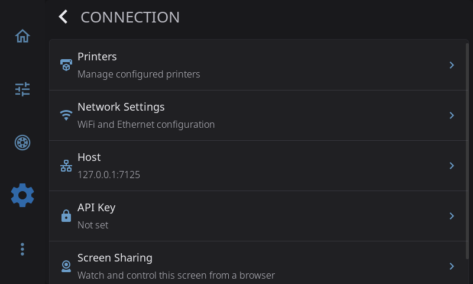
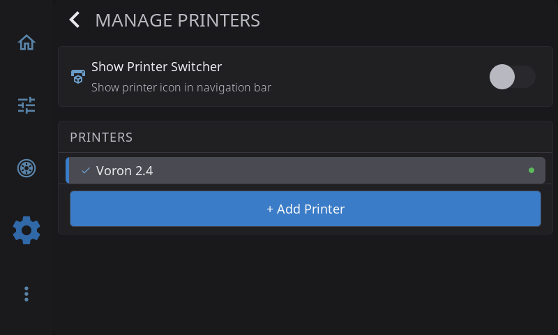
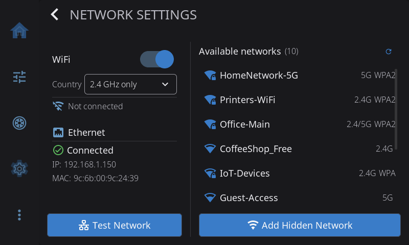

# Settings: Connection

**Settings > Connection** is about how HelixScreen reaches your network and your printers. Come here to join a Wi-Fi network, check your Ethernet connection, add or switch printers, point HelixScreen at a different Moonraker address, enter a Moonraker API key, or share the screen with Mainsail and Fluidd.

On the Settings screen, the **Connection** row shows how the screen is connected right now: the Wi-Fi network name (for example *Wi-Fi HomeNet*), *Ethernet*, or *Not connected*.

---

## Printers

Opens **Manage Printers**, the list of every printer this screen knows about. The printer you are using has a check mark and a dot that shows whether it is connected.

- **Show Printer Switcher**: adds a printer icon to the navigation bar, so you can switch printers from any screen.
- **Switch printers**: tap a printer in the list. HelixScreen shows a "Switching to" message while it disconnects from the current printer and connects to the new one, then takes you to the Home screen. Tapping the printer you are already connected to does nothing.
- **Add a printer**: tap **+ Add Printer**. HelixScreen shows an "Adding printer" message and runs the setup wizard for the new printer, skipping the steps you have already done on this screen (such as Wi-Fi and language). Its connection step lists the printers it finds on your local network, including ones that serve Moonraker only on port 80; pick one to fill in its address and port. If you cancel the wizard, the new entry is thrown away and you are back on your previous printer.
- **Remove a printer**: tap the trash icon next to it, then **Remove** to confirm. The dialog warns that all settings for that printer are deleted. The icon only appears while you have more than one printer, so you can never remove the last one. If you remove the printer you are connected to, HelixScreen switches to the first printer left in the list.

See [Getting Started](../getting-started.md) for adding a second printer.

---

## Network Settings

> Hidden on Android, where the phone or tablet manages its own network.

Opens the network screen. It has two columns.

**Left: your connection**

- **WiFi**: turn Wi-Fi on or off and see the network name, IP address, MAC address and signal strength. A **2.4GHz** tag appears if your hardware only supports that band.
- **Country**, under the Wi-Fi switch, sets the Wi-Fi country. The closed box shows the two-letter country code. Until one is set, the Wi-Fi radio stays in a restricted worldwide mode and usually can't find 5 GHz networks until it has joined a 2.4 GHz one; the Country box then reads **2.4 GHz only** when your hardware supports 5 GHz. The most common countries are listed first, then every country alphabetically. If your printer's system already set a country, it is shown here and left alone, and HelixScreen remembers it: if a firmware update later resets the radio to the worldwide mode, that country is set again at the next start. Choose **Not set** to go back to the system's own setting. Hidden on printers where the printer's own network service manages Wi-Fi.
- **Ethernet**: the IP and MAC address of the wired connection. Read-only.
- **Test Network**: checks that the internet is reachable. Grayed out when nothing is connected.

**Right: available networks**

- The Wi-Fi networks in range, with their signal strength.
- Tap a network to join it. Enter the password if it asks.
- **Add Hidden Network** joins a network that doesn't broadcast its name.
- **Refresh** scans again.

Some boards have one network chip and can't use Ethernet and Wi-Fi at once. On those, joining Wi-Fi while Ethernet is connected shows a warning that the wired network will disconnect, and the join goes ahead. If joining fails, the screen tells you why. If an administrator has blocked the Wi-Fi radio (for example with `rfkill`), HelixScreen leaves it blocked unless you set up Wi-Fi in HelixScreen on that printer.

---

## Host

Shows the Moonraker address HelixScreen is connected to, such as `192.168.1.50:7125`. Tapping it opens the **Change Printer Host** dialog, which edits the printer you are using.

To connect to a different address:

1. Tap **Host**. While the dialog is open, HelixScreen looks for Moonraker on your local network, including printers that serve it only on port 80, and lists what it finds under **Discovered Printers**. Pick one to fill in its address and port, or type them yourself.
2. Enter the printer's IP address or host name, and the port (usually 7125).
3. Tap **Test Connection**. A successful test says where Moonraker answered and what state Klipper is in, for example *Moonraker answered at 192.168.1.50:7125. Klipper: ready*. Testing does not disconnect the printer you are on; only **Save** switches. **Save** stays grayed out until a test succeeds.
4. Tap **Save**. HelixScreen disconnects and reconnects at the new address.

If you leave the port at the default 7125 and nothing answers there, the test also tries port 80, where Moonraker answers when it sits behind a web server (nginx, or printer firmware that serves it on the plain web address). If Moonraker answers on 80, the port field changes to 80 and that is what **Save** stores. A port you type yourself is the only one tried.

Host names are looked up again every time HelixScreen reconnects, so if your router gives the printer a new IP address, HelixScreen finds it again without a restart.

---

## API Key

Shows **Configured** when this printer has an API key saved and **Not set** when it has none. Most printers do not need one. You only need it when Moonraker is set to require a login.

The key is a 32-character code made of the digits 0 to 9 and the letters a to f. Tap **API Key** to open the same **Change Printer Host** dialog as the Host row, where the key goes in the **API Key (if Moonraker requires a login)** field below the address. The key is hidden as you type; tap the eye button to show it. Each printer keeps its own key, and HelixScreen sends it only to that printer's Moonraker.

- **Test Connection** uses the key you typed. If Moonraker needs a login, the result says *Moonraker at ... requires an API key.* when you sent none, or *Moonraker at ... rejected the API key.* when the key was wrong. **Save** stays grayed out in both cases.
- A key that is not 32 characters of 0-9 and a-f is refused with *An API key is 32 characters, each 0-9 or a-f.*
- **Save** stores the key and reconnects with it straight away.

If a printer refuses the login while HelixScreen is running, a message says so once, with an **Enter API Key** button that opens this dialog.

---

## Screen Sharing

> Hidden on Android, and on printers whose own firmware already shares the screen (the Snapmaker U1 with its stock screen page).

Opens the **Screen Sharing** page. Its settings belong to the printer you have selected, so each printer you control keeps its own:

- **Share Screen** shows this screen live in a web browser.
- **Add to Mainsail/Fluidd Webcams** also lists it as a **HelixScreen Screen** webcam in this printer's Mainsail and Fluidd. On unless you turn it off; it only matters while **Share Screen** is on.
- **Allow Remote Control** lets a browser tap and drag on it.
- **Pairing Code** and **Forget Paired Browsers** appear on printers where a browser needs a code before it can control the screen.

How to open it, which printers ask for a code, and troubleshooting: [Screen Sharing and Remote Control](../screen-sharing.md).

---

[Back to Settings](../settings.md) | [Prev: Safety & Alerts](safety.md) | [Next: Language & Time](language-time.md)
