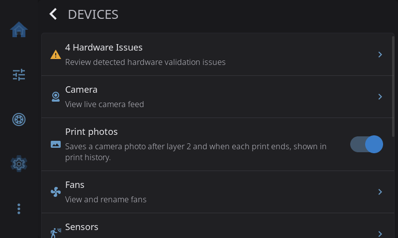
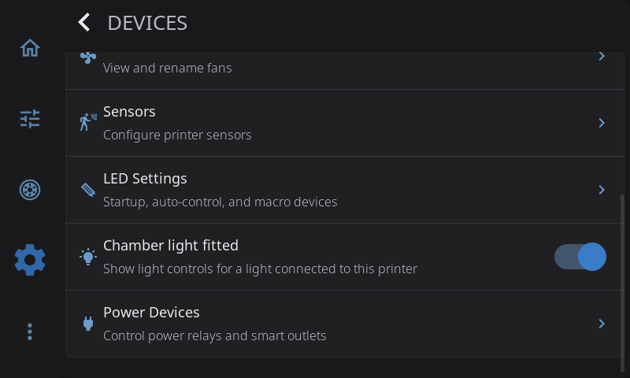
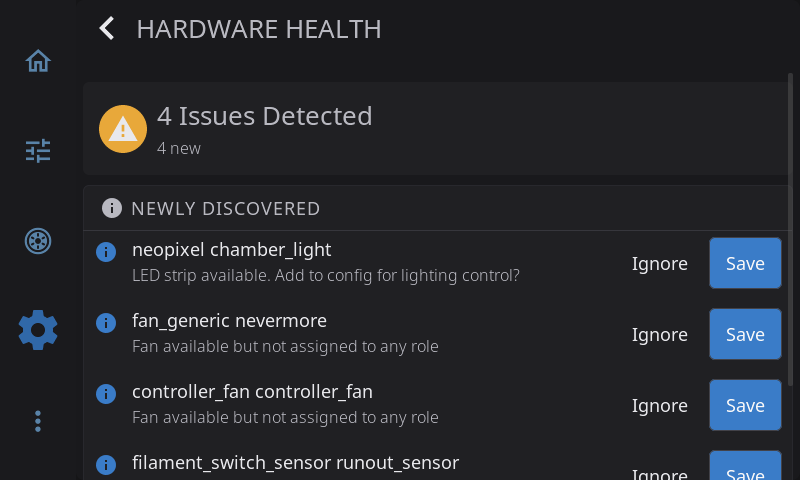

# Settings: Devices

**Settings > Devices** is where you look after the hardware and services around your printer: its camera, fans, sensors, lights and power switches. Rows only appear for things HelixScreen finds in your Klipper and Moonraker setup, so your list may be shorter than the one pictured.

Spoolman's settings are not on this page: they are under [Settings > Printing > Spoolman](printing.md#spoolman).

On the Settings screen, the **Devices** row shows a one-line health check: *All healthy*, *Needs attention* (Hardware Health lists something worth a look) or *Problem found* (hardware the printer needs is missing).

---

## Hardware Health

Compares the hardware Klipper reports with what HelixScreen expects, and lists anything that doesn't match. The row itself shows the result: **No Hardware Issues**, or a count such as **3 Hardware Issues**. Its icon turns amber when something needs attention and red when something is critical.

Tap it to see the list:

| Section | Meaning |
|---------|---------|
| **CRITICAL** | Hardware the printer needs is missing, such as the nozzle heater |
| **MISSING CONFIGURED** | Hardware you saved as expected is no longer found |
| **NEWLY DISCOVERED** | New hardware HelixScreen hasn't seen before |
| **CHANGED FROM LAST SESSION** | Hardware that was there the last time HelixScreen ran is now missing |

For each item you can:

- **Ignore**: mark it as optional. HelixScreen won't warn about it again, even if it goes missing. This works on critical items too, so a machine built without a nozzle heater can stop the warning about it.
- **Save** (new hardware only): add it to the expected list. HelixScreen will warn you if it disappears later.

A Klipper machine that isn't a printer, one whose `[printer]` section sets `kinematics: none`, is never warned about a missing nozzle heater.

Check this page after you add or remove hardware, so HelixScreen's list matches your printer.

---

## Camera

> Only shown when a webcam is set up in Moonraker. Not available on the ESP32 screen.

Opens your printer's camera full screen. See [Camera](../camera.md) for rotation, stream status and the home screen camera widget.

### Print photos

> Only shown when a webcam is set up in Moonraker.

When this switch is on, HelixScreen saves two pictures from your camera for every print: one after layer 2 is done, so you can check the first layers went down well, and one when the print ends (finished, canceled or failed). They appear on the print's page in [Print History](../print-history.md#print-details--reprinting). It is on by default.

With the [HelixPrint plugin](../helixprint-plugin.md#print-photos) installed, the printer takes the photos itself, for every print, whichever app started it and whether or not a screen is connected. Without the plugin, the screen takes them while it is connected to the printer, so a print that runs while the screen is off or away gets no photos. On a screen that is not attached to the printer (a tablet, a desktop), the row says so and offers to install the plugin.

The photos are kept on the printer. They are removed when you delete the print from the history, and the oldest go once there are photos of 500 prints. The K-Touch cannot show or take photos itself; with the plugin installed, the printer still takes them and other screens show them.

---

## Fans

> Only shown when HelixScreen finds fans.

Lists every fan and its current speed. Tap a fan to rename it, for example from "fan_generic exhaust_fan" to "Exhaust". The new name is used everywhere fans appear. See [Fans](../fans.md).

---

## Sensors

Always shown, even before HelixScreen finds any sensors.

Lists your printer's sensors and lets you give each filament sensor a job:

| Role | What HelixScreen does with it |
|------|------------------------------|
| **None** | Nothing. The sensor is there but not watched |
| **Runout** | Pauses the print when the filament runs out |
| **Toolhead** | Watches for filament at the toolhead |
| **Entry** | Watches for filament where it enters the extruder path |

Door switches and other on/off inputs are listed under **Inputs**, where you mark each as **Door** or **Other** and turn the door-open warning on or off; see [Inputs (Doors and Buttons)](../sensors.md#inputs-doors-and-buttons).

HelixScreen tells switch sensors and motion sensors apart on its own; you don't choose. Other sensors (accelerometers, probes, humidity, filament width, color) are listed for information only.

The roles only decide what HelixScreen watches, with one exception. When you turn on bypass on a filament system, HelixScreen turns the toolhead runout sensor on at the printer if the filament system's software had left it off (common on Creality printers), and turns it off again when you leave bypass. That way a bypass print is still protected from running out. It happens automatically and doesn't change your settings here.

See [Sensors](../sensors.md) for the full guide.

---

## LED Settings

> Only shown when HelixScreen finds LEDs or lights.

Chooses which lights HelixScreen controls, what they do on their own during printing, and any macro-driven lights. See [LED Settings](led-settings.md) for the full guide.

---

## Chamber light fitted

> Only shown when Klipper reports an LED or light.

Shows light controls for a light connected to this printer. Turn it off if your printer's firmware declares a light that you haven't wired up: the light buttons and the **LED Settings** row above disappear. Turn it on to bring them back. Some printer models start with it off for this reason.

---

## Power Devices

> Only shown when power devices are set up in Moonraker.

Turns individual relays and smart plugs on or off. It's the same screen as **Advanced > Power Devices**, or a long-press on the power button on the home screen. See [Power Device Control](../advanced.md#power-device-control).

---

[Back to Settings](../settings.md) | [Prev: Printing](printing.md) | [Next: Safety & Alerts](safety.md)
