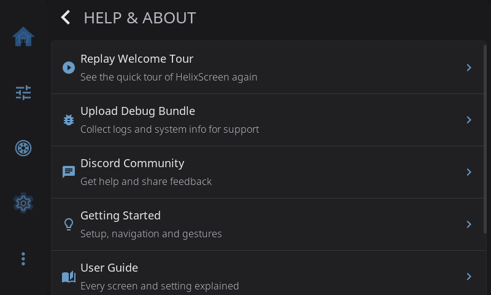
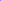
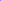
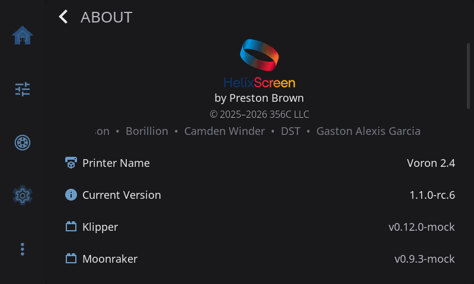

# Settings: Help & About

**Settings > Help & About** is where to go when you need help: replay the welcome tour, send a debug bundle to support, or find the community and the guides. **About** at the bottom shows which versions you're running. Updates have their own page: see [Updates](updates.md).

1. Replay Welcome Tour.
2. Upload Debug Bundle.
3. Discord Community.
4. Getting Started.
5. User Guide.
6. About.

---

## Replay Welcome Tour

Plays the short guided tour again. HelixScreen goes to the Home screen and starts the tour from the beginning.

The tour first appears once, after you finish the setup wizard and HelixScreen has found your printer's hardware. It highlights one part of the screen at a time, with **Skip** to leave early and **Next** to move on (it reads **Done** on the last step). A counter such as *3 / 9* shows how far along you are. Replaying it shows every step.

The steps are:

1. **Welcome to HelixScreen**: a quick hello.
2. **Your printer at a glance**: tap any tile to open its full controls or toggle its state.
3. **Customize your home screen**: long-press any tile to enter edit mode, then rearrange, resize, remove or add widgets, and drag them between pages.
4. **A new Print Status screen**: a sample of the print screen, with a chip for each heater, fan and light, a checklist of the start sequence, and progress with controls in one strip.
5. **Controls**: move the toolhead, home axes, level the bed, and fine-tune temperatures, fans and other motion settings.
6. **Filament**: load, unload and swap spools, set temperatures, and monitor runout sensors.
7. **Load and unload**: the tour opens the Filament screen and points out the load, unload and purge buttons.
8. **Your filament system**: only on printers with a filament system such as an AMS. Tap a slot to load or unload it, pick a spool, or edit its details.
9. **Advanced**: macros, the G-code console, calibration tools (PID, input shaper, z-offset), firmware updates and developer utilities.
10. **Settings**: network, display, sound, printer setup and more, and a reminder that you can replay the tour here.

Without a filament system the tour has nine steps; with one it has ten. Opening another screen yourself while a step is showing ends the tour. The tour does not start while a dialog, an open screen or home-screen edit mode covers Home; it is offered again the next time you open Home.

After an update that adds tour steps, the tour starts again by itself and shows only what is new: a **New in 1.1** card, then the steps about customizing the home screen, the Print Status screen, load and unload, and your filament system.

---

## Upload Debug Bundle

Sends the HelixScreen team what they need to look into a problem you're having.

1. Include logs adds the recent log files.
2. The note box is where you describe the problem.
3. Upload sends the bundle and shows a share code.

1. Tap **Upload Debug Bundle**.
2. Optionally switch on **Include Klipper/Moonraker logs** (off by default) and describe the problem in the note box.
3. Tap **Upload**. HelixScreen gathers your logs, system details and settings, removes personal data and uploads the bundle.
4. When it says **Bundle Uploaded**, give the share code it shows to the HelixScreen team on Discord or GitHub, then tap **Done**. If the upload fails, the dialog says **Upload Failed** and why.

> **Tip:** For a bug report, set **Settings > System > [Log Level](system.md#log-level)** to **Debug**, reproduce the problem, then send the bundle.

### What a debug bundle contains

- **Logs**: recent HelixScreen log output, from the very start of startup. The Klipper and Moonraker logs are added only when you switch on **Include Klipper/Moonraker logs**. That includes problems that happen while your settings are still loading, such as a settings file that couldn't be read or had to be restored from backup.
- **Settings**: your HelixScreen settings, without passwords or API keys.
- **Printer configuration**: your Klipper `printer.cfg` and the files it includes, so support can see how your printer is set up (cleaned as described below).
- **Macro names**: the names of your G-code macros, not what they do.
- **System details**: operating system, hardware, screen size, touch-screen details, Wi-Fi signal history, your update channel, and which filament system you have.
- **Your note**: the text you typed in the note box, if any.
- **Crash data**: the crash report, if HelixScreen crashed.
- **Crash history**: earlier crash reports and their GitHub issue numbers, so support can spot repeat problems.
- **Printer events**: the same list as **Printer Events** in the notification history (shutdowns and their reasons, printer errors, pauses, how prints ended), so support sees what led up to the problem.
- **Device ID**: a doubly scrambled ID used only to match up telemetry. It doesn't identify you.

Before anything is uploaded, HelixScreen removes passwords, API keys and tokens, webhook URLs (Discord, Slack, Telegram, Pushover, ntfy, IFTTT), usernames and passwords inside URLs, email addresses and MAC addresses.

Your `printer.cfg` is your own file, and HelixScreen can only remove things it recognizes. File paths stay as they are, so an include from `/home/yourname/…` shows that name. If your printer config holds something unusual you'd rather not share, check it before you send the code. And a share code is only as private as the people you give it to.

**Which builds can upload.** Only official release builds send bundles. If you built HelixScreen yourself, the upload stops with "Upload unavailable in this build". Add `HELIX_DIAGNOSTIC_UPLOADS=1` to `helixscreen.env` to allow uploads on that install, or `0` to block them on any build.

---

## Discord Community

Shows a QR code for the HelixScreen Discord, **discord.gg/RZCT2StKhr**. Scan it with your phone for help from other users and the developers, or to share feedback.

---

## Getting Started

Shows a QR code for the Getting Started guide: the setup wizard, moving around the screens and touch gestures.

---

## User Guide

Shows a QR code for these guides, which explain every screen and setting. Both QR codes open the pages for the HelixScreen version you are running, at **helixscreen.org**.

---

## About

Shows which versions of everything you're running. Tap **About** to open it.

| Row | What it shows |
|-----|---------------|
| **HelixScreen logo** | Credits, copyright and a scrolling list of contributors |
| **Printer Name** | The name you gave your printer in the setup wizard |
| **Current Version** | Your HelixScreen version |
| **Klipper** | Your Klipper version |
| **Moonraker** | Your Moonraker version |
| **OS** | The operating system on the computer running HelixScreen |
| **Host** | That computer's hardware type. Not shown on Android |
| **Install Root** | Where HelixScreen is installed. Not shown on Android |
| **Config Dir** | Where HelixScreen keeps its settings. Not shown on Android |
| **Logs** | Where HelixScreen writes its log |
| **Cache Dir** | Where HelixScreen keeps its cache (files it can rebuild). Not shown on Android |
| **Print Hours** | Your total printing time. Tap it to open the [History Dashboard](../print-history.md) |
| **Open Source Licenses** | The licenses of the open source software HelixScreen uses |

The install, config, log and cache locations are useful when support asks where a file is.

### Easter Eggs

- Tap **Printer Name** seven times for a hidden Snake game.
- Tap **Current Version** seven times to turn beta features on or off, like Android's "tap build number" trick. Each tap has to come within two seconds of the one before, and the screen counts down the last three taps.

### Enabling Beta Features

Tap **Current Version** seven times in **Settings > Help & About > About**. A message at the top of the screen reads **Beta features: ON**.

With beta features on:

- The **Update Channel** menu in [Updates](updates.md#update-channel) gains a third choice, **Dev**.
- HelixScreen offers to install the [HelixPrint plugin](../helixprint-plugin.md) when your printer does not have it.

Tap seven more times to turn them off again. See [Beta Features](../beta-features.md) for the full list.

---

[Back to Settings](../settings.md) | [Prev: Updates](updates.md)
