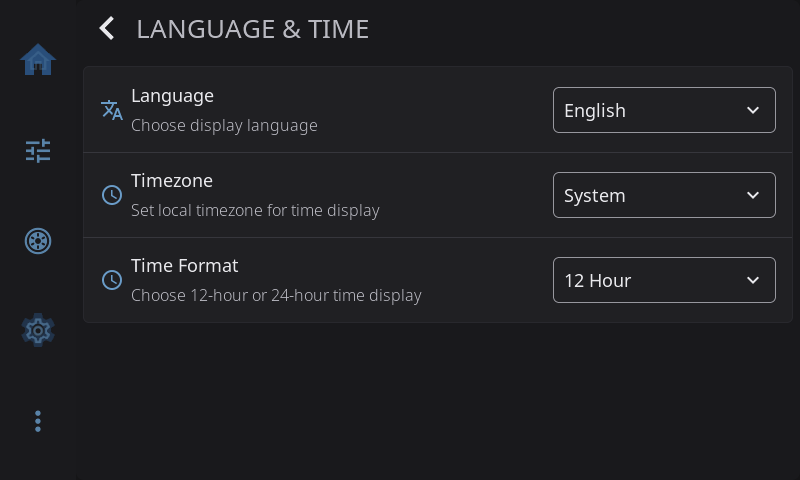
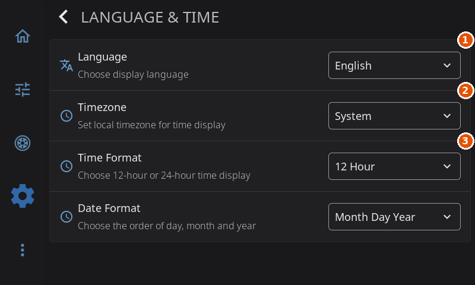

# Settings: Language & Time

**Settings > Language & Time** sets the language HelixScreen uses and how it shows the time. Set your timezone here so print finish times and the clock match your wall clock.

On the Settings screen, the **Language & Time** row shows your choices, for example *English · 24-hour*.

---

## Language

The language for everything on screen. The list shows each language in its own name: English, Deutsch, Français, Español, Русский, Português, Italiano, 中文 and 日本語. The screen switches as soon as you pick one. No restart needed.

1. Language.
2. Timezone.
3. Time Format.
4. Date Format.

The BTT K-Touch has no Chinese or Japanese, because its firmware has no room for those fonts.

---

## Timezone

Your local timezone, so print finish times, time remaining and the clock widget show the right time. **System**, the first entry, uses the timezone of the computer HelixScreen runs on, and is the default. If that is not your local time, pick from the list of common timezones. Each one shows its offset from UTC, for example "Eastern (-5:00)". Daylight saving time is handled for you.

The BTT K-Touch has no System entry, because it has no timezone of its own. The Wi-Fi setup page sets it from your phone's timezone; otherwise it shows UTC until you pick one.

---

## Time Format

**12 Hour** (such as 3:45 PM, the default) or **24 Hour** (such as 15:45). Applies to every time shown in HelixScreen.

---

## Date Format

The order of day, month and year: **Day Month Year**, **Month Day Year** or **Year Month Day**. Applies to every date HelixScreen writes out. Until you pick one, the order follows your language and timezone: English reads month first in a United States timezone and day first in another known timezone, Chinese and Japanese read year first, and the other languages read day first.

---

[Back to Settings](../settings.md) | [Prev: Connection](connection.md) | [Next: System](system.md)
