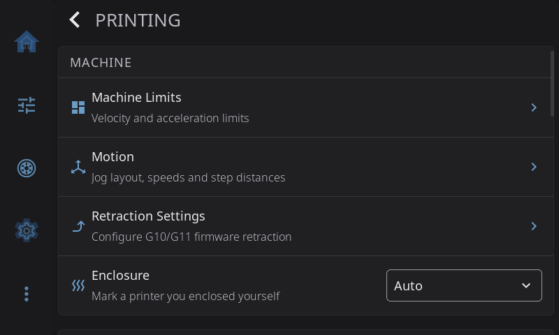
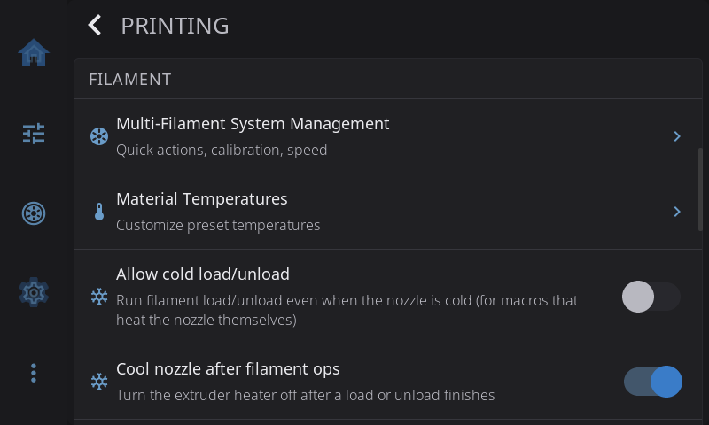
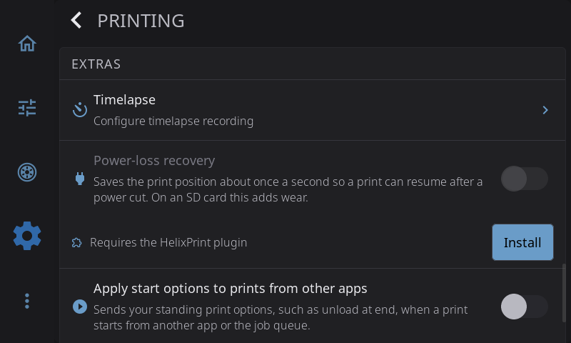
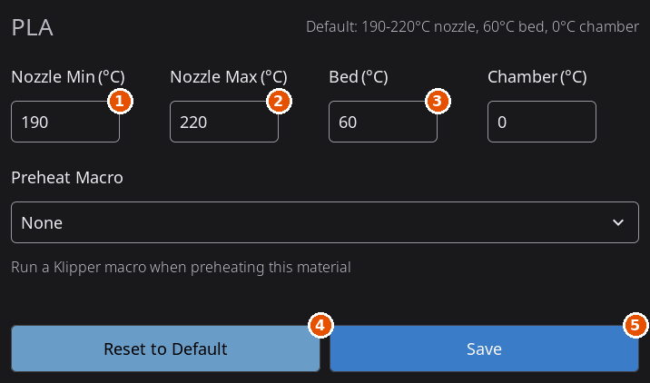
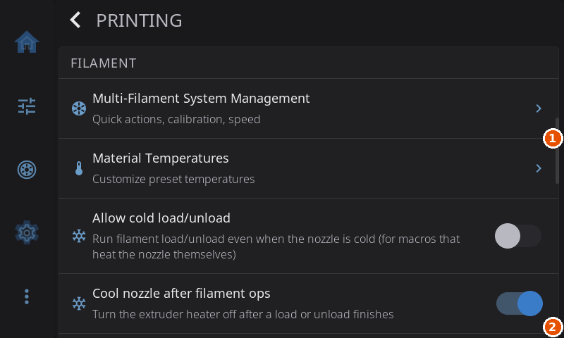

# Settings: Printing

**Settings > Printing** holds the settings that change how your printer moves, heats and handles filament, and the buttons and macros HelixScreen runs for you. The page has three sections:

- **MACHINE**: Machine Limits, Motion, Retraction Settings and Enclosure
- **FILAMENT**: Multi-Filament System Management, Material Temperatures, Z Offset by Material, Allow cold load/unload, Cool nozzle after filament ops, Edit filament on insert, Material presets heat the bed and chamber, Number slots from 0 and Confirm tool changes
- **EXTRAS**: Timelapse, Power-loss recovery, Resume reloads the saved bed mesh, Apply start options to prints from other apps, and Macro Buttons

Rows for things your printer doesn't have are hidden, so your list may be shorter than the one pictured.

Looking for how the printer is *drawn* (toolhead picture, G-code preview, Z button labels, bed mesh view)? That's in [Appearance](appearance.md#printer-visuals).







---

## Machine Limits

Opens sliders for your printer's speed and acceleration limits. Use them to test or troubleshoot motion. A note at the top reminds you that changes are temporary and reset on printer reboot. To change the limits for good, edit `printer.cfg`.

> **Tap a value to type an exact number.** The sliders are quick but coarse. Max Acceleration covers 500 to 50000 in a few hundred pixels, so landing on exactly 3000 by dragging is luck. Tap the number next to a slider to open a keypad instead.

| Setting | Range | What it limits |
|---------|-------|----------------|
| **Max Velocity** | 50 to 1000 mm/s | The fastest the toolhead moves |
| **Max Acceleration** | 500 to 50000 mm/s² | How quickly it speeds up |
| **Accel to Decel** | 500 to 50000 mm/s² | How hard moves slow down |
| **Square Corner Velocity** | 1.0 to 20.0 mm/s | The speed carried through a sharp corner. Half steps such as 5.5 can be typed on the keypad |
| **Extrude Speed** | 1 to 50 mm/s | The speed of the manual extrude and retract buttons. The speed dropdown on the Filament panel sets it too. |

> **Extrude Speed is kept.** Unlike the limits above, it's a HelixScreen setting. It's remembered after a restart.

Under the sliders, a **Config-defined (read-only)** section shows your **Max Z Velocity** and **Max Z Accel**. They come from your Klipper config and can't be changed here.

**Reset** at the bottom puts the limits back to the values they had when you opened this screen.

---

## Motion

Jog layout, which way the Z buttons move, jog speeds, how far each jog pad button moves, the Z clearance a move across the plate keeps (Bed tab, Move tab positions and the home Toolhead widget), and whether Save Z-Offset buttons appear. See [Motion](../motion.md#motion-settings) for what each one does, and the [Z Offset guide](../z-offset.md#the-save-z-offset-buttons-setting) for what the save setting changes.

---

## Retraction Settings

> Only shown when firmware retraction (`[firmware_retraction]`) is set up in Klipper.

Sets the firmware retraction that `G10`/`G11` use. **Changes apply straight away**, even mid-print, so you can tune while you watch.

As with Machine Limits, **tap a value to type an exact number**. Distances take two decimals, such as 0.85 mm.

| Setting | Range | What it does |
|---------|-------|--------------|
| **Enable Retraction** | On or off | Turns firmware retraction on or off |
| **Retract Length** | 0.00 to 6.00 mm | How much filament to pull back. 0.4 to 2 mm for direct drive, 4 to 6 mm for Bowden |
| **Retract Speed** | 10 to 80 mm/s | How fast to pull back |
| **Unretract Extra** | 0.00 to 1.00 mm | Extra filament pushed out afterwards to make up for oozing |
| **Unretract Speed** | 10 to 60 mm/s | How fast to push it back |

---

## Enclosure

Tells HelixScreen whether your printer is enclosed. **Auto** (the default) counts the printer as enclosed when its model is known to ship enclosed, or when a chamber heater is set up. Choose **Enclosed** if you've enclosed an open-frame printer yourself, or **Open frame** if HelixScreen thinks your printer is enclosed and it isn't.

It matters for [drying filament on the bed](../temperature.md#drying-filament-on-the-bed), which is only offered on an enclosed printer.

---

## Multi-Filament System Management

> Only shown when HelixScreen finds a multi-filament system.

Opens quick actions (**Home**, **Recover**, **Abort**), calibration and speed settings for your filament system: AFC, Happy Hare, ACE and the other systems HelixScreen supports. Most of what's inside depends on your hardware, but these switches can appear on any system:

| Switch | When it appears | What it does |
|--------|-----------------|--------------|
| **Endless Spool** | Systems whose firmware takes an on/off switch (Creality CFS, Anycubic ACE, Snapmaker U1, single-unit Happy Hare) | Switches to a matching spool when one runs out mid-print. The firmware picks which spool |
| **Keep Spool Info on Eject** | Tool changers (including MedusaHC and INDX), OpenAMS without `[openams_spoolman]`, ACE without the ACEPRO driver; on AFC it switches AFC's own `remember_spool` | Remembers a lane's spool when it empties, so putting the same spool back after maintenance needs no new selection. On by default. Where the firmware holds the spool (Happy Hare, CFS, AD5X, QIDI Box, Snapmaker U1) the firmware decides and the switch is not shown |
| **Link Spools from Tags** | Creality CFS, with Spoolman set up | When a spool whose tag names a Spoolman spool is put in a slot, links the slot to that spool. On by default |
| **Always Show Bypass Spool** | AFC only | Keeps the external spool on the filament path even while bypass is off. AFC reports a bypass sensor whether or not one is wired, so the spool is hidden until you actually use bypass |
| **Enable Bypass Controls** | Only when your firmware reports **no** bypass | Shows the bypass controls and external spool anyway, for printers where you feed filament straight to the extruder. Applies to the Anycubic ACE Pro, Snapmaker U1, tool changers, QIDI Box and any Happy Hare setup with `has_bypass: 0` |

Where Endless Spool backups can be edited (AFC and single-unit Happy Hare), a **Reset Endless Spool** button clears every backup.

What **Enable Bypass Controls** gets you depends on the system:

- **Happy Hare**: `MMU_SELECT_BYPASS` works whether or not `[mmu_machine] has_bypass` is set, so the bypass becomes fully usable. This helps `mmu_vendor: Other` setups, such as a QIDI Box run through Happy Hare, and uncalibrated type-A selectors.
- **Creality CFS**: bypass always works and is always shown, so the switch never appears.
- **Snapmaker, tool changers, QIDI Box, and an ACE without a bypass switch**: there's no bypass command, so the Bypass switch says the operation isn't supported. The setting still lets you record the material and color you loaded by hand, which keeps filament tracking and temperature presets right. An ACE Pro with a fifth spool on its bypass switch and bypass macros does get a working Bypass switch.

See [Filament: When Bypass Doesn't Appear](../filament.md#when-bypass-doesnt-appear).

**Unload at end** lives in the **Print Behavior** section on AFC and Snapmaker U1 systems. On AFC it records whether your end-of-print macros unload the toolhead, so an empty toolhead at the next print start is not flagged. The U1 has one switch per toolhead.

---

## Material Temperatures

Sets the preheat temperatures for each filament material (PLA, PETG, ABS, TPU and so on). The presets on the Home, Controls and Filament screens use these. The list shows each material with its nozzle and bed temperatures. Tap a material to edit it:



1. Nozzle Min is the lowest nozzle temperature for this material.
2. Nozzle Max is the highest; a preset heats to the middle of the two.
3. Bed is the bed temperature.
4. Reset to Default restores the built-in values.
5. Save keeps your changes.

- **Nozzle Min (°C)** and **Nozzle Max (°C)**: the nozzle's working range for this material. A preset heats the nozzle to the middle of the range.
- **Bed (°C)**: the bed target.
- **Chamber (°C)**: the chamber target. Only shown on a printer with a chamber heater.
- **Preheat Macro**: a Klipper macro to run when you preheat this material, or **None**.
- **Macro handles heating** (shown once a Preheat Macro is chosen): when on, only your macro runs and it sets the temperatures. When off, HelixScreen sets the temperatures first and then runs your macro.

Each field has a limit: nozzle 100 to 500 °C, bed 0 to 200 °C, chamber 0 to 120 °C, and Nozzle Min can't be above Nozzle Max. **Reset to Default** puts a built-in material back to its shipped values, and **Save** keeps your edit.

See [Per-Material Preheat Macros](#per-material-preheat-macros) for when the macro runs.

### Editing materials and brands by hand

Everything on this screen and in the filament catalog (the brand and material picker) is also stored in one file, `user_filaments.json`. On most installs it's in `~/printer_data/config/helixscreen/`, so you can open it from Mainsail's or Fluidd's config file list. The copy in the install folder's `config/` folder (for example `~/helixscreen/config/`) is a link to the same file.

The file has two lists: `types` for materials (PLA, PETG and so on) and `filaments` for branded products.

```json
{
  "types": [
    {"name": "PLA", "nozzle_min": 205, "nozzle_max": 225, "bed": 65},
    {"name": "ABS", "chamber": 50, "preheat_macro": "PREHEAT_ABS", "macro_handles_heating": true},
    {"name": "PEKK", "nozzle_min": 330, "nozzle_max": 360, "bed": 120, "chamber": 80}
  ],
  "filaments": [
    {"id": "mybrand-pla-basic", "brand": "MyBrand", "name": "PLA Basic", "type": "PLA",
     "nozzle": 215, "nozzle_min": 200, "nozzle_max": 230, "bed": 60}
  ]
}
```

**Materials (`types`).** An entry with the `name` of a built-in material changes only the fields you list. Everything else keeps its built-in value. The Material Temperatures screen writes to this list too, so a change on the screen shows up in the file and the other way round. An entry with a new `name` adds a material. It then appears in the Material Temperatures list and can be used as a product's `type`.

- Fields: `nozzle_min`, `nozzle_max`, `bed`, `chamber` (0 means no chamber heat), `preheat_macro`, `macro_handles_heating`, `dry_temp`, `dry_time` (minutes), `density` (g/cm³), `category` and `compat_group`.
- Write numbers as plain numbers: `205`, not `"205"`. A field holding text or `null` is ignored (with a warning in the log) and the built-in value stays.
- A new material must set `nozzle_min` and `nozzle_max`, with `nozzle_max` at least `nozzle_min`. One without a usable nozzle range is skipped, with a warning in the log. Set `bed` too; anything else you leave out is 0. Its `compat_group` is its own name unless you set one, so Endless Spool never swaps it for a different material. Set `compat_group` to an existing group (for example `"PLA"`) only if it really can stand in for that group. A material whose `category` is `"Support"` (HIPS, PVA and BVOH are built in that way) is never swapped for another material, whatever its group: its group only sets its drying preset.
- The built-in list is the `types` section of `assets/filaments.json` in the HelixScreen install folder. Read it for names and defaults, but don't edit it: updates replace it.
- **Reset to Default** on the Material Temperatures screen removes your temperature and macro changes for a built-in material. A material you added has no default, so the button is hidden for it.

**Brands and products (`filaments`).**

- `id`, `brand`, `name` and `type` are required. The `id` must be unique. Lowercase with dashes is the convention.
- `nozzle`, `nozzle_min`, `nozzle_max`, `bed` and `density` are optional. Anything you leave out comes from the product's material, including your changes in `types`.
- To change a built-in product, use its `id` and list only the fields you want to change. Built-in products are in the `filaments` section of `assets/filaments.json`.
- Temperatures set on a product override those of its material.

Restart HelixScreen after editing so every screen picks up the change. A file that is only a list of products (`[ ... ]`) still works; HelixScreen rewrites it in the form above the next time it saves. If the file stops being valid JSON, HelixScreen ignores it until it's fixed. The next save from the screen then copies it to `user_filaments.json.bak` and starts fresh.

Which material each preset button uses is kept in `settings.json` under `preset_materials`, a list of four entries such as `{"type": "PETG"}`. Stop HelixScreen before editing `settings.json`, because it rewrites the whole file whenever it saves a setting.

If you upgraded from 1.0, your Material Temperatures changes were moved into `user_filaments.json` the first time 1.1 started. If `user_filaments.json` isn't valid JSON at that moment, they stay in `settings.json` and the move is tried again at the next start.

---

## Z Offset by Material

Keeps a separate first-layer Z offset for each material, and optionally a stored bed mesh per material, because a bed heated for PETG or ABS sits at a slightly different height than one heated for PLA. The printer's start macro applies the right one at every print, and **Save** during a print changes only that print's material.

The screen shows one of three things:

- **One-time setup**, when your printer has no per-material storage yet: install the helper macros, add one line to your `PRINT_START`, and have your slicer pass the material.
- **Update the helper macros**, when they are installed but Klipper has no `[save_variables]` to keep the values in.
- **The list**, with the **Z offset by material** switch, **Any other material** (the default) and PLA, PETG, ABS, ASA, TPU, PA and PC. Tap a value to type a new one. A grid mark means the material has a stored bed mesh.

The setting is kept for each printer. It isn't offered on printers whose firmware stores the Z offset itself. Setup for each kind of printer, how saving works and the full list of gotchas: [Z Offset by Material](../z-offset-by-material.md).

## Allow cold load/unload

| Setting | What happens |
|---------|--------------|
| **Off** (default) | Loading and unloading are blocked while the nozzle is too cold to extrude |
| **On** | Loading and unloading run on a cold nozzle, and HelixScreen never heats it for you first |

By default HelixScreen won't load or unload filament while the nozzle is too cold, the same safety check Klipper makes. Turn this on if your load and unload macros heat the nozzle themselves, so they aren't blocked before they get the chance.

With it on, HelixScreen also skips its own preheat. Your macro runs straight away and is in charge of the temperature. This applies wherever you start a load or unload, including the Filament screen and your filament system's own screen.

You don't need it for printers whose stock macros HelixScreen already knows heat on their own (QIDI's `M604` and `M603`, for example), or for filament systems that heat as part of loading (AFC, CFS, QIDI Box, AD5X IFS). HelixScreen detects those and skips its preheat whatever this switch says.

---

## Cool nozzle after filament ops

| Setting | What happens |
|---------|--------------|
| **On** (default) | The nozzle heater turns off a couple of minutes after a load or unload finishes |
| **Off** | The nozzle stays at whatever temperature the load or unload left it at |

A filament change heats the nozzle to printing temperature. Left alone, it would stay hot, using power and slowly cooking the filament inside. So HelixScreen turns the heater off when you're done. It waits two minutes first, so you can do several loads and unloads in a row without the nozzle cooling in between. Each new load or unload restarts the wait. Nothing happens during a print: the print looks after its own temperatures.

**Turn this off if your filament system already does it.** [AFC](../filament.md) has its own cool-down after loading, and other filament systems are adding the same. Two timers controlling one heater only confuses things, so keep one and switch the other off.

The setting is per printer, so an AFC printer can turn it off while your other printers keep it. To change the two-minute wait, see [`cooldown_delay_seconds`](../../CONFIGURATION.md#cooldown_delay_seconds).

---

## Edit filament on insert

| Setting | What happens |
|---------|--------------|
| **Off** (default) | Putting a spool in does nothing on its own |
| **On** | The slot editor opens when you insert a new spool, so you can set its material and color |

The editor opens when the printer reports a slot that was empty now holds filament, or when a filament sensor sees filament you fed in by hand (it then opens the external spool editor). It does not open during a print, while a load, unload or tool change is running, or while the editor is already open. On a slot with a tag reader, the editor opens only when the reader found no tag on the spool, because a tag already names the spool. The first reading after HelixScreen starts or reconnects is never treated as an insert.

---

## Material presets heat the bed and chamber

| Setting | What it does |
|---------|--------------|
| **On** (default) | A material preset sets the bed to the material's bed temperature along with the nozzle, and the chamber to the material's chamber temperature when the material has one and the printer has a chamber heater |
| **Off** | A material preset sets the nozzle only and leaves the bed's and the chamber's targets as they are |

This covers every material preset: the PLA, PETG, ABS/ASA and TPU buttons and the spool's own preset on the Filament screen, the Home screen's Preheat widget, and the nozzle presets on the temperature graph screen. The graph screen's bed and chamber presets still set the bed and the chamber. A material whose preheat macro you assigned in Material Temperatures, and marked as handling heating, runs that macro instead, and the macro sets whatever heaters it sets. Each printer keeps its own setting.

---

## Number slots from 0

| Setting | What happens |
|---------|--------------|
| **Off** (default) | Slots, lanes, gates and tools count from 1 |
| **On** | They count from 0, matching T0 in G-code |



1. Material Temperatures opens the preset editor.
2. Edit filament on insert opens the editor when a spool is detected.

Below them, Number slots from 0 changes how slots are labelled, and Confirm tool changes asks before a tool change, on multi-tool printers only.

Only the display changes. Tool names such as T0 and T1 stay as they are. See [the filament system panel](../filament-ams-panel.md) for where the numbers appear.

---

## Confirm tool changes

| Setting | What happens |
|---------|--------------|
| **On** (default) | Tapping another tool asks "Switch to Tool 2 (T1)?" before the printer moves |
| **Off** | Tapping another tool switches to it straight away |

> Only shown on printers with more than one tool.

On a printer with more than one toolhead, three places switch tools with a tap: the tool switcher on the home screen, a toolhead on your filament system's screen, and the **Pick up** button on the Filament screen (and the pick-up that Load, Unload, Extrude, Retract or Purge do first). This setting decides whether those ask first. Choosing a head in the Filament screen's Operations card, the Controls Temperature card's tool picker or the temperature graph's row of heads never switches tools, so it never asks. Where a hub feeds several lanes into one toolhead, selecting that toolhead keeps the lane already loaded in it.

Some things happen whatever the switch says:

- A paused print always asks, because the toolhead moves while your part is still on the bed. Printers whose filament change homes the toolhead itself (such as the AD5X) refuse a tool change while paused instead.
- While a print is running or starting, or while spools are on the bed, the change is refused with a message.
- While your filament system is waiting for you to deal with a problem, the change is refused with "The filament system needs attention". Sort it out on the filament system's screen, then try again.
- While your filament system is busy loading or unloading, the tap does nothing.

Tapping a filament tube or spool on the filament system's screen never switches tools: it opens the slot menu. So does tapping the toolhead that is already mounted.

---

## Timelapse

> Only shown when the [Moonraker-Timelapse](https://github.com/mainsail-crew/moonraker-timelapse) plugin is installed.

Sets up how HelixScreen records timelapse videos of your prints.

| Setting | Options | What it does |
|---------|---------|--------------|
| **Enable Timelapse** | On or off | Turns recording on or off |
| **Recording Mode** | Layer or Hyperlapse | **Layer** takes one frame per layer, best for most prints. **Hyperlapse** takes frames at a fixed time interval, better for very long prints |
| **Framerate** | 15, 24, 30 or 60 fps | How fast the finished video plays. 30 fps is the default |
| **Auto-render video** | On or off | Makes the video file automatically when the print finishes |

Changes are saved straight away and sent to Moonraker. The print status screen also has a timelapse switch, so you can turn recording on or off without leaving the print.

If the plugin isn't installed yet, this row is hidden and **Advanced > Timelapse Setup** offers an **Install Wizard** that walks you through the commands. See [Advanced > Timelapse](../advanced.md#timelapse). To watch recorded videos, use **Advanced > Timelapse Videos**.

---

## Power-loss recovery and start options for other apps

These settings come from the **HelixPrint plugin** on your printer. See [HelixPrint Plugin](../helixprint-plugin.md) for installing it and everything else it adds.

| Setting | What it does |
|---------|--------------|
| **Power-loss recovery** | Saves the print position about once a second so a print can resume after a power cut. Shown only on a printer HelixScreen supports for it (today, the QIDI Q2). On by default on a supported printer that stores its data on eMMC; off on an SD card, where it adds wear. Resuming is described in [Recovering After a Power Loss](../printing.md#resuming-with-the-helixprint-plugin) |
| **Apply start options to prints from other apps** | When a print starts from Mainsail, Fluidd, your slicer or the job queue, sends your standing print options too, such as which toolheads unload at the end. Off until you turn it on |
| **Resume reloads the saved bed mesh** | Adds `[include helix-plr/*.cfg]` to printer.cfg, so a power-loss resume reloads the mesh the print started with instead of the printer's default mesh profile. HelixScreen keeps a backup of printer.cfg beside it, asks before changing anything, and offers the firmware restart that applies the change. Tap the row again to remove the lines |

Without the plugin on the printer:

- **Power-loss recovery** is greyed out with **Requires the HelixPrint plugin** and an **Install** button (or asks for a newer plugin when yours is too old). If your printer cannot use it at all, the switch is not shown.
- **Apply start options to prints from other apps** still works: HelixScreen sends the options itself when it sees a print start, as long as the HelixScreen app is running and connected to the printer. A screen attached to the printer covers almost every print (only a print that starts while the printer is booting or HelixScreen is restarting is missed), so it shows no note. A phone, tablet or other remote screen covers prints only while it is connected, so there the switch says **Only while this app is connected** and offers **Install**: with the plugin, the printer applies the options to every print itself.

If several HelixScreens are connected to one printer, only one of them sends the options: the one attached to the printer, or a remote one when none is attached.

---

## Macro Buttons

Chooses what HelixScreen's quick buttons run, and which of your Klipper macros it uses for common jobs such as loading filament or cleaning the nozzle.

### Quick Buttons

The Controls panel's **Quick Actions** card has four quick buttons under the Home row. Each one runs one of the [standard actions](#standard-macros) below, or toggles the printer light:

| Setting | Default |
|---------|---------|
| **Quick Button 1** | Clean Nozzle |
| **Quick Button 2** | Bed Level |
| **Quick Button 3** | (Empty) |
| **Quick Button 4** | (Empty) |

- **A standard action** runs whatever macro that action is assigned to under Standard Macros. If your printer has no macro for it, the button shows grayed out.
- **Light** turns the button into an on/off switch for the chamber light, like a home screen LED Light widget left on its default. It hides while no light is controllable.
- **(Empty)** hides the button.

While a light is controllable and no Quick Button is set to **Light**, the first button you have never set that would otherwise be empty shows the light, and its dropdown reads **Light**. Picking **(Empty)** for that button turns the light off there and keeps it off.

**Cool Down** (on the Preheat widget while a heater is on, and on the Filament panel) runs the `cooldown` G-code from `settings.json`. By default it turns off the extruder and bed heaters. Override it when cooling down should do more, such as turning off a chamber heater or bed fans:

```
SET_HEATER_TEMPERATURE HEATER=extruder TARGET=0
SET_HEATER_TEMPERATURE HEATER=heater_bed TARGET=0
SET_FAN_SPEED FAN=bed_fan SPEED=0
```

See the [default_macros reference](../../CONFIGURATION.md#default_macros) for the format.

### Standard Macros

HelixScreen looks for common macros in your Klipper config and uses them for each job below. It recognizes common spellings, such as both `CLEAN_NOZZLE` and `NOZZLE_CLEAN`. You can pick a different macro for any slot:

| Slot | Used for | Macros it looks for |
|------|----------|---------------------|
| **Load Filament** | Loading filament | LOAD_FILAMENT, LOAD_MATERIAL, M701, M604 |
| **Unload Filament** | Unloading filament | UNLOAD_FILAMENT, UNLOAD_MATERIAL, M702, HELIX_UNLOAD_FILAMENT, QUIT_MATERIAL, M603 |
| **Purge** | Purging or priming the nozzle | PURGE, PURGE_LINE, PRIME_LINE, PURGE_FILAMENT, LINE_PURGE |
| **Pause** | Pausing a print | PAUSE, M601 |
| **Resume** | Resuming a print | RESUME, M602 |
| **Cancel** | Canceling a print | CANCEL_PRINT |
| **Bed Mesh** | Bed mesh calibration | BED_MESH_CALIBRATE, G29 |
| **Bed Level** | Physical bed leveling. A macro you pick here also runs from the **QGL** and **Z-Tilt** buttons | QUAD_GANTRY_LEVEL, QGL, Z_TILT_ADJUST |
| **Clean Nozzle** | Nozzle cleaning | CLEAN_NOZZLE, NOZZLE_WIPE, WIPE_NOZZLE, CLEAR_NOZZLE, PURGE_NOZZLE, NOZZLE_CLEAN |
| **Heat Soak** | Chamber heat soak | HEAT_SOAK, CHAMBER_SOAK, SOAK |
| **Park** | Parking the toolhead (Motion screen, Move tab) | PARK, PARK_TOOLHEAD, TOOLHEAD_PARK |

If your printer has no matching macro, some slots fall back to HelixScreen's helper macros, which you install from **Advanced > Install Helper Macros**. Leave a slot empty to turn that job off.

**Load Filament and Unload Filament on a multi-filament printer.** Left on **(Auto)**, these two use your filament system directly instead of running a macro. If you pick a macro, your macro takes over and the filament system's own loading is skipped, so anything it would have done is now up to your macro. Set the slot back to **(Auto)** to hand the job back. The other slots aren't affected. See [Customizing which macro runs](../filament.md#customizing-which-macro-runs) for a step-by-step guide.

### Per-Material Preheat Macros

Each material in [Material Temperatures](#material-temperatures) can run its own Klipper macro when you preheat it. Use this when preheating needs more than temperatures, such as turning on bed fans for ABS or starting a chamber heater.

The macro runs from the **Preheat widget** on the Home or Controls screen and from the **material preset buttons on the Filament screen**, including the active-spool preset. On the Filament screen, tap a preset to preheat it, or long-press it to choose which material the button uses. The separate nozzle, bed and chamber temperature controls never run a material's macro.

**Macro Handles Heating** doesn't turn the macro on or off: the macro runs either way. When it's on, the macro must set every temperature itself. When there's no macro, or the macro doesn't exist on this printer, the button just sets the preset temperatures. A manual preheat doesn't keep a hotter nozzle target from before; loading and unloading keep their own heating.

---

[Back to Settings](../settings.md) | [Prev: Sound](sound.md) | [Next: Devices](devices.md)
