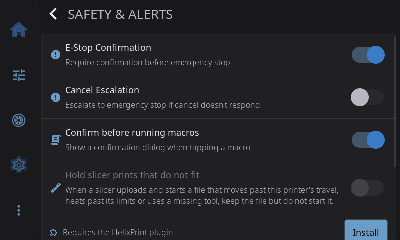

# Settings: Safety & Alerts

**Settings > Safety & Alerts** decides how careful HelixScreen is and how loudly it tells you things. Use it to add a confirmation to the emergency stop or to macros, to set a safety net for cancels that hang, to control camera failure detection, to hold slicer prints that don't fit the printer, and to choose how finished prints and other messages are announced.

Rows for hardware your printer doesn't have are hidden, so your list may be shorter than the one pictured.

---

## E-Stop Confirmation

| Setting | What happens |
|---------|--------------|
| **On** (default) | E-Stop asks you to confirm first |
| **Off** | Tapping E-Stop stops the printer immediately |

The confirmation guards against stopping a print by accident. Turn it off if you want the fastest possible emergency stop.

---

## Cancel Escalation

Some printers take a long time to finish canceling a print: parking tools, cooling down, running a long cancel macro. Cancel Escalation is a safety net. If a cancel hasn't finished after a set time, HelixScreen sends an emergency stop (`M112`).

**Off** by default.

**Leave it off** on tool changers that park tools when canceling, on printers with long cancel macros, and on any printer whose cancel is expected to take more than a few seconds.

**Turn it on** on simple printers where a cancel should be quick, or if you've had cancels that got stuck and never returned to idle.

### Escalation Timeout

> Only shown while Cancel Escalation is on.

How long to wait before the emergency stop: **15**, **30** (default), **60** or **120 seconds**.

---

## Confirm before running macros

| Setting | What happens |
|---------|--------------|
| **On** (default) | HelixScreen asks before running a macro |
| **Off** | Tapping a macro button runs it straight away |

Keep it on if you have macros that move the toolhead, heat the printer or do anything else you wouldn't want set off by a stray tap. Turn it off if you run macros often and trust your fingers. Macros that take parameters always open a form first, whatever this says.

---

## Spaghetti Detection

> Only shown on printers with camera failure detection: Creality K2, K2 Plus and K2 Pro on stock firmware, and the Snapmaker U1 with its own defect detection.

While a print runs, the printer's camera watches for "spaghetti": a print that has come loose or is piling up as a tangle of plastic.

| Setting | What happens |
|---------|--------------|
| **On** (default) | The camera is checked for failures during every print |
| **Off** | Nothing is watched and no detection alerts appear |

**Where the setting starts.** HelixScreen copies the printer's own choice once, so detection doesn't switch back on if you had turned it off before:

- **Creality K2 family:** the first time HelixScreen runs, it copies the printer's own AI detection switch and its pause choice.
- **Snapmaker U1:** the first time HelixScreen connects, it reads the printer's own detection switch and takes that value.

After that, the switches in this page are the ones that count.

**On a Snapmaker U1, the switch controls the printer itself.** The U1 detects spaghetti in its own firmware and pauses the print on its own. Turning Spaghetti Detection off here turns the printer's detection off, so the U1 stops pausing prints for spaghetti. Turning it on turns the printer's detection back on. HelixScreen also sets the printer to match this switch every time it connects, so a change made on the printer's own screen is undone at the next connection. Only the spaghetti check follows this switch; the [Bed Clear Check](#bed-clear-check) below has its own.

### Pause on Detection

| Setting | What happens |
|---------|--------------|
| **On** (default) | A detected failure pauses the print and opens a dialog where you can resume, cancel, or turn detection off |
| **Off** | A detected failure only shows a warning. The print keeps going |

Grayed out while Spaghetti Detection is off. Hidden on the Snapmaker U1, whose firmware always pauses the print on its own and whose detection dialog always opens.

See [Print Monitoring](../print-monitoring.md#print-failure-detection) for what the detection dialog offers.

---

## Bed Clear Check

> Only shown on the Snapmaker U1.

1. Spaghetti Detection also switches the printer's own detection on a U1.
2. Bed Clear Check is the printer's own pre-print bed check.

Before each print, the U1's camera checks that the bed is empty. The row's description reads "Camera checks the bed is empty before each print".

| Setting | What happens |
|---------|--------------|
| **On** | The printer looks over the bed before each print and stops if it sees something on it |
| **Off** | The printer starts without the check |

The switch shows and sets the printer's own setting. It is grayed out while the printer's detection module is switched off as a whole, because the check cannot run then. If the printer refuses the change, the switch goes back to where it was and a message says "The printer did not change its bed check". See [Print Monitoring](../print-monitoring.md#bed-clear-check-snapmaker-u1) for the dialog a failed check opens.

---

## Hold slicer prints that do not fit

When your slicer uploads a file and asks the printer to print it, the printer starts it without HelixScreen ever seeing it. This switch lets the [HelixPrint plugin](../helixprint-plugin.md) on your printer check the file first. If the file would move past the printer's travel, heat the nozzle or bed past their limits, or use a tool the printer doesn't have, the file is still uploaded but the print isn't started. Start it from the screen once you have re-sliced it, or ignore it.

| Setting | What happens |
|---------|--------------|
| **On** | A slicer's upload-and-print waits for the check, and a file that doesn't fit stays in the file list unstarted |
| **Off** (default) | The slicer's print starts as soon as the upload finishes |

Only an upload that asks for the print in the same request is held: a slicer set up with an OctoPrint-style host upload and its **Upload and Print** (or **Print**) button, such as PrusaSlicer, SuperSlicer and OrcaSlicer's host upload. A print started separately after the upload (OrcaSlicer's own Moonraker connection, Mainsail, Fluidd, or the next job in the job queue) is not held, because the plugin never sees a request to print it.

Without the plugin the row is grayed out with **Requires the HelixPrint plugin** and an **Install** button. Prints you start from the screen are checked either way; see [Does the file fit this printer?](../printing.md#does-the-file-fit-this-printer). The [HelixPrint plugin page](../helixprint-plugin.md) lists the rest of the details, such as the 45-second wait and what happens while the printer is already printing.

---

## Print Completion Alert

How HelixScreen tells you a print has finished, been canceled or failed, when you're not already looking at the print status screen.

| Setting | What you get |
|---------|--------------|
| **Off** | Nothing on screen. The sound still plays if sounds are on |
| **Notification** | A short message at the top of the screen |
| **Alert** (default) | A full-screen summary of the print (time, layers, filament used), with confetti when it succeeded |

A failed print always gets the full alert, whatever you choose, because errors need your attention. If the print status screen is already open when the print ends, there's no extra alert: that screen shows the result.

The end-of-print sound plays for every finished, canceled or failed print as long as the master Sounds switch is on.

---

## On-screen Alerts

Toasts are the short messages that slide in at the top of the screen, like "Filament loaded", "Saved" or "Update available". If the informational ones feel chatty, choose the least important kind that's still allowed to interrupt you:

| Setting | What still shows |
|---------|------------------|
| **All** (default) | Everything: info, success, warnings and errors |
| **Warnings & errors** | Info and success messages are held back |
| **Errors only** | Only errors |

Held-back messages aren't lost. They still go into the notification history, which you open from the Notifications widget on the Home screen. This setting never hides a full-screen error, and never hides the [Print Completion Alert](#print-completion-alert).

---

[Back to Settings](../settings.md) | [Prev: Devices](devices.md) | [Next: Connection](connection.md)
