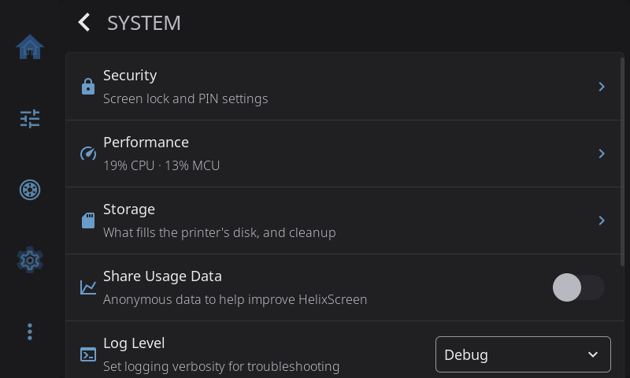
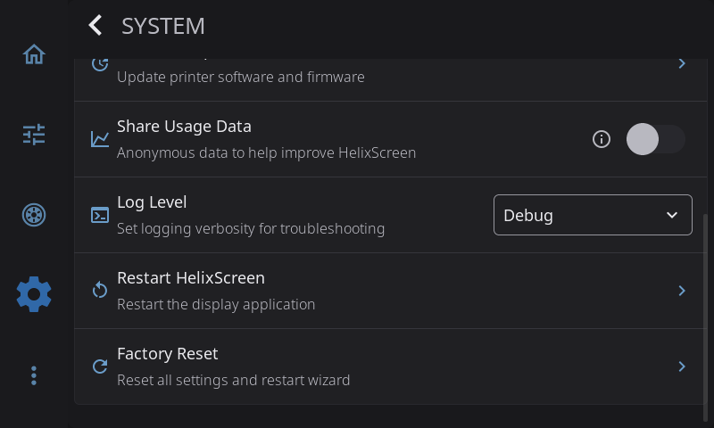

# Settings: System

**Settings > System** looks after HelixScreen itself: the screen lock, the printer's storage, anonymous usage data, how much it logs, and restarting or resetting it. Network and printer connections are in [Connection](connection.md), and touch settings are in [Touch & Input](touch-input.md).

---

## Security

Locks the screen with a PIN, so nobody can use your printer's controls without it. Tap **Security** to set it up.

**With no PIN set:**

- **Set PIN**: choose a 4 to 6 digit PIN and enter it twice.

**With a PIN set:**

- **Change PIN**: enter your current PIN, then the new one twice.
- **Remove PIN**: turn the lock off. You'll need to enter your current PIN.
- **Auto-lock**: off until you turn it on. When on, the keypad comes up as soon as the screen wakes from sleep or from dimming (see [Display Sleep](display.md#display-sleep)). There is no separate timer. Previewing a screensaver from settings never locks the screen.

When the screen is locked, a keypad covers it. Enter your PIN and tap the check mark. A wrong PIN shows a short error (*Wrong PIN*). While a print is running, an **Emergency Stop** button stays in the top-right corner of the lock screen, so you can always stop the printer without unlocking.

HelixScreen never saves your PIN itself, only a scrambled version of it that can't be turned back into the digits. A factory reset removes the PIN. See [Security](../security.md) for more.

---

## Storage

Shows what fills your printer's storage, and lets you clear out what is safe to delete. Tap **Storage** to open it.

The top of the page shows how much space is free, with a bar for how full the storage is. Below it, one line per kind of file, with how much space it takes:

| Line | What it is | Clean up |
|------|------------|----------|
| **Print copies** | Changed copies of your files, made when a print starts with options that change the file | With the HelixPrint plugin. It keeps copies made in the last 10 minutes, the one printing now, and the one a power-loss resume would need |
| **3MF conversions** | G-code unpacked from `.3mf` uploads, so they can print | No |
| **File analysis** | Indexes that make print previews faster | With the HelixPrint plugin. Previews then read each file in full until it is analyzed again |
| **Print photos** | Camera photos kept with your print history | With the HelixPrint plugin. The photos also leave the print history |
| **Timelapse videos** | Finished timelapse videos | Yes. Only video and preview files older than 5 minutes |
| **Old logs** | Older Klipper and Moonraker logs. The logs in use are kept | With the HelixPrint plugin. Only older log files, not other files in the logs folder |
| **Thumbnails** | The preview pictures of your files | No |
| **Your files** | Everything you uploaded | No, delete them from the file list |
| **Power-loss recovery** | The saved print position and bed mesh for resuming after a power cut | No |

**Clean up** appears on lines that can be cleaned and hold something. HelixScreen asks you to confirm, then deletes those files and says how much space it freed. If some files could not be deleted, it says so; if none could, it shows "Could not free space". Nothing you uploaded is ever deleted from here.

**Automatic cleanup**: once a day, while nothing is printing, deletes print copies older than a week and old logs older than a month. Photos, timelapse videos and your files are never deleted automatically. **Off** until you turn it on.

**With the [HelixPrint plugin](../helixprint-plugin.md)** the printer measures its own storage, so every line is shown, and Automatic cleanup is available. **Without it**, HelixScreen measures by listing the printer's folders, which takes longer on a printer with many files. 3MF conversions and Power-loss recovery are not shown then, conversions count under Your files, only Timelapse videos can be cleaned, and only when the timelapse folder is a folder of its own rather than your files or config folder (HelixScreen cannot tell on its own which print copy or index a power-loss resume still needs, and the printer does not let it delete logs). If the plugin is installed but refuses to clean up because a folder is set up unsafely, nothing can be cleaned from this page until that is fixed, and Automatic cleanup is not shown. Without the plugin, Automatic cleanup shows "Requires the HelixPrint plugin" with an **Install** button. This works the same whether HelixScreen runs on the printer's own screen or on a tablet or another computer.

HelixScreen also checks for space before it uploads a file to the printer, a print copy or a file from a USB stick: if the upload would leave less than 100 MB free, it does not start and says so.

---

## Performance

> Only shown once HelixScreen has performance readings.

The row shows how busy things are right now, for example *95% CPU · 13% MCU*. Tap it for live processor and memory use on the computer running HelixScreen, plus the load on each of your printer's controller boards. Check it when prints stutter or the screen feels slow, to see whether the host or a board is overloaded.

The same readings can sit on the home screen as the [Host Health widget](../home-panel.md#host-health-widget), which opens this screen when tapped.

---

## Share Usage Data

Sends anonymous usage data that helps improve HelixScreen. **Off** until you turn it on; turning it on shows a thank-you message. Nothing personal is sent: no names, printer names or file names. See [Telemetry & Privacy](../../TELEMETRY.md) for exactly what is and isn't collected.

### View Telemetry Data

> Only shown while Share Usage Data is on. Not shown on the ESP32 firmware (the BigTreeTech K-Touch), which keeps no queue of data to show.

Shows exactly what would be sent, before it's sent.

---

## Log Level

How much detail HelixScreen writes to its log. Raise it when you're chasing a problem or preparing a bug report.

| Level | What it records |
|-------|-----------------|
| **Warn** | Only errors and warnings |
| **Info** (default on a normal install) | Connections, screen changes and other milestones |
| **Debug** | Changes of state and messages to and from the printer. Use this for bug reports |
| **Trace** | Everything, including screen drawing. Very long and rarely needed |

The change takes effect straight away. Set **Debug**, reproduce the problem, send a [debug bundle](help-about.md#upload-debug-bundle), then set it back to **Info**.

> **Tip:** Debug and Trace use more processor time and fill the log faster. Don't leave them on.

---

## Restart HelixScreen

Restarts the screen app (not the printer). A short "Restarting HelixScreen..." message appears first, with no confirmation question. Use it after changing a setting that needs a restart, such as [UI Scale](display.md#ui-scale), or if the screen stops responding properly.

---

## Factory Reset

Erases **all** HelixScreen settings and starts the setup wizard again. HelixScreen asks you to confirm first ("This will reset all settings to defaults. This action cannot be undone.", with **Reset** and **Cancel**). After **Reset**, a message reads "Settings reset to defaults. Restarting..." and HelixScreen restarts into the setup wizard. A factory reset clears:

- Display, appearance, sound and all other preferences
- LED setup
- Your printers and how to connect to them
- Sensor roles and the Hardware Health expected list
- The screen lock PIN

It also deletes the backup copies of those settings, so they cannot come back by themselves. It **doesn't touch** your Klipper config, Moonraker or any files on the printer.

---

[Back to Settings](../settings.md) | [Prev: Language & Time](language-time.md) | [Next: Updates](updates.md)
