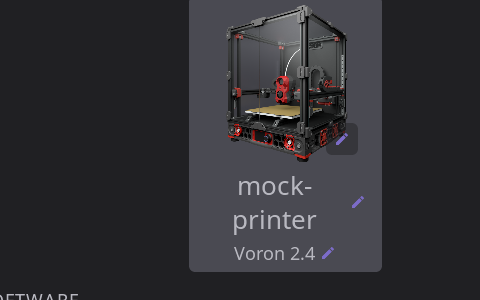
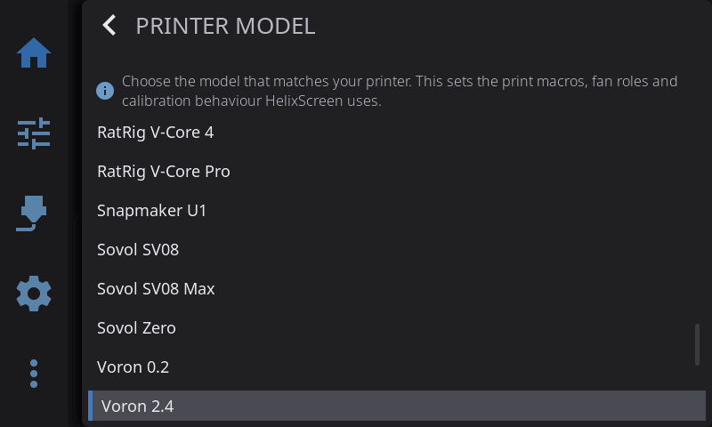

# Supported Printers

HelixScreen works with **any Klipper printer running Moonraker**. On top of that, a number of printers get model-specific support: their filament systems, chamber heaters, cameras and quirks are wired up so they work without extra setup.

This page describes what works on those printers. For a one-line status of every platform, see [Which printers are supported?](../FAQ.md#which-printers-are-supported) in the FAQ. For setup steps, see the [Installation Guide](../INSTALL.md).

---

## Two Things Worth Knowing First

**1. You do not have to run it on the printer.** Some printers can run HelixScreen on their own built-in screen (listed below). Because HelixScreen is a Moonraker client, any printer can also be controlled from a separate Raspberry Pi, mini PC or tablet with a touchscreen, over the network. See [Can I run HelixScreen on a separate device?](../FAQ.md#can-i-run-helixscreen-on-a-separate-device-instead-of-on-my-printer) and [Remote Screen Setup](../INSTALL.md#remote-screen-setup-run-on-a-separate-device).

**2. Your printer is recognized automatically.** HelixScreen compares your printer with a database of more than 100 models and fills in its name, picture, bed size, probe type and, where one exists, a ready-made profile. The **printer type** it saves decides which features and calibration screens you get; the picture you choose in the Printer Manager is only cosmetic. When the best match is less than 85% certain, or two models match equally well, no type is saved and the wizard's **Printer Setup: Identity** step asks you to pick your model (see [Getting Started](getting-started.md#picking-your-printer-model)).

**Wrong model? Fix it in the Printer Manager.** Open the Printer Manager by tapping the printer picture on the Home panel, or from **Settings > Printer**. Its model row opens the same model picker the wizard uses; the model you pick applies right away, without running setup again. HelixScreen also notices when the saved type stops matching what it finds on the printer, and asks once whether to **Choose Model** (which opens the picker) or **Keep current**. Re-running the wizard with a factory reset is only needed in rare cases; see [Wrong printer model identified](../TROUBLESHOOTING.md#wrong-printer-model-identified).

**Printer-specific install packages.** The packages built for one printer family (for example the Creality K1 or the FlashForge Adventurer 5M) set up that family's profile. The wizard then skips the Identity step, and the printer type comes from the package's family. If such an install shows the wrong printer, for example an Adventurer 5M package on a different machine, install the package built for your hardware, or set the screen up as a remote screen. Picking another model in the Printer Manager changes the printer type, but not the printer the package was built for.

A printer that is not in the database still works fully through generic detection; see [Every Other Klipper Printer](#every-other-klipper-printer).

> **What the status labels mean:** on this page and in the FAQ, **Tested** means the HelixScreen team checked it on real hardware; **Supported** means it works with the firmware named; **Community** means a user confirmed it but the team has not tested it; **Preliminary** means support was built from the printer's published configuration or captured data and has not been checked on hardware. If you run HelixScreen on hardware the team has not tested, [tell us](settings/help-about.md). Reports are how printers move up the list.

---

## Deeply Integrated Printers

### FlashForge Adventurer 5M / 5M Pro

Runs on the printer's built-in 4.3" screen in place of the stock interface.

**What works:**
- Temperature, motion, bed mesh (with the 3D view), fan and macro control on the printer's own screen
- **Firmware-managed Z-offset** on ZMOD: the firmware stores the offset, and HelixScreen shows the stored value while the printer is idle, instead of the 0.000 that Klipper reports between prints. See [Printing: Z-Offset](printing.md#z-offset--baby-steps)

**Requirements:** Forge-X, ZMOD or Klipper Mod firmware, each of which provides Moonraker. See [Installing on the Adventurer 5M](install-ad5m.md).

**Status:** Tested.

---

### FlashForge Adventurer 5X

Runs on the printer's built-in 4.3" screen, with the four-color **IFS (Intelligent Filament System)** fully integrated.

**What works:**
- **4-slot IFS**: load, unload and select filament per slot, with color and material for each slot and a filament-presence sensor on each port
- **Filament Mapping** for multi-color prints (tools T0 to T15 onto the four ports), correct even with slot renumbering turned on. Mapping writes the printer's own tool map, so what HelixScreen shows is what the printer does
- **External-spool bypass** for feeding a spool directly: it turns on runout protection at the toolhead sensor and offers the spool to OrcaSlicer as an extra lane
- **[Spoolman](filament-tracking.md)** spools assigned to slots
- **Infinite Spool** reporting: when a slot runs out, the IFS switches to another slot loaded with the same filament type and color, if there is one. HelixScreen says so on the runout screen and in the filament system panel
- **Firmware-managed Z-offset**: ZMOD stores the offset, so there is no Save step. HelixScreen shows the stored value while idle and adjusts from it. See [Printing: Z-Offset](printing.md#z-offset--baby-steps)

**Requirements:** ZMOD firmware 1.7.0 or newer (a community firmware mod). See [Installing on the Adventurer 5X](install-ad5x.md).

**Status:** Tested.

> **Good to know:** Infinite Spool is always on in stock ZMOD, with no switch. The optional [bambufy](https://github.com/function3d/bambufy) and [lessWaste](https://github.com/Hrybmo/lesswaste) plugins add an on/off switch in their own Mainsail or Fluidd dialog; HelixScreen shows which one is active but does not offer the switch itself. Virtual channels beyond four tools are not shown yet. Some units show a random solid color while the screen sleeps; if yours does, set the sleep timeout to Never.

---

### FlashForge Creator 5 / Creator 5 Pro

FlashForge's four-head tool changer. Both models are recognized separately (the Pro adds a chamber heater and chamber fans) and run HelixScreen on the printer's own screen, using the same install package as the Adventurer 5X.

**What works:**
- **Four toolheads**: mounting and parking a head is driven from the screen, and a tool change shows its steps (dock, pick up) as Z-Mod reports them
- **Per-head filament** on Z-Mod 1.7.4 and newer: each head's material and color are read from the printer, and a head without filament reads Empty
- **Endless spool** reporting: Z-Mod's switching is always on, and HelixScreen reports it
- **Load** on a head (on Z-Mod) feeds that head and heats only that head
- The firmware's own filament-system faults, in their own wording

**Requirements:** one of the two firmwares that replace the stock software: [Z-Mod](https://wiki.zmod.link/C5PRO/), which installs and updates HelixScreen itself, or [Reforge](https://github.com/Klipper4FlashForge/firmware), which ships with HelixScreen. See the [Installation Guide](../INSTALL.md).

**Status:** Tested on a Creator 5 Pro.

---

### Creality K1 / K1C / K1 Max / K1 SE

Runs on the K1's built-in screen. The K1C and K1 Max are the most thoroughly tested.

**What works:**
- Temperature, motion, bed mesh, fan and macro control on the printer's own screen. The on-printer build has no camera view; see [Camera](camera.md#printers-without-a-camera-view)
- **Chamber heater control** on the K1 Max
- **Optional CFS**: with Creality's CFS upgrade kit and its firmware (v2.3.5.33 or newer), HelixScreen detects and drives the CFS on the K1 series (see [Creality Filament System](filament.md#creality-filament-system-cfs))
- **Creality Print keeps working**: installing HelixScreen replaces only the stock screen, not Creality's background services

**Requirements:** community firmware that adds Moonraker (stock K1 firmware has none), such as Guilouz, Simple AF or Guppy Mod, plus root access. See [Creality K1 Series setup](creality-k1c-setup.md); the [K1 series page](install-k1.md) covers the easy installer.

**Status:** Supported.

> **Good to know:** the K1 series has the least memory of any HelixScreen platform (256 MB). It has a single extruder.

---

### Creality K2 / K2 Plus / K2 Pro

Runs on the K2's built-in screen and, unlike the K1, **works with stock firmware and stock Moonraker**. This is the most complete CFS integration. The base K2 is recognized as its own machine with its own picture. Unlike the Plus and Pro it has no chamber heater, so there is no chamber control. With a CFS connected, the Home picture of a K2 shows the CFS on top of the printer.

**What works:**
- **CFS multi-material**: up to 4 units of 4 slots (16 colors), with color, material and remaining length per slot, temperature and humidity per unit, and load and unload
- **Auto-Refill** (endless spool), run by the CFS itself, and Filament Mapping. A runout always pauses the print first. The CFS switches to another slot only when Auto-Refill is on and that slot holds exactly the same material and color; otherwise the print stays paused
- **Humidity and temperature** for each CFS unit, each shown as one box on the [filament environment screen](filament.md#filament-drying-and-humidity). The CFS has no heater, so there are readings but no drying controls
- **External-spool bypass**: turn it on in the filament system panel to stand the CFS down, switch on the toolhead runout sensor, and offer the spool to OrcaSlicer as an extra lane. See [Filament: CFS and the External Spool](filament.md#cfs-and-the-external-spool)
- **No CFS?** A K2 without one is a single-spool printer: there are no filament system screens, and Load and Unload run the K2's own external-spool load and cut. See [Filament: CFS](filament.md#creality-filament-system-cfs)
- **Chamber heater** control on the K2 Plus and Pro
- **Hotend fan** shown in Fan Control without a dial: it runs with the heater and is never set from the screen
- **Spaghetti detection**: during a print, HelixScreen runs the K2's own AI model on camera snapshots and can pause the print (see [Print Monitoring](print-monitoring.md#print-failure-detection)). Filament runout is detected and handled by the printer's firmware, which pauses the job; HelixScreen shows what the CFS decided and offers the recovery buttons

**Requirements:** stock firmware. See [Installing on the K2 series](install-k2.md).

**Status:** Tested, with CFS support.

> **Community firmware:** the list above describes stock Creality firmware. Community firmware that brings its own rewritten CFS module is recognized and supported too, including load, unload and filament changes; see [Filament: CFS](filament.md#creality-filament-system-cfs). On the K2 Plus, the Kalico-based community port (including Jacobean's firmware, which is recognized as itself) adds more with recent module versions:
> - **Per-unit readings**: each CFS unit shows its own temperature and humidity
> - **Filament Mapping**: the tool-to-slot choices you make when starting a print are sent to the CFS just before the print starts, and apply to that print only. If a mapping points at a slot the CFS cannot feed from, or at a unit that has stopped answering, the print does not start and HelixScreen tells you why. Older module versions have no Filament Mapping
> - **Disconnected units**: a CFS unit that stops answering is marked **Disconnected** on its card until it comes back

> **Good to know:** the K2's portrait panel is rotated to landscape in software, which is the supported setup. Running it unrotated with the portrait layout is alpha and mostly untested. Animations and the 3D bed mesh may be slowed down on this processor. The CFS material list is fetched from Creality's cloud.

---

### QIDI Plus 4 / Q2 / Plus 5 / Max 4

The 4-series QIDI printers use the **QIDI Box** filament changer. The Q2, Plus 5 and Max 4 can run HelixScreen on the printer's screen. The Plus 4, and the 3-series X-Smart 3, X-Plus 3, X-Max 3 and Q1 Pro, have a serial display that HelixScreen cannot drive, so on those it is **remote only**: run HelixScreen on a separate device pointed at the printer's Moonraker.

**What works:**
- **QIDI Box** (4, 8, 12 or 16 slots): slot status, Filament Mapping and Assigned Tool, and load, unload and tool change
- **The full stock load wizard**: a load runs QIDI's whole `M604` sequence on the screen (push the filament in, then **Extrude more** or **Done**), then cools the nozzle and turns the filament sensor back on. See [Loading on a QIDI](filament.md#loading-on-a-qidi-m604)
- **QIDI Box drying**: the box's heater, temperature and humidity are on its [filament environment screen](filament.md#filament-drying-and-humidity)
- **Chamber heater** control on enclosed models
- **Power-loss recovery** on the Q2, Q1 Pro and Plus 4 with stock firmware: after a power cut the resume dialog offers the printer's own recovery or a clean discard
- **Print-start tracking** through QIDI's steps (homing, bed heat, nozzle clean, Z tilt, mesh, nozzle heat, chamber heat)
- WiFi setup

**Requirements:** stock firmware works (it runs standard Moonraker); FreeDi and FreeQIDI are supported too. On-printer install is for the Q2, Plus 5 and Max 4 only; everything else is [remote control](../INSTALL.md#remote-screen-setup-run-on-a-separate-device).

**Status:** Supported.

> **Good to know:** the team owns no QIDI hardware; the Q2 is community-checked. Writing to the QIDI Box (load and unload) is still being checked in the field, and Max 4 box control differs from the Q2 and is unfinished. Installing on the printer replaces QIDI's stock screen program, which QIDI Studio box sync, QIDI cloud and QIDI Box filament edits depend on; uninstalling HelixScreen brings them back. Install steps: [QIDI](install-qidi.md).

---

### Snapmaker U1 (SnapSwap)

A true four-toolhead changer, running on the U1's built-in 3.5" screen. Each head is independent, with no shared filament path.

**What works:**
- **Four independent toolheads** with fast tool changes (T0 to T3, about 5 seconds, no purge tower)
- **Filament details per slot**: material type and sub-type, brand and color, read from the print job even with the RFID reader off
- **RFID filament recognition** through the built-in reader
- **Feed and load state per head**, and runout handling with automatic resume
- **Batch load and unload**: the filament system panel's Load and Unload buttons open a picker for several heads at once, and the U1 runs its own batch command, preheating the next head while the current one finishes. See [Filament](filament.md#sidebar)
- **The firmware's print preferences**, under the filament system panel's **Settings** button in the **Print Behavior** section: whether refilling ignores color, filament tangle detection with low, medium or high sensitivity, and turning the light off when a print ends. These show and change the firmware's own stored values. Auto-Replenish is the **Endless Spool** switch on the same Settings page
- **Unload at end, per toolhead**, in the same section. The U1 forgets this choice after every print, so HelixScreen keeps it for each printer and sends it with every print it starts, including Print Again and a restart from the beginning. A choice made from another app between prints is replaced by HelixScreen's. A head holding soft filament such as TPU is never unloaded, as on the Snapmaker screen: its switch is grayed out and reads off until that head holds rigid filament again. A change made during a print applies from the next print
- **Nozzle size and type per toolhead**: after swapping a nozzle, set its size (0.2, 0.4, 0.6 or 0.8 mm) and type (Standard or High Flow) under **Settings** in the **Toolhead** section. The printer stores them and checks print files against them. They are grayed out while a print runs or is paused. Choosing 0.2 mm asks first, because the printer clears a head's filament details when the loaded filament cannot go through a 0.2 mm nozzle (including PA, PC, TPU, and carbon- or glass-filled types). High Flow exists only at 0.4 mm, so moving a High Flow head to another size also sets it back to Standard. If the printer refuses a change, HelixScreen says why and shows the printer's value again
- **Pre-print options that stick**: the switches offered before a print (bed mesh, input shaper, pressure advance, timelapse) show and save the firmware's own stored settings
- **Per-filament temperatures**: a load preheats to the temperature the firmware measured for that filament, not a generic default
- **A spool with no material set is caught before the print starts**, instead of the printer heating and homing and then reporting a runout
- **Faults in plain language**: the U1's numeric fault codes are shown as a sentence saying what went wrong
- **Screws-tilt calibration** run through the firmware, with a check first that asks you to take the PEI sheet off the bed, because probing through it gives wrong results
- **Print-start tracking** and near-certain recognition. Z-offset baby steps are temporary: the firmware re-applies each head's own stored offset at every tool change. See [Printing: Z-Offset](printing.md#z-offset--baby-steps)

**Requirements:** SSH access, through either stock firmware 1.2 or newer (its **Root access** option) or PAXX Extended Firmware (SSH on by default). Reinstall after any firmware update. See [Installing on the Snapmaker U1](install-u1.md).

**Status:** Tested on PAXX 1.2.x to 1.4.x. The stock-firmware path has not been checked on a real stock printer; testers wanted.

> **Good to know:** the U1's 480x320 screen is one of the smallest resolutions HelixScreen supports, and a few screens are known to be tight there. Cameras work normally. Writing filament data back to RFID tags works only on PAXX firmware.

> **ACE Pro units on a U1 (multiACE):** a modded U1 can feed its four toolheads from ACE Pro units. HelixScreen still drives it as a U1, with four toolheads and everything above, rather than as an ACE, because the ACE units' slot data cannot be read in that setup.

**Remote screen in Mainsail and Fluidd (PAXX only):** on PAXX Extended Firmware, the U1's built-in "gui" webcam shows the live HelixScreen screen, and you can tap it to control the printer remotely, the same as touching the panel.

1. Open the firmware settings page at `http://<printer-ip>/firmware-config/` (log in with your Mainsail or Fluidd login) and set **Remote Screen** to **Enabled**.
2. The setting restarts HelixScreen and Moonraker, registers the "gui" webcam and starts the screen server. Nothing else is needed.
3. Open your printer in Mainsail or Fluidd while logged in, and choose the **"gui"** webcam in the camera view.
4. To control it, go to `http://<printer-ip>/screen/` and tap the picture. Taps, presses and drags drive HelixScreen live.

Notes:
- Use the firmware settings page, not a hand edit. Setting `web remote_screen` in `extended2.cfg` by hand is not enough: the page also turns on the `[webcam gui]` section in `extended/moonraker/04_remote_screen.cfg` and restarts Moonraker. If you must do it by hand, do all three, then restart HelixScreen and Moonraker.
- The feed is a still picture refreshed a few times a second, not smooth video. It is fine for watching and tapping through menus.
- Stock firmware is not yet known to offer the feed.
- If the "gui" webcam shows **"No Signal"** or a stale or black frame, HelixScreen has not restarted since the setting was turned on. Restart HelixScreen or reboot the printer.

For screen sharing on other printers, see [Screen Sharing](screen-sharing.md).

---

### Anycubic Kobra + ACE Pro, and Sovol SV06 ACE

The **Anycubic ACE Pro** filament system is integrated on the Kobra 2 Pro, Kobra 3, Kobra 3 V2, Kobra 3 Max, Kobra S1 and Kobra S1 Max, and on the Sovol SV06 ACE. These usually run community firmware, with HelixScreen on the printer or on a separate screen.

**What works:**
- **ACE filament system**: color and material per slot, load and unload, and [filament drying](filament.md#filament-drying-and-humidity) in the ACE's heated chamber

**Requirements:** community firmware that provides Moonraker, such as [Rinkhals](https://github.com/jbatonnet/Rinkhals) on Anycubic printers. ACE support needs one of the community ACE drivers. With the ValgACE driver, the `ace_status.py` Moonraker component must be installed; if it is missing, HelixScreen shows a prompt telling you to install it. Printers running the [ACEPRO](https://github.com/Kobra-S1/ACEPRO) Klipper driver (the Kobra S1, Kobra X and Kobra 3 family on standard Klipper) need nothing extra: HelixScreen reads that driver directly. With several ACE units chained on ACEPRO, each one shows as its own unit, with its own slots and dryer.

**Status:** Community. Recognized automatically, not yet tested on the team's hardware. ACEPRO support was built from captured status data and the driver's source, not a live machine.

---

### Other Dedicated Builds

| Printer | What is special | Status |
|---|---|---|
| **Creality Sonic Pad** | Its own 32-bit ARM build for the Sonic Pad's screen. Needs [SonicPad-Debian](https://github.com/Jpe230/SonicPad-Debian), the only firmware tested; stock Creality OpenWrt is untested | Supported |
| **Elegoo Centauri Carbon** | Runs on the printer with [OpenCentauri COSMOS](https://docs.opencentauri.cc/klipper-conversion/cosmos/cosmos/) firmware, and ships with a factory white-balance setting for the camera | Tested |
| **Creality Hi** | Recognized automatically as a bed-slinger with optional CFS | Preliminary |

---

## Multi-Material Systems on Any Printer

These filament systems are not tied to one printer model. HelixScreen detects them from Klipper on any machine:

- **Happy Hare** (ERCF, Tradrack, 3MS, EMU and other MMUs)
- **AFC-Klipper** (Box Turtle, OpenAMS, ViViD)
- **OpenAMS** on its own (klipper_openams without AFC, with its UI API installed)
- **klipper-toolchanger** (multi-toolhead machines)
- **MedusaHC** (hotend changer, often on a Duender), detected from its controller and dock sensors, with or without klipper-toolchanger
- **Bondtech INDX** (one Smart Head with up to ten passive tools in a dock)
- **Anycubic ACE Pro** through the ValgACE, BunnyACE, DuckACE or ACEPRO driver

Details on each are in [Filament Management](filament.md#ams--multi-material-systems).

### Where Each System Keeps a Spool's Details

HelixScreen keeps nothing about your lanes on the screen itself. A lane's details are kept on the printer: partly by the filament system, and the rest in a lane record the printer shares with OrcaSlicer, Mainsail and any other screen. When you edit a spool, HelixScreen writes the change to the place shown below.

| System | Kept by the system itself | Kept in the shared lane record |
|--------|---------------------------|--------------------------------|
| AFC (Box Turtle, ViViD) | Spool link, material, color, weight, tool mapping | Brand, spool name, color name, catalog pick and full weight, in HelixScreen's own record beside AFC's (AFC owns the shared one) |
| Happy Hare | Spool link, material, color, name, temperature, and brand on Happy Hare 4 | Brand on older versions, full weight, color name and catalog pick, in HelixScreen's own record beside Happy Hare's. A Happy Hare that fills its gates from Spoolman takes changes only in Spoolman |
| OpenAMS with openams_spoolman | Everything, in Spoolman, through openams_spoolman | Nothing: name and color name cannot be kept, and Clear Spool belongs to openams_spoolman |
| OpenAMS on its own | Nothing | Everything |
| Creality CFS | Material and color (and the tag's spool, read from RFID) | Everything else |
| FlashForge AD5X | Material and color | Everything else |
| QIDI Box | Material, color and vendor | Everything else (the color is matched to the box's palette) |
| Snapmaker U1 | Material type, vendor, sub-type and color | Spool link, name and weights |
| ACE | Color, material and temperature (on the ACEPRO driver) | Everything else |
| Tool changers | Nothing | Everything, one record per tool |

---

## Every Other Klipper Printer

If your printer is not listed above, it still works, using generic detection instead of a model profile. Point HelixScreen at your printer's Moonraker (port `7125`) and it reads the live Klipper configuration, turning on every screen your hardware supports:

- Nozzle and bed temperatures, with an extruder picker on machines with several
- Motion, homing and emergency stop
- Bed mesh, including the 3D view
- Fans, LED and WLED lighting, and power devices
- Camera, when a Moonraker webcam is configured
- Macros, the console, the file browser and print controls
- Firmware retraction, chamber heating, input shaper, exclude objects and [Spoolman](filament-tracking.md), each when found
- Timelapse, when the Moonraker-Timelapse plugin is installed
- [Screen sharing and remote control](screen-sharing.md) from a browser, and as a webcam in Mainsail and Fluidd

The printer database (more than 100 models, including Voron, RatRig, Prusa MK4, VzBot, Elegoo Neptune, Sovol, Anycubic, Artillery, FLSUN, Kingroon, Zero G and more) adds the finishing touches: your printer's name, picture, bed size and preset options. Printers added in 1.1 include the VzBot 330 and 235, the FLSUN S1, S1 Pro and T1 Pro, and the base Creality K2. A printer missing from the database loses only those details; every control above still works.

---

## Don't See Your Printer?

- Check the [status table in the FAQ](../FAQ.md#which-printers-are-supported), which lists more platforms than the sections above.
- Any Klipper and Moonraker printer works through generic detection, listed or not.
- If you get it running on hardware the team has not tested, tell us on [Discord](settings/help-about.md) so it can be added.

---

## See Also

- [FAQ: Which printers are supported?](../FAQ.md#which-printers-are-supported): a quick status table for every platform
- [Installation Guide](../INSTALL.md): setup steps for each platform
- [Getting Started](getting-started.md): the setup wizard, including picking your printer model
- [Filament Management](filament.md): AMS, CFS, IFS and other multi-material details

---

**Next:** [Home Panel](home-panel.md) | **Prev:** [Getting Started](getting-started.md) | [Back to User Guide](../USER_GUIDE.md)
