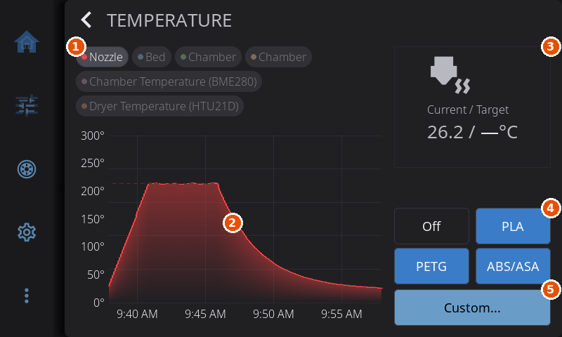
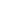
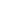
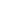

# Temperature Control

1. The sensor chips.
2. The temperature graph.
3. The readout card for the selected heater.
4. The preset buttons.
5. The Custom button.

---

HelixScreen shows every temperature in degrees Celsius. There is no setting to switch the display to Fahrenheit.

Temperatures appear in three places:

- The **Temperature** card on the Controls panel, where you read and set the nozzle, bed and chamber.
- The **temperature graph screen**, which plots every sensor over time and has presets for the heater you opened it from.
- Home screen widgets such as **Temperatures**, **Nozzle Temperatures** and **Temperature Graph**. Tapping a heater in a widget opens the graph screen on that heater.

---

## The Temperature Card

The **Temperature** card on the Controls panel has a row for the **Nozzle**, the **Bed** and, when your printer has a chamber heater or a chamber sensor, the **Chamber**. Each row shows the current and target temperature.

- **Tap a row** to open the [temperature graph screen](#temperature-graph-screen) for that heater.
- **Tap the pencil icon** on a row to type a new target on a keypad. The keypad stops at your printer's maximum for that heater and tells you what the limit is when you reach it.
- **The status line** under a row (hidden on the smallest screens and in portrait) shows how hard the heater is working as a percentage of its power, followed by an icon: a flame while it heats, a check mark when it is at its target, a snowflake while it cools, and nothing while it is off. On the chamber, a circled **A** means the printer is holding its own standing temperature (see [Heating, Maintaining and Auto](#heating-maintaining-and-auto)). A chamber with only a sensor says **Monitoring**.
- **"N more sensors"** appears under the rows when your printer has other temperature sensors. Tap it to open the sensor list.

### Choosing the Nozzle on a Multi-Head Printer

On a tool changer, an IDEX printer or any printer with more than one hotend, the word "Nozzle" in the card's first row becomes a drop-down list of your tools (**T0**, **T1** and so on).

- Pick a tool to make the row show **that tool's** nozzle, current and target, and to make the pencil icon set **that tool's** target. A tool that is not mounted can be pre-heated this way without changing tools.
- The tool you pick stays selected when you leave Controls and come back.
- A tool change from anywhere (the Tool Switcher, a macro, a print) moves the row to the tool that is now mounted. An empty carriage keeps your pick.
- Several filament slots feeding one hotend, as on an AMS, do not count as several heads. The drop-down appears only when there are physically several toolheads.

On a single-nozzle printer the row simply says **Nozzle** and there is no drop-down.

1. The tool drop-down.
2. The pencil icon, which sets that tool's target temperature.

---

## Temperature Graph Screen

Tap a heater on the Controls panel (or a heater in a home screen widget) to open the graph screen. It is one screen for every heater, so you can compare traces and set the temperature of the heater you came from.

### Layout

In landscape the **graph** takes the left two thirds and the **controls** for the heater you opened take the right third. In portrait the controls sit below the graph. Tapping a graph on the Print Status screen, the Filament screen or the Temperature Graph widget opens the graph alone, at full width, without controls.

### Sensor Chips

Above the graph, a row of **sensor chips** lets you choose which traces are visible:

- Each chip shows a colored dot matching its graph line and the sensor name.
- Tap a chip to show or hide that sensor's trace.
- When you open the screen from a heater, that view starts with its own defaults, and your chip choices are remembered for that printer and that view the next time you open it.
- Chips wrap across several lines when you have many sensors.
- Every generic heater (`[heater_generic]`) other than your chamber heater gets its own chip with a target line, for example a filament dryer's heater.

### Graph Features

- **Solid line:** the current temperature.
- **Dashed line:** the target temperature, for heaters.
- **Auto-scaling Y axis:** the range adjusts to the traces you have visible.

### Setting a Temperature

The controls column has:

- **Off**, which sets that heater's target to 0.
- Three **material presets** (see [Temperature Presets](#temperature-presets)). A preset applies at once.
- **Custom...**, which opens the keypad for an exact temperature.

If a chamber has a sensor but no heater, the column shows the current temperature and the word **Monitoring** instead of presets and Custom.

### Picking a Nozzle on the Graph Screen

When the printer has more than one extruder, the nozzle controls start with a row of small numbered buttons, one per nozzle. Tap one to aim the presets and **Custom...** at that nozzle. The nozzle card above them shows that nozzle's temperature and status.

- Picking a nozzle here does not change which tool is mounted. It only chooses which heater you are setting.
- The pick is remembered when you close the screen and open it again, so a pre-heat on a docked tool is where you left it. It is dropped when a tool change happens, even one that happened while the screen was closed, and the card then follows the mounted tool.
- A preset or custom value you apply goes to the nozzle you picked, even if you opened the keypad from this screen and it stacks on top of it.

1. The row of nozzle buttons.
2. The readout card for the selected nozzle.

### The Mini Graph on the Filament Screen

The Filament screen has its own small graph. It plots the nozzle that the Filament screen is aimed at, the one chosen with the tool chooser there. When that is the mounted tool, the graph follows the mounted tool through every tool change.

---

## Temperature Presets

A preset sets a heater's target in one tap. There are four preset slots, and each slot holds a material. The slots start as **PLA**, **PETG**, **ABS** and **TPU**.

- **Nozzle** and **bed** targets come from the slot's material: the middle of its nozzle range, and its bed temperature. With the built-in materials they are:

| Slot | Nozzle | Bed |
|------|--------|-----|
| PLA | 205°C | 60°C |
| PETG | 245°C | 80°C |
| ABS (shown as **ABS/ASA**) | 255°C | 100°C |
| TPU | 225°C | 50°C |

  If you change a material's temperatures in **Settings > Printing > Material Temperatures** (see [Material Temperatures](settings/printing.md#material-temperatures)), its presets change with it. A preset above the printer's maximum is applied at that maximum.
- **Chamber** presets do not depend on the material. They are fixed steps by position: **40°C**, **50°C** and **60°C**. A step above the chamber heater's configured maximum is hidden.

The graph screen has room for **Off** and the first three slots. The Filament screen shows all four.

### Reassigning a Preset's Filament Type

The preset buttons are not fixed. On the **Filament** screen you can point any of them at a different material from the built-in materials list. The graph screen's presets follow the same slots.

1. **Long-press** a preset button on the Filament screen until the material picker appears.
2. Scroll the list and tap the filament type you want. The button's label and its temperatures update immediately, and the choice is remembered across restarts.
3. To undo all changes, long-press any preset button and tap **Reset to defaults** at the top of the list. That restores PLA, PETG, ABS and TPU.

A short tap still just applies the button's temperatures. Only a long-press opens the picker.

### Spool Preset

When a filament is loaded, either from an [external spool configuration](filament.md#external-spool-configuration) or an active AMS slot, and its material does not match one of the standard preset slots, an extra **spool preset** button appears on the Filament screen. It shows the material and its recommended temperature, for example "PA-CF (265°C)". Tap it to heat for that material.

---

## Chamber Temperature

If your printer has a chamber heater or a chamber temperature sensor configured in Klipper, you can open the chamber view by tapping the chamber row in the **Temperature** card, the chamber row in the **Temperatures** widget, or the single **Chamber** temperature tile on the Home screen.

- **Heated chambers** (`heater_generic chamber`) get the full controls: current and target temperature, **Off**, the presets **40°C**, **50°C** and **60°C**, and **Custom...**.
- **Sensor-only chambers** (`temperature_sensor chamber`) get a monitoring view: the current temperature, the graph and the word **Monitoring**. Presets and target entry are hidden, since there is no heater to control.

### Heating, Maintaining and Auto

Some printers, such as the Creality K2, coordinate a chamber heater and a cooling fan. On those, a chamber target comes in three kinds:

- **Heating:** the heater is actively warming the chamber to your target (for materials like ABS or ASA).
- **Maintaining:** the target is a **cooling ceiling**, 40°C or below. The printer does not heat. It keeps the chamber from rising above your target, which suits PLA in an enclosure.
- **Auto** (a circled **A**): the target equals the printer's own standing value, for example 35°C on a stock K2. It is shown as a number with the circled **A** to say it is the printer's normal behavior, not something you set.
- **Off:** no chamber target is held.

You set any of them the same way, by picking a preset or entering a temperature. The printer decides whether to heat or maintain from the value.

### Chamber Heater Diagnostics

Some add-on chamber heaters, currently the BIGTREETECH Panda Breath with either its stock firmware or the third-party DragonBreath firmware, also report their health. When yours does, extra rows appear on the chamber card on the graph screen, in the right column in landscape and in a band between the graph and the presets in portrait. The card shows only what your heater reports, so it is smaller on some setups than on others.

- **Element:** how hot the heating element is, usually a little above the chamber air while heating. *DragonBreath only.* On narrow screens only the icon and the number are shown.
- **Filter fan:** a fan icon with the current speed, and a switch that runs the filter fan without heating. A **Device** badge in place of the speed means the heater is running the fan on its own (during warm-up, or a purge after heating), and the switch is disabled because it cannot override that. *DragonBreath only.*
- **Fault banner:** when the heater reports a problem, such as over-temperature, a sensor failure or lost communication, a red banner shows the reason with a **Reset** button that clears a latched fault. *DragonBreath only.* The stock firmware reports no faults to Klipper.
- **Heater offline:** the heater is a separate box on your network and can drop off while Klipper keeps showing its last temperature. When that happens the card says **Heater offline** and the Reset button is hidden, so a reading that has stopped updating does not look healthy. Brief dropouts are ignored. Only a sustained outage raises it. *Both firmwares.*
- **External:** something other than your setpoint is driving the heater: the unit's own web page, a button on it, or its built-in Auto mode holding a target of its own. This is information, not a problem. *Both firmwares.*

The card appears only when the heater provides diagnostics. A printer with a plain heated chamber sees no change.

1. The heating-element temperature.
2. The filter-fan speed.
3. The filter-fan switch.

### Drying Filament in the Chamber

A Panda Breath on its **stock firmware** can also dry filament, and HelixScreen can start and stop that from the chamber card.

1. Tap **Start Drying** on the chamber card.
2. Choose a material preset in the list. Each entry shows the temperature and time the heater will actually use. The heater caps drying at 60°C and runs in whole hours, up to 12, so a longer or hotter preset is rounded to what it can do.
3. Leave **Heat the bed to 70°C** switched on if you want the bed to help (see below), then tap **Start**.

While a run is going, the card shows the chamber temperature next to the drying target and the time left, with a **Stop** button. On its own the heater often cannot bring a whole enclosure up to the target, especially with the bed off, so a chamber that levels off below the target is expected. The run still ends on the heater's own timer.

**Heat the bed to 70°C** is on by default when your printer has a heated bed (the number drops to your bed's maximum if that is lower). It heats the bed for the length of the run, which helps the chamber get warmer. Do not leave plastic spools sitting on a hot bed. HelixScreen turns the bed back off when the run ends, whether it finishes, you tap **Stop**, or the heater stops it itself. If you have set a different bed temperature in the meantime, or a print has started, the bed is left alone.

Klipper's idle timeout would otherwise switch the heaters off a few minutes into a run, because nothing moves. HelixScreen holds it off for the length of the run and puts your configured value back afterwards. You cannot start a drying run while a print is running, because drying takes over the chamber heater. DragonBreath firmware has no drying control in Klipper, so on DragonBreath you start drying from the unit itself.

If your heater is not showing up yet, see [Add-On Chamber Heater Setup](chamber-heater.md).

---

## Drying Filament on the Bed

On an enclosed printer with a heated bed, HelixScreen can dry filament on the build plate. Tap the **Bed** row on the Controls panel, then **Dry Filament** on the graph screen (or use **Advanced > Dry Filament**). Pick the material in the **Dry Filament on the Bed** window, tick **I understand** and tap **Start**.

The material list is **PLA**, **PLA Silk/CF**, **PETG**, **TPU** and **ABS/ASA/PC/PA**. Each runs for 12 hours at a bed temperature capped at 90°C and at your bed's maximum (70, 75, 85, 90 and 90°C with a bed that can reach them).

If a chamber dryer is fitted, a switch reads **Run the chamber dryer too**. On a printer with a plain chamber heater and no dryer, it reads **Heat the chamber too** with a temperature. The chamber then holds a drying air temperature for the material, lower than the bed's (50°C for PLA, where the bed runs at 70°C), capped at the heater's maximum. It is turned off when the run ends unless you changed it yourself.

What happens next:

1. If filament may still be loaded at the toolhead, HelixScreen offers to unload it first, so it does not soften in the extruder. If a sensor says the toolhead is empty, this step is skipped. You can skip it either way.
2. The printer homes, then moves the plate almost as far from the nozzle as it goes, stopping 20mm short of the end so anything under a plate that moves down stays clear, and parks the toolhead over the back of the plate.
3. Clear the area above and below the plate, lay the spools on the plate, cover them with a box (a printed lid or the filament's packaging) and close the door. Tap **Start drying**. If you change your mind before placing anything, tap **No spools placed** instead.
4. A banner at the top of the screen shows the time left. Halfway through, HelixScreen reminds you to flip the spools over. Use gloves, because the plate is hot.
5. At the end the bed turns off. Once it has cooled below 40°C, HelixScreen asks you to take the spools off and confirm.

The printer's motors stay powered for the whole run and for up to 24 hours after it, until you confirm the spools are off, so a gantry or bed does not sink onto them in the meantime.

From the moment HelixScreen asks you to place the spools until you confirm they are off, it will not home, move the printer, restart Klipper or start a print, and the banner stays up, even after a restart or a power cut. Only **No spools placed** or confirming removal ends that. Tap the banner to stop a run early, or to confirm the spools are off before the bed has cooled.

**Some spools are not heat-resistant enough and can deform.** HelixScreen cannot stop Mainsail, a macro run from elsewhere, or a print sent from a slicer while the spools are on the bed.

Dry Filament appears only on printers with a heated bed, at least 130 mm of Z travel, and an enclosure HelixScreen knows about. If you enclosed your printer yourself, set **Settings > Printing > Enclosure** to **Enclosed** (see [Enclosure](settings/printing.md#enclosure)). Open-frame printers never offer it.

---

**Next:** [Motion & Positioning](motion.md) | **Prev:** [Print Monitoring & Failure Detection](print-monitoring.md) | [Back to User Guide](../USER_GUIDE.md)
