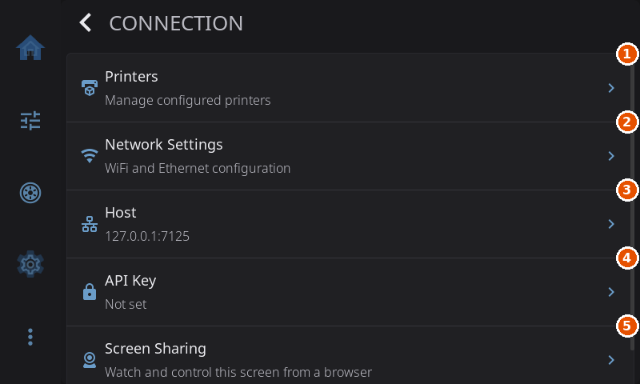

# Connection and network problems

The screen cannot reach the printer, WiFi misbehaves, or Klipper has stopped and a recovery dialog covers the screen.

Back to the [troubleshooting index](../TROUBLESHOOTING.md).

---

### The screen says it cannot connect to Moonraker

**Symptoms:**
- Red connection indicator on home screen
- "Disconnected" status
- Cannot control printer

**Causes:**
1. Wrong IP address or port
2. Moonraker not running
3. Firewall blocking connection
4. Network issues

**Solutions:**

**Check Moonraker is running:**
```bash
sudo systemctl status moonraker
```
If stopped: `sudo systemctl start moonraker`

**Verify the IP address:**
```bash
# On the Pi running Klipper
hostname -I
```
Enter the correct address under **Settings > Connection > Host** and tap **Test Connection**.



1. Printers switches, adds or removes printers.
2. Network Settings opens Wi-Fi and Ethernet.
3. Host is the Moonraker address.
4. API Key shows Configured or Not set.
5. Screen Sharing shows this screen in a browser.

**Test connection manually:**
```bash
curl http://localhost:7125/printer/info
```
Should return JSON with printer info.

**Moonraker behind a web server:** some printers serve Moonraker only on port 80, through the same web address a slicer uses, and leave 7125 closed. With the port left at its default 7125, **Test Connection** tries port 80 too and switches to it when Moonraker answers there; the failure message says when both were tried. If you typed 7125 yourself, enter `80` instead. `curl http://PRINTER_IP/server/info` answering while `curl http://PRINTER_IP:7125/server/info` does not confirms this case.

**Check firewall:**
```bash
sudo ufw status
# If active, allow Moonraker:
sudo ufw allow 7125/tcp
```

### Login Required, or "Unauthorized" everywhere

**Symptoms:**
- A **Login Required** message saying the printer's Moonraker requires a login, or that it rejected the API key
- HelixScreen connects but shows no files, no history and no printer status
- In the setup wizard, Test Connection reports that Moonraker requires an API key
- `moonraker.log` lists requests from HelixScreen refused with `401 ... Unauthorized, Force Logins Enabled`

**Cause:** Moonraker has `force_logins: True` in its `[authorization]` section and at least one user account exists. Moonraker then refuses every request that carries no credential, including requests from the printer itself, even though `trusted_clients` lists it.

**Solutions:**

Give HelixScreen the printer's Moonraker API key. Moonraker accepts it whether or not logins are forced.

1. Get the key. With logins forced, you must log in first. Run this on the printer, using your Moonraker user name and password:
   ```bash
   TOKEN=$(curl -s -X POST http://localhost:7125/access/login \
     -H 'Content-Type: application/json' \
     -d '{"username": "YOUR_USER", "password": "YOUR_PASSWORD"}' \
     | python3 -c 'import json, sys; print(json.load(sys.stdin)["result"]["token"])')
   curl -s -H "Authorization: Bearer $TOKEN" http://localhost:7125/access/api_key
   ```
   The key is the 32-character value in `result`. A password or a shortened key does not work: Moonraker refuses a wrong key outright, even from a trusted address.
2. Enter it on the screen: **Settings > Connection > API Key** (or the **Enter API Key** button on the Login Required message) opens the printer's host, port and key together. Type or paste the key, press **Test Connection**, then **Save**; HelixScreen reconnects with it at once. In the setup wizard, the key field appears beside the address as soon as Test Connection finds a printer that requires one.

   Without the screen, put it in HelixScreen's `settings.json` instead, in your printer's entry, as `"moonraker_api_key": "THE_KEY"` (see [`moonraker_api_key`](../CONFIGURATION.md#moonraker_api_key)), and restart HelixScreen.

HelixScreen sends the key only to that printer's Moonraker address and port, never to a webcam, Spoolman or any other server. It is kept with that printer's entry, masked on screen until you reveal it, and left out of logs and debug bundles.

If you do not need logins, the alternative is to remove `force_logins` from Moonraker's configuration and restart Moonraker.

---

### "Disconnected" during a print

**Symptoms:**
- Disconnect toast appears
- UI shows "Disconnected"
- Print continues (Klipper handles it)

**Causes:**
1. Network instability (WiFi)
2. Moonraker timeout
3. Power management issues

**Solutions:**

**Use Ethernet if possible** - wired connections are more reliable.

**Check WiFi signal strength:**
```bash
iwconfig wlan0 | grep -i signal
```

**Disable WiFi power management:**
```bash
sudo iw wlan0 set power_save off
```

To make permanent, add to `/etc/rc.local`:
```bash
iw wlan0 set power_save off
```

**Give Moonraker more time to answer.** On a slow or busy network, raise the connection timeout (default 10000) and the request timeout (default 30000) in your printer's entry in `settings.json`. Values are in milliseconds, so 15000 is 15 seconds. Stop HelixScreen before editing. The keys are `moonraker_connection_timeout_ms` and `moonraker_request_timeout_ms`; see [Configuration](../CONFIGURATION.md#moonraker_connection_timeout_ms).

---

### WiFi won't connect

**Symptoms:**
- WiFi setup in wizard fails
- Network not found
- Authentication failures

**Solutions:**

**Verify WiFi is working at OS level:**
```bash
nmcli device wifi list
```

**Check NetworkManager is running:**
```bash
sudo systemctl status NetworkManager
```

**Manual WiFi connection:**
```bash
sudo nmcli device wifi connect "YourSSID" password "YourPassword"
```

**For hidden networks:**
```bash
sudo nmcli device wifi connect "HiddenSSID" password "Password" hidden yes
```

> **Note:** Older guides may reference `wpa_supplicant` directly, but MainsailOS and most modern systems use NetworkManager. Use `nmcli` commands instead.

### WiFi isn't responding

**Symptoms:**
- A **WiFi isn't responding** message pops up after you tap a network, **Disconnect**, **Forget** or the WiFi switch
- **Settings > Connection > Network Settings** shows **WiFi isn't responding** under the WiFi details
- The list of networks stops updating, even when you tap **Refresh**

**What it means:** The printer's own WiFi service (NetworkManager or wpa_supplicant) has stopped answering. This usually means the WiFi driver or adapter has hung. HelixScreen itself is fine: the screen keeps working and your printer stays usable.

**What HelixScreen does meanwhile:**
- Shows the last WiFi details and network list it got, instead of blanking them
- Stops scanning for networks, so it doesn't pile more requests onto the stuck service
- Checks the service again after about 15 seconds, then less often, up to every 2 minutes
- As soon as the service answers, the message goes away and scanning starts again on its own. You don't need to do anything.

Before HelixScreen notices the service is stuck, an action can take up to about 45 seconds to show the message. After that, tapping a network, **Disconnect**, **Forget** or the WiFi switch shows **WiFi isn't responding** right away. Nothing is sent to the WiFi service, so nothing changes.

**What to try:**

1. **Wait a minute, then try again.** A service that was only busy recovers by itself, and the message clears.
2. **Check the WiFi service from a computer** (over SSH):
   ```bash
   # For NetworkManager systems:
   sudo systemctl status NetworkManager
   nmcli device wifi list

   # For wpa_supplicant systems:
   sudo wpa_cli status
   ```
   If these commands also hang or report errors, the problem is in the WiFi service or driver, not in HelixScreen.
3. **Restart the WiFi service** (NetworkManager systems):
   ```bash
   sudo systemctl restart NetworkManager
   ```
   This drops the WiFi connection for a moment. If you are connected over WiFi, your SSH session will close.
4. **Reboot the printer.** If a reboot doesn't help, turn it off at the power switch, wait ten seconds, and turn it back on. A hung WiFi adapter sometimes needs a full power cycle.
5. **If it keeps coming back,** send a debug bundle from **Settings > Help & About > Upload Debug Bundle** and mention "WiFi isn't responding" in your report.

### No WiFi networks listed, or WiFi permission denied

**Symptoms:**
- WiFi scan shows no networks (but WiFi works from command line)
- "Permission denied" error when connecting
- WiFi worked before an update but stopped working

**Cause:**
HelixScreen needs permission (via polkit rules) to manage WiFi through NetworkManager. These rules are installed automatically, but can be missing if:
- HelixScreen was installed before NetworkManager was set up
- A self-update couldn't install permission rules (runs with restricted privileges)
- The polkit rules file was deleted or corrupted

**Solutions:**

**Re-run the installer** (recommended, installs correct polkit rules):
```bash
curl -fsSL https://releases.helixscreen.org/install.sh | bash
```

**Verify polkit rules are installed:**
```bash
# Check for HelixScreen polkit rules (one of these should exist;
# older installs may have 50-helixscreen-network.rules instead of 49-)
ls -la /etc/polkit-1/rules.d/49-helixscreen-network.rules
ls -la /etc/polkit-1/localauthority/50-local.d/helixscreen-network.pkla
```

HelixScreen also installs a second polkit rule, `49-helixscreen-power.rules` (or `helixscreen-power.pkla` on older systems), which lets the screen shut down and reboot its own computer. See [Screen Shutdown/Reboot is not permitted](#shutting-down-or-rebooting-from-the-screen-is-not-permitted).

**Check NetworkManager permissions:**
```bash
nmcli general permissions
```
If most entries show "no" instead of "yes", polkit rules are missing.

**Manual fix** (if re-running installer isn't possible):

Create `/etc/NetworkManager/conf.d/any-user.conf`:
```ini
[main]
auth-polkit=false
```
Then restart NetworkManager:
```bash
sudo systemctl restart NetworkManager
sudo systemctl restart helixscreen
```

> **Note:** The manual fix disables permission checks for all users. The installer method is preferred as it only grants access to the HelixScreen service user.

---

### Shutting down or rebooting from the screen is not permitted

**Symptoms:**
- Shutting down or rebooting from the screen shows "Screen is not permitted to shut down or reboot. Restart HelixScreen to fix it."
- The log shows `Interactive authentication required` from `[SystemPower]`

**Cause:**
When HelixScreen runs as a normal user (as on a Raspberry Pi), the system only lets it power off or reboot the computer if a polkit rule allows it. HelixScreen installs that rule itself, and reinstalls it every time it starts:
- `/etc/polkit-1/rules.d/49-helixscreen-power.rules` (polkit 0.106 and newer, Debian 12+)
- `/etc/polkit-1/localauthority/50-local.d/helixscreen-power.pkla` (older polkit, Debian 11)

The rule allows power off and reboot only. It does not override a shutdown block held by another program, such as a package upgrade in progress.

**Solutions:**

**Restart HelixScreen**, which installs the rule:
```bash
sudo systemctl restart helixscreen
ls -la /etc/polkit-1/rules.d/49-helixscreen-power.rules
```

**Check that it works** without powering anything off (replace `pi` with the user HelixScreen runs as):
```bash
sudo systemd-run --uid=pi --pipe --wait busctl call org.freedesktop.login1 \
  /org/freedesktop/login1 org.freedesktop.login1.Manager CanPowerOff
```
`s "yes"` means the rule is working; `s "challenge"` means it is missing.

### Certificate errors

**Symptoms:**
- Connection fails with certificate errors
- Works with HTTP but not HTTPS

**Cause:**
System time is wrong, making SSL certificates appear invalid.

**Solution:**
```bash
# Check current time
date

# Sync time manually
sudo timedatectl set-ntp true

# Or force sync
sudo systemctl restart systemd-timesyncd
```

---

### A recovery dialog covers the screen (printer error, shutdown or disconnect)

If Klipper shuts down, hits an error, or loses contact with the printer's control board, HelixScreen automatically pops up a full-screen **recovery dialog** with a warning icon, a short explanation, and one or more recovery buttons. You don't have to go looking for it, it appears on top of whatever you were doing.

**What it looks like and when it appears:**

| Dialog title | When it appears | What it usually means |
|--------------|-----------------|-----------------------|
| **Printer Shutdown** | Klipper has entered a shutdown state | An emergency stop was triggered, a thermal runaway was detected, or a configuration problem stopped the printer. When Klipper reports a specific reason (for example "Max force exceeded"), that exact message is shown instead of the generic text. |
| **Printer Error** | Klipper has entered an error state | Usually the control board (MCU) lost its connection, or there's a configuration error. |
| **Printer Firmware Disconnected** | The printer's firmware has disconnected from the host, or Klipper has not come up within two minutes of HelixScreen connecting | The host software lost its link to the printer's control board, or Klipper is not running on the printer at all. |

**The buttons and when to use each:**

| Button | What it does | When to use it |
|--------|--------------|----------------|
| **Restart Klipper** | Performs a soft restart of Klipper, it reloads your configuration and reconnects to the printer without power-cycling anything. | The quickest first thing to try after a **Printer Shutdown** or **Printer Error**. Good when nothing physical is wrong and you just need Klipper to come back to a ready state. |
| **Firmware Restart** | Does everything Restart Klipper does, and also resets the printer's control board (MCU) firmware. | Use when a plain Restart Klipper isn't enough, for example after fixing a configuration error, or when the control board itself shut down or lost communication. |
| **X** (top right) | Closes the dialog without doing anything. The printer stays exactly as it was, still shut down, errored, or disconnected. | When you want to read logs, check wiring, or fix a config file first, and you'll restart afterward. Closing it does **not** fix anything on its own. |

> **Note:** The restart buttons are there even when Klipper itself is not running. Then both buttons, and **Restart Klipper** elsewhere, such as on the Advanced panel, restart the Klipper service from outside: first with the recovery script HelixScreen installed for the printer, if it has one, then by asking Moonraker to restart the service. If neither works, for example on a printer whose Moonraker cannot restart services, a message says **HelixScreen cannot restart Klipper on this printer. Turn the printer off and on again to restart it.** If HelixScreen cannot reach Moonraker at all, the buttons cannot reach the printer either, and a **Restart failed** message says so: check the printer's network connection and power.

**If Klipper fails to start again.** Whenever Klipper goes away, after a restart or for any other reason, HelixScreen keeps checking for up to two minutes until Klipper reports ready. If Klipper stops at a startup error instead (a mistake in `printer.cfg`, say, or a control board it can't reach), the dialog changes to **Printer Error** and shows Klipper's own message, so you can see what to fix without opening the log. On printers where HelixScreen installed a recovery script for the platform (such as the Creality K2 and the Snapmaker U1), it runs that script once when a restart alone doesn't bring Klipper back.

**When a HelixScreen save is what broke it.** Saving an input shaper result, switching a heater between PID and MPC, or changing a probe setting writes to your Klipper config and restarts the firmware. Before writing, HelixScreen copies each file it changes into a hidden folder named `.helix_backups` inside your config folder, under the same name with `.helix_backup` added. If Klipper does not come back within about 15 seconds of that restart, HelixScreen puts the copy back, restarts again and tells you the change was undone. With the [HelixPrint plugin](../guide/helixprint-plugin.md) installed, the plugin writes the change instead and keeps the five most recent copies of each file, named with the date and time (`printer.cfg.helixbak-20261022-101500`), so you can put an older one back by hand. Mainsail and Fluidd hide folders whose name starts with a dot until you turn on hidden files in their file manager.

**Common causes:**

- **Thermal runaway**, a heater isn't reaching or holding the temperature Klipper expects (loose heater or thermistor, a fan blowing on the sensor, or a failing part). Klipper shuts down for safety.
- **Configuration error**, a recent edit to your `printer.cfg` has a mistake. Klipper will shut down again immediately after a restart until the config is fixed.
- **Lost control-board communication**, a USB/serial cable came loose, the board lost power, or the connection was interrupted.

**Important:** A restart only sticks if the underlying problem is resolved. If a bad config or a wiring fault caused the shutdown, Klipper will just shut down again. Fix the root cause first, correct the `printer.cfg` (through Mainsail or Fluidd), reseat cables, or check heater and thermistor wiring, then use **Firmware Restart** to bring the printer back.

---

### Only 2.4GHz WiFi networks show

**Symptoms:**
- Only 2.4GHz WiFi networks appear in the network list
- 5GHz networks visible in KlipperScreen or other tools but not in HelixScreen
- WiFi adapter supports 5GHz (e.g., AP6256) but only 2.4GHz networks shown

**Cause:**
HelixScreen displays all networks returned by the WiFi subsystem (`wpa_supplicant` or `NetworkManager`). If 5GHz networks are missing, the issue is typically in the underlying WiFi configuration rather than HelixScreen itself.

**Solutions:**

**Check if your WiFi adapter sees 5GHz networks at the OS level:**
```bash
# For NetworkManager systems:
nmcli device wifi list

# For wpa_supplicant systems:
sudo wpa_cli scan
sudo wpa_cli scan_results
```

If 5GHz networks don't appear here either, the issue is in the WiFi driver or configuration.

**Verify 5GHz support is detected:**
```bash
iw phy phy0 info | grep -A 20 "Frequencies"
```
Look for frequencies above 5000 MHz (e.g., 5180, 5240).

**Check wpa_supplicant configuration:**
If your `wpa_supplicant.conf` has a `freq_list=` parameter that only lists 2.4GHz frequencies, 5GHz networks won't be scanned. Remove the `freq_list` line or add 5GHz frequencies.

**Set the WiFi country first.** **Settings > Connection > Network Settings** shows the radio's country under the WiFi switch. Pick yours (the United States, United Kingdom, Germany, Canada, Australia and France are listed first) so 5GHz networks appear in scans before the first connection. HelixScreen remembers the country you pick and sets it again at every start. If you never picked one, it remembers the country the printer's own system last used and puts it back when a firmware update resets the radio.

**If you cannot set it there, check the country code at the OS level:**
5GHz channels require a regulatory domain. Without it, the kernel may block 5GHz scanning:
```bash
sudo iw reg get
```
If it shows "country 00", set your country code:
```bash
sudo iw reg set US   # Replace US with your country code
```

To make it permanent on a wpa_supplicant system, add `country=US` to `/etc/wpa_supplicant/wpa_supplicant.conf`.

**After changing WiFi hardware** (e.g., swapping from AP6212 to AP6256), a reboot is recommended to ensure the correct driver and firmware are loaded.
