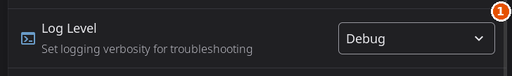

# Logs, debug bundles and getting help

How to turn on debug logging, restart HelixScreen, find the logs on your printer and report a problem.

Back to the [troubleshooting index](../TROUBLESHOOTING.md).

---

### The log is empty or missing

**Symptoms:**
- `journalctl -u helixscreen` shows nothing useful
- Log file doesn't exist

**Causes:**
1. Log destination misconfigured
2. Service not actually running
3. Crash before logging initializes

**Solutions:**

**Check service status first:**
```bash
sudo systemctl status helixscreen
```

**Run it by hand to see all output** (stop the service first so the two do not fight over the screen):
```bash
sudo ~/helixscreen/bin/helix-screen -vvv
```
**Check where the log goes.** The `log_dest` setting in `settings.json` can be `auto`, `journal`, `syslog`, `file` or `console`. Leave it on `auto` unless you are chasing a logging problem; see [Configuration](../CONFIGURATION.md#log_dest).

---

### Turning on debug logging

By default HelixScreen logs warnings, errors and milestones (the **Info** level). To capture what a bug report needs, raise the level, reproduce the problem, then collect the logs.

1. Open **Settings > System > Log Level** and choose **Debug** (or **Trace** for the deepest detail, which is very verbose). It takes effect at once, with no restart.
2. Reproduce the problem.
3. Open **Settings > Help & About > Upload Debug Bundle**. It collects the log and system information and gives you a short share code to paste into a bug report.
4. Set **Log Level** back to **Info**. Debug and Trace add CPU load and log volume.



1. Log Level: choose Debug, reproduce the problem, then set it back to Info.

| Level | What it records |
|-------|-----------------|
| **Warn** | Only errors and warnings |
| **Info** (default) | Connections, screen changes and other milestones |
| **Debug** | State changes and messages to and from the printer. Use this for bug reports |
| **Trace** | Everything, including internals. Very verbose |

**If you cannot reach Settings, or want debug logging to survive reboots,** put one line in `helixscreen.env`:

```
HELIX_LOG_LEVEL=debug
```

The file is `<install dir>/config/helixscreen.env` (on a Raspberry Pi usually `~/helixscreen/config/helixscreen.env`, a link into your Klipper config folder). `HELIX_LOG_LEVEL` accepts `trace`, `debug`, `info`, `warn`, `error`, `critical` or `off`. Restart HelixScreen after editing, and remove the line when you are done. Write the value itself: `helixscreen.env` is read literally, so `$VAR` and `$(command)` are not expanded, and a line with one is skipped with a warning.

**A startup warning about `helixscreen.env`.** If the file cannot be trusted (wrong owner, or still writable by others after the automatic repair), HelixScreen starts with its defaults and shows a warning on screen. The warning says what is wrong, names the one command that fixes it, and stays until you close it. Lines the launcher skipped (a setting this file may not change, shell syntax in the value, a bad quote) are listed with the key and the reason.

**Last resort, if the service will not start at all:** stop it, then run the program by hand to see its startup output:

```bash
sudo systemctl stop helixscreen
sudo ~/helixscreen/bin/helix-launcher.sh --debug --log-dest=console
```

Press Ctrl+C to stop. On the Flashforge Adventurer 5M with Forge-X, stop and start the service through its chroot (see the table below), and run `./bin/helix-launcher.sh --debug --log-dest=console 2>&1 | tee /tmp/helix-debug.log` from `/opt/config/mod_data/helixscreen`.

> **Do not edit `/etc/systemd/system/helixscreen.service`.** HelixScreen rewrites that unit from its install-folder template on every start, so an edit is gone before the app launches. Use `helixscreen.env`, or a drop-in made with `sudo systemctl edit --force helixscreen`; drop-ins are left alone. To remove a drop-in you made earlier, such as one that adds `--debug` to the start command, run `sudo systemctl revert helixscreen`, then `sudo systemctl daemon-reload` and `sudo systemctl restart helixscreen`.

### Restarting HelixScreen

| Printer | Command |
|---------|---------|
| Raspberry Pi and other systemd hosts | `sudo systemctl restart helixscreen` |
| Creality K1 and K2 | `/etc/init.d/S99helixscreen restart` |
| Flashforge AD5M (Klipper Mod) | `/etc/init.d/S80helixscreen restart` |
| Flashforge AD5M (Forge-X) | `/usr/sbin/chroot /data/.mod/.forge-x /etc/init.d/S90helixscreen restart` |
| Flashforge AD5X and Creator 5 (Z-Mod) | `chroot /usr/data/.mod/.zmod /etc/init.d/S80helixscreen restart` |
| Elegoo Centauri Carbon | `/etc/init.d/helixscreen restart` |
| Snapmaker U1 | `/userdata/helixscreen/config/helixscreen.init restart` |

You can also use **Settings > System > Restart HelixScreen**. Replace `restart` with `stop`, `start` or `status` for the other actions.

### Reading the printer's own report first

Before digging into HelixScreen's logs, look at what the printer reported. Tap the **Notifications** widget on the Home screen, then **Printer Events**. It lists Klipper shutdowns with their reason, lost MCU connections, pauses and their causes, printer errors and how each print ended, with times. A reason such as "Timer too close" or "Lost communication with MCU" often answers the question on its own. If you removed the bell from your Home screen, **Advanced > Notification History** is there instead. See [Printer Events](../guide/advanced.md#printer-events).

### System information

```bash
~/helixscreen/bin/helix-screen --version     # use your actual install path
cat /etc/os-release
cat /proc/cpuinfo | grep Model
free -h
```

**Settings > Help & About > About** shows the same version and printer information on the screen.

### Collecting logs

Where the app's log lives depends on the printer. The app log has everything HelixScreen logs; the launcher log has the startup banner and crash output. Send both when you report a problem, or send a debug bundle instead. A debug bundle carries both logs, and also the system's record of any program on the computer running HelixScreen, such as Klipper when it runs there too, that was stopped for running out of memory or that crashed.

**Raspberry Pi and other systemd hosts:**
```bash
sudo journalctl -u helixscreen -n 200 --no-pager -o short-iso
sudo journalctl -u helixscreen -p err --no-pager     # errors only
sudo journalctl -u helixscreen -f                    # follow live
```

**Flashforge Adventurer 5M:**
```bash
tail -200 /data/.helixscreen/logs/helix.log                      # app log
tail -200 /opt/config/mod_data/helixscreen/logs/launcher.log     # Forge-X launcher log
tail -200 /root/printer_software/helixscreen/logs/launcher.log   # Klipper Mod launcher log (/opt/helixscreen/logs/ on v00.06 and newer)
```

**Flashforge Adventurer 5X (Z-Mod):**
```bash
tail -200 /opt/config/mod_data/log/helix.log         # app log
tail -200 /opt/config/mod_data/log/helixscreen.log   # startup and crash output
```

On an older AD5X install, outside the chroot, the same two files are under `/usr/data/config/mod_data/log/`. Installs from before the log moved may instead have the app log at `/data/.helixscreen/logs/helix.log` and the launcher log at `/srv/helixscreen/logs/launcher.log`.

**Flashforge Creator 5 and Creator 5 Pro (Z-Mod):**
```bash
tail -200 /opt/config/mod_data/log/helixscreen.log   # one file holds both
```

**Creality K1, K1C and K1 Max:**
```bash
tail -200 /usr/data/helixscreen-state/logs/helix.log
tail -200 /usr/data/helixscreen/logs/launcher.log
logread | grep helix-screen | tail -200
```

**Creality K2:**
```bash
tail -200 /mnt/UDISK/helixscreen-state/logs/helix.log
tail -200 /mnt/UDISK/helixscreen/logs/launcher.log      # or /var/log/helixscreen/launcher.log where /var/log survives a reboot
logread | grep helix-screen | tail -200
```

**Snapmaker U1:**
```bash
grep helix-screen /home/lava/printer_data/logs/syslog | tail -200
tail -200 /var/log/helixscreen/launcher.log
```

**Elegoo Centauri Carbon:**
```bash
tail -200 /user-resource/helixscreen-state/logs/helix.log
tail -200 /user-resource/helixscreen/logs/launcher.log
logread | grep helix-screen | tail -200
```

### Settings and hardware information

```bash
cat ~/helixscreen/config/settings.json   # remove API keys before sharing
ls -la /dev/fb* /dev/dri/ /dev/input/
cat /proc/bus/input/devices
```

---

## Getting help

1. Search these pages for your symptom.
2. Check the [FAQ](../FAQ.md).
3. Search the [GitHub issues](https://github.com/prestonbrown/helixscreen/issues) for a known problem.
4. Ask on the [HelixScreen Discord](https://discord.gg/RZCT2StKhr).

### Opening a new issue

Include:

- The HelixScreen version (**Settings > Help & About > About**, or `helix-screen --version`)
- Your hardware: printer, Raspberry Pi model, screen
- What you expected and what happened
- Steps to reproduce
- A debug bundle share code, or the debug log ([turn on debug logging first](#turning-on-debug-logging))
- Screenshots for a visual problem, and your config with API keys removed

Example:

```markdown
## Environment
- HelixScreen version: 1.1.0
- Hardware: Raspberry Pi 4 4GB, official 7" touchscreen
- OS: MainsailOS

## Problem
Cannot connect to the printer after a WiFi change.

## Expected
Connects to Moonraker at 192.168.1.100.

## Actual
Shows "Connection failed".

## Steps to reproduce
1. Change WiFi network
2. Enter the new address under Settings > Connection > Host
3. Restart HelixScreen
4. See the error

## Debug bundle
Share code: ABC123
```
