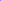

# Screen and touch problems

The screen is black, the wrong size, rotated or too dim, or touch does nothing, lands in the wrong place or fires by itself.

Back to the [troubleshooting index](../TROUBLESHOOTING.md).

---

### HelixScreen starts and exits at once (crash on startup)

**Symptoms:**
- Service starts then immediately exits
- "Segmentation fault" in logs
- Black screen, no UI appears

**Common causes:**

1. **Missing or corrupt assets** (use your actual install path)
   ```bash
   # Check assets exist (Pi: ~/helixscreen or /opt/helixscreen)
   ls -la ~/helixscreen/assets/
   ls -la ~/helixscreen/assets/fonts/
   ls -la ~/helixscreen/xml/
   ```

2. **Wrong display backend for your hardware**
   ```bash
   # Check what display devices exist
   ls -la /dev/fb*      # Framebuffer devices
   ls -la /dev/dri/*    # DRM devices

   # Pi 4 typically uses /dev/dri/card1
   # Pi 5 may use /dev/dri/card1 or card2
   # Flashforge Adventurer 5M (AD5M) uses framebuffer /dev/fb0
   ```

3. **Permission issues**
   ```bash
   # Check user is in required groups
   groups
   # Should include: video, input, render
   ```

### The log says no display device was found

**Symptoms:**
- Log shows "No suitable DRM device found" or similar
- Service keeps restarting

**Solutions:**

**Specify the DRM device explicitly:**
```json
// ~/helixscreen/config/settings.json (or /opt/helixscreen/config/)
{
  "display": {
    "drm_device": "/dev/dri/card1"
  }
}
```

**For Pi 5, try different cards:**
- `card0` = v3d (3D acceleration only, won't work)
- `card1` = DSI touchscreen
- `card2` = HDMI via vc4


---

### The screen stays black

**Symptoms:**
- Display stays black
- Service shows running but no output

**Causes:**
1. Wrong display driver
2. Permission issues
3. Display not detected

**Solutions:**

**Check service is running:**
```bash
sudo systemctl status helixscreen
sudo journalctl -u helixscreen -n 50
```

**Identify your display hardware:**
```bash
# Framebuffer devices (older displays, Flashforge AD5M)
ls -la /dev/fb*

# DRM devices (Pi 4/5, modern displays)
ls -la /dev/dri/*
```

**Check display permissions:**
```bash
# User needs video group access
groups
# Should include 'video'
sudo usermod -aG video $USER
# Log out and back in for group change to take effect
```

**For DRM displays, specify device:**
```json
{
  "display": {
    "drm_device": "/dev/dri/card1"
  }
}
```

---

### The picture is the wrong size or resolution

**Symptoms:**
- UI too small or too large
- Partial screen visible
- Stretched or squished display

**Solutions:**

HelixScreen auto-detects resolution from DRM and framebuffer backends. If auto-detection picks the wrong resolution, set `HELIX_SCREEN_SIZE` in your `helixscreen.env` file (typically `~/helixscreen/config/helixscreen.env`, which is a symlink to `~/printer_data/config/helixscreen/helixscreen.env`):

```bash
HELIX_SCREEN_SIZE=large
# or: HELIX_SCREEN_SIZE=1024x600
# Named sizes: micro, tiny, small, medium, large, xlarge
```

Despite the name, this is a resolution, not a UI scale factor. The named values are
aliases for resolutions (`large` is 1024x600), and the layout follows from whichever
resolution you set. If the resolution is already correct and only the interface looks
too big or too small, you want the UI Scale setting instead, covered in
[Buttons and text look too large or too small](#buttons-and-text-look-too-large-or-too-small).

Then restart:
```bash
sudo systemctl restart helixscreen
```

Confirm it took effect in the log:
```bash
journalctl -u helixscreen -b | grep "Screen size from HELIX_SCREEN_SIZE"
```

> **Do not edit `/etc/systemd/system/helixscreen.service`.** HelixScreen rewrites that unit
> from its install-dir template on every start, so an `ExecStart` edit is gone before the app
> launches. `helixscreen.env` is the supported place for persistent settings: it lives in your
> Klipper config directory, survives updates, and is restored from backup if an update wipes it.
> If you need a systemd-level change anyway, use a drop-in (`sudo systemctl edit --force
> helixscreen`). Drop-ins under `helixscreen.service.d/` are left alone by the refresh.

---

### The resolution will not change

**Symptoms:**
- HelixScreen shows a "Cannot set HelixScreen to selected resolution" message on startup
- Display is locked at 800x480 (or similar) even though you set `HELIX_SCREEN_SIZE=large` or `HELIX_SCREEN_SIZE=1024x600`
- System journal contains `[DRM Backend]` or `[fbdev Backend]` warnings about the requested size

**Cause:** HelixScreen can only use resolutions the kernel exposes to it. If the kernel display driver is misconfigured, or if a fallback driver like `simpledrm` is active, the display is locked to whatever the bootloader programmed at power-on, HelixScreen cannot override this at runtime.

**Fix on Raspberry Pi / RatOS:**

1. Open the boot config:
   ```bash
   sudo nano /boot/firmware/config.txt
   ```

2. Make sure this line is present and not commented out:
   ```
   dtoverlay=vc4-kms-v3d
   ```

3. If you are using a specific HDMI mode (e.g., 1024x600), add the appropriate `hdmi_cvt` / `hdmi_group` / `hdmi_mode` lines per the Raspberry Pi HDMI documentation.

4. Reboot.

5. After reboot, verify the real DRM driver is now active:
   ```bash
   ls /sys/class/drm/
   ```
   You should see something like `card0-HDMI-A-1`. If you still see only `card0` and `dmesg | grep -i drm` mentions `simpledrm`, the vc4 overlay did not load, double-check /boot/firmware/config.txt for typos and any conflicting `dtoverlay` lines.

**Fix on Armbian (BTT CB1 / CB2, Manta, and other Allwinner / Rockchip SBCs):**

Armbian has no config.txt. Kernel parameters go in /boot/armbianEnv.txt instead.

1. Find your connector name:
   ```bash
   ls /sys/class/drm/
   ```
   Look for a `card0-*` entry such as `card0-HDMI-A-1`. The connector name is everything
   after `card0-`.

2. Force the mode on the kernel command line:
   ```bash
   sudo nano /boot/armbianEnv.txt
   ```
   Add or extend the `extraargs` line (many images ship without one, so add it if missing):
   ```
   extraargs=video=HDMI-A-1:800x480@60
   ```
   Keep any existing `extraargs` values on the same line, separated by spaces. If the kernel
   thinks nothing is connected, append `e` to force the connector on: `800x480@60e`.

3. Reboot, then confirm the mode took, using the check below.

> **A mode list of exactly `1024x768`, `800x600`, `848x480`, `800x480`, `640x480` and nothing
> else is the kernel's built-in fallback set**, which means no EDID was read from the panel at
> all. Forcing the mode as above is the fix. The panel does not have to supply working EDID for
> a forced mode to drive it, so you do not need to replace the screen or the cable.

**Check what modes the kernel knows about:**
```bash
cat /sys/class/drm/card0-HDMI-A-1/modes
```
This lists the resolutions the DRM driver will accept for `HELIX_SCREEN_SIZE`.

---

### Buttons and text look too large or too small

**Symptoms:**
- Buttons, text, and spacing look oversized, controls feel cramped or run off the edge of the screen
- Or the opposite: everything looks tiny with lots of empty space, and touch targets are hard to hit
- The resolution is correct (the whole screen is used), but the *scale* of the interface looks wrong

**Cause:**
The interface is sized by the screen's resolution and by the **UI Scale** setting. On Automatic the scale is 100% on every supported printer and only grows on very high-density screens such as a phone. The scale never goes below 100%.

**Fix:**

- **Everything too small:** open **Settings > Display > UI Scale**, pick a size above 100%, and restart HelixScreen. See [UI Scale](../guide/settings/display.md#ui-scale). The `helixscreen.env` equivalent is a `HELIX_DPI` above `225` (for example `300` is about 124%, `400` about 156%), which only applies while UI Scale is on Automatic.
- **Everything too large:** if UI Scale is above 100%, set it to 100%. Nothing shrinks the interface below 100%, and a `HELIX_DPI` of 225 or lower changes nothing. Controls are sized for the resolution's layout size, so on a monitor that offers several modes a higher resolution (`HELIX_SCREEN_SIZE`) gives them proportionally less of the screen.

> **Tip:** If instead the *whole layout tier* is wrong, for example a compact phone-style layout on a big screen, or vice versa, the resolution rather than the DPI is being mis-detected. Force a layout size with `HELIX_SCREEN_SIZE` (named preset `micro`/`tiny`/`small`/`medium`/`large`/`xlarge`, or `WxH` like `1024x600`), covered in [The picture is the wrong size or resolution](#the-picture-is-the-wrong-size-or-resolution).

---

### An ultrawide or portrait screen looks stretched, cramped or clipped

**Symptoms:**
- On a very wide screen (e.g. 1920x480), panels look stretched with large empty gaps
- On a taller-than-wide screen (e.g. 480x800), content is cramped, clipped, or runs off the bottom

**This is expected, ultrawide and portrait layouts are alpha at best.**

HelixScreen detects both orientations and adjusts the navigation bar and grid sizing. Portrait is the better covered of the two: besides the app shell and navigation bar, the home dashboard, Print Status, Print Tune, Motion, Bed Mesh, the temperature graph and the Advanced panel's E-stop bar all rearrange themselves for a tall screen. Ultrawide has a home dashboard layout and nothing else. Any panel not in that list falls back to the standard landscape layout, which is what you are seeing on it. Neither orientation has been tested much on real hardware.

**The home dashboard is the exception, in both orientations.** Its grid is sized from the actual screen so the cells come out square, a 480x800 portrait panel gets 4 columns by 6 rows, a 320x1480 one gets 4x17, a 1920x440 ultrawide gets 23x5, and portrait and ultrawide each have their own default layout rather than a stretched landscape one. Buttons, inputs, and headers on a portrait panel are sized from the screen's height, so they come out taller rather than cramped.

**What you can do:**

- **On a portrait panel, rotate it to landscape.** This is the well-tested path and what the Creality K2 does out of the box. Set `"rotate": 90` (or `270`) in the `display` section of your config, see [The picture is upside down or rotated](#the-picture-is-upside-down-or-rotated).
- **On an ultrawide screen,** there is no better fallback today. The layout will be a landscape layout stretched wide.
- **Force the standard layout** if the alpha layout is worse than the fallback: `--layout standard`, or `"layout": "standard"` in the `display` section.

Contributions are very welcome here and only need XML, not C++, see the [UI Contributor Guide](../../devel/UI_CONTRIBUTOR_GUIDE.md).

---

### A widget disappeared from the home screen

**Symptoms:**

- A widget vanished from the home screen and did not come back after a restart or an update
- **Tips** in particular is missing on a portrait-mounted screen
- You saw a message like *"'Tips' removed, grid full"* even though the grid looked far from full
- A *"'Fan Speeds' removed, grid full"* message appears again on every launch

**Why it happens.** A widget is switched off, and put back in the Widget Catalog, when it is too big for the grid at any size (a wide widget on a narrow portrait screen), or when the grid had no free cell for it. A widget that only lacks a free cell keeps its enabled setting and places itself again as soon as a cell frees up. The *"removed, grid full"* message appears only when the widget was on your screen and lost its spot. If it repeats on every launch, [update HelixScreen](../UPGRADING.md).

If your dashboard is full and you want a specific widget back, make room for it: remove a widget you care less about, or move it to a second page (see [Multiple Pages](../guide/home-panel.md#multiple-pages)).

**Tips** is the one that hits this most, because it is a wide widget and a portrait grid is narrow. On the shortest portrait screens Tips is also left out of the default layout on purpose, so if Tips is the only thing missing, that may be the default rather than a widget that got dropped.

**Fix, put back a single widget:**

1. **Long-press the widget grid** to enter Edit Mode
2. **Long-press an empty area** of the grid, the Widget Catalog opens
3. Tap the widget you want. Widgets already on your dashboard are dimmed and labeled "Placed"; the ones you lost will not be
4. Tap **Done** to leave Edit Mode

**Fix, put back everything at once:**

Enter Edit Mode and tap **Reset**. This restores the default layout *and* the default set of enabled widgets, and because the defaults are now portrait-aware you get the corrected portrait layout. Your per-widget settings (display mode preferences and so on) are preserved.

Reset is not free, though: it collapses **all pages back to a single page**, so any extra pages you created are removed, and every widget position and size goes back to default. If you have a layout you like and only lost one or two widgets, re-add them from the catalog instead.

See [Home Panel](../guide/home-panel.md) for the full Edit Mode walkthrough.

---

### The picture is upside down or rotated

**Symptoms:**
- Content displayed at wrong angle
- Touch offset from visual

**Automatic detection:**

HelixScreen automatically detects display orientation on first boot using the kernel's panel orientation setting. If your display is physically mounted upside down and the kernel knows about it (via `panel_orientation=upside_down` in the kernel command line), HelixScreen detects this and applies the correct rotation automatically, both the splash screen and the main UI will appear right-side up.

On framebuffer displays only (e.g., AD5M, Allwinner-based devices, **not** Raspberry Pi), an interactive rotation wizard runs on first boot: it cycles through 0°, 90°, 180°, and 270°, tap the screen when the text appears right-side up, then tap again to confirm. This wizard is not available on Raspberry Pi or other DRM-based displays, use the kernel `panel_orientation` parameter or manual config instead.

The detected rotation is saved to the config file and applied on all subsequent boots.

**Setting panel orientation in the kernel (Raspberry Pi):**

Edit /boot/firmware/cmdline.txt and add a `video=` parameter for your display connector:

```
video=DSI-1:panel_orientation=upside_down
```

Valid orientations: `normal`, `upside_down`, `left_side_up`, `right_side_up`. HelixScreen reads this on startup and applies the corresponding rotation.

**Rotate from Settings:** open **Settings > Display > Screen Rotation** and pick **Normal**, **90° Clockwise**, **180° Upside Down** or **270° Clockwise**. The change applies after a restart. The row is hidden on screens where HelixScreen cannot rotate the picture (the desktop app).

**Manual rotation (if you cannot reach Settings):**

Edit your config file (typically `~/helixscreen/config/settings.json` or `/opt/helixscreen/config/settings.json`):

```json
{
  "display": {
    "rotate": 180
  }
}
```

Valid values: `0`, `90`, `180`, `270`. Restart HelixScreen after changing this value. Touch coordinates are automatically adjusted to match, no separate touch configuration is needed.

**All four values work on every printer.** GPU-enabled DRM builds rotate the final image on the GPU. Other DRM builds switch to the framebuffer path automatically when the display hardware cannot rotate the image itself, so you do not need to set `HELIX_DISPLAY_BACKEND` or install anything. If the picture stays unrotated after a restart, the fallback failed and the log will say `Continuing without rotation`. In that case rotate the panel in the kernel with `video=...,rotate=90` instead.

**If rotation looks wrong:** HelixScreen picks the best rotation method for your hardware by itself. If you notice flicker or tearing, you can force the framebuffer backend:

```bash
sudo systemctl edit helixscreen
```

Add:
```ini
[Service]
Environment="HELIX_DISPLAY_BACKEND=fbdev"
```

Then restart: `sudo systemctl restart helixscreen`. A line `HELIX_DISPLAY_BACKEND=fbdev` in `helixscreen.env` does the same.

**To re-run automatic detection:**

Remove the `rotate` and `rotation_probed` keys from your config file's `display` section, then restart HelixScreen:

```json
{
  "display": {
    // remove "rotate" and "rotation_probed" from here
  }
}
```

---

### Red and blue are swapped

**Symptoms:**
- Red images appear blue and blue images appear red
- Green colors display correctly
- UI elements with red/blue tints look "off"

**Cause:**
Your display's framebuffer uses BGR pixel order instead of RGB, but the kernel driver reports the wrong format. This is common on some Allwinner SoCs (H616, R818, etc.) with RGB parallel (40-pin) display interfaces.

HelixScreen auto-detects BGR layout from the kernel's `fb_var_screeninfo`, but some display drivers report incorrect pixel offsets. You can verify with:

```bash
fbset -i -fb /dev/fb0
```

Look at the `rgba` line. If it shows `8/16,8/8,8/0,0/24` (red at offset 16), the kernel claims RGB. If your colors are swapped despite this, the kernel is wrong and you need a manual override.

**Solution:**

Add this line to your `helixscreen.env` file (typically `~/helixscreen/config/helixscreen.env`):

```bash
HELIX_COLOR_SWAP_RB=1
```

Then restart HelixScreen:
```bash
sudo systemctl restart helixscreen
```

To disable the swap (if auto-detection is wrong in the other direction), use `HELIX_COLOR_SWAP_RB=0`.

**Verifying the fix:**
After restart, flags on the language selection screen should show correct colors (e.g., the French flag should be blue-white-red, not red-white-blue).

---

### The screen goes dark at sleep but the backlight stays on

**Symptoms:**
- When the screen sleeps (idle timeout), the picture goes black but the panel still glows: you can see the backlight shining through, especially in a dark room
- Touching the screen wakes it normally

**Cause:**
By default, sleep turns the backlight off and leaves the panel powered, so waking is instant. Some panel controllers treat "backlight at zero" as "very dim" rather than "off", so the LEDs stay lit. Powering the whole panel down fixes these screens, but it breaks others (see the next section), so it is not the default.

**Fix - power the panel down at sleep:**

1. SSH into your printer
2. Edit `settings.json` (typically `~/helixscreen/config/settings.json`; see [Configuration](../CONFIGURATION.md) for other platforms)
3. Find the `"display"` section and set:

   ```json
   "panel_power_off": 1
   ```

4. Save the file and restart HelixScreen:

   ```bash
   sudo systemctl restart helixscreen
   ```

   (Use your platform's restart command: see [Restarting HelixScreen](diagnostics.md#restarting-helixscreen).)

5. Let the screen sleep, then touch it to wake it.

To confirm the setting was picked up, look for this line in the log after the restart:

```
[DisplayManager] Display power-off: true (config override)
```

If it says `false (config override)`, your display driver has no way to power the panel down, and this setting cannot help on your hardware.

**If it makes things worse:**
On some screens, a full power-down causes flashing colors, edges that glow white, a color test pattern, or a screen that does not come back when touched. If you see any of these, SSH in, set `"panel_power_off": -1` (automatic) or remove the line, and restart HelixScreen. As a fallback, set **Settings > Display > Display Sleep** to **Never**.

**Helping us fix it:**
If `panel_power_off: 1` works for you, please tell us your printer and screen model (or send a debug bundle from **Settings > Help & About > Upload Debug Bundle**). We can then turn it on automatically for that hardware.

---

### Solid red, green or blue fills while the screen sleeps (AD5X)

**Symptoms:**
- After the screen goes to sleep (idle timeout), the display shows a solid red, green, or blue fill instead of a black/off screen
- Color may differ each time the screen sleeps
- Touching the screen wakes it normally and the UI returns fine
- Only affects the FlashForge Adventurer 5X

**Cause:**
The panel has been fully powered down at sleep. A driver-level quirk in the AD5X's Allwinner display pipeline makes the display controller cycle solid primary-color fills when the panel is powered down and brought back. HelixScreen only powers a screen down when it cannot control the screen's backlight, or when `/display/panel_power_off` in `settings.json` forces it; normally it leaves the panel powered and just turns the backlight off, which does not trigger the colors. This is not a HelixScreen rendering bug - it does not affect printing, connectivity, or anything else.

**Fix - stop the panel from being powered down:**

1. SSH into your printer (or open a shell on the AD5X directly)
2. Edit `settings.json`. On the AD5X (ZMOD firmware) HelixScreen lives inside ZMOD's system folder, not in `~/helixscreen`: the config file is `/usr/data/.mod/.zmod/srv/helixscreen/config/settings.json` from a plain SSH login, or `/srv/helixscreen/config/settings.json` from inside the ZMOD chroot.
3. Find the `"display"` section and set:

   ```json
   "panel_power_off": 0
   ```

4. Save the file and restart HelixScreen. The AD5X uses ZMOD's SysV init, not systemd, and the service script is inside ZMOD's system folder:

   ```bash
   chroot /usr/data/.mod/.zmod /etc/init.d/S80helixscreen restart
   ```

   (or restart via the ZMOD launcher / Mainsail if you manage it that way)

With the power-down forbidden, sleep blanks the screen instead: the panel stays powered and dark. Waking is immediate.

**Workaround - disable screen sleep entirely:**

1. Open **Settings > Display**
2. Find **Display Sleep**
3. Set it to **Never**

The screen will stay on continuously. Power the touchscreen off at the wall if you want it dark when not in use.

**Helping us fix it:**
If you are experiencing this and are willing to help, please send a debug bundle from **Settings > Help & About > Upload Debug Bundle**. Include a note that mentions the sleep color issue so we can correlate configs and logs.

---

### The brightness slider or screen dimming does nothing

**Symptoms:**
- Moving the brightness slider in Settings has no visible effect
- Auto-dim (screen sleep) never dims or blanks the backlight
- Brightness works in another UI (KlipperScreen, stock screen) but not HelixScreen

**Cause:**
HelixScreen didn't find a backlight control method it can drive on your hardware. It tries several methods automatically, but some panels, notably certain Creality Sonic Pad firmware variants, expose the backlight through a control path HelixScreen doesn't pick by default.

**Fix:** Force a specific backlight method by adding one line to your `helixscreen.env` file (typically `~/helixscreen/config/helixscreen.env`), then restart HelixScreen.

**Creality Sonic Pad**, if the slider and auto-dim don't respond even though the screen otherwise works, use Creality's `brightness` helper:
```
HELIX_BACKLIGHT_DEVICE=brightness
```

**Other hardware**, try each of these in turn, restarting after each, until the slider works:
```
HELIX_BACKLIGHT_DEVICE=sysfs       # standard Linux backlight (Raspberry Pi and most SBCs)
HELIX_BACKLIGHT_DEVICE=allwinner   # Allwinner-based panels (AD5M and similar)
```

**External monitor with its own brightness buttons**, if HelixScreen shouldn't touch the backlight at all (e.g. an HDMI monitor you dim with its own controls), disable control entirely:
```
HELIX_BACKLIGHT_DEVICE=none
```

Restart after editing:
```bash
sudo systemctl restart helixscreen
```
(Use your platform's restart command: see [Restarting HelixScreen](diagnostics.md#restarting-helixscreen).)

> **Note:** Only the values `sysfs`, `allwinner`, `brightness`, and `none` are recognized. Any other value (including a `/sys/class/backlight/...` path) is ignored and HelixScreen falls back to auto-detection.

---

### The screen does not respond to touch

**Symptoms:**
- Display works but touch doesn't
- No response to taps

**Causes:**
1. Touch device not detected
2. Wrong input device
3. Permission issues

**Solutions:**

**Check touch device exists:**
```bash
ls /dev/input/event*
cat /proc/bus/input/devices | grep -A5 -i touch
```

**Test touch input:**
```bash
# Install evtest if needed: sudo apt install evtest
sudo evtest /dev/input/event0
# Tap screen and watch for events
```

**Specify touch device in config:**

Edit `settings.json` in your install's `config/` directory (see [Config File Locations](../guide/touch-calibration.md#config-file-locations) for the path on your platform). **Stop the service before editing** so the daemon doesn't overwrite your changes.

```json
{
  "input": {
    "touch_device": "/dev/input/event1"
  }
}
```

**Check permissions:**
```bash
ls -la /dev/input/event*
# User needs input group
sudo usermod -aG input $USER
# Log out and back in
```

---

### Touch feel: which setting do I tune?

Two separate settings control the feel of taps vs. scrolls. Match the symptom to the right knob before changing anything - they have different effects and tuning the wrong one makes things worse.

| Symptom | What's happening | Setting to change | Direction |
|---|---|---|---|
| Stationary taps register as swipes/scrolls | Touch controller drifts a few pixels while finger is still, crossing the scroll threshold | `scroll_limit` | **Raise** (e.g., 15–20) |
| You scroll a list and a button in it fires mid-gesture | Finger released before moving far enough to commit to scroll, so the press becomes a click | `scroll_limit` | **Lower** (e.g., 5) |
| Lists feel sluggish, long coast after a flick | Scroll momentum decays too slowly | `scroll_throw` | **Raise** (e.g., 35) |
| Short flicks never travel far enough, list barely moves | Momentum decays too fast | `scroll_throw` | **Lower** (e.g., 15) |

Both live under `input` in `settings.json` (path varies by platform - see [Config File Locations](../guide/touch-calibration.md#config-file-locations)). See [CONFIGURATION.md § Input Configuration](../CONFIGURATION.md#input-settings) for the full reference.

> **Stop the service before editing `settings.json`**, the daemon rewrites the file periodically and your edits can be clobbered. Stop, edit, start.
>
> **Want to try a value before committing it?** `scroll_limit` is a slider under **Settings > Touch & Input** on the printer itself (Scroll Engage Distance), so you can feel the change immediately and keep it only if it helps; it takes effect on the next touch, no restart needed. `scroll_throw` has no on-screen control, so set it in `settings.json` directly.

---

### Taps register as swipes

**Symptoms:**
- Tapping buttons doesn't work, the screen scrolls instead
- Most or all taps are interpreted as swipe/scroll gestures
- Buttons only work when tapped very quickly and precisely

**Cause:** Noisy touch controller (common with Goodix GT9xx and similar capacitive controllers) reports jittery coordinates even when the finger is stationary. The small coordinate changes exceed LVGL's scroll detection threshold.

**Solution:** Raise `scroll_limit`, the distance a finger has to travel before a press is treated as a scroll. Putting it above the controller's drift means a stationary tap stays a tap:

```json
{
  "input": {
    "scroll_limit": 18
  }
}
```

Or set it from the printer itself: **Settings > Touch & Input > Scroll Engage Distance**.



1. Scroll Engage Distance sets how far a finger moves before a touch counts as a scroll.
2. Long Press Time sets how long you hold before a press counts as a long press.

Raising it too far makes real scrolls feel unresponsive, so move in steps of a few pixels.

### The Toolhead plate or Bed tab will not move the toolhead

**Symptoms:**
- Tapping the plate of the home screen's Toolhead widget opens the Motion screen instead of placing a target
- The Bed tab's plate is grayed out and ignores taps and drags
- The Move tab's positions and **Park** are grayed out

**Cause:** These controls only move the toolhead when it is safe and you asked for it. They stay inert while:

- **Any axis is not homed.** Nothing on the plate or the Move tab homes by itself. Tap **Home All** on the Toolhead widget, or the home button on the Motion screen's Jog or Bed tab.
- **A print is running or paused.** The plate shows the live toolhead over the print instead.
- **The printer is not ready**, or another operation (homing, leveling, a filament load) is using the toolhead.
- **You are in Edit Mode** on the home screen. Tap **Done** first.

**If a move is refused with "The part on the bed is too tall to clear":** HelixScreen thinks your last print is still on the bed and the nozzle cannot rise above it. Remove the part and tap **Cleared** on the plate. See [A print on the bed](../guide/motion.md#a-print-on-the-bed).

### A button fires while I scroll

**Symptoms:**
- You drag a list to scroll and a button in the middle of it fires instead
- The list jumps a little, but the click on whatever was under your finger still goes through
- Happens with short or slow swipes more than long, fast flicks

**Cause:** LVGL treats the first few pixels of finger movement as a "press" on the widget under your finger. Only after you've moved past `scroll_limit` pixels does it cancel the press and commit to a scroll. If you release before reaching that threshold, the press becomes a click.

**Solution:** Lower `scroll_limit` so scrolling engages sooner.

```json
{
  "input": {
    "scroll_limit": 5
  }
}
```

Default is 10; the UI accepts values from 1 to 20. Going too low will make intentional taps feel twitchy, any slight finger wobble will start a scroll, so settle on the lowest value that feels correct, not the smallest possible.

Note that this is a separate problem from the phantom click *after* a scroll (see below) and from taps being misread as swipes (see above).

### A button fires when I lift my finger after scrolling

**Symptoms:**
- After scrolling a list, a button press fires when you lift your finger
- Unwanted actions triggered at the end of a scroll gesture

**Cause:** Some capacitive touch controllers generate a phantom "clicked" event when the finger is released after scrolling. Common on FlashForge AD5M/AD5X displays.

**Solution:** Enable the scroll guard, which ignores taps for 80 ms after a scroll ends:

```json
{
  "input": {
    "scroll_guard": true
  }
}
```

This is enabled by default on AD5M and AD5X via their hardware presets. If you see this on other hardware, enable it manually (or test with `HELIX_SCROLL_GUARD=1 helix-screen`).

**Still getting phantom clicks with the guard enabled?** The 80 ms cooldown works for most capacitive controllers but some need longer. Raise `scroll_guard_cooldown_ms` (range 20–500):

```json
{
  "input": {
    "scroll_guard": true,
    "scroll_guard_cooldown_ms": 150
  }
}
```

Or test temporarily with `HELIX_SCROLL_GUARD_COOLDOWN_MS=150 helix-screen`. Try 120, 150, then 200; stop at the smallest value that eliminates the phantom tap, since going higher will start swallowing legitimate taps that closely follow a scroll.

---

### Taps land in the wrong place

If taps are landing in the wrong place on screen:

1. **Visualize touch points:** Enable touch debug to draw a ripple at every touch point, easiest way to see if taps are landing where you think they are.

   **Persistent (recommended):** Add this line to `helixscreen.env` (path under [Config File Locations](../guide/touch-calibration.md#config-file-locations)) and restart the service:
   ```
   HELIX_DEBUG_TOUCH=1
   ```
   Remove the line and restart when you're done.

   **One-shot from SSH** (stop the service first so it doesn't fight for the touch device):
   ```bash
   helix-screen --debug-touches
   ```
2. **Recalibrate from the UI:** Go to **Settings > Touch & Input > Touch Calibration**.
3. **If the option isn't visible:** Your screen may not normally need calibration. SSH in, **stop the service**, then run:
   ```bash
   sudo systemctl stop helixscreen
   helix-screen --calibrate-touch
   # When done, start the service again:
   sudo systemctl start helixscreen
   ```
4. **If the screen is too broken to navigate (recommended path):** SSH in and set `HELIX_TOUCH_CALIBRATE=1` in your `helixscreen.env`, then restart the service. Remove the line once calibration succeeds, the env var does not self-clear.

For the full menu of options (env var, config-file `force_calibration`, manual CLI, factory reset) plus exact config-file paths for every platform, see the [Touch Calibration Guide § Forcing Recalibration](../guide/touch-calibration.md#forcing-recalibration).

> **Don't hand-edit `settings.json` while the service is running**, the daemon rewrites the file periodically and your edits can be clobbered. Stop the service first, edit, then start it again.

---

### Touch is offset from what is on screen

**Symptoms:**
- Touch registers in wrong location
- Have to tap above/below intended target
- Touch accuracy varies across the screen

**Causes:**
- Rotation mismatch between display and touch
- Uncalibrated touch screen

**Solutions:**

**1. Ensure rotation is set correctly:**

The `display.rotate` setting affects both display AND touch automatically. Make sure it matches your physical display orientation:

```json
{
  "display": {
    "rotate": 180
  }
}
```

Restart HelixScreen after changing. Touch coordinates rotate automatically to match, you should not need any separate touch axis configuration.

**2. Run touch calibration:**

1. Open **Settings > Touch & Input**
2. Tap **Touch Calibration**
3. Tap each crosshair that appears, as accurately as you can
4. Calibration saves automatically

> **Note:** The **Touch Calibration** row only appears on built-in touchscreens, not in the desktop app.

**3. Visualize touch points to diagnose:**

Enable `--debug-touches` to see exactly where touches register, then compare with where you're tapping:
```bash
helix-screen --debug-touches
```
Or set `HELIX_DEBUG_TOUCH=1` in your environment for persistent debugging.

**4. If calibration doesn't help:**

Try different `rotate` values (0, 90, 180, 270) until touch aligns with visuals. Or remove the rotation config entirely and restart to re-trigger automatic detection (see [The picture is upside down or rotated](#the-picture-is-upside-down-or-rotated)).

### Calibration did not help

**Symptoms:**
- Calibration wizard completes but touches still land far from where you tap
- Accuracy varies wildly across different screen regions
- Recalibrating multiple times doesn't improve things

**Cause:**
Some touchscreen controllers report X/Y axes that don't match the display orientation. The calibration math tries to compensate but produces a numerically unstable matrix, it technically "works" at the calibration points but falls apart everywhere else.

This is common on devices where the touch controller is mounted at a different orientation than the display panel (e.g., some Sonic Pad configurations).

**Solutions:**

**1. Recalibrate (recommended):**

HelixScreen automatically detects swapped touch axes during calibration and corrects them. Just recalibrate:
```bash
# Settings > Touch & Input > Touch Calibration
```

**2. Manual axis swap (fallback):**

If auto-detection doesn't resolve it, set the axis swap environment variable, then recalibrate:
```bash
# Add to your helixscreen.env:
HELIX_TOUCH_SWAP_AXES=1
```
Then restart HelixScreen and run the calibration wizard again. The swap is applied before calibration, so the resulting matrix will be clean and stable.
